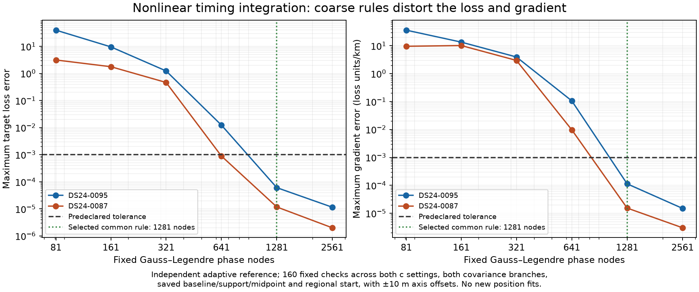
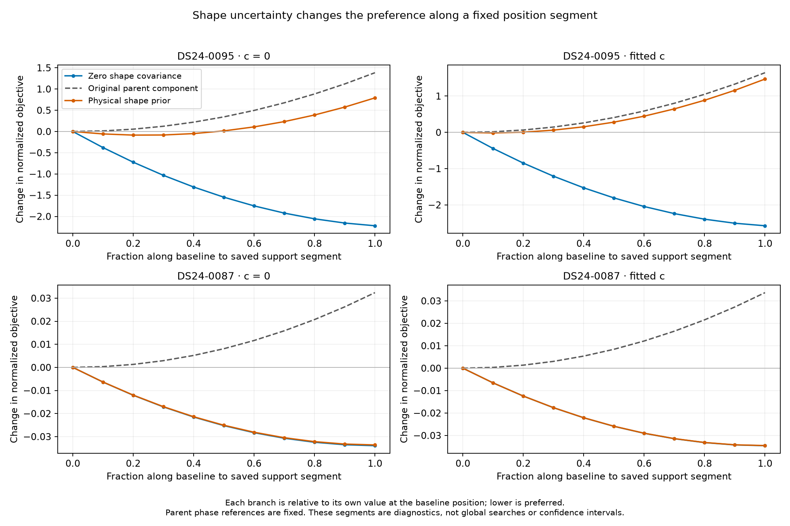
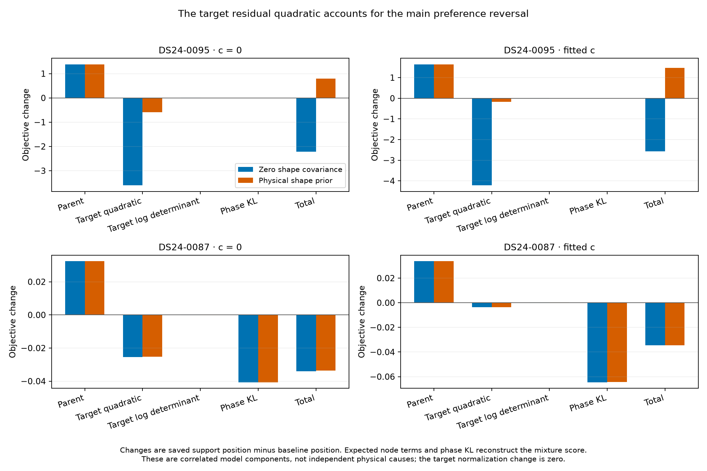
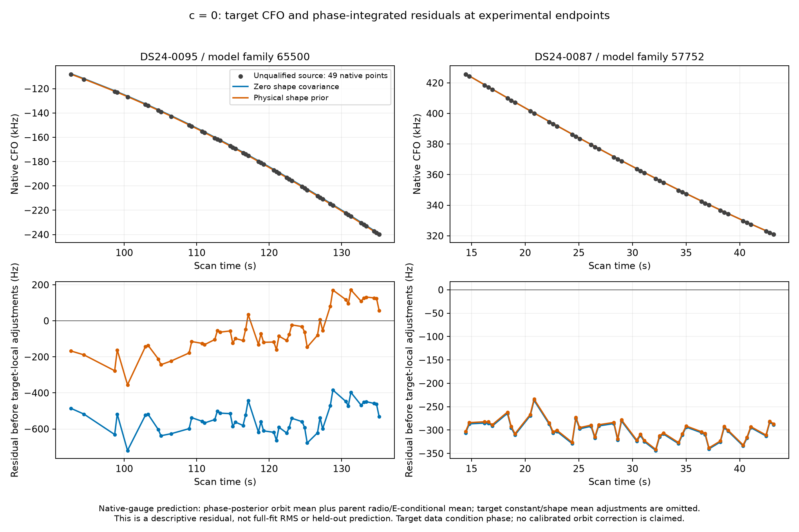
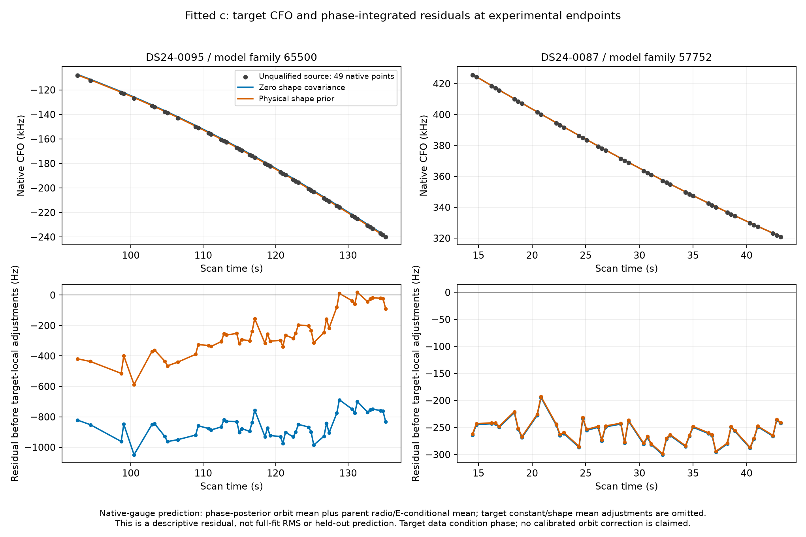
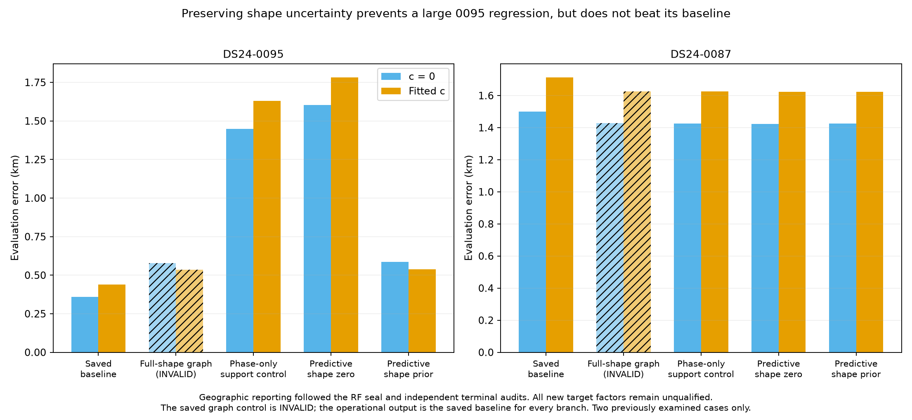

# Preserving new-family orbit uncertainty prevents a large recovery regression, but does not beat the 0095 baseline

The controlled DS24 experiment identifies a concrete model mechanism: removing
unsupported orbital coordinates also removes their uncertainty, allowing a new
one-owner family to pull position too strongly. Restoring the existing physical
prior as predictive covariance prevents most of the DS24-0095 regression in
both c arms. It does **not** improve that scan over its saved baseline. The
DS24-0087 control changes by only metres between covariance branches. Neither
new source becomes a validated association, and every operational output remains
its exact saved baseline.

The study completed 88 fixed-position comparisons and eight fits in **100.70 s**.
All eight passed the original parent validity/ownership checks and independent
final-endpoint numerical qualification. These two previously examined same-site
development examples establish a conditional mechanism, not unseen-scan or
new-location efficacy. The broader [evidence review](REVIEW.md) explains why more
associations, cleaner CFO estimates, generic multistart, and the tested movement
selection rule have not reliably improved fast-scan localization.

## Controlled question and evidence ownership

The saved recovery controls raised a specific question. With the same 49-point
RX1 CH5 source modeled as family65500, the ordinary full-shape graph result for
0095 had c=0/fitted-c errors of 0.578/0.536 km, whereas the shape-removed support
control had 1.450/1.631 km. The ordinary graph result remains **INVALID under its
original one-owner support rule**. Its geographic error cannot qualify it.
For the 43-point RX2 CH7 family57752 source in 0087, that saved contrast was
negligible. The complete original statuses and evidence roles are retained in
[saved_controls.csv](evaluation/saved_controls.csv).

The new experiment changes information flow explicitly. The original curved
data C alone calibrate receiver and shared nuisance terms. Original predictive
entries E and the new target T share that posterior through

    p(E,T | C,x) = p(E | C,x) integral p(T | E,C,x,phi) p(phi | domain) dphi.

Both new branches retain the same physical observations, native IDs, candidate,
alias, causal phase distribution before domain conditioning, unseen-noise convention, source constant,
parent construction and search budgets. `predictive_shape_zero` sets the target's
three physical-mode variances to zero; `predictive_shape_prior` retains their
unchanged declared covariance. They preserve E/T cross-covariance and complete
quadratic, determinant and density normalization terms. Dormant parent-family
coordinates are not counted again in the target design. At fixed x, target CFO
redaction leaves the parent coefficients, phase references and Gamma precision
unchanged. Target evidence can move x, which then changes parent geometry.

The branch toggles the **full** original three-mode covariance B(phi)B(phi)',
including components overlapping constant and phase directions. These modes
are not pure projected curvature. At the saved 0095 fitted-c baseline, their
pointwise prior SD ranges from about 90 to 358 Hz, their path-mean SD is
186.5 Hz, and the residual projection after constant/phase removal is 34.1 Hz.
For 0087 the corresponding path-mean/projected quantities are 58.7/0.86 Hz.
The projected numbers are prior-design diagnostics, not the covariance actually
isolated by this experiment, measured orbit errors, or calibrated uncertainty.
See the [saved projections](scientific/preparation01/deleted_prior_projections.json).

Parent curved/predictive counts remain 2262/0 in 0095 and 2957/644 in 0087. The
new sources add 49/43 **experimental predictive inputs**, giving experimental
likelihood totals of 2311/3644, while contributing **zero newly accepted target
associations** and no new curved-calibration ownership. Only the two new
branches isolate shape covariance. Comparisons with saved graph/support
controls also change evidence role and phase treatment.

## The phase approximation was rejected before fitting

A first-order target-phase Gaussian approximation failed its own physical
preflight: after removing constant and local phase directions, one original
prior SD produced 115–129 Hz nonlinear error in 0095, larger than the roughly
34 Hz projected shape prior. For 0087 the quantities were about 1.42/0.86 Hz.
No position fits used that approximation. This does not establish the same
error in the original parent, which refreshes local phase references.

The separately frozen [amendment](PHASE_INTEGRATION_AMENDMENT.md) instead uses
direct propagated target Doppler and phase-dependent mode columns. The original
causal Student nu=3 prior is conditioned on the existing [-15,+15] s domain,
without recentering or shrinking. For 0095 this removes 2.846380% prior mass
and changes location/SD -2.296774/6.282140 s to conditional mean/SD
-2.132187/4.567776 s. For 0087 it removes 0.004943% and gives conditional SD
0.709302 s rather than original marginal SD 0.732391 s. These engineering-prior
domain effects are explicit and identical between branches.

One global **1281-node** phase-space quadrature rule passed all 160 RF-only
preparation probes against both a strictly denser 2561-node rule and independent
adaptive integration. At h=.01 km, maximum score/position-gradient discrepancies
from the implementer's adaptive reference were 6.08e-5 and 1.13e-4 objective/km,
below the frozen 1e-3 limits. The rule was fixed before fits. Final endpoints
were checked again with their actual final parent phase references; independent
terminal score/gradient bounds remained below 1.90e-5/5.06e-5 objective/km.
Invalid propagation or visibility would have failed an arm without dropping
phase nodes. All tested nodes and domain endpoints were visible.

## The RF preference reversal comes mainly from residual energy

The fixed profiles use **saved baseline parent phase references throughout each
segment**, with parent nuisance/Gamma terms recomputed at each position. They
are diagnostic segments, not global searches, confidence intervals, or profiles
using each newly fitted endpoint's refreshed reference.

For 0095 fitted c, moving from the saved baseline to the saved phase-only-support
position raises parent loss by 1.644735. The zero-shape target lowers its own
loss by 4.219853, so total loss favors the displacement by 2.575118. With the
physical-mode prior covariance, target loss falls by only 0.175000, and total
loss opposes that displacement by 1.469735. The c=0 comparison shows the same
reversal: total changes -2.220534 versus +0.791750.

Expected residual quadratic changes account for the fitted-c reversal:
-4.215475 with zero covariance versus -0.171457 with the physical prior.
Expected logdet changes are +0.004183/-0.001971, phase posterior/prior
divergence changes -0.008561/-0.001572, and density-normalization change is zero.
The full mixture includes posterior phase reweighting; branch means coincide
at a fixed phase and parent state, while phase posterior weights can differ.
These correlated model components do not establish independent physical causes.
The [component table](evaluation/profile_component_changes.csv) closes exactly
to the complete score difference.

The target CFO figures use identical native observation IDs for source and
prediction coordinates, with breaks at alias jumps/gaps. Their residual is
source CFO minus parent radio/E-conditional mean and phase-posterior orbit
mean; target constant and shape posterior mean adjustments are omitted. Target
data condition phase. These are descriptive views, not held-out residuals,
full-fit RMS, identity validation or calibrated orbital corrections.

## Geographic evaluation followed the RF seal

The independent evaluator added geographic reporting only after the RF seal
and both terminal audits. Errors below are in kilometres, rounded to six
decimal places; they are outputs, not error-bar precision. The [complete comparison](evaluation/endpoint_comparison.csv)
also includes invalid graph and saved support controls.

| DS24 scan | c arm | Saved baseline | Predictive shape zero | Predictive physical prior |
| --- | --- | ---: | ---: | ---: |
| 0095 | c=0 | 0.360179 | 1.602508 | 0.586916 |
| 0095 | fitted c | 0.438631 | 1.782320 | 0.537432 |
| 0087 | c=0 | 1.500145 | 1.423571 | 1.424670 |
| 0087 | fitted c | 1.713148 | 1.623893 | 1.624473 |

In 0095, retaining uncertainty prevents roughly 1.016/1.245 km of error relative
to zero covariance, but remains 227/99 m worse than baseline across c arms.
In 0087 the new evidence improves error by about 75–89 m over baseline, while
covariance branches differ by only about 1 m in error and 2.19/1.69 m in endpoint
position. The baseline remains operational for all rows. The matched RF
objective favors the prior branch in 0095, but that frequency evidence is
reported separately from geographic accuracy.

## Validation, artifacts and next boundary

There were no retries, timeouts, multistarts or constrained rescues. Each of the
eight fits took 17.985–25.966 s, including endpoint numerical qualification,
within 180 s/arm; total scientific wall time was 100.698457805 s within 1200 s.
Two workers used one BLAS/OMP/MKL thread each. Summed fit-worker time was
170.33 s; bounded quadrature preparation was separately recorded as 137.54 s.

The original `r.valid` predicates enforce nonempty compatible parent tracks,
predictive gates, finite regional endpoints, final phase change <=.01 s and
absolute unclipped posterior phase <=15.000001 s. Gamma convergence and complete original
accepted/likelihood ID preservation also pass in every arm and matched pair.
Nine initial construction tests, four nonlinear adapter tests and seven final
runner regressions pass; independent Gaussian, construction and runner checks
also pass. First-order phase preparation and the first nonlinear runner freeze
remain preserved with zero scientific profiles/fits: audits caught a cached
dictionary mutation risk and missing original validity/file-binding predicates
before launch. The final repair changed bookkeeping, not the likelihood.

The complete target mixture NLL is appended once as one scalar square-root
residual. Actual optimizer scalar and reported objective differ only by the
original fixed parent normalization/noise offset. Its Gauss-Newton curvature
differs from separate Gaussian observation factors; bounded solver completion
is not proof of global optimality. There is no demonstrated parent ELBO/solver
scalar bug.

Parent variational/Gaussian approximations and the linear physical-mode model
remain. Nonlinear integration corrects only this new target's phase treatment;
it does not establish calibrated joint uncertainty, correct satellite identity
or an exact parent posterior.

Detailed reproducibility and provenance are available in the
[frozen protocol](scientific/protocol03.json),
[nonlinear likelihood source](scientific/quadrature02.py),
[runner](scientific/execution03.py),
[RF summary](scientific/RF_summary03.json),
[RF seal](scientific/RF_seal03.json),
[RF findings](scientific/FINDINGS.md),
[independent parent audit](audit/parent_audit.json),
[terminal ownership/gate audit](audit/terminal_audit.json),
[terminal mathematical audit](math_audit/terminal03_audit.json),
[evaluation seal](evaluation/seal.json),
[reporting audit](evaluation/reporting_audit.json), and
[figure receipt](evaluation/figure_receipt.json). All round/endpoint checkpoints,
gate ledgers, numerical qualifications and 88 exported profiles are retained
in the raw-evidence release asset indexed below.

The [publication index](publication_index.json) lists three new release assets,
exact SHA-256 digests and every archived member. The [restore guide](RESTORE.md)
and [standard-library verifier](verify_publication.py) explain byte-for-byte
restoration. The new archives add the two frozen scan-input sets that R1 had
only bound by hash. Five immutable R1 assets supply the existing recovery
records and runtime source capsule; the unrelated movement-vector archive is
not duplicated. Exact actual source and input provenance are recorded in
[runtime_closure.json](audit/runtime_closure.json) and
[publication_dependencies.json](audit/publication_dependencies.json).

The next step is an ownership-bound transfer test, not another prior adjustment
to these known GPS errors. The [metadata inventory](next_inventory/INVENTORY.md)
found **zero fully bound additional candidates** in the other 22 fast scans and
zero specialized screened recovery ledgers. Its 97 provisional rejected graph
bindings retain curvature/candidate/alias/native IDs but lack complete both-arm
accepted-ID ledgers including postfit-only extensions. They are not four ready
cases or qualified associations. A separate bounded prerequisite must establish
ownership before the [next-policy proposal](math_audit/NEXT_POLICY.md) can run.
Fast-geometry synthetic calibration/selection controls and supported simultaneous
same-family receiver contrasts remain separate directions. No new ALGO release,
operational change or broad cohort expansion is justified by this pilot alone.
