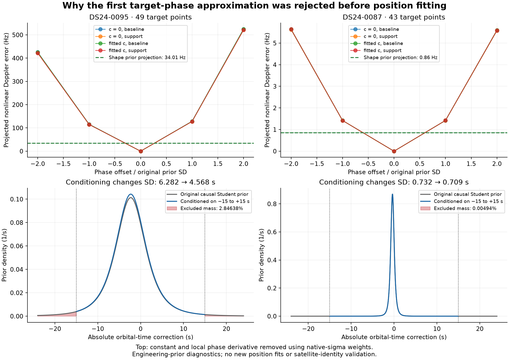

# Fast-scan performance: evidence review and next experiments

Review date: 2026-10-25. This document reviews the prior evidence and the now
completed bounded new-family uncertainty experiment. Three SOL xhigh agents
handled implementation, independent mathematical checks, and independent input,
evaluation and publication checks. The active goal is to iteratively understand
and improve fast-scan performance. The operational baseline remains unchanged.

## What the completed work establishes

The current DS24 reference is the saved fresh ALGO02-v1 plus qualified causal
signed phase prior and equal-assignment-prior family cavity. Historical ALGO02,
DS23 recovery candidates and the RX1 candidate are distinct comparators.
The frozen fast population has 34 recordings and 24 usable saved contracts.
All 24 already have geographic evaluation exposure. No result here establishes
transfer to a new location or a receiver moving within a scan.

| Question | Completed evidence | Consequence |
| --- | --- | --- |
| Are all channels useful? | DS24 mean c0/fitted error is 1.202/1.220 km for CH1–8, 1.538/1.558 for CH1–4 and 2.040/2.040 for CH5–8. | All eight channels already improve the population result. A channel-half win on one scan is not proof of a solver failure. |
| Are we missing the half-channel position basin? | Thirty targeted fits return within 2.06 cm of the original full-channel solution. Four transferred label configurations yield no qualified better full-data solution. | Do not repeat generic multistart. Other identities or nonlinear model errors remain possible. |
| Are accepted identities broadly inconsistent? | On common accepted IDs, full/low-half labels agree 99.686%; full/high-half 100%. | Widespread label disagreement does not explain the channel comparison; shared wrong identities are not ruled out. |
| What dominates local information loss? | Median curved weak-axis scale is 534 m; diagnostic known receiver parameters reduce it to 386 m, known orbital timing to 110 m and known timing plus shape to 56 m. Largest phase/weak-position correlation median 0.935. | Timing/orbit ambiguity is the strongest measured local effect. These oracle scales are not achievable errors or permission to tighten priors. |
| Does receiver modeling help? | Shared RF-scaled RX1 candidate improves c0/fitted means 1.202/1.220 → 1.112/1.120 km, but fitted-c 0095 worsens 0.439 → 1.173 km. | Retain as a candidate, explain regressions, do not infer location accuracy from frequency fit. |
| Does separating receiver noise solve it? | Fitted-c median improves 1.114 → 1.013 km, mean changes by only 1.8 m and P95 worsens 2.131 → 2.175 km. | Unequal noise matters, but this weighting rule is not a general repair. |
| Can held families select safe position movements? | Two fresh partitions and 576 fits retain only three RX1 corrections: one improves, two worsen. Fitted-c mean gains 9 m; median/P95 unchanged. Earlier 0017/0095 distinction does not reproduce. | Do not tune seeds/thresholds to restore favorable examples. The conditional cross-validation score is not reliable enough as tested. |
| Does causal phase/shape correlation resolve ambiguity? | Grouped historical forecasts reject the tested correlation model; median phase/mean-motion correlation is about 0.054. Central-95% phase-proxy coverage is only 87–89%. | The known-phase oracle cannot be obtained by that weak correlation. Arbitrarily narrower phase priors are unsupported. |
| Does more recovered GLRT reliably improve position? | DS23 fitted-c graph stage: 70.71% association, mean 1.434 km, P95 3.082 km. Final native stage: 74.41%, mean 1.426 km, P95 3.202 km. Latest DS24 additions improve 0087 modestly but substantially worsen 0095. | Coverage is an engineering goal, not a sufficient localization selection criterion. |
| Do cleaner frequency estimates guarantee better positions? | DS23 remeasured 322 RX2 curves/11,167 probes; median fixed-degree scatter fell 78.07 → 22.18 Hz without qualifying cohort mean/median improvement. | Another broad RX2 precision campaign is not the first next experiment. |

Sources: [channel halves](https://github.com/misko/leo-tracker-reduxredux/blob/main/reports/2026_10_24_ds24_channel_halves/README.md),
[bottlenecks](https://github.com/misko/leo-tracker-reduxredux/blob/main/reports/2026_10_24_ds24_bottlenecks/README.md),
[receiver/orbit controls](https://github.com/misko/leo-tracker-reduxredux/blob/main/reports/2026_10_24_ds24_receiver_orbit_controls/README.md),
[movement policy](https://github.com/misko/leo-tracker-reduxredux/blob/main/reports/2026_10_25_ds24_movement_policy/README.md),
[DS23 recovery review](https://github.com/misko/leo-tracker-reduxredux/blob/main/reports/2026_10_23_ds23_opportunity_review/README.md),
and [RX2 measurement cohort](https://github.com/misko/leo-tracker-reduxredux/blob/main/reports/2026_10_19_ds23_rx2_measurement_cohort/README.md).

The association definitions differ across historical publications: the DS24
movement comparison uses unique curved-plus-predictive position-likelihood IDs,
whereas DS23 recovery's accepted totals include post-fit extension. Preserve
each source's definition and denominator; do not combine them into a single
improvement curve. Current DS24 baseline position likelihood is 78,067/108,600,
71.8849%, unchanged by receiver-only controls.

## Concrete new lead: absence of support becomes zero shape uncertainty

The support-aware recovery helper removes each newly active one-owner family
from `p.supported`. `JointMarginal.calculate` consequently drops its three
physical shape feature columns. Those columns are absent from both the
conditional mean and integrated covariance. That is an exact-shape assumption,
not simply a decision to avoid calibrating an insufficiently supported orbit.

An already saved comparison is especially informative:

| Scan / exact same new source | Shape-present ordinary graph error c0 / fitted (km) | Shape-removed support error c0 / fitted (km) | Status of shape-present result |
| --- | --- | --- | --- |
| 0095 / 49 points / 65500 | 0.578 / 0.536 | 1.450 / 1.631 | INVALID: one-owner support rule |
| 0087 / 43 points / 57752 | 1.428 / 1.626 | 1.427 / 1.626 | INVALID: one-owner support rule |

The invalid endpoints remain invalid. Better GPS errors cannot qualify them.
This is a hypothesis about an information assumption, not proof of emitter
identity or a general instruction to enable every orbital correction.

The 0095 source is one stored degree-4 piece, 49 points from approximately
92.66 to 135.19 seconds, native polynomial RMS 59.75 Hz, without stored structure
flags. No actual bad join has been demonstrated. Its causal phase prior is
wide, about 6.28 seconds. A read-only projection of the removed engineering
shape prior gives about 34 Hz RMS uncertainty after removing constant and
phase directions, versus roughly 54 Hz median supplied point sigma. The same
projection for 0087 leaves only about 0.86 Hz, versus 64 Hz point sigma.
These are prior-design quantities, not measured orbit errors or confidence
intervals. The new experiment saved and independently audited them.

The original shape-present graph model already integrates its Gaussian orbital
uncertainty. Renaming those coefficients as covariance would not create a new
model or justify bypassing its gate. A distinct test must change information
flow explicitly: the new curve becomes a predictive factor while incumbent
curved evidence alone calibrates receiver and shared nuisance terms.

## Completed controlled test: mechanism found, no baseline improvement established

The [coordinator plan](COORDINATOR_PLAN.md) and separately versioned
[phase amendment](PHASE_INTEGRATION_AMENDMENT.md) produced 88 fixed profile
evaluations and eight fits in 100.70 seconds. All eight passed the original
parent gates, observation-preservation checks and final-reference numerical
checks. Both branches use the same nonlinear integral of the causal Student
phase prior conditioned on the operational ±15 s interval. They differ only in
target shape covariance. Parent curved evidence alone calibrates shared terms.
These two previously examined examples are mechanism tests, not new-location
or unseen-scan validation.

| DS24 scan | c arm | Saved baseline error (km) | Predictive target, zero shape variance (km) | Predictive target, existing shape prior (km) |
| --- | --- | ---: | ---: | ---: |
| 0095 | 0 | 0.360179 | 1.602508 | 0.586916 |
| 0095 | fitted | 0.438631 | 1.782320 | 0.537432 |
| 0087 | 0 | 1.500145 | 1.423571 | 1.424670 |
| 0087 | fitted | 1.713148 | 1.623893 | 1.624473 |

Retaining shape uncertainty prevents most of the 0095 regression relative to
the zero-variance branch. Its endpoint changes by 1.016/1.246 km across c arms;
0087 changes by only 2.19/1.69 metres. It does not improve 0095 over its saved
baseline. For 0087, the new evidence improves error modestly, with little
sensitivity to shape uncertainty. No target becomes a validated association;
49/43 points are experimental predictive inputs, with zero newly accepted target
points. Every operational output therefore remains its exact saved baseline.

The 0095 fixed profiles identify the mechanism more directly than geographic
error alone. In fitted-c, moving from the saved baseline to the old support
endpoint increases parent loss by 1.644735. The zero-shape target reduces its
own loss by 4.219853, so total loss favors that displacement by 2.575118.
With the unchanged shape prior, target loss decreases by only 0.175000 and
total loss opposes the displacement by 1.469735. The expected residual quadratic
drives the reversal; determinant and phase-divergence changes are small. Both
branches have the same orbit mean at each phase node and fixed parent state;
their posterior phase weights can differ. This supports the deleted-uncertainty
explanation without proving satellite identity or the actual orbital error.

See [RF findings](scientific/FINDINGS.md),
[complete endpoint comparison](evaluation/endpoint_comparison.csv),
[independent terminal math audit](math_audit/terminal03_audit.json), and
[independent terminal input/gate audit](audit/terminal_audit.json).

## Ranked next work

### 1. Test whether this evidence role transfers

Keep prior uncertainty, supported learning of an orbital correction, and
validated satellite association as separate concepts. The completed pilot
supports a conditional model correction, not unrestricted recovery or an ALGO
release. Do not spend another iteration adjusting these two priors to their GPS
errors. The [next-policy memo](math_audit/NEXT_POLICY.md) proposes a small,
deterministically ordered archived fast-scan panel, with no new candidate search
if the required proposals do not already exist. The completed
[metadata inventory](next_inventory/INVENTORY.md) found zero fully bound transfer
candidates across the other 22 fast scans. There are 97 provisional rejected
graph bindings, but their complete accepted-ID ledgers in both c arms, including
post-fit extensions, are missing. They cannot yet be certified as new, nonoverlapping
evidence. Reconstructing those ownership ledgers from the unchanged parent would
be a separate bounded prerequisite; no four-case run has been launched.
Preserve the baseline and all failures;
preventing a zero-variance regression is not improvement over baseline.

### 2. Extend synthetic tests to fast geometry and evidence selection

We already ran 120 conditional synthetic position fits on DS23 adaptive scans
0081/0326. Correct labels and passing gates still allowed a 17.996 km error in
0326. Those tests fixed source selection and used Gaussian observation noise;
they do not evaluate selection-induced bias or full posterior coverage.
See [existing mechanism tests](https://github.com/misko/leo-tracker-reduxredux/blob/main/reports/2026_10_23_ds23_worst_mechanism_tests/README.md).

A useful extension uses actual fast timestamps/RX/channel geometry but seeded
artificial positions around the regional box. Compare known assignments against
the existing recovery/selection stage under null, receiver discrepancy and
orbital discrepancy injections. Keep identical simulated observations between
method arms. Measure position bias, interval coverage, false association and
false movement acceptance, and recovery of injected effects. Known-truth
controls belong only to the simulator; they are unavailable-information oracles
in real data.

This can distinguish a weakness that occurs under the declared model from a
physical mismatch absent from that model. It is conditional calibration testing,
not formal simulation-based calibration unless posterior samples and rank tests
are actually used. The distinction follows the scope of
[Talts et al.](https://arxiv.org/abs/1804.06788).

### 3. Seek direct receiver contrasts before more flexible receiver models

Use raw CFO from the same satellite observed by both receivers at matched times,
where supported, and carry time-interpolation uncertainty. A properly constructed
difference can reduce common satellite motion while exposing relative receiver
terms. Predict another family's discrepancy with receiver reversal/time-shift
negative controls. Do not mistake two channels of one satellite for independent
families, use nearly linear coincidences to calibrate offsets, or obtain absolute
position merely from a difference that has canceled its common Doppler signal.

The 0095 addition itself has only one owner; same-family cross-RX samples during
its interval are sparse. Other simultaneous families on RX1 high band are
available, so a time-local receiver witness can be investigated without claiming
direct cross-RX confirmation of 65500. An overlap graph may be disconnected or
retain common-mode ambiguity; report that as lack of information.

Only a supported measurement hypothesis should trigger a small existing-IQ panel
covering both receivers and bands. Verified readers exist, but direct raw-manifest
access for these two scans was unavailable during earlier planning. No ACL changes,
substitute recordings or new RF collection are part of this work.

## What to stop repeating

Do not use association percentage as the sole objective, random individual-point
holds as independent family validation, lower residual RMS as geographic proof,
or clean residual gates as an orbit/identity certificate. Do not reroll validation
partitions, loosen physical gates, blacklist satellites using GPS, or pool these
recordings into an assumed stationary position. Existing covariance and physical
ID bookkeeping are already present; neither is a newly discovered general fix.

The DS24 objective audit should verify actual implementation, but source review
does not establish a baseline optimizer/ELBO mismatch: fixed-mask normalization
and visibility penalties account for the apparent scalar distinction. An earlier
tempering-wrapper mistake was corrected and rerun. More iterations or replacing
the solver is not the first justified direction.

The new wave's independent preflight has now checked 72 fixed evaluations in
the actual original-parent and saved support contexts, without position fits.
Residual/ELBO identity discrepancy is at most 7.276e-12; the visibility-adjusted
offset varies by at most 1.091e-11. Exact target ownership, original input hashes
and causal catalogue/history checks also pass. See
[parent audit](audit/parent_audit.json). This further weakens the solver-scalar
explanation; it is not a global convergence proof.

The new-target Gaussian phase approximation failed its own preflight: after
constant/local-phase projection, one-SD nonlinear timing errors are 115–129 Hz
for 0095, compared with about 34 Hz of deleted shape uncertainty. For 0087 they
are about 1.42 versus 0.86 Hz. No position fits ran under that approximation.
The separately versioned [phase amendment](PHASE_INTEGRATION_AMENDMENT.md)
requires common direct phase integration, explicit conditioning of the causal
Student prior on the operational ±15 s domain, and independent score/gradient
convergence before fits. This is a new-target approximation finding; it does
not establish the same error in the phase-refreshed parent baseline.

Sample rate and mounting angle remain unproven causes. All relevant DS24 fast
scans use 10 MS/s. The CFO estimator's coherent aperture is much shorter than
the full 20 ms window, but better scatter has already failed to guarantee better
positions. The nominal 40-degree feed separation affects satellite visibility;
it is not a calibrated angle-of-arrival measurement or a separated geolocation
baseline. Differential Doppler literature often introduces an external known
base station, which we do not have; its claimed accuracies cannot be transferred
to our two co-located feeds. See
[Hasan et al.](https://arxiv.org/abs/2409.05026).

Independent literature is consistent with taking orbit error and clock/estimator
behavior seriously: the Starlink error-budget study by
[Stock, Schwarz and Knopp](https://www.ion.org/publications/abstract.cfm?articleID=20093)
finds online-orbit errors dominant in its standalone Doppler setting and shows
that clock/measurement effects depend on observation duration. That supports
the type of diagnostic, not a proven cause or accuracy bound for our corpus.

## Iteration discipline

Each iteration retains source/input hashes, exact likelihood and compatibility
counts, matched c=0/fitted-c arms, RF fit and geographic effects separately,
failures, fallback and a bounded stopping rule. Publish the complete MD report
and figures on remote main, including negative results. Move from diagnostic
examples to a frozen wider fast cohort only after identifying a general rule;
DS23/DS25 are previously examined same-site transfer data. No new ALGO series
is justified until broader fast performance and regressions support it.
