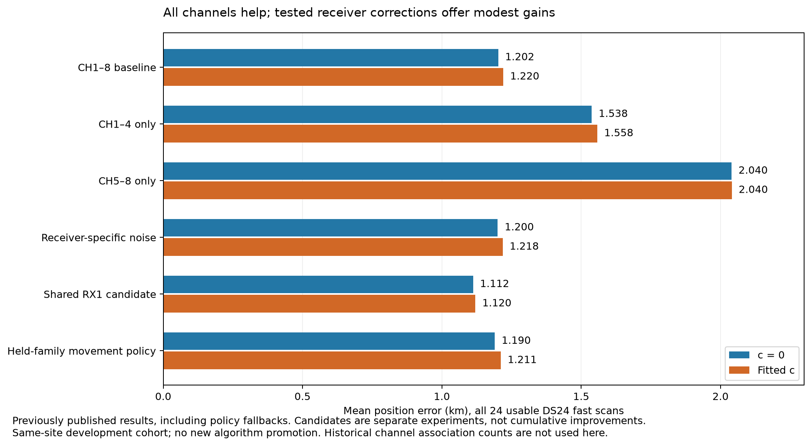
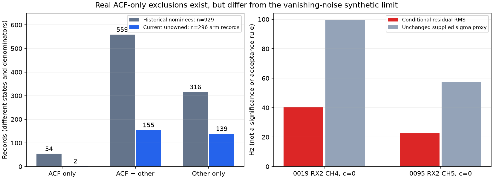

# Fast-scan localization: what we have learned and where to go next

Review date: 2026-10-25. This synthesis reviews the ALGO02/ALGO03-derived work,
DS23 recovery results, and the recent DS24 controls. Three SOL xhigh agents
independently reviewed proposed identities, real residual-gate failures, and
earlier identity/phase methods. No operational algorithm is changed by this
review. The bounded diagnostics below perform no new position fits.

The strongest measured limitation is the trade between receiver position and
satellite orbital timing, with receiver/model discrepancy also contributing.
Missing associations remain an opportunity, but adding points has repeatedly
failed to translate into proportional position gains. More optimization starts
and generic extra nuisance flexibility are now low-priority directions.

## What has actually improved

The initial track-construction work compared graph, EM, Hough and multiple-
hypothesis tracking. On the first DSX01 scan their selected configurations
assigned 4,304–4,440 of 4,797 GLRT points to polynomial tracks, with separate
residual-structure and insufficient-support flags. Those are polynomial
membership counts, not satellite associations. We retained graph construction
and concentrated subsequent work on receiver/band alignment, causal satellite
association, orbital timing/shape and localization.
[Original method comparison](https://github.com/misko/leo-tracker-reduxredux/blob/main/reports/2026_10_17_dsx01_full_data_tuning/comparison.csv).

The important earlier improvement was ALGO02's separation of curved-track
calibration from additional predictive linear evidence, with shared uncertainty
and causal satellite timing priors. On 404 matched DS23 recordings, fitted-c
mean/median error improved from 1.870/1.602 km for freshly run ALGO01 to
1.508/1.249 km. ALGO02 returned qualified positions on 404/413 attempts versus
407/413 for ALGO01; the coverage difference matters. The additional recordings
supported an improvement beyond the initial development cases, within the same
site. [Full ALGO02 evaluation](https://github.com/misko/leo-tracker-reduxredux/blob/main/reports/2026_10_19_algo02_ds23_full/README.md).

Recent DS24 experiments use a different, explicitly named reference: fresh
ALGO02-v1 plus qualified causal signed phase priors and equal-assignment-prior
family cavity. The frozen fast population has 34 recordings, 24 with usable
saved inputs. All 24 have now been exposed to geographic evaluation.

| Same 24 fast scans | Mean error c=0, km | Mean error fitted-c, km | Interpretation |
| --- | ---: | ---: | --- |
| All eight channels, current reference | 1.202 | 1.220 | Operational reference |
| CH1–4 only | 1.538 | 1.558 | Fewer observations and less geometry |
| CH5–8 only | 2.040 | 2.040 | Fewer observations and less geometry |
| Receiver-specific noise candidate | 1.200 | 1.218 | Mean essentially unchanged; tail worsens |
| Shared RX1 correction candidate | 1.112 | 1.120 | Best recent cohort mean; individual regressions |
| Held-family movement policy | 1.190 | 1.211 | Fresh partitions retain only three movements |

These are separate experiments including their declared fallbacks, not a chain
of cumulative improvements. The shared RX1 candidate improves 11 scans, worsens
seven and retains six baselines in fitted-c. Its median changes 1.114→1.090 km
and P95 2.131→2.064 km; scan 0095 worsens 0.439→1.173 km. The stricter movement
policy does not reproduce the earlier favorable discrimination: only one of
its three retained changes improves geographic error. It is not a reliable
way to choose the best per-scan correction.

[Receiver/orbit controls](https://github.com/misko/leo-tracker-reduxredux/blob/main/reports/2026_10_24_ds24_receiver_orbit_controls/README.md)
and [movement policy](https://github.com/misko/leo-tracker-reduxredux/blob/main/reports/2026_10_25_ds24_movement_policy/README.md)
contain the complete paired comparisons. The overview is regenerated directly
from published summary JSON at commit `dad19ba5ef74744d8234ccb4d461bac8444663aa`;
[source hashes and metrics](overview_metrics.json) preserve its provenance.

## What the negative experiments rule out, and what they leave open

| Direction tried | Evidence | Decision |
| --- | --- | --- |
| More continuous-position starts | Thirty full-channel restarts return within 2.06 cm; four half-channel label transfers yield no qualified better full-data solution. | Do not repeat generic multistart. This is not a proof over every possible identity. |
| Recovering more GLRT points | DS23 graph→native recovery increases fitted-c accepted coverage 70.71→74.41%, while mean improves only 1.434→1.426 km and P95 worsens 3.082→3.202 km. | Keep coverage as a separate measure; qualify additional position information. |
| Cleaner frequency measurements | Remeasuring 322 RX2 curves reduces median fixed-degree scatter 78.07→22.18 Hz without a qualified cohort mean/median gain. | Target a measured receiver/estimator defect before another broad IQ campaign. |
| Narrower or correlated orbital priors | Causal phase/shape forecasts fail grouped validation; median phase/mean-motion correlation is only about 0.054. | The timing oracle is valuable, but this tested predictor does not supply it. |
| Generic receiver flexibility | A modest mean benefit exists, but regression selection does not generalize across fresh family partitions. | Require direct transfer evidence for the location-sensitive part of a correction. |
| Deleting unsupported orbit corrections | Removing a one-owner family's shape columns also deletes its prior uncertainty. In 0095 this makes its new curve pull position too strongly. | Preserve uncertainty even when a curve cannot calibrate an orbit correction. |
| Retaining new-family uncertainty | Prevents much of the 0095 regression; on four further chronological scans, two improve and two worsen, and one c arm loses 29 previously accepted IDs. | A useful model correction, still not a validated new association or release. |
| Residual whiteness as an accuracy certificate | Known-label noisy synthetic fits all pass gates but can err by 1.09 km; noiseless fits recover within 0.8–2.5 m but fail normalized ACF. | Identity, residual compatibility, uncertainty and geographic accuracy are separate questions. |

The two DS23 association figures above include postfit accepted extensions.
Current DS24 position-likelihood membership is 78,067/108,600 original GLRT
points, 71.8849%, and excludes postfit-only extensions. These definitions must
not be combined into one coverage trend. Polynomial clustering is another
earlier stage and does not itself establish satellite identity.

Sources: [DS23 recovery review](https://github.com/misko/leo-tracker-reduxredux/blob/main/reports/2026_10_23_ds23_opportunity_review/README.md),
[RX2 measurement cohort](https://github.com/misko/leo-tracker-reduxredux/blob/main/reports/2026_10_19_ds23_rx2_measurement_cohort/README.md),
[new-family uncertainty](https://github.com/misko/leo-tracker-reduxredux/blob/main/reports/2026_10_25_ds24_new_family_uncertainty/README.md),
and [fast identifiability controls](https://github.com/misko/leo-tracker-reduxredux/blob/main/reports/2026_10_25_ds24_fast_identifiability/README.md).

## What currently limits precision

The local information experiment is the clearest diagnostic. With the same
selected curved measurements, the median weak-axis scale is 534 m. Treating
receiver coefficients as known reduces it to 386 m; treating satellite orbital
timing as known reduces it to 110 m; knowing timing and shape reduces it to
56 m. These are unavailable-information controls, not achieved errors or
calibrated confidence intervals. The largest phase/weak-position correlation
has median 0.935. Here phase means orbital time displacement, not carrier phase.

Additional channels frequently observe the same uncertain families: the median
is 11 shared calibration families across bands, and their weak position axes
are only 17.7 degrees apart. More samples reduce measurement noise, but do not
independently determine each satellite's along-orbit timing. At the true site,
the median curved RMS penalty relative to the fitted endpoint is only 0.032 Hz
despite kilometre-scale displacement. The noisy synthetic controls show that
correct identities alone do not eliminate this ambiguity.

All usable DS24 fast scans use 10 MS/s, so we have no controlled sample-rate
comparison. The two receivers' large scatter difference at the same rate also
argues against sample rate as the sole cause. The nominal 40-degree feed angle
changes visibility; without measured bearing or a separated baseline, it does
not give a 40-degree triangulation measurement.
[Full bottleneck evidence](https://github.com/misko/leo-tracker-reduxredux/blob/main/reports/2026_10_24_ds24_bottlenecks/README.md).

The latest direct same-satellite cross-RX contrast improves held projected RMS
only 88.996→88.411 Hz. It supports some relative receiver structure, with strong
dependence on overlapping time coverage, but does not explain all absolute
position error or identify which receiver causes it. The contrast is derived
from existing GLRT points; adding it as an independent likelihood would count
those observations twice.

The literature supports investigating orbit error, without proving it is the
cause of any particular scan: Stock, Schwarz and Knopp's standalone Starlink
error-budget study identifies online orbit errors as its largest contributor.
Its clock/measurement effects also depend on observation duration.
[Primary study abstract](https://www.ion.org/publications/abstract.cfm?articleID=20093).
Differential approaches such as 3DPose use an additional known-position base
receiver, which our two co-located feeds do not supply; their accuracy claims
cannot simply be transferred to this setup.
[Hasan et al.](https://arxiv.org/abs/2409.05026).

## New checks during this review

The identity review covered every member of the four-scan chronological transfer
panel, including its two geographic regressions. It reused archived proposals,
fixed parent positions and unchanged causal prior construction; it did not run
an exhaustive catalogue search or use GPS. Ten single-source scores and a
four-owner conditional check used 63.80 s of cumulative scientific execution.
An initial owner-harness argument error was corrected in a separate continuation;
the initial failure and completed single-source results are preserved.

| Scan | Proposed family | Additional identity evidence found |
| --- | --- | --- |
| 0010 | 64023 | No archived alternative or second same-family owner in the examined parent node |
| 0011 | 58175 | No archived alternative or second same-family owner in the examined parent node |
| 0012 | 57743 | Archived alternative 66259 is nearly tied; preferred identity changes between saved parent states |
| 0013 | 60108 | Three other raw owners on RX1 CH4/CH7/CH8, giving four curves and 189 distinct points |

For 0012, the c=0 parent favors 57743 by 1.422 in negative twice log predictive
density; the fitted-c parent favors 66259 by 1.344. Either is only about 2:1
relative evidence within this restricted candidate pair and fixed archived
alias. Both parent position and calibration differ, so this is not an isolated
effect of c. Neither ratio is a calibrated identity probability.

For 0013, each raw owner is better predicted after conditioning on the other
three under common 60108 phase/shape and shared parent uncertainty. The original
53-point target improves by 5.351/4.301 in negative twice log predictive density
for c=0/fitted-c. Single-source equivalence and all 189 native IDs pass their
checks. This makes 0013 a practical next identity challenge, despite its earlier
single-source geographic regression. However, all four owners are RX1: a common
receiver discrepancy remains possible. There is no competing-family or calibrated
clutter comparison, and overlapping leave-one-owner folds are not independent
significance evidence. All four nominated identities remain unqualified.
[Identity findings and numerical checks](identity/FINDINGS.md).

The ACF audit completed all 24 scans in 160.78 s. Among 929 coherent historical
incompatible nomination rows, 54 fail only the observed ACF/RMS/bias/structure
screens through the ACF term. At the current saved parent states, a narrower
set of 148 wholly unowned, calibration-excluded curves yields 296 c-arm records;
only two are ACF-only. These are 0019 RX2 CH4 and 0095 RX2 CH5 in c=0, with
residual RMS 40.38 and 22.63 Hz. Both fail other predicates in fitted-c.

Those real residuals are far larger than the millihertz noiseless synthetic
edge case. This gives no justification for a blanket ACF waiver. The replay
holds the proposed identity and parent phase/calibration fixed; large failures
are not proof that the curve has no valid satellite. Historical and current
states have different membership and are not a before/after experiment.
Historical row-vector/scalar binding was checked; none of the 929 rejected rows
has the binding ambiguity found in other nomination paths.
[Full ACF findings, scope and tests](acf/FINDINGS.md).

The independent [method review](methods/FINDINGS.md) inventories earlier soft
identity, orphan recovery, temporal prediction and nonlinear phase methods.
It distinguishes already-tested ideas from the specific missing comparisons.

## Recommended sequence

1. **Validate the identity of new curved evidence before letting it move position.**
   Compare plausible causal satellites under the same allowed alias set and
   prior, with symmetric alias marginalization or a declared profile penalty.
   Apply the same causal phase/orbit prior construction to every candidate;
   their history-derived numerical priors can differ. Preserve an unresolved outcome when alternatives cannot
   be distinguished. Where another receiver/channel provides a separate whole
   track, fit the shared satellite parameters using one owner and predict the
   other, carrying shared uncertainty. The same track split into random points
   is not this test. Start with all four chronological nominees, including both
   regressions, rather than selecting the best geographic example.

2. **Use fast synthetic controls to isolate the remaining information loss.**
   Reuse the eight saved noisy fast realizations. In one paired intervention,
   zero the generating orbital timing/shape deviations; in another, zero the
   generating receiver/smooth deviations. Preserve all other latent/noise draws
   and the estimator's original priors, masks, starts and budgets. This requires
   32 paired-arm fits and isolates interactions under the actual fast geometry
   without granting inference the true coefficients. Earlier adaptive simulations
   and known-nuisance controls already exist; this bounded extension is useful
   only if it distinguishes the fast failure mechanism. Then test the association/selection stage
   with a consistent synthetic catalogue and clutter source, including plausible
   wrong identities. The current fast simulator fixes labels and selection and
   cannot measure false-association or false-movement rates.

3. **Recover evidence by its additional geometry and time support.**
   After identity qualification, rank archived sources by position sensitivity
   remaining after the existing phase, receiver and orbit uncertainty is
   removed. Favor new directions and observations that connect otherwise weakly
   calibrated time intervals. Use the expected information only to allocate
   search effort; it is conditional on identity and is not an acceptance score.
   Compare against count/length ranking on the same candidate pool and budget.

4. **Pursue receiver improvements where a physical witness exists.**
   Use existing IQ in a small matched RX1/RX2, low/high-band panel to test a
   specific common frequency error or coherent-estimator hypothesis. Compare
   fixed native IDs and windows before position fitting. Keep the existing RX1
   correction as a candidate; avoid additional arbitrary per-track polynomials.
   Any later joint contrast model must retain the original observation covariance
   rather than adding derived differences as independent measurements.

Do not start another generic nonlinear phase integration experiment without
checking the existing DS23 work. A five-case conditional nonlinear audit used
829,440 curved/joint draw-evaluations and found a maximum local predicted shift
of 22.795 m, with seed disagreement 0.062 m. Noise precisions and physical-shape
design remained frozen. Other large importance-sampling checks also exist.
A new computation must isolate a
specific missing coupling, such as phase-dependent orbit design or joint noise
precision, and demonstrate numerical reliability before a position comparison.

The first practical deliverable should be a defensible recovered-family rule,
with an explicit unresolved state and a falsification test. A frozen broader
comparison follows only if that rule survives the bounded controls. All 24
current DS24 cases are development data. First audit geographic exposure before
identifying an untouched chronological block of existing recordings; this
review has not established that such a block is available. Keep related TLE
publication errors together. Broader same-site testing still does not
establish transfer to new locations.

Keep matched c=0/fitted-c observations, candidate sets, other priors and budgets;
report frequency scores, unique accepted IDs, loss of old associations, position
distribution, failures and runtime separately. Start at the existing 25×25 km
region centered on 37.906,-122.545. Evaluation GPS remains evaluation-only.
No future TLE inference, stationary-position pooling or new RF collection is
part of this plan.

## Artifacts and replay limits

This compact report includes the new diagnostic sources, saved results, figures,
input hash bindings and independent checks. [Replay requirements](REPLAY.md)
distinguish inspecting these results from rerunning the scientific diagnostics.
It is not a standalone archive of the original scan banks, inputs or full
runtime environment. No operational change or new association is published.
