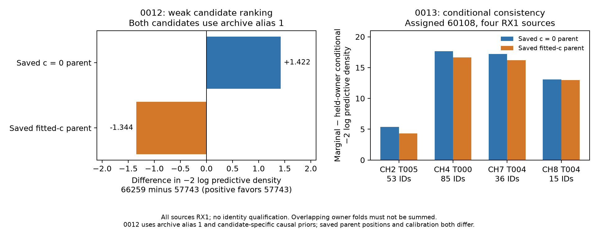

# Archived identity evidence and fixed-position challenges

None of the four transfer nominees has a qualified identity. Repeated NORAD labels in three archived radio hypotheses are related proposals, not independent corroboration or exhaustive catalogue competition. Better localization or conditional frequency likelihood under an assigned NORAD does not establish that assignment. This review used no GPS/error lookup, position fitting, fresh nomination, post-recording TLE, changed gate, or production change.

| Scan / assigned NORAD | Target native IDs | Explicit archived candidate/alias pairs | Other disjoint raw owners of assigned family | Accepted same-candidate owners in either parent arm |
|---|---:|---|---|---|
| 0010 / 64023 | 50 | 64023 / 0 | None | None |
| 0011 / 58175 | 20 | 58175 / 1 | None | None |
| 0012 / 57743 | 59 | 57743 / 1; 66259 / 1 | None for 57743 | None for either candidate |
| 0013 / 60108 | 53 | 60108 / 1 | CH4 T000: 85; CH7 T004: 36; CH8 T004: 15 | None |

All four have zero dedicated archived family-cavity identity records for the nominated family. The source metadata, exact IDs, aliases, original candidate indices, accepted-ID ledgers, archived compatible/rejected flags and hashes are in [inventory.json](inventory.json). Nomination compatibility is preserved as provenance, not promoted to association qualification. The three alternative radio hypotheses for 0010, 0011 and 0013 do not supply different satellite competitors. All four 0013 sources use **RX1**, on different channels; a common RX1 discrepancy cannot be excluded.

## 0012: the available competitor exposes ambiguity

We compared the only two archived candidates at each unchanged saved parent endpoint/reference, using the same nonlinear conditional likelihood, full three-mode physical covariance, 300 Hz source-constant prior, equal identity weights and archive alias **1**. Parent receiver/noise calibration was not learned from this target. Both fresh candidate causal priors were available; no candidate was discarded.

| Saved parent state | −2 log predictive density: 57743 | 66259 | 66259 minus 57743 | Conditional pair evidence |
|---|---:|---:|---:|---|
| c = 0 | 755.116979 | 756.539411 | +1.422431 | 2.04:1 for 57743 |
| fitted c | 758.040221 | 756.696327 | −1.343895 | 1.96:1 for 66259 |

These are normalized conditional density ratios for this pair, fixed alias and prior policy, **not calibrated identity probabilities**. The ranking reverses between saved parent states whose **positions and calibration both differ**; this does not isolate the coefficient c alone. The prior construction is symmetric but the original candidate-specific phase parameters are numerically different: 57743 has location/SD −0.164845/0.613081 s, versus +0.713326/2.643365 s for 66259, before conditioning the Student ν=3 prior on [−15,+15] s. Thus this is not an identical-numerical-phase-prior ablation. The candidate-specific causal priors and physical mode scales are retained rather than tuned to the target. Both candidates integrate the same operational phase interval, with exact prior-mass normalization. Maximum single-source score discrepancy versus 2561 nodes and adaptive integration is 1.97e−5.

## 0013: additional owners support conditional consistency, not identity

The four raw sources contain **189 distinct native IDs**, unique within every source and disjoint across sources. None overlaps either complete parent accepted-ID ledger, including postfit extensions. We integrated one shared causal phase and physical three-mode uncertainty, shared parent radio covariance, native RF scaling and independent 300 Hz source constants. Each held-owner score is joint −2 log density minus the other owners' −2 log density; parent calibration/noise remains fixed from the original parent.

| RX1 source | IDs | Marginal minus held-owner conditional NLL, saved c = 0 parent | Saved fitted-c parent |
|---|---:|---:|---:|
| CH2 T005 target | 53 | 5.351038 | 4.301233 |
| CH4 T000 | 85 | 17.677429 | 16.646993 |
| CH7 T004 | 36 | 17.210324 | 16.217127 |
| CH8 T004 | 15 | 13.100304 | 12.975717 |

Positive differences show conditional consistency under the **assigned 60108 model**. They do not compare identities or an independently calibrated clutter/unknown class. The leave-one-owner folds overlap and must not be summed as independent significance. Different-time owner disagreement, if found later, could reflect identity, receiver/orbit error or track joins; these possibilities are not distinguished here. The RF/q implementation reproduces the original single-source likelihood to 1.14e−13 and zero in the two arms; maximum joint/conditional 1281-versus-2561 discrepancy is 1.904e−5. This multiowner check did not include an independent adaptive integration campaign or gradient qualification, and supports only these fixed-position score diagnostics.

## What would add new information

The existing `tools/ds23_soft_predictive_identity.py` has normalized finite-candidate identity weights and shared nuisance covariance, but its attached alternatives are current active families with fixed aliases and local phase linearization. It cannot directly qualify these inactive families. `tools/ds23_orphan_predictive_mixture.py` and `tools/ds23_temporal_predictive_recovery.py` include unknown/clutter mechanisms, but use restricted active-family pools and approximations. Their posterior weights are conditional on those pools and models. `algo04-family-predictive-20261023/identity/study.py` provides the more relevant symmetry pattern: remove all shortlisted identities from calibration, use fresh causal candidate priors, and compare a frozen pool without favoring the original label. Merely rerunning the original calibrated family-cavity prediction can advantage an already active identity.

The most discriminating next experiment is therefore a **bounded causal identity challenge before another localization campaign**. Freeze a common candidate/alias pool and an explicit unknown/clutter control using RF metadata; apply fresh causal priors to every identity, retain the nonlinear phase integration and report both saved parent states. Start with the known 57743/66259 ambiguity and all four chronological nominees, preserving missing-prior cases as blocked. For 0013, predict a fully withheld native owner from the others and compare candidate and unknown models; an RX2 owner, if already archived and independently bound, would be more discriminating against RX1-common error than adding RX1 points. No new owner or competitor is asserted available here. Stop on unavailable causal inputs, ownership overlap, failed numerical qualification, or absence of a calibrated identity decision rule; keep identity unqualified and baseline operational. Freeze a separate protocol and bounded compute cap before any such extension. This review authorizes no additional search or production adoption.

## Reproduction and scope

The initial [protocol](protocol.json), [source](review.py), [results](results.json) and [seal](seal.json) preserve ten completed single-source scores and the subsequent harness failure: the multiowner helper called the predictive adapter without its required branch argument. The separately versioned [owner02 repair](owner02.py) changes that call to the original parent builder, with [protocol](owner02_protocol.json), [results](owner02_results.json) and [seal](owner02_seal.json); it does not repeat the single-source calculations. Total scientific wall time across both attempts is **63.796088 s** (40.893827 + 22.902260), within the cumulative 300 s cap. Zero position fits and zero GPS/error lookups occurred.

[evidence_summary.json](evidence_summary.json) contains the plotted numbers and exact ownership counts. [checks.json](checks.json) verifies frozen bytes, native ownership, score convergence and original single-source equivalence. [report.py](report.py) and [plot02.py](plot02.py) use saved results only; [PDF figure](identity_diagnostics02.pdf) and [current report seal](report02_seal.json) complete the artifacts. The first report seal and figure are superseded solely to correct the rounded convergence bound and a clipped figure title; scientific sources/results are unchanged. No target identity or association was validated, and operational baselines remain unchanged.
