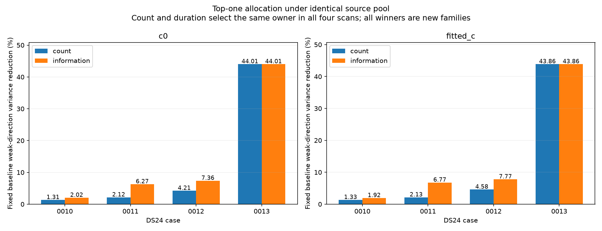
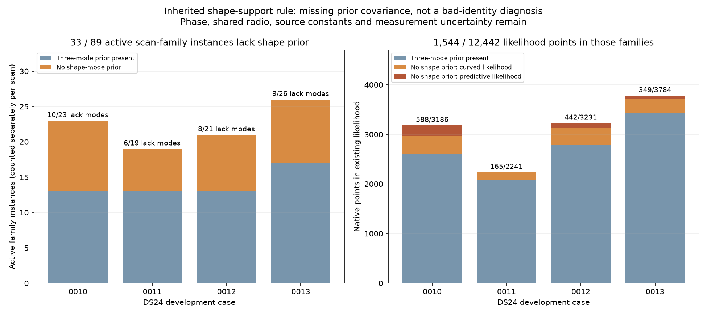

# Fast scans: review, satellite nomination and useful missing evidence

Research date: 2026-10-25. This iteration builds on the
[accumulated review](https://github.com/misko/leo-tracker-reduxredux/blob/a3ae6254d2dee7dc25e794eac06279fee9631c03/reports/2026_10_25_ds24_next_directions_review/README.md)
and the
[phase/shape controls and later-recording validation](https://github.com/misko/leo-tracker-reduxredux/blob/a3ae6254d2dee7dc25e794eac06279fee9631c03/reports/2026_10_25_ds24_phase_shape_validation/README.md).
Three SOL xhigh agents implemented catalogue-nomination and information
diagnostics, independently audited them, and prepared publication. No production
algorithm, operational association, dataset manifest or golden fixture changes.

**The main opportunity is better-supported position information, rather than
more accepted points by themselves.** Existing experiments implicate uncertainty
in satellite timing and orbital shape, shared receiver effects and some
ambiguous identities. They do not establish a single cause of every scan error.

## What we have tried

The rows below describe different cohorts and controls. They are not successive
gains that can be added together. Phase here means orbital time displacement,
not carrier phase.

| Direction | Measured evidence | What it tells us |
| --- | --- | --- |
| Graph, EM, Hough and multiple-hypothesis polynomial construction | Roughly 90–93% polynomial coverage on the first DSX01 scan. | Smooth curves can be recovered much more readily than their satellite identities can be established. |
| ALGO02 pipeline improvements | On 404 matched DS23 recordings, fitted-c mean/median error 1.870/1.602 → 1.508/1.249 km; qualified outputs 404/413 versus 407/413 for ALGO01. | There was a substantial within-site improvement, with a qualification tradeoff. |
| All channels versus halves | Same 24 usable DS24 fast scans: fitted-c mean 1.220 km with CH1–8, 1.558 km with CH1–4, 2.040 km with CH5–8. | All channels already help. Their information is partly redundant. |
| Continuous multistart and transferred half-channel assignments | Thirty targeted restarts agree within 2.06 cm; four label transfers give no qualified better full-data solution. | Generic continuous restarts are low priority for these tested assignments. Other discrete identities remain possible. |
| More native GLRT recovery | DS23 fitted-c postfit coverage 70.71→74.41%; mean error 1.434→1.426 km, P95 3.082→3.202 km. | More association can worsen the tail. Postfit membership is distinct from position-likelihood membership. |
| Cleaner RX2 frequency measurements | 322 curves: median fixed-degree scatter 78.07→22.18 Hz, without a qualified cohort accuracy gain. | Measurement scatter alone is not the demonstrated dominant limitation. |
| Shared smooth RX1 correction | Development mean 1.220→1.120 km; later eight-recording fitted-c mean 1.239→1.224 km, P95 2.829→2.956 km. | The earlier mean gain did not replicate at comparable magnitude; retain the reference. |
| Known-nuisance information controls | Median local weak-axis scale 534 m normally, 386 m with receiver terms known, 110 m with timing known, 56 m with timing and shape known. | Timing/shape can strongly resemble position movement. These are unavailable-information controls, not achieved accuracy or calibrated confidence intervals. |
| Conditional synthetic timing/shape interventions | Fitted-c mean 0.469 km originally, 0.403 with timing deviations removed, 0.405 with shape removed, 0.297 with both removed. | Both contribute in this simulator. This does not justify narrowing real priors. |
| Causal identity competition | Two of four proposed new families have close alternatives; one changes preferred identity between c arms. | Small residuals do not certify satellite identity. An unresolved outcome is necessary. |
| Orbit uncertainty for single-owner families | Earlier DSX01 `all_3`, `all_5` and `all_3_window` controls already tried this, with mixed positional outcomes and lower accepted-curved coverage. | Reuse that mechanism and its controls; this is not an untried universal fix. Its relevance to the current fast-scan likelihood needs measurement. |

The linked reviews provide primary result archives and historical comparisons.
Earlier soft-identity, temporal-mixture, prior-forecast, held-family movement and
nonlinear-phase tests also exist; repeating them unchanged is low priority.
All usable DS24 fast scans in the channel comparison are 10 MS/s, so that cohort
does not identify a sample-rate effect. The nominal 40-degree feed separation
changes coverage but supplies neither a measured bearing nor a spatial baseline.

## New result: which missing complete curve is most useful?

We froze the first four chronological DS24 development cases, 0010–0013, and
inventoried 503 native owners, including 295 original curved owners. Twenty-six
complete curved sources have no overlap with the full accepted-point union of
either parent arm, including postfit-only extensions. No fragment is trimmed,
no identity is replaced and no new position is fitted.

For every eligible source, the diagnostic retains receiver, timing and physical
orbit uncertainty. Existing-family evidence shares the parent's latent terms;
a new family receives its own original timing and three-mode orbit uncertainty.
Old curved evidence, old predictive evidence and the proposed curve share one
joint covariance calculation. The ranking maximizes the smaller of the two
c-arm fractional reductions in variance along each fixed baseline weak axis.
Changing only target CFO values leaves the calculation unchanged. Identities
and source selection nevertheless came from earlier RF analysis.

| Scan | Largest source: candidate / points | Information choice: candidate / points | Weak-axis variance reduction: largest → information |
| --- | --- | --- | ---: |
| 0010 | 64023 / 50 | 59333 / 14 | 1.31% → 1.92% |
| 0011 | 65497 / 55 | 58175 / 20 | 2.12% → 6.27% |
| 0012 | 57743 / 59 | 62145 / 30 | 4.21% → 7.36% |
| 0013 | 60108 / 85 | 60108 / 85 | 43.86% → 43.86% |

Count and duration choose the same top source in all four cases. Information
chooses a shorter source in three. These are local Gaussian design calculations,
conditional on identity, fitted precisions, fixed RF endpoints and the current
linearization; they are not nonlinear-mixture Fisher information or measured
accuracy gains. In fitted-c, the information choices reduce the corresponding
local weak-axis standard-deviation scales by only about 5, 21, 18 and 127 m.
Variance percentages should not be interpreted as proportional error reductions.

Twenty-five of 26 sources score successfully in both arms. The remaining source,
0010 RX1 CH5 T000 / 69148, is blocked because its active parent family lacks
physical-mode columns. The diagnostic refuses to replace missing uncertainty
with certainty. The independent audit finds 47 existing curved points in two
RX1 CH5 fragments plus nine predictive points for this family. The parent
allocates shape columns only when a family has at least two distinct
(receiver, channel) owners. Multiple fragments on this one owner therefore
retain phase uncertainty but have no orbit-shape covariance, in both the curved
and predictive likelihoods. This is an inherited model limitation, not a new
numerical failure or evidence that satellite 69148 is incorrectly identified.

This limitation is newly identified in this diagnostic, but the remedy has
prior art in this repository: `tools/dsx01_all_candidate_uncertainty.py` already
retains physical prior uncertainty independently of owner count. The
[DSX01 follow-up](https://github.com/misko/leo-tracker-reduxredux/blob/a3ae6254d2dee7dc25e794eac06279fee9631c03/reports/2026_10_18_dsx01_radio_orbit_followup/README.md)
records mixed results. For example, `all_3_window` improves S03 fitted-c error
1.629→1.272 km relative to `window_noise`, but worsens S01 0.512→0.619 km.
Those different-data experiments are not an accuracy prediction for DS24.

The saved-state scope audit finds **33/89 active scan-family instances** without
three-mode shape slots across 0010–0013: 10/23, 6/19, 8/21 and 9/26 respectively.
They contribute 1,147 curved and 397 predictive observations, **1,544/12,442
(12.41%)** of the original position-likelihood points. None is predictive-only.
This establishes the scope of the modeling choice, not its effect on position
error. A physically scaled covariance/gradient comparison remains necessary.
See the [exact inventory](audit/shape_support_inventory.json).

**Decision: do not run another unqualified position-addition comparison yet.**
The 0011 information winner, 58175, already has the close 63312 alternative; the
0012 count winner, 57743, has the close 66259 alternative. Ranking a guessed
identity highly does not resolve that ambiguity. The 0013 source has stronger
cross-channel support, but those owners were historically selected under the
same label and all use RX1. No source becomes an accepted association here.

The exact protocol, all excluded/blocked owners and exported covariance/design
arrays are under [information](information/PROTOCOL.md).

## Catalogue-nomination falsification

We generated eight physical sources and four declared unresolved polynomial
sources on two inherited time/RF layouts. Each physical identity was selected
by a seeded, response-free rule from eligible causal catalogue entries outside
the existing parent likelihood. The same generated observations enter both c
arms. Ordinary full-catalogue nomination retains only its best eight candidates;
no true identity, old nominee or reserved competitor is forced into that list.

All eight physical sources reach the shortlist, and their true identities rank
first in the raw nonlinear physical comparisons in both c arms. Seven of eight
physical trials pass the frozen ordering checks, including numerical and
visibility requirements, in each arm. All
four polynomial-null draws favor the unresolved model in the raw scores, but
none passes those numerical ordering checks. Those failures prevent a qualified
null-rejection claim. No trial is rerun or backfilled, and no identity threshold
is calibrated or operationally adopted.

The physical trial failure is 0011 trial 1: true 56530 wins and its own
integration agrees to better than 4e−7 objective units in c=0. A different
shortlisted satellite, 100539, is above the horizon at its mean phase but falls
to −0.615 degrees at a phase-domain endpoint. The frozen all-shortlist rule
therefore withholds the whole ordering. This is a support-qualification failure,
not a missed true identity or failed integration of the winner.

The unresolved draws expose another limitation. Their best physical objectives
are roughly 406,000–4,448,000 versus 328–725 for the unresolved comparator.
Some required adaptive references fail their guard; others disagree by
0.006–0.014 objective units, exceeding the frozen absolute 0.001 tolerance.
These are extremely poor physical fits, not close identity ties. We retain
every failure and do not retrospectively weaken the rule. The saved generic
adaptive errors do not distinguish nonpositive integrals from excessive relative
error, so attributing every failure to underflow would be unsupported.

| Generated condition | Trials | True source shortlisted | Raw physical winner correct | Passed full ordering checks, each c arm |
| --- | ---: | ---: | ---: | ---: |
| Physical satellite | 8 | 8/8 | 8/8 | 7/8 |
| Declared unresolved polynomial | 4 | Not applicable | All four raw scores prefer unresolved | 0/4 |

The test completed in 68.41 s of scientific wall time with two workers and one
BLAS thread each, below its 600 s cap. There are no position fits or GPS reads.
Generation/nomination condition on the original parent, whereas exact identity
comparison removes shortlisted active families from a common parent cavity.
Those conditioning states differ and are archived explicitly. The real parent
mean can change by as much as 228.76 Hz RMS and its conditional covariance by
16.56% in relative Frobenius norm after the shared cavity operation. These
measured differences reinforce the conditioning limitation. The real parent
calibration, historically selected source layouts and broad declared polynomial
comparator make this a conditional falsification test, not end-to-end RF
simulation, calibrated false-match rates or matching-law probability calibration.
Eight positive draws provide no general shortlist-recall estimate.

The [older-shortlist readback](archive_shortlist_check.json) also finds that all
four old nominee-plus-competitor sets happened to equal their ordinary top-eight
sets. The old forced-retention mechanism was therefore not responsible for
those four observed identity outcomes. These two checks supply no current
evidence that simply enlarging the shortlist will solve the real ambiguities.
Full trial evidence is in the [nomination findings](nomination/FINDINGS.md).

## Next directions and stop conditions

1. **Make identity qualification precede position movement.** First establish
   whether ordinary nomination retains plausible true sources. Compare physical
   candidates with the same uncertainty and aliases, retain unresolved outcomes,
   and use whole-source prediction where separately selected support exists.
   A shortlist miss calls for a nomination fix; a close exact comparison calls
   for more discriminating evidence. Neither calls for looser residual gates.
   The present test suggests a narrower prerequisite: make the scoring procedure
   handle impossible visibility phases and clearly dominated alternatives. A
   proposed physical treatment gives invisible phases zero likelihood while
   retaining the original full-prior normalization; it does not renormalize
   away the visibility penalty. Conservative evidence bounds could certify that
   a poor alternative cannot change a decision. Both require fresh tests; the
   current failed trials remain failed and supply no calibrated decision rule.
2. **Audit missing orbit uncertainty in the existing likelihood.** Distinguish
   insufficient evidence to estimate a family's correction from certainty that
   its correction is zero. The newly blocked active family is a concrete lead:
   its 56 old likelihood points have no shape covariance because all use RX1 CH5.
   Reuse the existing all-candidate uncertainty control, whose earlier DSX01
   results were mixed. First inventory the affected families; then compare fixed-state information
   and gradients with their original physical prior retained, without claiming
   that a single owner independently calibrates the orbit. Only a material effect justifies matched position
   fits. Do not substitute wider arbitrary per-track polynomials.
3. **Use information to allocate recovery effort.** Retain the same complete
   candidate pool and fixed budget when comparing count/duration against useful
   weak-direction information. Start with at most one qualified source per scan;
   carry shared family and receiver uncertainty throughout. Stop if gains are
   negligible or rely on an ambiguous label. The current 0013 source is the
   strongest geometry opportunity, conditional on its identity/model validity.
4. **Test a specific omitted phase–shape coupling.** Earlier nonlinear-phase
   work kept physical-mode design and noise precisions fixed. A genuinely new
   bounded test would allow the physical-mode design to change with orbital
   phase under the same prior, compare fixed RF-selected positions and gradients,
   and require numerical convergence before position fitting. Stop if the
   correction is too small to explain the observed displacement.
5. **Reserve receiver changes for independently witnessed structure.** The
   later-recording RX1 result lowers generic smooth corrections in priority.
   Use same-satellite cross-receiver/band contrasts to test a specific physical
   mechanism. Derived differences must retain shared covariance; they cannot be
   added as independent duplicate observations.

A later policy must improve a frozen broader comparison, including failures and
tail error, before promotion. All 24 current DS24 cases and the eight RX1V cases
are now development evidence. Repartitioning them cannot create an untouched
validation set. Keep c=0 and fitted-c observations, candidates, other priors and
budgets matched; report frequency fit, actual likelihood membership, postfit
coverage and geography separately.

The current reference remains fresh ALGO02-v1 plus qualified causal signed
timing means and equal-assignment-prior family cavity. The existing 25×25 km
region is centered at 37.906,-122.545. Evaluation position
37.849061591561885,-122.48574968092912 is not an inference prior. No future-TLE
inference, stationary pooling, trajectory prototype or new RF collection is
part of this iteration. There is no ALGO promotion.

## Verification and replay

Eight nomination tests and three information/covariance controls pass. The
independent information audit checks all 50 scored source/arm contexts against
an augmented QR calculation (maximum relative discrepancy 2.80e−13). The
nomination terminal audit covers all 192 attempted candidate contexts, 48 saved
adaptive references and all 12 actual injected screen vectors, reproducing
the saved draws and coarse catalogue scores. The audit passes because the
results, including failed scientific checks, are faithfully preserved; it does
not turn the ten unqualified trial/arm orderings into qualified outcomes.

[Coordinator arithmetic checks](coordinator_checks.json) independently verify
the report's winners, paired rankings and observation/family counts. The
information branch takes 10.48 s for inventory/tests/ranking; the nomination
branch takes 68.41 s for context, generation, screens and exact comparisons.
These are host diagnostic timings, not an embedded benchmark. The root tracked
diff remains unchanged. See [replay notes](REPLAY.md) for archived inputs,
dependency paths and limits; the report is not a standalone full RF/TLE archive.
