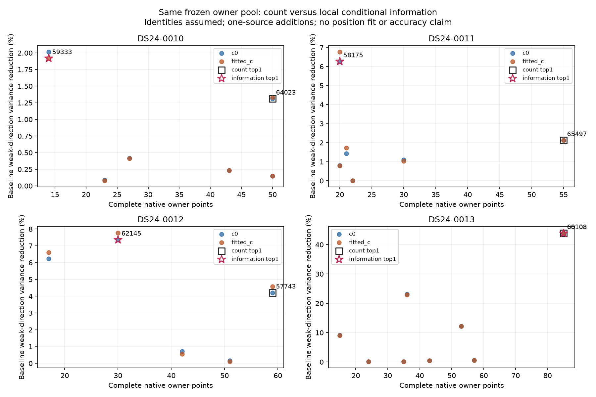
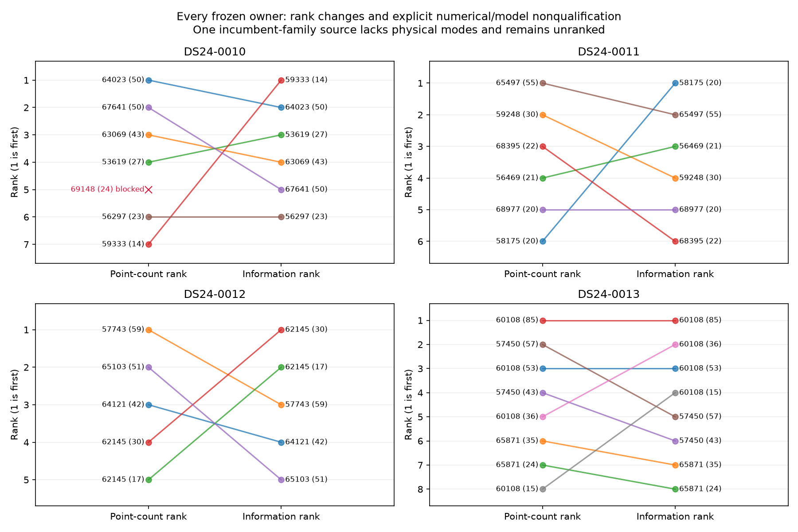

# Additional position information versus source length

The frozen local information calculation selects a shorter complete curved
source than point count in three of the four development scans. Count and
duration select the same source in all four. This establishes a difference in
conditional design information, **not** correct satellite identity, a calibrated
position error prediction, or an accuracy improvement. No position was fitted
and no geographic truth/error was read. The reference remains unchanged.

## Frozen common pool

The panel is the first four chronological usable DS24 development cases,
0010–0013, without replacement. Their full native track files contain 503 owners;
295 are original curved graph owners with archived causal candidate/alias
bindings. Excluding every source that overlaps either arm's complete accepted-ID
ledger, including postfit-only extensions, leaves **26 complete owners**. Nothing
is trimmed. All rows and exclusions remain in [inventory.json](inventory.json).

| Case | All native owners | Original curved graph owners | Eligible whole owners | Scored in both arms |
| --- | ---: | ---: | ---: | ---: |
| DS24-0010 | 128 | 73 | 7 | 6 |
| DS24-0011 | 117 | 65 | 6 | 6 |
| DS24-0012 | 112 | 70 | 5 | 5 |
| DS24-0013 | 146 | 87 | 8 | 8 |

The pool preserves the canonical reference node's original nominees and aliases,
including rejected nominations. Six eligible owners belong to families already
in the parent likelihood; the others do not. Sources sharing one family are
alternative one-source additions, not independent geometric witnesses. No
nomination is rerun and no label is chosen using information or geography.
All four scans and their labels are already development-exposed.

## Same-data allocation comparison

The score is the minimum, across matched c arms, of fractional variance reduction
along each arm's *fixed baseline weak direction*. Every source sees the same
parent, original IDs, physical priors and noise convention. Count sorts by
points then duration; duration reverses those keys; information sorts by its
paired score, points and duration. Component strings break remaining ties.

| Case | Count and duration top1: assumed NORAD, owner, points | Information top1: assumed NORAD, owner, points | Count variance reduction c0 / fitted-c | Information variance reduction c0 / fitted-c |
| --- | --- | --- | ---: | ---: |
| 0010 | 64023, RX1 CH1 T001, 50 | 59333, RX2 CH4 T001, 14 | 1.311391% / 1.331799% | 2.015175% / 1.919383% |
| 0011 | 65497, RX2 CH8 T000, 55 | 58175, RX1 CH1 T006, 20 | 2.124787% / 2.128520% | 6.266644% / 6.765249% |
| 0012 | 57743, RX1 CH2 T001, 59 | 62145, RX1 CH3 T005, 30 | 4.208451% / 4.583469% | 7.362654% / 7.769925% |
| 0013 | 60108, RX1 CH4 T000, 85 | Same source | 44.006454% / 43.858641% | Same |

**Every top1 winner is an inactive parent family.** Full source names, native
IDs, candidate indices and aliases are in [results.json](results.json);
[winners.csv](winners.csv) and [ranking.csv](ranking.csv) provide compact tables.

Variance percentages are larger than the corresponding SD percentages. The
table below gives the baseline and implied augmented SD *along the unchanged
baseline weak direction*. These are conditional Gaussian design scales,
not observed localization errors or calibrated confidence limits.

| Case | Arm | Baseline SD, m | Count/duration top1 SD, m | Information top1 SD, m |
| --- | --- | ---: | ---: | ---: |
| 0010 | c0 | 531.651 | 528.154 | 526.267 |
| 0010 | fitted-c | 532.053 | 528.498 | 526.922 |
| 0011 | c0 | 616.597 | 610.011 | 596.965 |
| 0011 | fitted-c | 620.345 | 613.708 | 598.994 |
| 0012 | c0 | 452.966 | 443.332 | 435.972 |
| 0012 | fitted-c | 456.613 | 446.025 | 438.515 |
| 0013 | c0 | 506.153 | 378.749 | 378.749 |
| 0013 | fitted-c | 506.282 | 379.345 | 379.345 |

For 0010–0012, information allocation changes these model SDs by only about
5–21 m from baseline. The larger 0013 result relies on the same unqualified
60108 source already examined in earlier identity work. It is not a fresh
independent source or a demonstrated 127 m position improvement.

The one blocked source is **0010 RX1 CH5 T000, assigned 69148, 24 points**, fifth
by count. Its family is present in the parent likelihood but the original
parent has no physical-mode columns for it. The frozen rule blocks both arms
rather than treat unsupported shape as zero uncertainty or introduce a new
unreviewed shared-family covariance model. This source remains in the count
and duration pool and has no information rank. None of the top1 count/duration
winners is blocked; no winner was replaced. There are no other source failures.
The terminal audit identifies 47 retained curved points (19+28) and nine
predictive points for this incumbent family, all RX1 CH5. Its existing phase
coordinate is present, while the original requirement of at least two distinct
(receiver, channel) owners leaves it without shape coordinates. This is a
model-support limitation, not evidence that the physical orbit has zero error.

## What is retained in the calculation

This is fixed **local Gaussian mean-design information**, conditional on the
saved RF endpoint, identity, phase reference, physical-mode linearization and
Gamma precision. Curved and *all* existing predictive evidence enter one shared
nuisance system. A new source conditions on that whole system. It does not
receive an independent copy of receiver calibration, or an independent copy of
an incumbent family's phase/modes. Inactive-family targets use a separate
causal-width Gaussian phase and all three physical modes; dormant parent slots
are zero in the target design to prevent duplicate priors. Every whole source
has its original independent 300 Hz constant uncertainty.

Target noise is the original per-ID nominal sigma multiplied by sqrt(2), the
explicit inverse-precision moment of unseen Gamma(2,2). No target noise or Gamma
is estimated. Jacobians at .02 and .01 km agree to relative error at most
7.18e-10 for targets. All **50 successfully scored source/arm contexts** pass
an exact copied-CFO-redaction check: changing only the new source values leaves
all design/covariance inputs unchanged, with maximum difference zero. The
inherited source/identity pool remains RF-selected despite this design check.

The [protocol](PROTOCOL.md) gives the joint Schur equations and deterministic
ties. [ranking.py](ranking.py) reuses the established geometry, physical modes,
predictive noise construction and stable nuisance projection. [Saved arrays](arrays/)
retain old and new designs, noise/prior precisions, shared sufficient statistics,
conditional covariance and every 2x2 baseline/augmented matrix. These support
independent dense and joint-Schur replay without propagation or fitting.

The local approximation does **not** integrate nonlinear Student phase mixtures,
relinearize phase with the new data, differentiate covariance volume, measure
model bias, or calibrate uncertainty. Earlier target-phase linearization
failures therefore still limit its physical interpretation. Positive local
design gain alone cannot certify a useful recovered identity.

## Prior work, novelty and decision

The earlier [DS24 information study](https://github.com/misko/leo-tracker-reduxredux/blob/a3ae6254d2dee7dc25e794eac06279fee9631c03/reports/2026_10_24_ds24_bottlenecks/information/REPORT.md)
compared retained data subsets and unavailable-information controls. Its
curved-plus-predictive Gaussian surrogate and
`tools/ds23_position_information.py` supply the nuisance-projection machinery.
The current diagnostic instead compares allocation among previously unowned,
complete candidate sources under an identical frozen pool. The earlier grouped
new-family runner (`tools/probe_ds23_new_family_prediction.py:select`) already
retained shared predictive covariance but prioritized eligible groups by points.
This result is not a claim that covariance-aware predictive recovery is new.

The [causal identity challenge](https://github.com/misko/leo-tracker-reduxredux/blob/a3ae6254d2dee7dc25e794eac06279fee9631c03/reports/2026_10_25_ds24_identity_components/identity/FINDINGS.md)
already finds a close 63312 competitor for 0011's information winner 58175 and
a 66259 competitor for 0012's count winner 57743. All winners remain assumed
identities. **No further position fits are launched from these ranks.** Identity
falsification and independent whole-source support take precedence over moving
a position using a high-information but ambiguous constraint.

The inventory took 0.084 s, three owned covariance tests 0.94 s, and the frozen
ranking 9.374 s: **10.480 s cumulative numerical/input work**, one worker and one
BLAS thread, under 600 s total and 120 s/case. The input-hash freeze's 0.081 s is
included. A zero-science bookkeeping protocol precursor is preserved. The
independent preflight passes 967 checks, including all 65 source/input bindings
and an observation-space Gaussian oracle (maximum difference 9.69e-14).
The [independent terminal audit](../audit/information_terminal.json) passes all
50 scored contexts: full augmented position-first QR agrees within 2.80e-13
relative error and direct conditional covariance inversion within 2.47e-13.
It checks ownership, dormant slots, local prior block dimensions, weak axes and
all 26 deterministic rank assignments without propagation or position fitting.
The scientific results/seal are unchanged by table or figure production.

The publication supplies new source, native-ID inventory, arrays and derived
results; original DS24 banks, full tracks and prior runtime remain external and
hash-bound. This is not a standalone complete input/runtime restoration.
