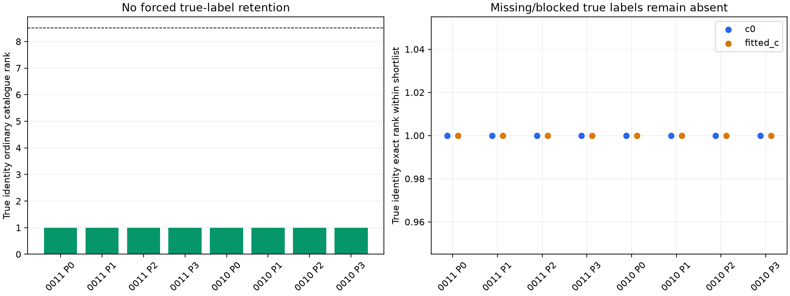
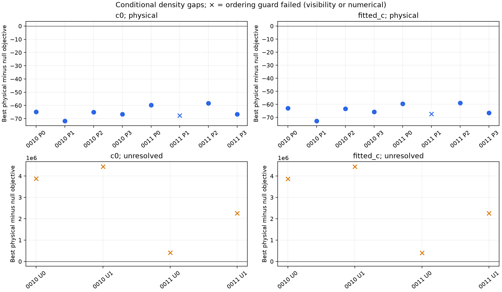

# No shortlist miss found in this conditional pilot; null qualification remains incomplete

The unchanged ordinary catalogue screen ranks the generating identity **first
in all eight physical draws**, with no forced nominee or true-label backfill.
The true identity is also the raw exact-score winner in both c arms for all
eight draws. **Seven of eight complete physical orderings qualify per arm**;
one other shortlisted candidate fails full phase-domain visibility. All four
declared polynomial-null draws favor the null in raw scores, but **zero of four
complete null orderings qualify numerically** in either arm. Their failures are
retained; raw preferences are not a validated rejection or false-accept rate.

All twelve trials and 24 arm jobs complete in **68.41 s** within the frozen
600 s cap. There are no position fits, geographic truth inputs, retries,
backfill, grid refinements, threshold changes or operational identity decisions.

## What was frozen and what this tests

The two source layouts are the previously examined DS24-0010 and DS24-0011
discovery owners: respectively 50 and 20 native point times, IDs and RF values.
Those layouts were historically selected using real responses; they are not a
new RF-blind source sample. Their metadata, complete causal catalogue/archive
bytes, source code and generating rule were frozen before any new CFO draw.

Generating identities are uniformly sampled without replacement from catalogue
families entirely absent from original protected, active-curved and predictive
parent families, with finite causal location inside ±15 s, positive width, and
visibility at the causal location and both operational-domain endpoints.
The response-free eligible sets contain **374 of 1,405** catalogue entries for
0010 and **389 of 1,422** for 0011. Each eligible set and all four identity draws
are sealed before producing CFO. No true-family-specific cavity is supplied.

| Source layout | Four physical generating NORADs |
| --- | --- |
| DS24-0010 | 59432, 59328, 63318, 53914 |
| DS24-0011 | 68707, 56530, 65700, 47361 |

Each physical draw uses its fresh original causal Student ν=3 timing law with
original location/marginal SD, conditioned on [-15,+15] s, and standard Gaussian
coefficients for the full original three physical modes evaluated at the actual
nonlinear phase. This is the full mode block, not isolated projected curvature.
The original c0 parent conditional radio/noise covariance supplies an independent
Gaussian draw, including native sigma×sqrt(2) and a 300 Hz source constant. This
conditional target law is not the full robust parent/GLRT generative hierarchy.

Each unresolved draw uses the original proper degree-four Legendre prior with
five standard Gaussian coefficients scaled by PERIOD/sqrt(6), plus the same
conditional covariance. Both conditions generate and score the **same uniform
whole-source alias prior −4,…,+4**. These broad polynomial draws are declared
synthetic sources, not empirical clutter, misleading satellite tracks or an
IQ false-peak simulator. PCG64 seeds and separate phase, shape/polynomial,
Gaussian and alias streams remain saved; no draw is rerolled.

The two c arms receive identical observations and use the **same fixed saved c0
parent position**, with arm-specific original calibration/prior state refreshed
only at fixed position. No evaluation site or true position is read. The
generating law is c0-conditional; fitted-c scoring is a matched-data sensitivity
comparison, not a second generative draw.

The ordinary screen receives only injected synthetic raw CFO/covariance and
response-free full-catalogue geometry. Its narrow port has no true identity,
true phase, source-kind flag, archived nominee or reserved competitor. It keeps
the original Gaussian phase approximation and nearest-alias nomination, then
takes the ordinary best eight finite visible candidates with NORAD tie breaks.
The exact Student/nonlinear-phase/physical-covariance/null comparison follows
that shortlist; a missed identity would remain missed and never be privately
scored. Here every physical identity already ranks first in the ordinary screen.

This is conditional nomination/ranking falsification against real, label-
conditioned calibration. The generator and screen use the full original parent;
exact comparisons remove the union of shortlisted families from calibration
and predictive conditioning, identically for all candidates and the null.
Consequently some exact scores condition on less parent data than generated
the draw. Only one physical trial, 0011/P0, removes parent likelihood IDs:
310 curved points. Null trials remove 85–466 curved points, and 19 predictive
points for each 0010 null. Every removed ID and active shortlisted family is
saved. This two-stage difference prevents a matched-law probability-calibration,
parent-closure or simulation-based-calibration claim.

## All outcomes, including failed ordering guards

Counts below describe the same eight physical/four null observations in both
arms; they are not sixteen/eight independent recordings.

| Condition | Trials per arm | True label in ordinary top8 | Raw best physical is truth | Raw physical / null preference | Complete orderings qualified, c0 / fitted |
| --- | ---: | ---: | ---: | ---: | ---: |
| Physical | 8 | 8 | 8 | 8 / 0 | 7 / 7 |
| Declared unresolved polynomial | 4 | Not applicable | Not applicable | 0 / 4 | 0 / 0 |

The physical best-minus-null objectives are roughly −58 to −72. The polynomial
draws are extreme mismatches for every shortlisted physical model: best physical
objectives are about **406,000–4,448,000**, versus null objectives about
**328–725**. These raw gaps are not difficult near-ties. The four null draws
therefore do not meaningfully test a calibrated threshold near ambiguous real
satellites, even apart from the failed numerical qualification below.

**Physical failure: DS24-0011/P1, true identity56530.** The true winner itself
passes quadrature: c0 primary/denser discrepancy2.46e-7 and primary/adaptive
discrepancy3.80e-7. Another shortlisted identity,100539, has saved causal-mean
elevation+0.6694° but operational endpoint minimum−0.6145°. The original screen
checks visibility at its causal mean; the exact method requires the whole
operational phase domain. The frozen conservative rule marks the complete
ordering unresolved if any shortlisted candidate is blocked. This is a
**competitor visibility blockage, not a quadrature failure of56530**. It occurs
in both c arms and was neither removed nor replaced.

**Null failures:** every ordering must satisfy the absolute1e-3 objective
tolerance for its denser top two and any additional ordering-sensitive reference.

| Null draw | Requirement that fails |
| --- | --- |
| 0010/U0 (trial4) | Required top-two identities100547 and63757 fail the adaptive integral guard in both arms, despite small1281/2561 discrepancies. |
| 0010/U1 (trial5) | c0 winner47797 passes (.000504 denser/.000746 adaptive), but runner63106 fails (.011901/.013574). Fitted-c winner also fails (.003255 denser plus adaptive-guard failure); its runner fails (.011800/.013532). |
| 0011/U0 (trial4) | Required top-two identities63137 and68395 fail the adaptive integral guard in both arms. |
| 0011/U1 (trial5) | Winner63137 passes, but runner62753 fails c0(.006918/.007492) and fitted(.006163/.006643) denser/adaptive discrepancies. |

Across192 candidate contexts,190 have finite defined scores and two are the
visibility block above. Eighteen finite null-candidate contexts are unqualified,
including nine adaptive-guard failures. Maximum primary/denser discrepancy is
0.012931 and maximum finite primary/adaptive discrepancy is0.013574. Some failing
candidates are extremely improbable runners-up. Their relative error is tiny
on million-unit objectives, but they exceed the **frozen absolute objective
tolerance**. No post hoc relative tolerance or winner-only exemption is applied.

The adaptive routine scales by a grid-estimated log-density peak, uses
epsabs/epsrel1e-10, and rejects a nonpositive integral or an estimated relative
integration error above1e-6. Its generic saved exception does not distinguish
those two causes. SciPy also emitted roundoff warnings. Without a new numerical
run we cannot attribute each generic failure specifically to underflow, a missed
narrow mode, or an absolute-integral-tolerance problem. Large raw null gaps do
not bypass the predeclared numerical requirements. We report diagnostic null
preference, not four validated rejections or a measured zero false-accept rate.

Alias-range/shift sensitivity is recorded separately from quadrature. Some
physical-draw comparisons change under a different finite alias prior. The
declared nine-alias generation/scoring law remains proper; no prior is widened
after seeing the result and no claim of alias-boundary robustness is added.

## Interpretation and artifacts

This pilot does **not falsify ordinary nomination** on its eight randomly drawn
physical cases and supplies no evidence for an immediate shortlist-budget or
phase-approximation change. It also does not resolve the previously observed
real close competitors or validate an identity acceptance rule. These mostly
easy physical ranks, broad null sources, two inherited layouts and conditional
parent approximation sharply limit generalization. There is no production
change, prior narrowing, geographic improvement or ALGO promotion.

A useful future test would freeze physically confusable identity pairs using
response-free predicted-curve geometry before generating CFO, retaining the
ordinary catalogue screen unchanged; numerical references for extreme
out-of-model nulls need a separately versioned qualification protocol. Neither
followup is executed or selected by these results.

Eight owned tests pass. Independent [preflight](../audit/nomination_preflight.json)
checks the ordinary synthetic observation port and dense physical/null density
oracles. The independent [terminal audit](../audit/nomination_terminal.json)
passes **1,545 checks**, reconstructing draws, phase CDFs, finite aliases, all
twelve actual catalogue screens,192 candidate contexts,48 adaptive references,
shared cavity membership and every saved failure/ordering flag, with no audit
propagation or fits. Maximum generating forward closure is1.27e-10 Hz.

[protocol.json](protocol.json), [PROTOCOL.md](PROTOCOL.md),
[metadata.json](metadata.json) and [RF_seal.json](RF_seal.json) bind inputs,
source and scientific outputs. Per-case context NPZ/JSON/seals retain the full
catalogue geometry, generating eligibility/identities and original conditional
mean/covariance. Each trial retains observations, all latent/alias/phase draws,
ordinary full-catalogue ranks, arm-specific cavity mean/covariance and removed
IDs, candidate checkpoints and final scores. [outcomes.csv](outcomes.csv),
[rows.json](rows.json), [summary.json](summary.json) and [details.json](details.json)
retain every denominator and numerical failure. The initial frozen reporting
source/figures remain preserved; [detail_seal.json](detail_seal.json) binds the
separate artifact-only visibility/numerics labeling and scale refinement.
