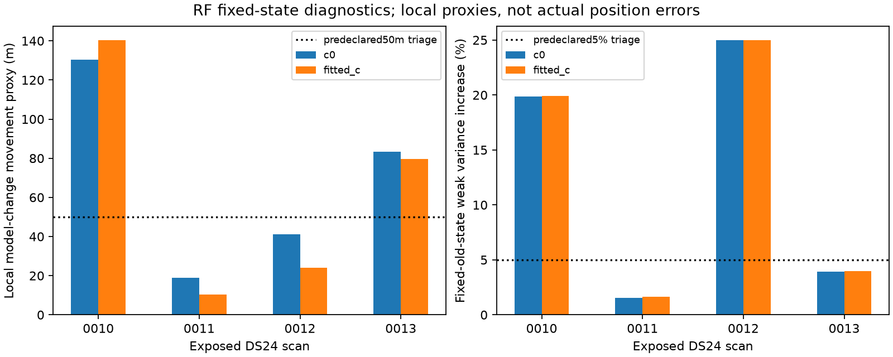
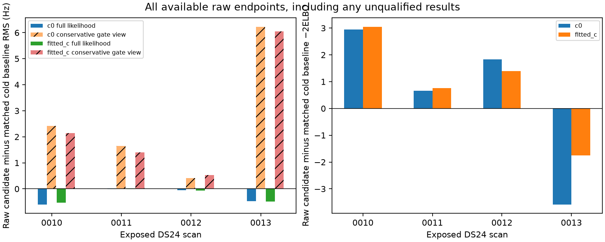
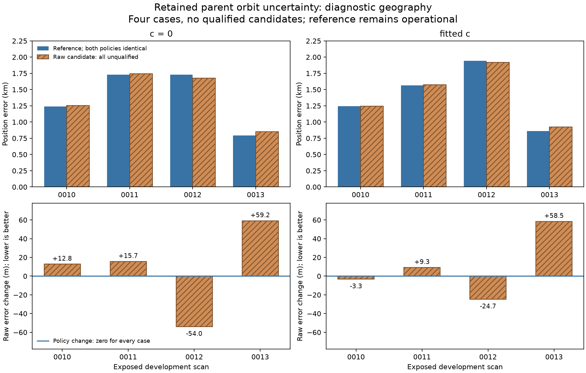

**Retaining parent orbit uncertainty: a material model effect, no qualified gain**

All 16 matched fits complete, but **none of the four retained-uncertainty
candidate pairs qualifies**. Every hypothetical research policy falls back,
and the operational reference remains unchanged. The rejected raw endpoints
worsen mean error by 8.4 m with c=0 and 9.9 m with fitted c. No ALGO is promoted.

This tests one concrete mechanism on the already exposed DS24-0010–0013
development scans. The preceding inventory found 33/89 active scan-family
instances without three physical orbit-mode priors, affecting 1,544/12,442
position-likelihood points. Their insufficient receiver/channel support prevents
qualified correction estimation; it need not imply zero physical uncertainty.
Earlier DSX01 all-family uncertainty experiments already gave mixed results.
This is a controlled test in the present fast model, not a novel universal fix.
[Prior-art and gate review](review/FINDINGS.md).

The candidate appends the existing three-mode prior for each active family
without modes, preserving original columns, observations, identities, aliases,
noise powers, causal priors and native ownership. Curved and predictive points
share each family's nuisance covariance. Both c arms use identical inputs,
regional cold start, five phase rounds and search budgets. No sources are added.
The existing 25×25 km box is centered at 37.906, -122.545. The coordinate
37.849061591561885, -122.48574968092912 is used only for geographic evaluation.
Predictive observations retain their one-way role and do not calibrate the
curved model. No postscan TLE inference, stationary pooling or new RF collection
is introduced.

Uncertainty integration and qualified calibration have separate roles. The
likelihood includes the new modes and their conditional posterior means. The
predeclared **conservative gate view** omits those new means from profile,
curved/predictive residual and postfit-extension acceptance, retaining original
support and thresholds. A separately saved literal expanded/full-mean view
applies the original two-owner requirement to the expanded modes. Neither view
is selected by geography. This is an explicit research adapter.

The hypothetical paired policy requires conservative RF gates, phase/Gamma
convergence, complete original accepted-ID retention in both arms, and successful
control/candidate execution. ID retention and execution are additional research
conditions, separate from original residual gates. The operational policy is
hardwired to the original reference regardless of these results.

At the saved RF endpoints, the covariance-only information control freezes old
Jacobians, precisions and priors. Original weak-direction variance increases
about 20% on 0010 and 25% on 0012. Local objective-gradient movement proxies are
130/140 m on 0010 and 83/80 m on 0013 for c0/fitted c. These are conditional
diagnostics, not actual movement or calibrated error bars. The predeclared
engineering triage passes; all four cases then proceed together.

All phase, Gamma and predictive requirements pass, and every matched cold pair
qualifies. Candidate conservative curved failures are primitive structured
residual failures, with no owner-only cascade rejection. In the literal
full-mean view all primitive residual checks pass, while the expanded owner
veto rejects 12/6/8/9 rows per arm. The new nuisance means explain structure
without establishing independently supported orbital corrections. This does
not prove that zero physical variance was correct or justify waiving gates.

| Scan | Conservative curved failures c0 / fitted c | Lost baseline accepted IDs per arm | Research policy |
| --- | ---: | ---: | --- |
| 0010 | 4 / 3 | 0 | Reference |
| 0011 | 1 / 1 | 20 | Reference |
| 0012 | 1 / 1 | 0 | Reference |
| 0013 | 2 / 1 | 0 | Reference |

The 0011 losses are postfit-only; original curved/predictive likelihood
membership remains exact everywhere. Counts of accepted-union points do not
imply qualification. Raw gate-accepted IDs are exported separately. All 14/538
candidate curved source-arm failures and 200/200 predictive passes are retained.

Geography is evaluated once after RF sealing, independent terminal audit and
explicit coordinator release. A no-distance schema check precedes evaluation.
The matched cold endpoints exactly reproduce the original reference. Every
policy statistic below therefore equals the reference; raw candidates remain
unqualified diagnostic outputs.

| Metric, km | c0 reference/policy | c0 raw candidate | Fitted-c reference/policy | Fitted-c raw candidate |
| --- | ---: | ---: | ---: | ---: |
| Mean | 1.373021 | 1.381433 | 1.404601 | 1.414550 |
| Median | 1.484823 | 1.465802 | 1.406751 | 1.409744 |
| P95 | 1.730433 | 1.733460 | 1.885343 | 1.865737 |
| Maximum | 1.730910 | 1.743444 | 1.941516 | 1.916818 |

Raw c0 improves one scan and worsens three; fitted c improves two and worsens
two. Full-mean frequency RMS decreases on every arm. Total optimized score
improves only on 0013, whose geographic error worsens in both arms. Frequency
fit, normalized score, qualification and position accuracy are distinct outcomes.

Independent auditing passes 2,035 RF checks and reconstructs all 16 endpoints;
the coordinator independently checks all 40 geographic rows and 24 exact
control/policy rows. Science uses 12.42 s fixed-stage wall time and 49.46 s
fit-stage wall time, about 102.02 summed numerical worker-seconds under the
600 s cap. There are no retries, rescues, replacements, nominations or tuning.
The initial owned test harness import collision and the evaluator's prelaunch
schema revision remain preserved; neither used new outcomes.

These four cases cannot establish transfer or a physical accuracy floor. The
identities are inherited, the orbit prior is an engineering approximation,
and parent variational/Gaussian, phase-refresh and linear-mode approximations
remain. The three physical modes include level and phase-like components as
well as curvature; this test does not isolate a pure curvature effect. Retaining
uncertainty does not validate its calibration or any satellite identity.

The result closes this bounded attempted fix without rollout. Keep the missing
covariance documented; prioritize a falsifiable identity/selection test before
another unqualified position addition. Broader recommendations and repeated
non-gains are in the separate
[evidence synthesis](https://github.com/misko/leo-tracker-reduxredux/tree/339fdd0f53b8fc8f5fc3822273294716fcc0422d/reports/2026_10_25_ds24_evidence_synthesis).

Sources: [frozen protocol](scientific/protocol.json),
[RF findings](scientific/FINDINGS.md), [independent audit](audit/FINDINGS.md),
[terminal reconstruction](audit/terminal.json),
[evaluation findings](evaluation/FINDINGS.md),
[full-precision CSV](evaluation/report/positions.csv),
[evaluation summary](evaluation/report/summary.json),
[coordinator geographic check](coordinator_geography_check.json),
and [replay/artifact guide](REPLAY.md).
