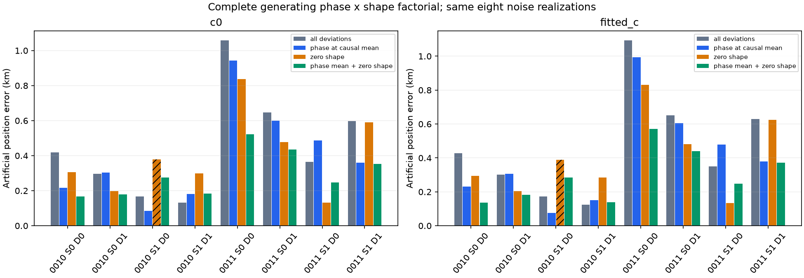
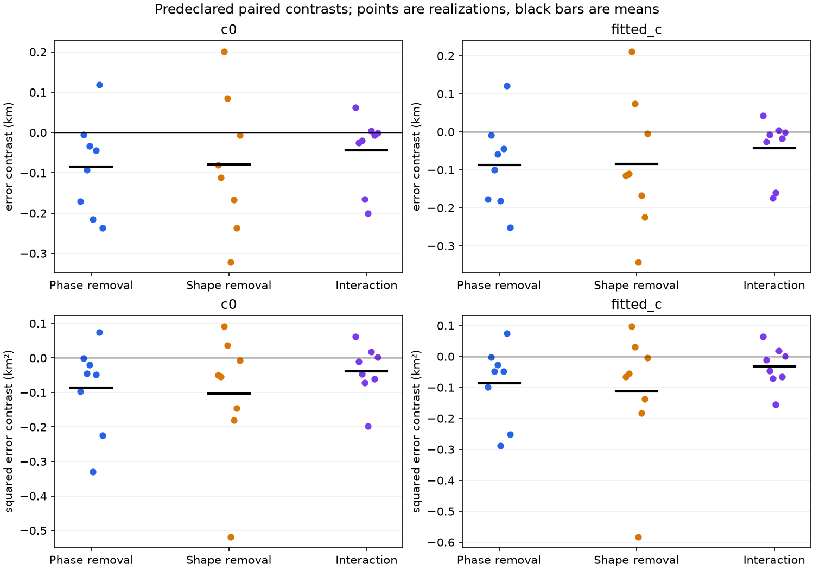
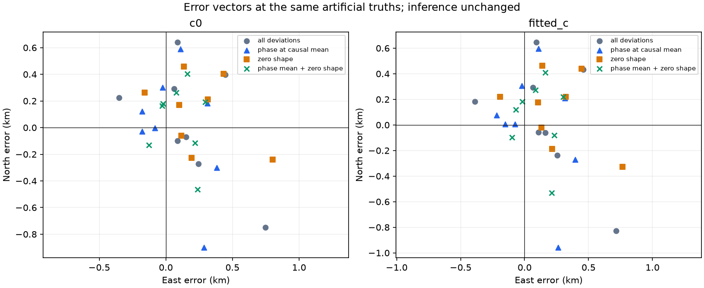

# Both generating phase and shape matter; this panel does not isolate a dominant one

The two missing generating interventions complete the same eight-realization
phase × physical-shape factorial. Removing phase deviations alone changes mean
artificial-position error from **0.4600/0.4689 to 0.3970/0.4026 km** for c=0/fitted-c;
removing shape alone gives **0.4023/0.4054 km**. Removing both, reused unchanged
from the preceding experiment, gives **0.2954/0.2966 km**. The average marginal
phase and shape removal effects are similar in error distance; shape has the
larger reduction in mean squared error. Neither component consistently helps
every realization, and this conditional panel identifies no single dominant
real-data cause.

All **32 new position fits completed**, and **30 pass the original gates**.
The same shape-zero realization fails the original slope gates in both c arms.
Every completed endpoint, including those two unqualified endpoints, remains in
the predeclared factorial summaries. These are diagnostic error contrasts, not
qualified policy gains. No fit or seed was replaced, and no observation was dropped.

## Frozen construction and unchanged inference

The common panel is DS24-0010/0011 × artificial east/north positions
[-4,+3]/[+4,-3] km × seeds 2026102511/2026102512. The original full and
both-removed observations reconstruct exactly; their **32 old fit outputs are
reused, not refitted**. Only the following missing cells were fitted:

- **01: phase at causal mean, original shape draws.** The actual generating
  phase equals each original causal prior location, not zero. All original
  physical-mode coefficients remain. Nonlinear Doppler and the physical-mode
  design B are recomputed at that actual phase.
- **10: original phase draw, zero shape.** The original nonlinear phase draw
  remains; only the three generating physical-mode coefficients per originally
  supported family become zero.

Cell **11** has both original deviations; **00** removes both. All cells retain
the same receiver/hardware/smooth coefficients, curved and predictive source
constants, per-ID Gaussian noise, per-track Gamma precision, native IDs, times,
known integer aliases, selection masks and powers. Four original independent
RNG streams remain bound; no new random draw is consumed. c truth remains zero,
and both c arms receive exactly the same observations within each cell.

Inference receives no true phase or shape coefficients. It retains the original
priors, sigma map, labels, aliases, powers, 25×25 km region centered at
[37.906,-122.545], regional [0,0] cold start, zero initial phase references and
five × 48 iteration budget. This is a generating-component intervention, not a
known-phase inference oracle or another local phase-integration test.

The original phase generator is the unit-marginal-variance Student ν=3 law with
original causal location/SD, conditioned on the operational ±15 s domain.
Causal locations are inside that domain. Phase-off cells instead use the
deterministic causal locations; original discarded phase draws remain saved.
Physical modes remain the original linear engineering model: the full original
three-mode block, including constant- and phase-like projections, not isolated
projected curvature. Parent VI,
local-phase approximation, predictive Gaussian approximation and inherited
selection remain, so this is not full generative simulation-based calibration.
No association/alias search, real GPS or new RF is used.

## Every cell and paired effect

There are eight completed realizations per row. Error summaries retain all
attempts regardless of qualification; each c arm has its own unchanged fit.

| Generating cell | Mean error c=0 / fitted, km | Mean squared error c=0 / fitted, km² | Maximum c=0 / fitted, km | Qualified c=0 / fitted | Improved / worsened full, each arm |
| --- | ---: | ---: | ---: | ---: | ---: |
| 11 Original phase and shape | 0.460013 / 0.468903 | 0.292010 / 0.307428 | 1.058704 / 1.093897 | 8 / 8 | Reference |
| 01 Phase at causal mean | 0.396955 / 0.402628 | 0.224518 / 0.237720 | 0.943623 / 0.992939 | 8 / 8 | 5 / 3 |
| 10 Zero shape | 0.402261 / 0.405434 | 0.207579 / 0.211519 | 0.837469 / 0.831795 | 7 / 7 | 6 / 2 |
| 00 Both removed, reused | 0.295396 / 0.296559 | 0.102199 / 0.108884 | 0.522417 / 0.570534 | 8 / 8 | 6 / 2 |

For any metric g, predeclared marginal phase removal is
½[(g01−g11)+(g00−g10)], shape removal is ½[(g10−g11)+(g00−g01)], and interaction
is **g11−g10−g01+g00**. These are evaluated separately for east/north error
vectors, error norms and squared error norms. Negative scalar removal effects
mean lower artificial error. Their means are:

| Metric and contrast | c=0 | Fitted c | Negative / positive realizations, c=0; fitted |
| --- | ---: | ---: | ---: |
| Error: marginal phase removal, km | −0.084961 | −0.087575 | 7 / 1; 7 / 1 |
| Error: marginal shape removal, km | −0.079655 | −0.084769 | 6 / 2; 6 / 2 |
| Error interaction, km | −0.043807 | −0.042600 | 6 / 2; 6 / 2 |
| Squared error: marginal phase removal, km² | −0.086436 | −0.086172 | 7 / 1; 7 / 1 |
| Squared error: marginal shape removal, km² | −0.103375 | −0.112372 | 6 / 2; 6 / 2 |
| Squared-error interaction, km² | −0.037890 | −0.032928 | 5 / 3; 5 / 3 |

The effects depend on the other component. For example, c=0 phase removal
reduces mean error by 0.063058 km with shape present, versus 0.106865 km with
shape absent. Shape removal reduces it by 0.057752 km with phase deviations
present, versus 0.101559 km at causal phase means. Phase removal changes from a
small regression to an improvement when shape is removed in 0010/site0/seed1
and 0010/site1/seed1. Shape removal worsens both 0010/site1 seeds when phase
deviations remain, while phase removal worsens 0011/site1/seed0. No consistent
component ranking follows across individual draws or loss metrics.

The raw observations already contain a phase–shape interaction:
**y11−y10−y01+y00 = [B(φdraw)−B(φcausal)] zshape**, up to floating-point closure.
Shared noise, receiver coefficients, constants and aliases cancel. Archived
complete-vector interaction RMS spans 2.70–25.05 Hz, with maximum absolute
native-point difference 113.56 Hz. Thus endpoint interaction combines generating
geometry coupling and estimator response. Scalar error interactions also contain
the nonlinearity of the norm; they do not diagnose optimizer failure or isolate
an estimator approximation. All per-ID interactions and component differences
are archived in [observation_factorials](observation_factorials/).

## Original qualification and frequency fit stay separate

Both unqualified endpoints are **0010/site1/seed0, cell10**, c=0 and fitted-c,
with artificial errors 0.378738/0.388339 km. The same 37-point RX2 CH4 T004
curve (candidate index609) fails original profile and conditional slope checks:
z=3.122881/3.127226. No other primitive curved/predictive gate fails. There are
no runtime, phase, Gamma or region failures. The original gates are unchanged;
these failures are neither removed from the factorial nor called qualified.
[gate_replay.json](gate_replay.json) retains every exact primitive decision.

| Cell | Mean curved RMS c=0 / fitted, Hz |
| --- | ---: |
| 11 Original | 108.055425 / 108.047274 |
| 01 Phase at mean | 108.050911 / 108.044496 |
| 10 Zero shape | 108.044221 / 108.036117 |
| 00 Both removed | 108.040152 / 108.033471 |

These tiny RMS changes are separate from position effects. Observations differ
across cells, so raw ELBO values are not same-data model-comparison scores.
Each new fit saves truth and endpoint objective decompositions and finite-
difference gradients at the **same final phase reference**, plus truth at its
generating reference. Weighted residual, latent-prior, log-volume, noise-Gamma,
prior-Gamma and predictive changes are retained in
[fixed_objective_diagnostics.csv](fixed_objective_diagnostics.csv). Maximum final
gradient norm is 1.34e-4 per km at h=.01 km, and forward-mean closure is below
1.43e-10 Hz. These checks do not establish global optimality.

## Bounds, provenance and limits

Six owned transformation/contrast tests pass. Independent preflight verifies
1,276 checks, including old controls, exact retained/changed arrays, matched c
inputs, all 32 forward closures and observation interactions. Its receipt is
[synthetic_preflight.json](../audit/synthetic_preflight.json). Source files and
input artifacts are frozen in [protocol.json](protocol.json),
[preparation.json](preparation.json) and [scientific_seal.json](scientific_seal.json).
The 16 new actual observation NPZ/truth pairs are under [instances](instances/).

Preparation took 7.42 s; the 32-fit batch took **58.36 s wall time**, with
1.78–6.84 s per fit and 112.38 summed worker-seconds. Wall time from first
preparation, including independent review wait, was 188.73 s at execution end
and **199.99 s through all fixed gate replays**, within the frozen 600 s cap.
Two workers each used one BLAS/OMP/MKL thread; each fit retained its 180 s cap.
There were no retries, rescues, seed rerolls, gate waivers or additional fits.

[factorial_contrasts.json](factorial_contrasts.json),
[factorial_contrasts.csv](factorial_contrasts.csv) and
[all_cell_results.csv](all_cell_results.csv) retain every vector, norm, squared
norm and source binding. [summary.json](summary.json) and
[report_checks.json](report_checks.json) retain table values and algebra checks.

Eight shared draws across two geometries are not eight independent geometry
replications. The findings concern this conditional simulator and unchanged
estimator; they do not identify measured orbit errors, calibrate real timing or
shape priors, validate the inherited identities, or estimate a precision floor.
Further diagnosis must still account for both components; these interventions
do not compare alternate inference priors and give no justification for
narrowing either real-data prior from this panel.
Production, original studies and real observations remain unchanged. No
publication or expanded experiment is part of this branch.
