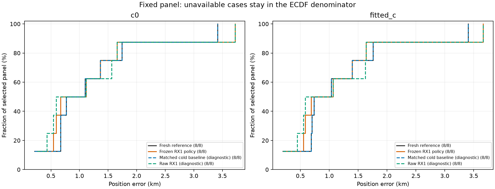
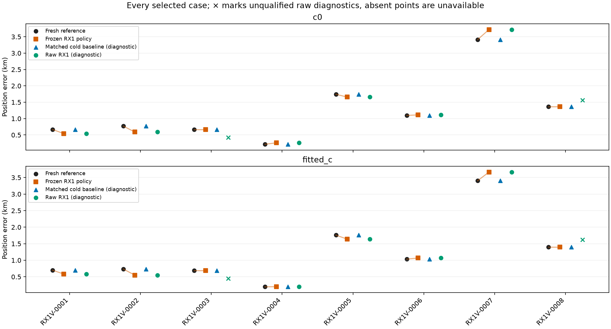
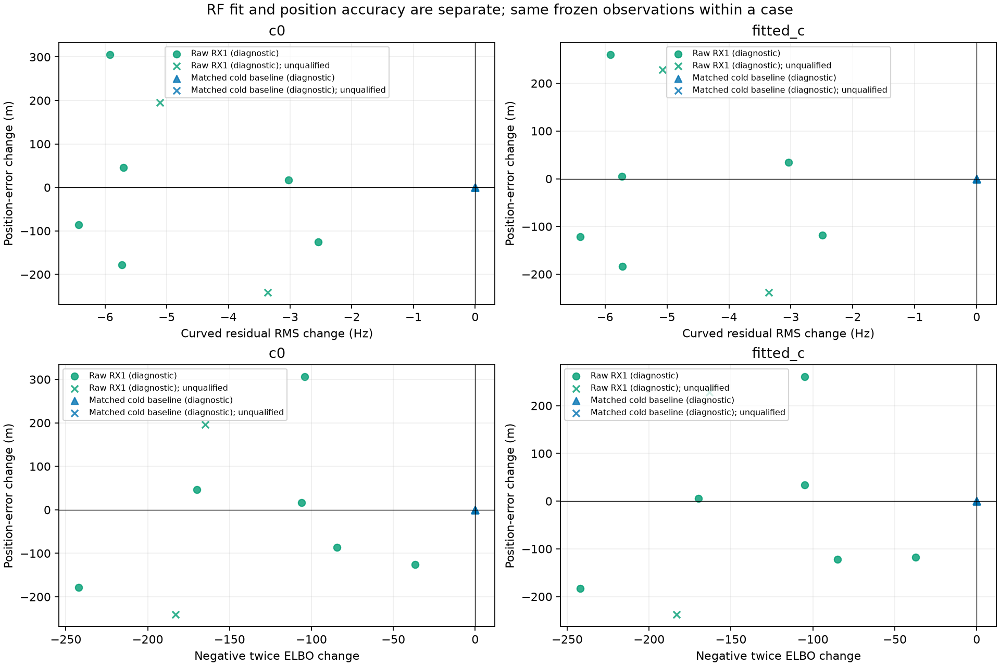

# Frozen RX1 later-panel geographic evaluation

8 selected cases; 6 frozen paired candidate adoptions. Every selected case remains in the table and ECDF denominator.

Primary policy uses the original paired RF/phase decision; failed trials fall back to the exact qualified freshly reconstructed baseline. Unavailable baselines have missing errors, never zero error or a replacement case. Raw RX1 and matched cold results are diagnostic and can be unqualified.

| Arm | Variant | Available / selected | Qualified | Mean error, km | Median, km | P95, km | Improved / worsened / tied paired |
| --- | --- | ---: | ---: | ---: | ---: | ---: | ---: |
| c0 | baseline | 8 / 8 | 8 | 1.242579 | 0.933348 | 2.830039 | 0 / 0 / 8 |
| c0 | primary_policy | 8 / 8 | 8 | 1.239835 | 0.891124 | 2.998630 | 3 / 3 / 2 |
| c0 | matched_cold_baseline | 8 / 8 | 8 | 1.242579 | 0.933348 | 2.830039 | 0 / 0 / 8 |
| c0 | raw_candidate | 8 / 8 | 6 | 1.234156 | 0.852368 | 2.998630 | 4 / 4 / 0 |
| fitted_c | baseline | 8 / 8 | 8 | 1.239054 | 0.884425 | 2.829220 | 0 / 0 / 8 |
| fitted_c | primary_policy | 8 / 8 | 8 | 1.223610 | 0.876498 | 2.955866 | 3 / 3 / 2 |
| fitted_c | matched_cold_baseline | 8 / 8 | 8 | 1.239054 | 0.884425 | 2.829220 | 0 / 0 / 8 |
| fitted_c | raw_candidate | 8 / 8 | 6 | 1.222359 | 0.825465 | 2.955866 | 4 / 4 / 0 |

Means and percentiles use available endpoints only; paired changes use only available reference/result pairs. Missing cases remain explicit in the selected denominator. The full table separates true likelihood membership from postfit acceptance and retains lost baseline IDs; postfit losses are reported rather than introduced as a new policy gate.

Frequency RMS and objective changes are reported separately from position errors. The known site is an evaluation-only assumption for this deployment; later same-site outcomes do not establish accuracy at new locations. Candidate priors, adoption and panel membership were frozen before this evaluation.

See [full table](positions.csv) and [summary/provenance](summary.json).
