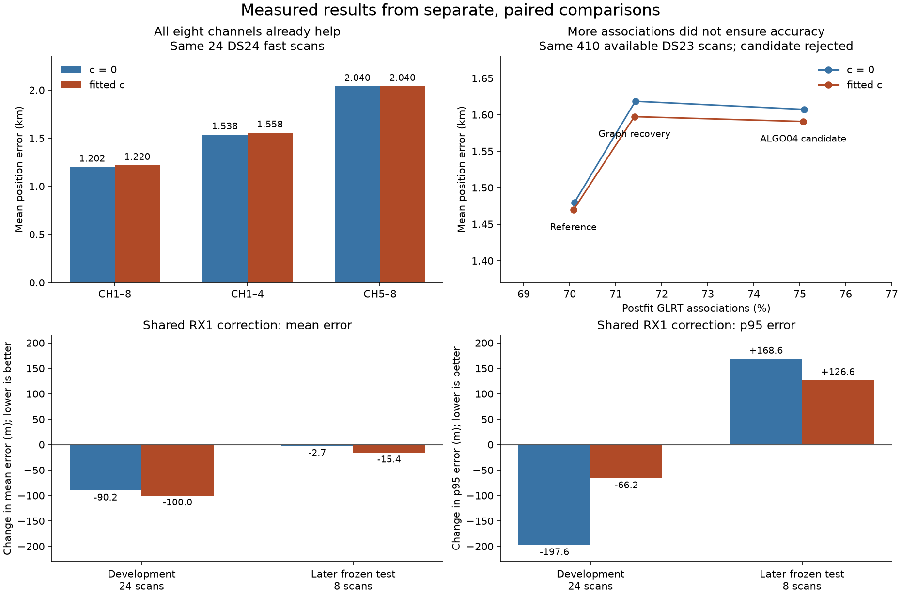

# Fast-scan localization: what the experiments justify doing next

Review completed 2026-10-25. This is a synthesis of saved experiments and three
independent SOL xhigh reviews, not another position-fitting campaign. The
operational reference remains fresh ALGO02-v1 with qualified causal signed
orbital-timing means and equal-assignment-prior family comparison. No new ALGO
is promoted.

The main finding is **weak separation of receiver position from satellite
orbital timing and shape**, with individual association and receiver-model
failures layered on top. This is the strongest demonstrated explanation for
limited precision in the tested fast scans. It is not proof that every real
identity is correct, that the approximation is unbiased, or that we have reached
a physical accuracy floor. We should optimize additional independent position
information and defensible identity, rather than association percentage alone.

## What has actually improved position

These are different matched cohorts. Their changes cannot be added together.
Both c=0 and fitted-c controls are retained in the linked reports.

| Experiment | Measured result | Decision supported |
| --- | --- | --- |
| ALGO01 to ALGO02, 404 common DS23 outputs | Fitted-c mean/median error 1.870/1.602 to 1.508/1.249 km; qualified outputs 407/413 to 404/413. | Meaningful within-site improvement, with an output-qualification tradeoff. |
| Equal-prior family-excluded replacement, 410 available DS23 scans | Mean error c0 1.509 to 1.479 km, fitted-c 1.498 to 1.469 km. Fitted-c improves 40 scans, worsens 34, leaves 336 unchanged. | A modest gain; temporal dependence limits confidence in the aggregate improvement. |
| Full ALGO04 recovery candidate, same 410 scans | Fitted-c associated GLRT 70.08% to 75.08%, mean error 1.469 to 1.591 km, P95 3.157 to 3.473 km; c0 also worsens. | Reject this candidate. More model-compatible points do not establish better localization. |
| DS24 all channels versus halves, 24 usable fast scans | Mean c0/fitted-c: all 1.202/1.220 km; CH1–4 1.538/1.558; CH5–8 2.040/2.040. | All eight channels already help on average, despite regressions on individual scans. |
| Smooth RX1 correction, 24 development scans | Mean c0/fitted-c 1.202/1.220 to 1.112/1.120 km. | A development lead, requiring independent validation. |
| Same frozen RX1 correction, eight later scans | Mean c0/fitted-c 1.243/1.239 to 1.240/1.224 km; P95 2.830/2.829 to 2.999/2.956 km. | The development-sized gain did not replicate, and the tail worsens. Retain the reference. |
| RX2 pilot remeasurement, 322 curves | Median fixed-degree scatter 78.07 to 22.18 Hz, without a qualified cohort accuracy gain. | Cleaner CFO alone has not resolved the problem. |
| Missing parent orbit covariance, four development scans, now complete | Zero of four candidate pairs qualify. Raw rejected mean errors c0 1.373 to 1.381 km, fitted-c 1.405 to 1.415 km. | Close this variant without rollout; the operational policy returns the exact baseline. |

Sources: [ALGO02](https://github.com/misko/leo-tracker-reduxredux/blob/main/reports/2026_10_19_algo02_ds23_full/README.md),
[family comparison](https://github.com/misko/leo-tracker-reduxredux/blob/main/reports/2026_10_22_ds23_family_cavity_full_assessment/README.md),
[rejected recovery](https://github.com/misko/leo-tracker-reduxredux/blob/main/reports/2026_10_23_algo04_candidate_full_ds23/README.md),
[channel comparison](https://github.com/misko/leo-tracker-reduxredux/blob/main/reports/2026_10_24_ds24_channel_halves/README.md),
[receiver development](https://github.com/misko/leo-tracker-reduxredux/blob/main/reports/2026_10_24_ds24_receiver_orbit_controls/README.md),
[later validation](https://github.com/misko/leo-tracker-reduxredux/blob/main/reports/2026_10_25_ds24_phase_shape_validation/README.md),
[RX2 measurements](https://github.com/misko/leo-tracker-reduxredux/blob/main/reports/2026_10_19_ds23_rx2_measurement_cohort/README.md),
and [completed orbit experiment](https://github.com/misko/leo-tracker-reduxredux/blob/e80f6d6776bd429936119fe15332960c36824269/reports/2026_10_25_ds24_parent_orbit_uncertainty/README.md).

Polynomial membership, satellite-compatible postfit extensions, and points
actually contributing to the position likelihood are different counts. The
current 24-scan DS24 position likelihood uses 78,067/108,600 original GLRT
winners, 71.8849%. Early approximately 90–93% DSX01 polynomial membership does
not contradict this smaller satellite-associated fraction. The 24 cases are
the usable saved fast inputs from a frozen 34-recording cohort, not all 34
successfully localized recordings.

The original graph, EM, Hough and multiple-hypothesis approaches established
that much of the GLRT evidence can be represented by smooth polynomial
fragments. The graph approach remains a useful construction choice. Later
work on phase refresh, shared satellite corrections, robust priors and family
replacement improved the satellite-to-position stage. A new polynomial fitter
alone would not address the demonstrated orbital ambiguity.

## What the results say about the bottleneck

A receiver displacement and a small displacement of a satellite along its orbit
can produce similar Doppler changes. More channels observing that satellite
share its orbital error. On DS24 the strongest timing/weak-position correlation
has median 0.935; the two channel halves share a median 11 calibration families,
and their least-constrained directions differ by only 17.7 degrees.

The following local calculation treats selected nuisance variables as known.
It shows where information is lost, not an available algorithm or achieved
accuracy. Median fitted-c weak-direction scale changes from 534 m to 386 m with
receiver terms known, 110 m with orbital timing known, and 56 m with timing and
shape known. Identities, fitted noise and local geometry remain conditioned on.

[Diagnostic source](https://github.com/misko/leo-tracker-reduxredux/blob/main/reports/2026_10_24_ds24_bottlenecks/README.md).
Here orbital timing means a displacement along the predicted trajectory, not
RF carrier phase or the downlink frame clock.

The conditional known-label fast simulations support this interpretation:
noiseless positions recover within 0.8–2.5 m, whereas declared stochastic
nuisance/noise draws can pass all gates and still give 1.09 km error. Their
generating and approximate inference laws are not identical; they are not an
irreducible-error bound or full calibration test. Separately, 30 targeted
continuous restarts agree within 2.06 cm, and four half-channel assignment
transfers yield no qualified better full-data solution. These results make
generic continuous multistart low priority for those tested assignments; they
do not exclude a different discrete satellite solution.

Sample rate remains unidentified: the current usable fast cohort is entirely
10 MS/s. The nominal 40-degree feed separation changes sky coverage but is not
a measured bearing or a separated geolocation baseline. Neither a higher sample
rate nor a different mount angle has a demonstrated accuracy gain in this study.

The completed covariance experiment changes modeled information materially but
does not solve the problem. All 16 matched baseline/candidate fits finish;
new covariance affects 33/89 scan-family instances. All four candidates fail
the frozen conservative residual requirements, and raw mean accuracy is about
8–10 m worse. Letting unsupported new correction means explain residuals makes
primitive residual tests pass but fails the existing independent-owner support
requirement. This is evidence of model sensitivity, not grounds to loosen gates.
It also does not establish that zero physical orbit variance is correct.

## Recommended next experiments, in order

### 1. Make satellite discrimination reliable, then test difficult alternatives

The recent conditional pilot puts all eight true physical sources first in
the ordinary full-catalogue screen and raw exact ranking. However, only seven
complete physical orderings qualify, and none of four polynomial-null orderings
qualifies numerically. One losing competitor crossing the horizon invalidates
the whole ordering; extremely poor physical fits expose integration failures.
These mostly easy positives and broad nulls do not validate real near-ties.
These failures occur in the new research identity comparison; they are not an
established explanation for the existing production position errors.

First replay those exact saved observations and covariance contexts as
regression cases. Integrate only physically visible phases while keeping the
original phase-prior normalization; do not discard inconvenient competitors or
renormalize away their invisible probability mass. Handle narrow peaks and
large score ranges numerically, with an independent reference. A rigorous bound
may establish that a losing alternative cannot change a decision; a loose
relative tolerance on a million-unit score cannot substitute for that bound.
The visibility/event-support change must be separately versioned; it is not
merely an arithmetic repair.
For a generative control, zeroing invisible phases represents the joint
observation/detection likelihood. Preserve its no-detection probability, or
select fully visible generating cases before drawing observations; do not
silently change to a detection-conditioned prior or reroll invisible draws.

Then freeze a small fresh control with physically confusable catalogue pairs,
an explicit unresolved alternative, ordinary nomination and no forced true
identity. The current generator uses the full parent calibration while scoring
removes shortlisted parent families after observing the target. That difference
must be isolated. A fixed background mean/covariance can supply a minimal
consistent conditional target-law control; it is not a full shared-family
physical simulation. Report the existing two-stage path separately.

**Decision:** Compare ordinary nomination with a known-label control on the
same observations and exactly the same conditional background and law, differing
only in label availability. Keep the response-dependent cavity path as a separate
sensitivity. If ordinary nomination fails while that known-label control
succeeds, work on nomination/assignment. If both fail similarly, concentrate on
information or model approximation. Numerically repairing the test is not itself
a claimed localization gain. Keep the first replay and control bounded to two
layouts and minutes, rather than a new dataset campaign.

### 2. Recover a curve that adds independent geometry

The completed 26-source inventory already shows why longest-first recovery is
insufficient: information and point count select different sources in three
of four scans. After nuisance uncertainty, the information choices imply only
about 5, 21, 18 and 127 m reductions in a local weak-direction SD. Those are
conditional design changes, not improvements in actual position error.

DS24-0013's proposed 60108 source is the strongest existing lead. Four proposed
owners contain 189 distinct points, but they are all RX1 and were already found
using that label. The eight-candidate/null discovery and three whole-owner
conditional comparisons have already run, with 53 discovery IDs and 85/36/15
held IDs, shared phase/modes/radio covariance and 81 paired alias hypotheses.
All favor 60108 within that finite pool. Repeating these same owners is not new
identity evidence. First establish whether another complete witness exists,
selected by metadata independently of the chosen label, preferably on the other
receiver. If none exists, declare the prerequisite unavailable. A second owner
is not automatically an independent orbit measurement; shared uncertainty must
remain. Only after identity qualification, compare one information-selected
source with one length-selected source on the same pool and budget.

**Decision:** Proceed to a small matched position comparison only if the source
has identity support and non-negligible additional information. Otherwise leave
it unresolved and move on. A coverage target cannot override that result.
[Inventory and scores](https://github.com/misko/leo-tracker-reduxredux/blob/main/reports/2026_10_25_ds24_nomination_information/information/FINDINGS.md).

### 3. Test the specific omitted phase–shape coupling

Earlier nonlinear-phase work already evaluated 829,440 draw-evaluations and
found at most 22.8 m predicted local movement with shape design and noise
precision held fixed. Repeating that integral is unlikely to answer a new
question. A distinct bounded test targets ACTIVE-PARENT calibration: evaluate
orbit-mode design at each sampled orbital timing value under the same prior law,
rather than freezing its design at one timing estimate. The predictive-target
and identity kernels already evaluate B(phi) at each nonlinear phase node;
repeating those integrals would not address this missing parent control.

Use a few fixed RF-selected positions on two fast contexts and two independent
numerical rules before any optimizer run. Keep normalization, aliases, data,
prior domains and both c arms matched. **Stop** if the objective-gradient change
is negligible or numerically unresolved. A useful result must distinguish an
approximation effect from new model flexibility; it must not narrow a prior
because the estimate moves toward the evaluation coordinate.

### 4. Investigate an additional observable only through a concrete feasibility test

If the first three routes do not supply enough information, independent bearing
or orbit information is more promising than another generic CFO refinement.
A separate published experiment extracts direction of arrival as well as Doppler
and finds lower sensitivity to ephemeris mismatch. Its additional measured
observable is the relevant difference; its accuracy is not a forecast for our
hardware. [El-Kouba et al., ION 2025, abstract](https://www.ion.org/publications/abstract.cfm?articleID=20327).

For the current corpus, first establish whether existing pose, antenna-pattern
and power records could support a calibrated bearing likelihood. Nominal feed
angle alone cannot. Stop the feasibility branch if those inputs are absent.
Frame timing is also not an immediate pseudorange solution: measured Starlink
frame clocks exhibit discontinuities and loose time discipline.
[Qin et al.](https://arxiv.org/abs/2501.05302).
Differential ephemeris correction studies use a separate receiver at a known
position, which our co-located feeds do not provide.
[Hasan et al.](https://arxiv.org/abs/2409.05026).
No new RF acquisition, hardware change, trajectory prototype or stationary
multi-scan pooling is part of this recommendation.

## Work to stop repeating, and how to qualify a real gain

Do not rerun unchanged generic multistart, blanket phase-prior narrowing,
unrestricted recovery, broad receiver flexibility, active-family-only soft
identity fitting or Gaussian log-volume removal. These already have negative,
mixed or small measured effects. Physical coupled sample-clock scale/time
corrections were also tested on DS23-0257/0202 with modest changes, so they are
not an unexplored explanation. [Methods inventory](https://github.com/misko/leo-tracker-reduxredux/blob/main/reports/2026_10_25_ds24_next_directions_review/methods/FINDINGS.md),
[sample-clock control](https://github.com/misko/leo-tracker-reduxredux/blob/main/reports/2026_10_19_ds23_robust_predictive_linear/README.md).

Cross-family timing dependence also has prior tests: geometry-dependent Student
covariance qualified 0/24 contexts, while a marginal-preserving Gaussian copula
qualified 2/24 with final latent correlation 0.03. A causal neighbor-mean
forecast mildly worsened the full-410 fitted-c policy mean, 1.498002 to 1.500347 km
(69 forecast-qualified, 67 paired-valid). These are mixed proxy results, not
proof of independence or a reason to repeat generic cross-family covariance.
[Exact prior-work inventory and saved evidence](reviews/cross_family_prior_art.md).

The next wave should have one implementation agent on identity qualification,
one on information-selected existing evidence, and one independent reviewer on
mathematics and matched controls; phase–shape work follows when a slot opens.
Set a small fixed compute budget and a decision for each experiment. Keep all
failures and exact reference fallbacks. Only a qualified mechanism leads to a
broader frozen comparison.

Every localization comparison keeps matched c=0/fitted-c observations,
candidates, other priors and search budgets. Report actual position-likelihood
membership, postfit-only associations, frequency fit, qualification, mean,
median and tail position error separately. Current DS24 examples, including
the eight later validation cases, have now been examined; they are development
data for future choices. A new validation claim requires an exposure-checked
untouched time/session block, and new-location generalization remains untested.

The inference region remains 25 by 25 km centered at 37.906, -122.545. The
evaluation coordinate 37.849061591561885, -122.48574968092912 is used only after
RF decisions are fixed. Causal TLEs and history remain mandatory. A result that
only improves one selected scan, association percentage, or frequency fit is
not enough to promote the next ALGO.
Promotion additionally requires a broader matched full-DS23/DS24 comparison and
confident full-DS23 gain. Exposed development results and fresh validation must
remain separately identified.

## Review artifacts

The two figures are byte-preserved from the
[previous evidence synthesis](https://github.com/misko/leo-tracker-reduxredux/blob/339fdd0f53b8fc8f5fc3822273294716fcc0422d/reports/2026_10_25_ds24_evidence_synthesis/README.md).
Their published source bindings and plotting code remain authoritative. The
finished parent-covariance report adds diagnostic geography to that synthesis's
RF checkpoint; the reference-policy decision is unchanged. Independent review notes and a publication manifest accompany this
report. No numerical inference source, production behavior or scientific
fixture was changed for this review.

[Scientific review](reviews/scientific.md) ·
[Independent audit/history review](reviews/audit.md) ·
[Conditioning and evidence review](reviews/conditioning_and_evidence.md) ·
[Replay limits](REPLAY.md) · [Source bindings](source_manifest.json) ·
[Publication manifest](publication_manifest.json).
