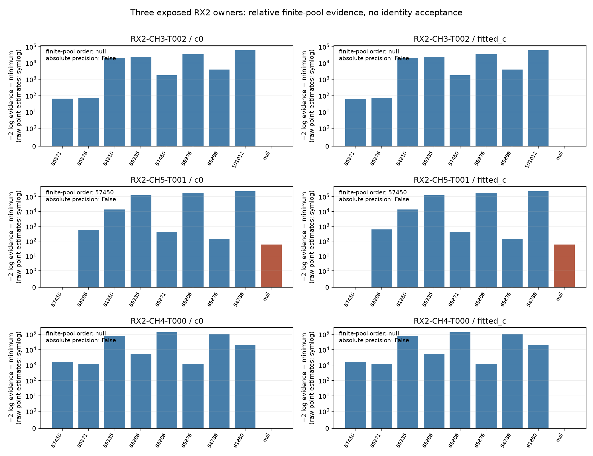
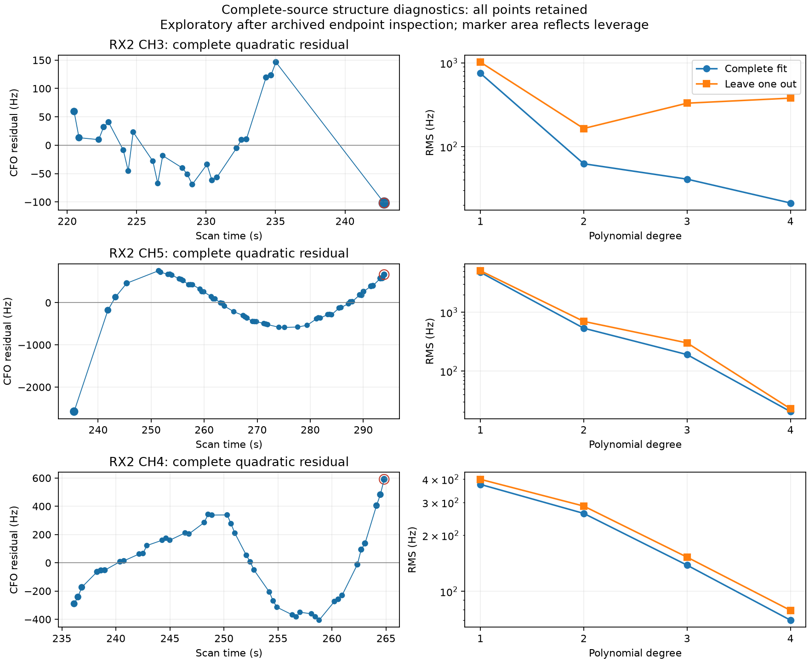

# RX2 witness test: two unresolved curves and one conditional physical lead

> **Correction (2026-10-25):** The 2,442.510 Hz archived residual below was
> carried unchanged when the CH5 row was relabeled; it is **not a verified
> 57450 fit residual**. See the [provenance correction](../2026_10_25_ds24_ch5_prediction/mechanism/FINDINGS.md)
> and [exact original files and annotation hashes](../2026_10_25_ds24_ch5_prediction/correction/annotation_receipt.json).
> The new catalogue/evidence results are unaffected. The original report is
> preserved at [commit 392faed8](https://github.com/misko/leo-tracker-reduxredux/blob/392faed8c5119279c832a56443aae77d76eb090e/reports/2026_10_25_ds24_rx2_witness/README.md).
> This report's original publication manifest and scientific seals bind that
> immutable commit's bytes, not these subsequently annotated Markdown files.

The three complete RX2 sources do **not** corroborate the historical 60108
assignment. Ordinary nomination searches all 1,487 causal candidates and omits
60108 from every top eight. In the subsequent matched finite-pool comparison,
the polynomial unresolved model wins for CH3 and CH4; physical candidate 57450
wins for CH5, in both c arms. All six model orders are numerically certified,
while the stronger absolute-score precision criterion is unmet. No identity
is operationally accepted, no position is fitted and the reference is unchanged.

The user's broader question—what the accumulated localization experiments
justify trying next—is addressed in **[the evidence review and ranked decisions](REVIEW.md)**.
It separates established ALGO02/family-comparison gains from failed recovery
and receiver transfers, and explains why timing/shape ambiguity, defensible
identity and additional geometry matter more than association percentage alone.
[Independent skeptical review](context/NEXT_DIRECTIONS.md) and
[conditional-model design](audit/CONDITIONAL_DESIGN.md) give the remaining
falsification questions. This report adds one bounded real-data result to that
review; it makes no new validation or accuracy claim.

The existing information calculation makes the main bottleneck visible: local
weak-position scale falls from about 534 m to 110 m with orbital timing known,
and 56 m with timing and shape known. These are conditional design diagnostics,
not achieved position errors or a calibrated physical floor. The figure is
byte-preserved from the [prior review](https://github.com/misko/leo-tracker-reduxredux/blob/82bc36cbd138b7024bd7af4f988032f1da5255cd/reports/2026_10_25_ds24_review_next_actions/README.md),
with the original [information study](https://github.com/misko/leo-tracker-reduxredux/blob/main/reports/2026_10_24_ds24_bottlenecks/README.md)
remaining authoritative.

## What was tested

All three metadata-frozen unused curved RX2 owners remain complete: CH3/T002
has 24 native IDs, CH5/T001 has 57 and CH4/T000 has 43. Their 124 IDs are mutually
unique and outside both baseline accepted ledgers and the historical 189 RX1
IDs. The baseline still contains 3,037 curved +747 predictive IDs, with zero
postfit-only accepted IDs, in each c arm. The sources were previously
graph-nominated and information-ranked under rejected labels: they are reused
development evidence, not unseen measurements.

Both c=0 and fitted-c use identical observations, the same saved c0 RF position,
causal priors and matched exact candidate pools/budgets. Each owner's ordinary
c0 top eight supplies that pool in both arms; the fitted-c ordinary screen is
also reported. Archived labels are neither inputs nor reserved candidates.
No source is pooled, trimmed, replaced or chosen because it favors 60108.
The saved graph gauge subtracts two alias periods from native CFO for every
selected point. A coarse alias of zero is relative to that graph gauge, not
an absolute native-frequency alias; both models use the same frozen gauge
and finite alias measure.

Original-parent nomination and exact scoring are distinct stages. Each exact
comparison removes its own eight shortlisted families from curved and predictive
parent evidence, then uses that common per-owner cavity for every physical
candidate and the proper polynomial null. Shared-radio covariance, the full
three physical modes, nonlinear phase, a separate 300 Hz source constant and
the same finite alias measure are retained. Invisible nominal phases contribute
zero without renormalizing away their prior mass. This is a declared conditional
comparison, not a full generative closure or calibrated clutter model.
[Scientific protocol](scientific/PROTOCOL02.md) · [native/exposure checks](context/FINDINGS.md).

## All three outcomes

The margin below is the winner's certified lower log evidence minus the largest
competing upper bound, including the proper null and all eight physical models.
It is a numerical ordering margin under this model and pool, not posterior
identity probability or an empirical false-association rate.

| Complete owner | IDs | Ordinary 60108 rank, c0 / fitted c | Finite-pool winner, both arms | Minimum log-evidence margin, c0 / fitted c |
| --- | ---: | ---: | --- | ---: |
| RX2 CH3/T002 | 24 | 87 / 87 | Unresolved polynomial | 21.214 / 20.866 |
| RX2 CH5/T001 | 57 | 197 / 197 | Physical 57450 | 29.232 / 28.446 |
| RX2 CH4/T000 | 43 | 143 / 145 | Unresolved polynomial | 34.421 / 30.730 |

All **6/6 owner-arm contexts and 48/48 physical-candidate contexts** complete.
The independent terminal audit reproduces all six finite-pool order
certificates; none of the 48 physical scores meets the stronger
absolute-score precision requirement: that requires the reported objective
within 0.001 of both ends of its full-support enclosure plus required reference
checks. Wide individual bounds can still separate competing models. Do not
interpret this distinction as either precise individual scores or failed
ordering. The absolute-precision and finite-pool-order flags remain separate.

The top ordinary nominees reproduce the old rejected labels: 65871 for CH3 and
57450 for CH5/CH4. CH4's best raw physical model changes to 65876/65871 across
the c arms, but the unresolved model wins both comparisons. Absence of 60108
from the coarse shortlist is not an exact all-catalogue exclusion; it supplies
no warrant to force the label back into this test.

CH5 is the concrete surviving physical-model question. The same old 57450 label
previously left 2,442.5 Hz archived nomination RMS. That residual and the new
marginal evidence use different conditioning and nuisance treatment; they are
not an accuracy comparison or evidence that the old rejection was erroneous.
Before using this source in a position factor, explain what changed in the
background, timing, physical modes and source constant, and whether those
corrections have independent support. A finite-pool win alone does not supply
that calibration. Its exact cavity removes four active families, 694 curved
and 129 predictive parent IDs. Saved scores do not isolate posterior phase,
alias, mode or constant contributions, so the cause of the preference remains
unassigned. Passing the remaining parent gates does not establish adequacy of
the new target. [Detailed scientific findings](scientific/FINDINGS.md) preserve
the conditioning and diagnostic-residual distinctions.
57450 has **zero accepted curved or predictive parent owners/points**. Its two
historical CH4/CH5 graph owners were rejected, and CH4 now favors the null.
There is no already accepted 57450 owner to supply corroboration. Availability
of another independently selected complete owner must be checked, not inferred
from this finite-pool win. The other two frozen owners are available predictive
challenges; CH4's existing null preference is adverse evidence to retain.

The scientific run uses **450.754 cumulative worker-seconds / 228.172 s wall**
under the 600-worker-second cap, at most two workers and one BLAS thread each.
No new RF, IQ processing, discovery-conditioned evidence, position fits or
geographic evaluation occurs. All original accepted IDs remain operationally
unchanged. [Execution ledger](scientific/execution.json) · [RF seal](scientific/RF_seal.json).
The [independent terminal audit](audit/terminal.json) passes all 115 checks,
including input/source bindings, native ownership and numerical order replay.

## Why smooth curves are not enough

The archived native CFO and rejected-model residuals show three different
failure signatures, with no new orbit fit:

CH3's final point is a genuine native maximum-margin peak after a 7.795 s gap.
Quartic leverage is 0.99917: 21.22 Hz complete RMS hides 379.73 Hz leave-one-out
RMS. Yet substantial quadratic curvature remains without it (−33.94 versus
−39.67 Hz/s²). It is an influential continuation, not proof that all curvature
is spurious. CH4 has distributed residual correlation (0.823) rather than one
dominant endpoint. CH5's quartic is comparatively stable (20.41 /22.81 Hz
complete/leave-one-out RMS). A join, smooth mismatch and measurement bias remain
competing explanations; these selected diagnostics identify no unique cause.

The complete-source diagnostic takes 1.111 s, conservatively below 3.112 s
including setup/tests under a 30 s cap. Two owned tests and all 496 direct versus
hat-matrix leave-one-out checks pass. Every point remains in the physical model
comparison. [Structure findings and provenance](structure/FINDINGS.md).

## Decision and limits

Close the proposed 60108 RX2 corroboration route here. Keep CH3 and CH4
unresolved under this comparison. The concrete next test, separately frozen,
is whether CH5's 57450 posterior predicts the **other complete owners**: retain
CH4 especially, whose separate result favors null, and CH3 as well. Keep D=CH5
physical under 57450 in every model; compare W sharing that family against
W unresolved and its own ordinary alternatives. Preserve shared orbit/radio
covariance, separate constants and joint-minus-D evidence. Failure rejects that
same-family extension, without proving CH5's identity false or allowing W to be
dropped. No already accepted 57450 owner or geographic fit is required to pose
this predictive challenge. It has not run. Multiplying separate source scores
would answer a different question.

The broader next choices and explicit stopping rules are in [REVIEW.md](REVIEW.md):
first explain CH5's old/new conditioning, then test independent complete-owner
prediction if warranted; a small same-law confusable-identity control; and the
specific untested active-parent phase/shape approximation. Additional geometry
requires defensible identity. Generic restarts, unchanged receiver flexibility, blanket recovery
and repeated easy synthetic positives have weak priority. A new ALGO requires
broader matched full-DS23/DS24 evidence, adverse-tail reporting and an
exposure-checked unused validation block. These familiar scans cannot provide
that fresh validation.

[Replay limits](REPLAY.md) describe external corpus/runtime dependencies.
The original upstream tracking authority file is permission denied here; its
readable exported bytes match the archived source digest. The context audit
also preserves incidental raw-field access, and all prelaunch/setup failures
remain in the evidence. These limitations do not change the earlier frozen
all-three selection or create a new acceptance route.
