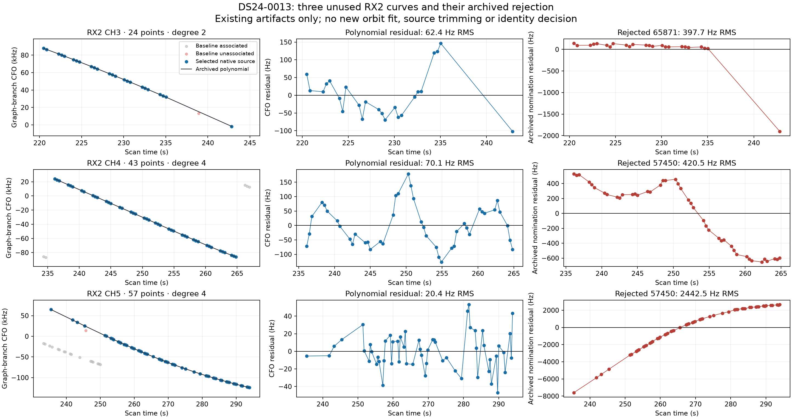

# Archived curves distinguish graph quality from satellite mismatch

This replot reads existing measurements, Legendre polynomial coefficients and
rejected nomination residuals. It runs no new polynomial or orbit fit, no new
candidate scoring and no position evaluation. Exact native-ID/time order and
stored residual RMS are checked before plotting.

| RX2 source | Points | Graph degree | Polynomial RMS | Archived rejected nomination RMS | Existing graph quality |
| --- | ---: | ---: | ---: | ---: | --- |
| CH3/T002 | 24 | 2 | 62.45 Hz | 397.70 Hz under 65871 | No structure flag |
| CH4/T000 | 43 | 4 | 70.08 Hz | 420.54 Hz under 57450 | Adjacent residual correlation flagged, 0.823 |
| CH5/T001 | 57 | 4 | 20.41 Hz | 2442.51 Hz under 57450 | No structure flag |

The first column includes original GLRT winners in each channel/time region.
Gray means baseline associated, red means baseline unassociated, and blue
identifies the selected complete source. All three selected sources are unused
by both baseline arms. A uniform -454545.454545 Hz shift puts every contextual
measurement on the source's stored graph branch; no point is individually
wrapped to an orbit or polynomial. The middle column replays the saved
Legendre polynomial. The right column is the exact archived rejected
nomination residual, not a newly fitted or accepted orbit.

CH3's archived orbital failure is concentrated at its isolated last point,
after a roughly 7.8 s gap. This motivates investigating endpoint leverage and
source ownership; it does not establish a bad join or authorize deleting that
point. CH4 already contains a polynomial residual-structure warning, so active
curvature is not equivalent to clean residuals. CH5's very smooth source has a
large systematic discrepancy under its old nominee, making identity/model
comparison particularly informative.

These findings do not alter the three-owner nomination pool, priors or budgets.
Historical labels are explanatory metadata and are not inserted into the new
catalogue screen. The original nominees and current scores use different
conditioning contexts and must not be compared as an accuracy improvement.

The graph coefficient convention is implemented in
`src/leo/analysis/polynomial_tracklets.py:_predict`: normalized Legendre
coefficients. An initial plotting attempt used monomials and stopped at its RMS
assertion before saving a figure; correcting that convention reproduces all
three stored RMS values to better than 1e-7 Hz. No archived data changed.

[Source and checks](review_archived.py), [summary/input hashes](summary.json),
and [artifact hashes](seal.json) retain the provenance.
