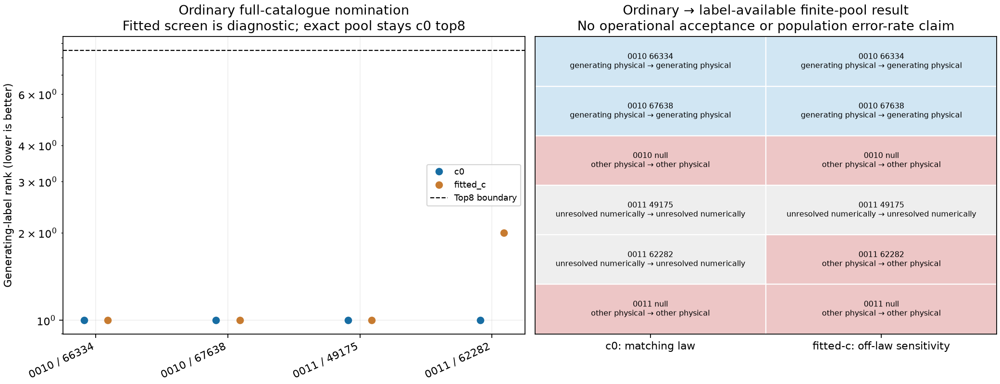

# DS24 source challenge: a specific ownership lead and limits of identity ranking

Completed 2026-10-25. Two bounded SOL branches test the next questions from the
[preceding complete-source study](../2026_10_25_ds24_source_coherence/README.md).
An independent SOL reviewer audited both. The current position estimator,
accepted observations and reference results are unchanged.

**The real-data screen points to different satellites on the two ends of one
rejected track. The synthetic control shows that ranking a satellite first
does not by itself establish an identity.** Neither experiment fits position
or demonstrates a localization gain. The accompanying
[cumulative review and next directions](REVIEW.md) explains how these findings
change the research priorities.

## Real source: prefixes and suffixes nominate different families

The input is the original 43-point DS24-0013 RX2 CH4/T000 owner. We screen its
whole curve and both portions at the three already declared cuts after points
14, 21 and 29, in c=0 and fitted-c arms. All 1,487 causal catalogue entries
participate in ordinary nomination. The existing CH5-discovery-cavity radio
background and common saved c=0 RF position are retained.

| Context | Original points | Span, s | Top nominee in both arms | Original duration and curvature prerequisite |
| --- | ---: | ---: | ---: | --- |
| Complete owner | 43 | 28.699 | 57450; 65871 second | Passes these two checks; remains originally structure-flagged |
| Cut 14 prefix / suffix | 14 / 29 | 8.858 / 18.424 | 57450 / 65871 | Neither portion passes |
| Cut 21 prefix / suffix | 21 / 22 | 14.524 / 13.820 | 57450 / 65871 | Neither portion passes |
| Cut 29 prefix / suffix | 29 / 14 | 20.195 / 8.148 | 57450 / 65871 | Neither portion passes |

The overlays are approximate phase proposals with the fixed radio mean, not
exact propagated fits at those phases or newly qualified gate residuals.
Whole-source rank one still has about 9.8 kHz unadjusted overlay RMS. A preferred
candidate can therefore be an inadequate explanation. Short pieces may fit
closely but do not acquire permission to calibrate frequency offsets or drifts.
Overlapping cuts are not independent witnesses.

This gives a concrete next comparison: whole 57450, whole 65871, a joint
57450/65871 split and proper unresolved alternatives, on every original point
with shared uncertainty and normalized cut weights. No such second-stage fit
was performed here. The separate CH3 owner's earlier 65871 nomination is an
exposed prior lead, not a new independent confirmation.

All 14 screens completed in 4.440 cumulative numerical seconds including
preparation and nine owned tests. The independent audit passes 176 checks.
[Full findings, fitted-c plot and tables](portions/FINDINGS.md).

## Matched-law control: successful nomination does not guarantee identification

We generated six curve vectors using the archived source layouts of DS24-0010
and DS24-0011: two physical satellites and one deliberately close proper
unresolved model with polynomial perturbations in each layout. The satellite
pairs were chosen using geometry
before drawing frequencies. The ordinary catalogue screen received no truth
labels. Generation and exact c=0 scoring use the same frozen Gaussian radio
background, physical phase/shape priors, aliases and nominal visibility law.

The fitted-c comparison scores those same vectors with its own radio background.
It is an explicitly off-law sensitivity, not a second matching-law experiment.
Both arms use the same c=0 shortlist, observations and candidate budget.

| Layout and generating model | c=0 ordinary nomination | Exact finite-pool result, c=0 |
| --- | --- | --- |
| 0010: physical 66334 | True label ranks first | Correct physical winner; minimum log-evidence margin 1.128 |
| 0010: physical 67638 | True label ranks first | Correct physical winner; minimum margin 1.065 |
| 0010: close unresolved model | No generating satellite label | Physical 67638 wins; minimum margin 0.698 |
| 0011: physical 49175 | True label ranks first | Evidence bounds overlap; no proved winner |
| 0011: physical 62282 | True label ranks first | Evidence bounds overlap; no proved winner |
| 0011: close unresolved model | No generating satellite label | Physical 49175 wins; minimum margin 0.357 |

The four generating physical labels all enter the ordinary shortlist, so no
nomination failure or benefit from truth-label backfilling was exercised.
The close nulls demonstrate overlapping model explanations. These are density
orders within eight physical candidates plus the declared null, not an
operational acceptance rule, posterior identity probabilities, catalogue-wide
orders or a population false-association rate.

The off-law fitted-c sensitivity preserves the 0010 winners; in 0011's second
physical trial it proves 56134 over the generating 62282, with a small 0.071
minimum log-evidence margin. This shows sensitivity to the background in this
constructed example; it does not establish that fitted-c harms real associations.

All six vectors, 12 arm-trial slots and 96 physical candidate contexts complete
without failure. The total numerical budget used is 327.907 worker-seconds,
including preparation and owned tests, below the 600-second cap. Run wall time
is 241.414 seconds. Six owned tests and 191 independent terminal checks pass.
None of the 96 physical contexts reaches the separate strict absolute
−2 log-evidence objective-precision target; full-domain bounds nevertheless prove the
reported orders. An overlapping bound is preserved as unresolved.

[Complete synthetic findings and figures](matched_law/FINDINGS.md),
[frozen protocol](matched_law/PROTOCOL.md),
[independent terminal audit](audit/matched_law_terminal.json).

## Additional observables and implications for the next iteration

A bounded read-only inventory of the 0010 and 0013 fast exports finds native
sample epochs, host clock anchors and detector scores, but no already-qualified
transmit-time, calibrated power/bearing or inter-receiver phase observable.
The current installation authority records a nominal 40° feed angle while
installed elevation and RF baseline remain unknown. This is a narrow metadata
availability result, not proof that every raw companion lacks usable evidence.
[Inventory and limitations](METADATA_FINDINGS.md).

The main next research priority is handling ambiguous new-family/source
assignments with an unresolved outcome, then seeking evidence that adds a new
position constraint after orbital and receiver uncertainty. The CH4 split
hypothesis deserves one bounded closure test, with a stop if it remains
ambiguous. It should not displace broader stage diagnosis or become a blanket
track-splitting policy. [Detailed recommendations](REVIEW.md).

No new RF, IQ campaign, post-scan TLE, evaluation GPS, position fit, association
adoption or ALGO release occurs in this iteration. Both real-data arms preserve
the same observations, candidate catalogue, other priors and budget. The fixed
RF position used for the diagnostic is an inherited estimate, not truth. The
operational region remains the 25×25 km box centered at 37.906,-122.545.

[Replay and publication scope](REPLAY.md), [coordinator plan](COORDINATOR_PLAN.md),
[portion terminal audit](audit/portions_terminal.json) and the linked frozen
artifacts preserve complete outputs and limitations. Hashes identify externally
stored raw inputs; they do not make this report a standalone raw-corpus archive.
