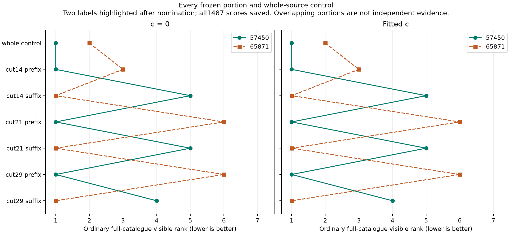

# Fast-scan localization review and next decisions

Reviewed 2026-10-25. This assessment combines the published DS23/DS24 comparisons,
the latest complete-source diagnostics and independent SOL reviews. It makes no
new algorithm promotion. The retained reference is fresh ALGO02-v1 with qualified
causal signed orbital-timing means and equal-assignment-prior family comparison.

The largest demonstrated improvement came early, from ALGO01 to ALGO02. Recent
work has been valuable mainly for eliminating explanations and exposing limits
of association decisions. It has not delivered another broadly validated gain of
similar size. We should now require each experiment to resolve a concrete
decision about the position estimator, and avoid allowing a single difficult
curve to become an indefinitely expanding project.

## What has actually improved

These are separate matched comparisons, not successive additive gains. The two
columns preserve the required c=0 versus fitted-c calibration ablation.

| Experiment | Mean position error, c=0 | Mean position error, fitted c | Assessment |
| --- | ---: | ---: | --- |
| ALGO01 to ALGO02, 404 common DS23 outputs | 1.870 to 1.520 km | 1.870 to 1.508 km | Substantial retained gain. Qualification fell from 407/413 to 404/413. |
| Signed-prior reference to equal-prior family comparison, 410 DS23 scans | 1.509 to 1.479 km | 1.498 to 1.469 km | Modest improvement; temporal-block uncertainty limits generalization. |
| DS24 CH1–8 / CH1–4 / CH5–8, same 24 usable scans | 1.202 / 1.538 / 2.040 km | 1.220 / 1.558 / 2.040 km | All channels already help on average. This is 24 usable scans from 34 recordings. |
| Smooth RX1 correction, 24 development scans | 1.202 to 1.112 km | 1.220 to 1.120 km | Promising development result. |
| Same frozen RX1 policy, eight later scans | 1.243 to 1.240 km | 1.239 to 1.224 km | Development-sized gain did not transfer; both P95 tails worsened. Retain reference. |

Sources: [ALGO02](../2026_10_19_algo02_ds23_full/README.md),
[family comparison](../2026_10_22_ds23_family_cavity_full_assessment/README.md),
[channel comparison](../2026_10_24_ds24_channel_halves/README.md),
[later receiver test](../2026_10_25_ds24_phase_shape_validation/README.md).

Three different coverage measures must stay separate:

* **Polynomial membership:** the original four constructors reached roughly
  90–93% on DSX01 S01. This establishes smooth paths, not satellite identities.
* **Postfit satellite association:** points may be judged compatible after the
  location fit without contributing to that fit.
* **Actual likelihood membership:** the reviewed 24-scan DS24 reference uses
  78,067/108,600 original GLRT winners, or 71.8849%, to fit position.

The full DS23 ALGO04 recovery candidate increases fitted-c association from
70.08% to 75.08%, while mean error worsens from 1.469 to 1.591 km and P95 from
3.157 to 3.473 km. Its c=0 comparison also worsens. That is a direct reason not
to use 90% association as the acceptance objective. Preserve the aspiration,
but judge recovered evidence by reliability and added position information.
[Full recovery comparison](../2026_10_23_algo04_candidate_full_ds23/README.md).

## Which bottlenecks are supported?

### Position and orbital timing are difficult to separate

In the local DS24 diagnostic, the median weak-direction uncertainty scale is
534 m under the model, 386 m when receiver terms are treated as known, 110 m
when satellite timing is treated as known, and 56 m when timing and shape are
both known. The median strongest timing/weak-position correlation is 0.935.

Intuitively, moving the receiver and shifting a satellite along its orbit can
produce similar changes in its Doppler curve. More samples from that same
satellite repeatedly measure a constraint containing the same orbital error.
They do not become independent orbit measurements. The two bands share a
median 11 calibration families; their weak directions differ by only 17.7°.
This explains why doubling channel coverage need not halve position error.

These calculations identify a sensitivity, not an irreducible floor. They do
not authorize replacing uncertain timing with its true value or tightening
priors until the estimate approaches evaluation GPS. Full real-data identity,
noise and physical-model errors remain additional possibilities.

### A missed continuous minimum is lower priority

Thirty targeted restarts of the retained full-data models finish within 2.06 cm
of the originals. Four channel-half assignment transfers provide no qualified
better full-data solution. More generic starts are therefore low value for
these tested models. Discrete alternatives, including different satellites or
track ownership, are still possible; this is not a global-optimality proof.

### Better CFO precision is insufficient by itself

Remeasuring 322 RX2 curves reduces median fixed-degree scatter from 78.07 to
22.18 Hz without a qualified cohort position gain. The later RX1 policy
improves frequency fit much more consistently than position: its worst later
case improves fitted-c RMS by 5.917 Hz while position worsens by 261 m.
This lowers the priority of another generic frequency denoiser or flexible
receiver correction. A new correction should target a measured, independently
predictable bias and first establish that the bias can materially move position.

### Satellite identity and source construction remain open

Agreement between related algorithms is not independent identity truth. A
curved track can resemble more than one causal satellite after timing and
radio uncertainty are allowed. A long graph owner can also contain a smooth
transition between physical sources. Neither a low RMS nor rank one in a
catalogue screen establishes a correct identity.

The latest DS24-0013 CH4 challenge supplies a specific lead: all three frozen
prefixes nominate 57450, and all three suffixes nominate 65871, in both c arms.
The complete source still nominates 57450 first and 65871 second. All six
portions fail the original combined duration/curvature prerequisite; no
calibration gate was relaxed. This makes an exact joint comparison worthwhile,
but does not prove a switch or justify a broad splitting rule.

The preceding complete-source calculation favored a physical portion plus an
unresolved remainder under its declared model. The new screens add a candidate
for that remainder. A simpler whole-source 65871 explanation must be tested
alongside the two-source hypothesis. The previously inspected complete CH3
owner also nominated 65871, but that is exposed evidence under an older
background, not a new independent confirmation. [Current findings](portions/FINDINGS.md).

### Sample rate and receiver direction have not been isolated

All compared usable fast scans are 10 MS/s; their errors cannot identify a
sample-rate effect. The nominal 40° feed angle changes coverage but is not a
measured bearing constraint. The export/metadata review finds no ready,
independently calibrated range, power-derived bearing or inter-receiver phase
observable in the two inspected fast exports. This narrow check is not a
claim that every original recording lacks such information.
[Metadata scope and findings](METADATA_FINDINGS.md).

The numerical evidence above is documented in the
[bottleneck study](../2026_10_24_ds24_bottlenecks/README.md) and
[previous cumulative review](../2026_10_25_ds24_source_coherence/REVIEW.md).

## Next directions and the decisions they can resolve

The highest priority is reliable treatment of identity ambiguity, followed by
evidence with genuinely new position information. The single CH4 example below
deserves one closure test because it is already prepared; it should receive a
smaller budget than those broader questions.

### 1. Test where association loses information, then fix that stage

The current six-vector matched-law control separates ordinary catalogue
nomination from subsequent exact physical/null comparison. It uses close
physical alternatives and a deliberately close unresolved model. Its results
and limitations are recorded in [matched-law findings](matched_law/FINDINGS.md).
It fixes position and inherited source layouts; it does not test the full
localizer or acquisition pipeline.

All four physical generating labels reach the ordinary shortlist. Both physical
draws in the 0010 layout have a proved correct finite-pool winner; the two in
0011 have overlapping numerical evidence intervals. Both deliberately close
unresolved-model draws favor a physical model over the tested alternatives,
with only 0.698 and 0.357 log-evidence lower-bound margins in c=0. No operational
identity rule was applied. These six selected draws neither estimate a false
association rate nor prove that the unknown model is incorrect. They show why
ranking first is not enough to accept a source. The fitted-c arm is a sensitivity
to a different background on the same c=0-generated data, not another matched-law
trial.

For this panel, widening nomination is not the indicated repair. A better next
prototype is a bounded treatment of **whole-source identity ambiguity**, including
alternative causal families and an unresolved outcome. Compare conservative
deferral against carrying a few complete assignment hypotheses into position
inference. Retain shared satellite/radio covariance and charge model complexity;
do not treat each point's label as independent. This extends beyond the old
active-family-only soft-label test, which did not test absent families or an
unknown source. Begin with a few RF-selected ambiguous cases, unchanged complete
observations and a common candidate pool. It is a hypothesis for testing, not
evidence that model averaging will necessarily improve geography.
First check the effect at fixed RF-selected positions along the weak direction;
freeze the deferral or multiple-hypothesis policy before evaluating position
error against GPS.

An independently selected complete owner that breaks the ambiguity is preferable
to a larger posterior weight on the same curve. If alternatives remain
indistinguishable, preserve that uncertainty or abstain rather than make a
confident hard assignment from their ordering alone.

One further, distinct gap is **GLRT selection itself**: the native-CFO controls
do not reproduce detection, competing peaks, crossings, track construction or
winner-dependent measurement errors. If the curve-level machinery closes,
use a small existing-recording injection/replay test with known injected
frequency histories, native detector windows and unchanged peak selection.
Include clean, weak and two-source crossing conditions. Reuse a bounded set
of archived noise windows if a read-only availability check establishes
accessible IQ/noise windows and a bounded runnable original detector. The
two-export metadata inventory has not verified those prerequisites; missing
inputs are a stop result. No new RF collection is proposed. This is a proposed
test, not evidence that selection bias is already the cause.

**Decision:** distinguish missed proposals, ambiguous identities, incorrect
ownership and biased measurements. Repair only the implicated stage. Keep
latent-truth diagnostics separate from the blind pipeline and from real-data
validation. A few synthetic draws cannot estimate a field false-match rate.

### 2. Recover evidence that adds a different position constraint

Choose recovery candidates by expected information in the weakest position
direction after receiver and orbital uncertainty, then require ordinary
identity qualification. Compare against length-based choice on the same
eligible source pool and compute budget. Use at most one new source per scan
initially. A second receiver observing the same satellite may help validate
identity or radio behavior; a satellite with different projected geometry may
help position. Those are different benefits.

The existing inventory already predicts only about 5, 21, 18 and 127 m of
weak-direction scale reduction in four cases. Its largest candidate is an
already-examined, unqualified identity. Check that an unexhausted eligible
candidate exists before launching another fit; do not recycle that candidate
as a new discovery. Predicted information is an allocation tool, not an
identity score or a guaranteed geographic gain.

**Decision:** continue only if qualified evidence supplies material new
information and preserves the original accepted observations. If the corpus
does not offer it, record that limitation instead of forcing 90% coverage.

### 3. Close the mixed-source question once

Use the complete original CH5+CH4 observations to compare whole 57450, whole
65871, the proposed 57450/65871 split and proper unresolved alternatives. Keep
all observations, shared radio uncertainty, satellite timing/shape priors,
aliases, and normalized cut choices. Do not choose the breakpoint from GPS or
discard the unfavorable remainder. A complete separate owner can test a
candidate's prediction while retaining shared covariance; random points from
one curve are not an independent source witness.

**Decision:** if the split is distinguishable and predicts the separate owner,
prototype a bounded ownership repair, then test it on other preselected
structure-flagged sources. If whole 65871 wins, investigate identity rather
than splitting. If none is distinguishable, retain unresolved status and move
to another scan. A small numerical gap or another numerical timeout is not a
reason to keep extending this one case. This is a source-construction test,
not a promise of a cohort accuracy improvement.

### 4. Reserve physical-model work for a falsifiable discrepancy

Use complete same-family observations across receivers/bands to identify
whether a discrepancy follows hardware or follows a satellite. Existing
contrasts are diagnostic transformations of the same data, not additional
independent likelihood terms. A correction must predict a separate owner or
time region and have a plausible position effect before a cohort refit.

The exports do not presently establish another calibrated observable. A
bounded lookup of applicable raw-recording synchronization/pose companions is
reasonable only with a named measurement and calibration requirement. Do not
treat detector scores as RSSI or a sample epoch as transmit time. No hardware
purchase, new RF campaign, stationary pooling or trajectory prototype is
proposed here.

## What to stop repeating and how to judge the next candidate

Deprioritize generic multistart, unrestricted point recovery, blanket orbital
prior tightening, arbitrary per-track corrections, repeated active-family-only
soft labels, log-volume removal and the tested phase-dependent shape coupling.
Causal TLE-history forecasting, shared/correlated orbit priors, temporal HMM
recovery and sample-clock corrections have also been tried. Reopening them
requires a specific new mechanism; see the
[methods inventory](../2026_10_25_ds24_next_directions_review/methods/FINDINGS.md).

The immediate execution recommendation is two bounded scientific branches
(source ownership and blind-selection diagnosis) plus one independent SOL
reviewer. Information-guided recovery is conditional on finding a qualified,
unexhausted source. More simultaneous variants would make attribution harder
and consume more effort before either important decision is resolved.

Before another full-DS23 run, freeze one implementable policy with exact
reference fallback. Evaluate matched c=0/fitted-c observations, candidate sets,
other priors and search budgets. Report frequency score, the three coverage
measures, family geometry, qualification, runtime, position mean/median/tails
and failures separately. A credible release should show a paired position
benefit without hiding lost outputs or an unacceptable tail regression.

All currently reviewed DS24 cases are development evidence. Establish an
exposure-checked unused recording block before claiming new validation; a
fresh split of already inspected cases is not unseen evidence. Same-site
success does not establish transfer to another location. The inference region
remains the 25×25 km box centered at 37.906,-122.545; known evaluation GPS is
excluded from nomination, priors, fitting and acceptance.
