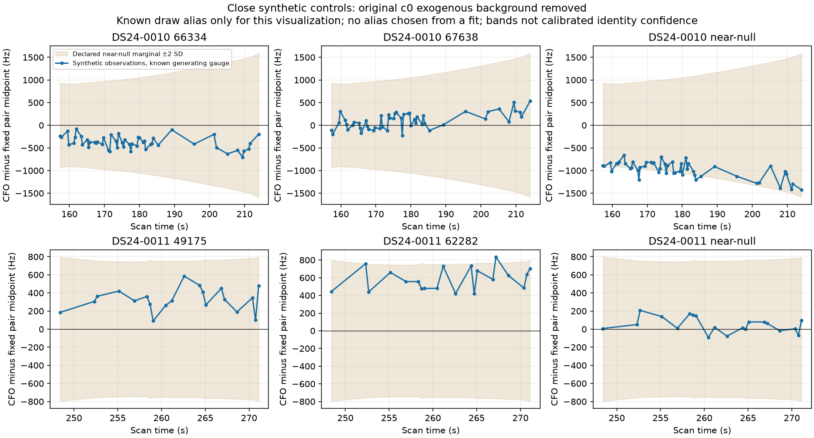

# Close synthetic labels: nomination succeeds, identity acceptance remains open

The ordinary catalogue screen ranked all four generating physical labels first.
Making the true label separately available therefore changed none of the exact
candidate sets or results. Both deliberately close unresolved-model draws
preferred a physical model under certified finite-pool ordering. These six
vectors do not establish a real false-association rate, an operational identity
rule, or a position improvement.

All six vectors, twelve arm/trial slots and 96 ordinary physical candidate
contexts completed. Independent artifact-only audit passed [191 checks](../audit/matched_law_terminal.json).
The scientific budget was 327.906501 cumulative worker-seconds, including
28.399624 seconds of preparation and 4.746420 seconds charged for tests;
the two-worker scoring stage took 241.413632 seconds wall time. No timeout,
scientific retry, position fit, GPS read, RF/IQ processing or dataset mutation
occurred.

## What is matched, and what is deliberately approximate

The [frozen protocol](PROTOCOL.md) resolves the earlier full-parent-generator
versus response-dependent union-cavity-scorer mismatch. For each layout and arm,
one exogenous Gaussian radio mean and covariance was frozen before every
hypothetical target label and draw. Generation, the ordinary screen and all
exact physical/null scores use that same background for the arm. It includes
the declared unseen-Gamma Gaussian second-moment surrogate and the independent
300 Hz owner constant once. The ordinary screen remains the original
approximate affine-phase/unrestricted-alias proposal algorithm; it is not
claimed to evaluate the exact nonlinear generative marginal.

The six vectors were drawn under **c = 0 only**. Exact generator/scorer law
matching applies to c0. Fitted-c evaluates the **same vectors** with its own
frozen background as an explicitly off-law sensitivity. Its separate ordinary
screen is diagnostic: c0 top eight is the fixed exact pool for both arms.

The physical law uses the causal Student phase prior with nu = 3, original
marginal SD divided by sqrt(3) as its scale, explicitly conditioned on
[-15,+15] seconds. It integrates exact nonlinear nominal Doppler, all three
Gaussian physical-mode columns B(phi), and a uniform proper whole-source alias
mixture over -4 through +4. The generator labels have certified full nominal
visibility over the operational phase domain. Other candidates have zero
likelihood on nominally invisible phases while retaining the original domain
normalization. This is a nominal-visibility event model, not a calibrated
detection model integrating physical-mode visibility uncertainty.

Labels already in the actual parent are treated as fresh target hypotheses
against the same exogenous background. Consequently this is a conditional
exogenous experiment, not the original shared-family hierarchy. The generating
labels themselves were selected outside the actual parent. Native layouts and
the background remain inherited, response-selected research objects.

## Response-free close controls

The two layouts preserve their complete archived native source times, RF and
IDs: 50 points from DS24-0010 RX1 CH1 T001, and 20 points from DS24-0011 RX1 CH1
T006. No real target CFO was used to select the synthetic labels.

| Layout | Physical pair | Eligible full-visible labels | Pair design distance |
|---|---|---:|---:|
| DS24-0010 | 66334 / 67638 | 374 | 0.443881 |
| DS24-0011 | 49175 / 62282 | 389 | 0.105313 |

Each pair minimizes the predeclared same-alias Mahalanobis distance at causal
means, with original Gaussian phase tangents in the design covariance and a
NORAD tie-break. That is a local affine design approximation, not exact
nonlinear Student-mixture separation. All pair metadata, visibility
certificates, conditional phase moments and background replay checks are saved
in the two context JSONs. Original background mean/covariance replay differences
were zero for both layouts.

The proper unresolved comparator is a Gaussian degree-four polynomial
perturbation **around the pair's physical midpoint**, which need not itself be
a polynomial. Its coefficient covariance projects the frozen local affine
physical-prior design covariance into an orthonormal basis and adds the fixed
native-noise roughness term specified in the protocol. The identical mean,
basis, covariance, finite-alias law and exogenous background are used for its
draw and score. This is a declared close synthetic alternative, not empirical
clutter or an unknown-satellite model calibrated on real sources.

Independent PCG64 streams from SeedSequence([2026102551, case number, trial])
produce phase, shape/polynomial coefficients, Gaussian noise and alias; all
latents and six actual synthetic CFO arrays are archived. No draw was replaced.

The plotted bands describe the declared null marginal after removing the fixed
c0 radio mean and pair midpoint. Known generating aliases are used only to
display the draws; the scorer integrates its entire alias mixture. The bands
are not calibrated identity confidence intervals.

## Results and numerical limits

| Layout / generating model | c0 finite-pool result | Minimum log-evidence margin | Same-vector fitted-c sensitivity |
|---|---|---:|---|
| 0010 / physical 66334 | Generating 66334 preferred | 1.128228 | 66334 preferred; margin 1.268346 |
| 0010 / physical 67638 | Generating 67638 preferred | 1.065017 | 67638 preferred; margin 1.911995 |
| 0010 / near-null | Physical 67638 preferred | 0.697545 | 67638 preferred; margin 0.696017 |
| 0011 / physical 49175 | Order not certified | — | Order not certified |
| 0011 / physical 62282 | Order not certified | — | Different physical 56134 preferred; margin 0.071061 |
| 0011 / near-null | Physical 49175 preferred | 0.357065 | 49175 preferred; margin 0.138493 |

All four physical truths had c0 ordinary rank 1; fitted-c's own screen ranks
were 1, 1, 1 and 2 respectively. Every truth was already in the common ordinary
top-eight set. Thus the label-available diagnostic never exercised a missing
truth and cannot estimate the benefit of repairing shortlist recall.

There are 9/12 certified finite-pool orders: four c0 and five fitted-c. The two
c0 physical DS24-0011 cases retain overlapping conservative evidence intervals;
they are not certified wrong classifications. Every ordinary pool contains
eight physical models and the proper unresolved comparator. These orders do
not establish ordering over every unscored catalogue label, posterior model
probabilities or an acceptance threshold.

**None of the 96 physical score contexts obtained the stronger absolute
1e-3 integration-tolerance certificate.** Dominance bounds can establish an
order while an individual score enclosure is much wider. Preserve that
distinction: a complete arm/trial is not an absolutely precise score, a proved
finite-pool winner is not a qualified identity, and no operational association
was made. Full precision, bounds and failures remain in the candidate JSONs,
[outcomes.csv](report/outcomes.csv) and [summary.json](report/summary.json).

The two null-generated vectors preferring physical models is compatible with
overlapping normalized predictive models and random draws. It does not imply
an arithmetic error or a measured two-of-two real false-accept rate. It does
show why physical-versus-null preference alone cannot yet justify association
or position movement. Catalogue selection supplies many physical alternatives
against one unresolved density; no calibrated physical-versus-unresolved class
prior or selection-adjusted acceptance rule is supplied here. The reported
likelihood margins therefore are not posterior identity odds. The fitted-c
change for 62282 is explicitly off-law
background sensitivity, not evidence that fitting c improves or worsens real
localization.

## Consequence for the next decision

This tiny control closes one concrete implementation gap: generator and exact
scorer now share their conditional background, phase/shape/alias law and
proper close comparator. It supplies no evidence that catalogue recall is the
current bottleneck on these four physical draws. Further repeats of easy
known-label recovery would be low value.

The useful next association question is whether a predeclared abstention rule
can distinguish close unresolved structure and competing physical labels on
independent synthetic draws and complete real-owner prediction, with candidate
selection kept separate. That would require a new protocol and held-out draws;
these six exposed vectors must not tune a margin. Physical identity needs
independent evidence or explicit uncertainty, rather than translating an
evidence winner directly into a position anchor. Practical position work
should retain the established baseline until such qualification survives
matched c arms and independent full-owner prediction. No follow-on experiment
is executed here.

## Provenance and replay

[protocol.json](protocol.json) freezes source and input hashes before generation;
[RF_seal.json](RF_seal.json) binds the complete run. Scientific sources are
[control.py](control.py) and [law_math.py](law_math.py), with six owned tests in
[test_control.py](test_control.py). B's [preflight](../audit/matched_law_preflight.json)
and terminal receipt independently check actual contexts, normalized Gaussian
algebra, draws, ownership, fixed pools and order flags. The report source
[report_matched_law.py](report_matched_law.py) reads only sealed JSON/NPZ and has
no propagation, scoring or fit path.

Prelaunch wrapper issues were corrected before scientific execution: draw
argument/schema alignment, a test-only collection typo, common sky/mode knot
guard, complete unavailable-slot reporting, and explicit BLAS1 enforcement.
The unused pre-thread-guard source/protocol are preserved in `prefreeze01/`;
actual tests/preparation and their charges are retained. Scientific outputs
have no failed or missing slots. The lean report does not include the full
older runtime/input closure; regeneration depends on the exact externally
hash-bound causal banks, layouts and prior research modules identified by the
protocol. Saved-vector/table replay and scientific regeneration are distinct.
