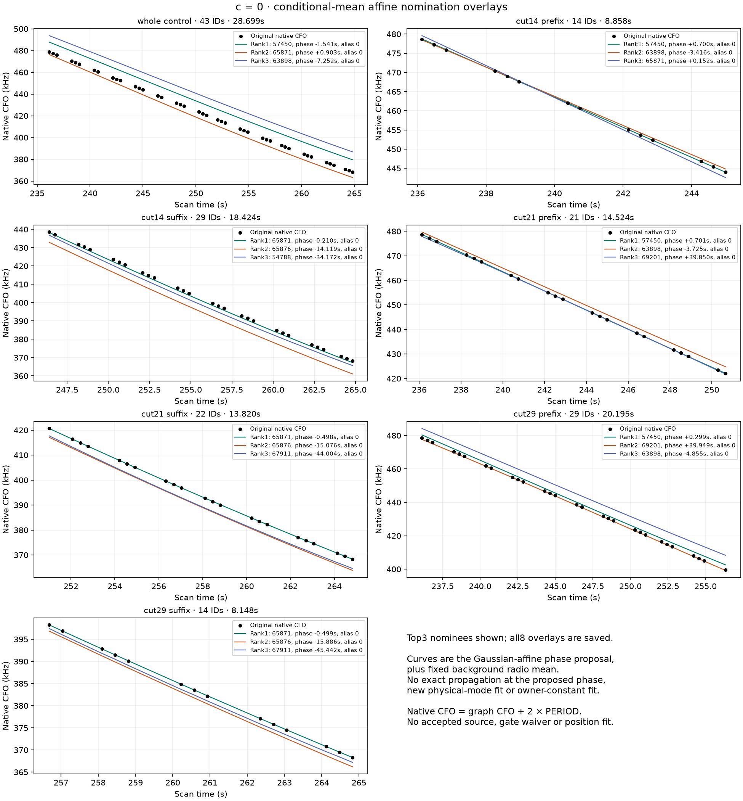
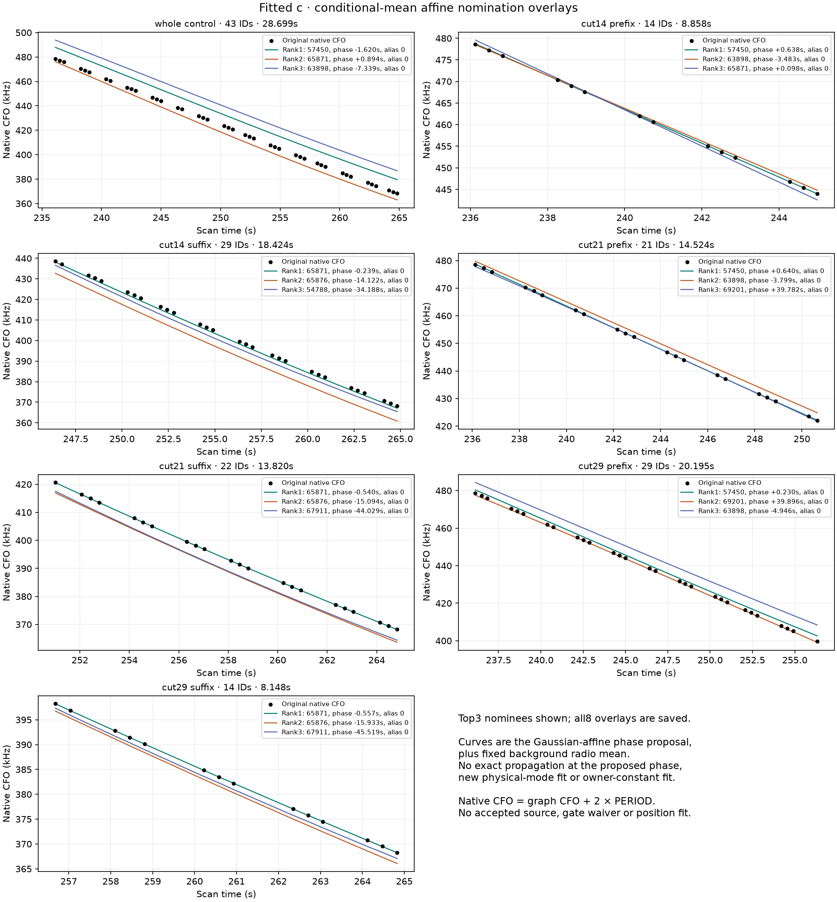

# Every frozen portion nominated, with the whole-source control

Ordinary full-catalogue nomination returns **57450 first for every prefix** and
**65871 first for every suffix**, identically in both c arms. The complete
43-point CH4 control still ranks **57450 first, 65871 second**. Nothing was
forced into a shortlist. All14 screens completed, and all8 nominees are identical
between arms. The [independent terminal audit](../audit/portions_terminal.json)
passes176 checks, including112 dense saved-density replays; no new propagation,
search or position fit was used by that audit.

| Context | IDs | Span s | Linear-detrended RMS Hz | Winner both arms | 57450 rank | 65871 rank |
|---|---:|---:|---:|---:|---:|---:|
| Whole control | 43 | 28.699 | 375.22 | 57450 | 1 | 2 |
| Cut14 prefix | 14 | 8.858 | 23.38 | 57450 | 1 | 3 |
| Cut14 suffix | 29 | 18.424 | 396.97 | 65871 | 5 | 1 |
| Cut21 prefix | 21 | 14.524 | 52.37 | 57450 | 1 | 6 |
| Cut21 suffix | 22 | 13.820 | 332.45 | 65871 | 5 | 1 |
| Cut29 prefix | 29 | 20.195 | 102.92 | 57450 | 1 | 6 |
| Cut29 suffix | 14 | 8.148 | 149.14 | 65871 | 4 | 1 |

None of the six portions passes the original duration≥20s **and**
linear-detrendedRMS≥250Hz curved-salvage prerequisite. Cut29 prefix passes
duration but fails curvature; all other portions fail duration. The whole
control passes these two prerequisites but remains the original
`structure_flagged`, rejected source. No owner/support/residual gate is waived
or newly qualified. Overlapping portions are development probes, not six
independent confirmations; their scores must not be summed as significance.

## Proposals, approximate phases, and native CFO

| Context | Winner | Affine phase s, c=0 / fitted c | Alias | Unadjusted affine RMS Hz, c=0 / fitted c |
|---|---:|---:|---:|---:|
| Whole control | 57450 | −1.541 / −1.620 | 0 | 9807.1 / 9860.6 |
| Cut14 prefix | 57450 | +0.700 / +0.638 | 0 | 46.0 / 46.6 |
| Cut14 suffix | 65871 | −0.210 / −0.239 | 0 | 1069.1 / 1210.7 |
| Cut21 prefix | 57450 | +0.701 / +0.640 | 0 | 63.5 / 67.8 |
| Cut21 suffix | 65871 | −0.498 / −0.540 | 0 | 21.3 / 89.8 |
| Cut29 prefix | 57450 | +0.299 / +0.230 | 0 | 1863.7 / 1885.2 |
| Cut29 suffix | 65871 | −0.499 / −0.557 | 0 | 26.0 / 38.4 |

These are Gaussian-affine phase proposals from the unchanged coarse screen,
not exact propagated orbit fits. The displayed RMS uses the affine frequency
at that phase plus the fixed parent radio mean, with zero new physical-mode or
owner-constant posterior adjustment. It is **not an original acceptance gate**
or the marginalized score. The whole-source winner's phase and large overlay
RMS particularly show why rank1 is not model adequacy. Some other nominees have
phases outside ±15s; the full table preserves those flags and the original
unrestricted nearest aliases without clipping or reranking.

Curves show the first3 nominees, while all8 overlays are archived. Native CFO
is the saved graph CFO plus2×PERIOD, as verified against the original GLRT
observation ledger. Every original CH4 ID is retained, and each cut's prefix
and suffix partition all43 points. The original CH5 discovery's57 IDs remain
bound in the ledger; they are not independently rescored or multiplied into
these nomination scores.

## Conditioning and interpretation

Both arms use the same saved c=0 RF position, causal catalogue, observations,
candidate phase priors and search budget. The background is exactly the
previous CH5-discovery-cavity CH4 marginal, including shared radio uncertainty,
the original300Hz owner constant and Gaussian2σ² native-noise approximation.
No shortlist-dependent new cavity or calibration is constructed. Frequencies
and derivatives reuse the original complete1487-entry catalogue. The real
input smoke reconstructs candidate-mean per-ID elevations once and verifies
nominal frequencies exactly; each portion's LOS test uses its own points.

All existing parent candidates remain ordinary hypotheses. Their possible
shared-family calibration dependence is not repaired by this coarse screen.
Neither57450 nor65871 has active surviving likelihood membership in the
retained CH5 cavity. Both still occur in the inherited `p.supported` list:
that list retains allocated physical-mode slots for dormant seed families,
so it is **not surviving accepted-owner support or corroboration**. The
[top8 table](report/top8_proposals.csv) distinguishes actual active membership
from these legacy slots for every nominee.

The pattern justifies a bounded **joint two-source challenge** as the next
scientific question: physical57450 on D and a CH4 prefix, with physical65871
on the remainder, against whole57450, whole65871 and proper unresolved
alternatives. It must keep all100 IDs, shared radio covariance, proper
phase/mode/alias priors, normalized cut/allocation weights and both c arms.
An exact whole65871 alternative is needed before interpreting a split as a
switch; the whole-track coarse ranking alone cannot decide that question.
No such second-stage integration or position fit was launched here.

There is also an existing separate complete CH3 owner: the old
[c=0 ordinary screen](../../2026_10_25_ds24_rx2_witness/scientific/owner0/c0_screen.json)
and [fitted-c screen](../../2026_10_25_ds24_rx2_witness/scientific/owner0/fitted_c_screen.json)
already nominated65871 first,65876 second. That was under the old original
parent nomination background, not this CH5 cavity, and is an exposed prior
result. No new CH3 score was computed. It suggests a later separate-owner
conditional consistency test, with complete CH3 and shared orbit/radio
uncertainty; it is not another independent factor to multiply after discovery.

## Artifacts and replay

[contexts.csv](report/contexts.csv) records all14 contexts and eligibility;
[top8_proposals.csv](report/top8_proposals.csv) has112 proposal rows;
[catalogue_scores.csv](report/catalogue_scores.csv) has20,818 catalogue rows,
including visibility misses; and [native_CFO_overlays.csv](report/native_CFO_overlays.csv)
has2,752 native-ID proposal overlays. Original source/cut/alternative-list
exposure is explicit. No identity, portion, calibration or position is adopted.

The [frozen protocol](protocol.json), SHA256
`4495936258f5ce70de5918a13565cf93380da5de3f1966c5a3dce1f54cd0670c`,
binds [nominate.py](nominate.py), inputs, nine owned tests and both-arm actual
input smoke. [RF_seal.json](RF_seal.json) binds the terminal outputs.
Preparation2.516971677076s + owned numeric tests1.77s + screen workers0.152737770695s
= **4.439709447771 cumulative numerical seconds**, below180s. No failures,
retries, new RF, GPS or position fits occurred.

From the repository root use `.venv/bin/python -B`, one BLAS/OMP/MKL thread,
and `PYTHONPATH=/tmp/algo03-feasible-deps:src:tools:/srv/bulk/leo/research/ds24-movement-policy-r01/recovery:/srv/bulk/leo/research/ds24-source-challenge-r01/portions`.
Tests: `-m pytest -q -p no:cacheprovider` followed by the absolute path to
[test_nominate.py](test_nominate.py). Execution is `nominate.py run`, requiring
the matching independent preflight and refusing to overwrite archived results.
Do not rerun in this sealed directory. [report.py](report.py) verifies the RF
hashes and produces the figures/tables from saved outputs only, with no new
scientific scores or propagation.
