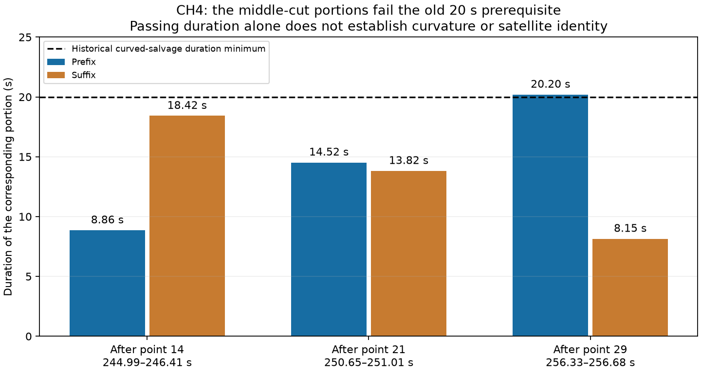

# A short coherent portion was ineligible for the historical curved salvage

The historical salvage runner's exact source hash matches the original
DS24-0013 result. It permits only supports lasting at least **20 seconds**,
followed by its separate `raw_curvature` prerequisite. The portion ending near
the visible CH4 residual slope change is shorter than that duration minimum.
This explains why it could not be proposed through that curved-calibration
salvage route, regardless of how well a satellite might predict its points.

These cuts are the scientific experiment's observation-count thirds/half
alternatives, not newly optimized breakpoints or accepted portions.

| Cut after point | Boundary interval, scan seconds | Prefix duration | Suffix duration | Passes historical duration prerequisite |
| --- | --- | ---: | ---: | --- |
| 14 | 244.988–246.405 | 8.858 s | 18.424 s | Neither |
| 21 | 250.654–251.009 | 14.524 s | 13.820 s | Neither |
| 29 | 256.326–256.681 | 20.195 s | 8.148 s | Prefix only; other requirements still apply |

The original pure index-support function generates 63 prefix/suffix/whole
supports. Replaying its duration predicate leaves 27. The historical record
reports 15 after all support gates, 30 satellite candidates and no selected
salvage alternative. This trace does not recompute the other curvature test
or claim that all 27 duration-eligible supports were physically eligible.
It also does not reconstruct the exact residual gate that rejected any
specific full-curve candidate.

The graph already marked the original 43-point CH4 quartic
`structure_flagged`, with adjacent residual correlation 0.8234676. Thus neither
the structure warning nor the minimum-duration restriction is a newly found
unrecorded failure. The new question is whether an independently predicted
physical portion can be represented while accounting for the unresolved
remainder, without using short/linear evidence to calibrate receiver drift.

A positive conditional score would not remove the original calibration
prerequisites. A short portion could at most be investigated for a separately
qualified predictive role; its identity, ownership and position contribution
would still need evidence. No production gate, accepted ID, input observation
or inferred position changes here.

[Read-only extraction](trace.py), [exact source/data bindings and all support
durations](summary.json), and [original extraction seal](seal.json) preserve
the evidence. The extraction executes only the recorded pure index-list
function via its syntax tree; it does not import or run the historical CLI.
No new curve fit, orbit score, position fit or GPS read is performed.
