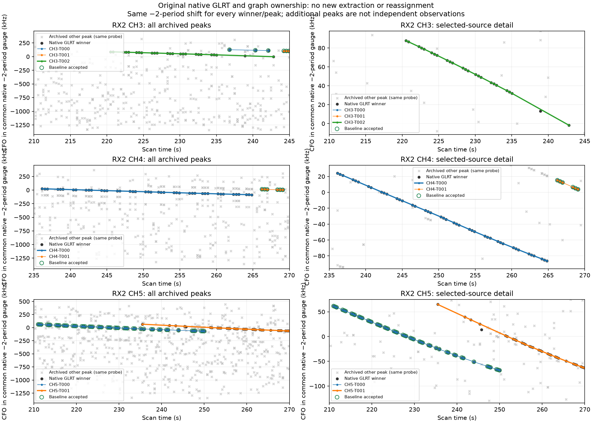
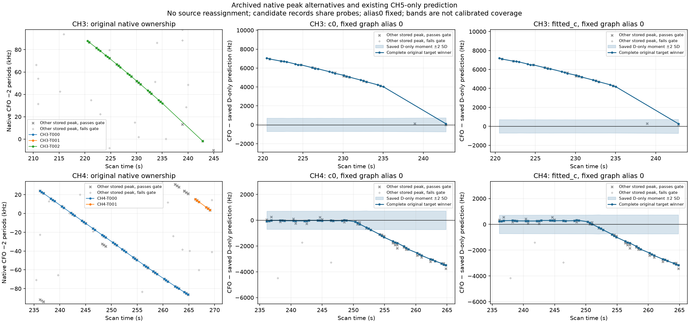

# Native evidence: an existing structure flag, not a demonstrated join fault

All **4,808 original native GLRT winners** and every archived graph lane index
reconstruct exactly through the original fast public input adapter. The three
complete selected sources keep their original 24/43/57 IDs. No receiver,
channel, RF, timestamp, ID, winning peak or graph membership changes here.
Their graph CFO is exactly native CFO minus two alias periods
(−454,545.454545 Hz). The same shift is applied to every contextual candidate;
there is no nearest-model wrapping.

This investigation is selected after the earlier CH5 prediction residuals
were inspected. It is an exposed descriptive diagnosis, not independent
validation or a satellite-identity acceptance test.

## What the original native records show

| Fixed local window | Original probes | Native winners | Other archived candidate records | Of those, original gate passes | Probes without a passing winner |
| --- | ---: | ---: | ---: | ---: | ---: |
| RX2 CH3, 210–245 s | 99 | 31 | 406 | 25 | 68 |
| RX2 CH4, 235–270 s | 99 | 49 | 497 | 219 | 50 |
| RX2 CH5, 210–270 s | 169 | 82 | 734 | 148 | 87 |

“Other candidate records” means stored candidates other than the maximum-margin
gate-passing winner of that same original probe. They are not new measurements
or independent corroboration. Records may also represent nearly duplicate peaks;
these counts are deliberately not a count of independent distinct emitters.
Both passing and failing records are retained in [the full local peak CSV](archived_peaks.csv).
No additional IQ extraction was required to establish their availability.

The full-CFO panels retain all candidates; detail views use the selected
source's CFO range plus a declared 10 kHz margin. Every omitted-from-view record
remains in the CSV. Green circles identify original baseline accepted IDs.
The three selected sources have no accepted current-baseline IDs.

**CH4/T000 was already flagged.** Its original single degree-four piece spans
native lane indices 238–280, 236.130545–264.829165 s, with the saved
`structure_flagged` status and `adjacent_residual_correlation` flag. The earlier
correlation was about 0.823. The figure does not establish an undetected graph
join bug. All 43 winners stay in this one original graph owner across 250 s;
the other local owner, T001, starts at 266.247333 s. The local 49 winners are
exactly 43 T000 points plus six T001 points. There is no second *original graph
owner* crossing near 250 s in this window.

The stored winning CFO sequence through the suspected transition is continuous,
with no receiver/RF/ownership change. This does not prove a single physical
emitter: a smooth wrong continuation, transmitter effect or physical-model
mismatch can remain smooth in CFO. Other stored candidate records are visible,
but this inspection does not establish a coherent alternative continuation
following the CH5 prediction after the departure. A cloud of same-probe peaks
cannot be promoted to a second track without a separately defined comparison.

**CH3/T002 has a real isolated tail point.** The last body point is at
235.024480 s, followed by the final selected point at 242.819219 s, a
7.794739 s gap. The final point's native ID is
`sha256:203267ed0e2a200e420147bc8a0d6238481c3db444fa2d7c8aeee29520029eac`;
its original lane index is 108 and its global probe-list index is 10863.
It is an actual original winning peak, not an invented interpolation.
There is also one original **unassigned** winner at 238.921705 s inside the gap
(ID `sha256:81973a8d66660f33139661afb5879580d0c52fbea1b85508a11bb3696d42c529`).
It is preserved as unassigned. The seven contextual winners outside T002 are
three each in T000/T001 and this one unassigned point. The body and isolated
tail cannot be declared a new physical source merely from this local view.

**CH5 is the parallel reference.** Its window contains 31 of the complete
57-point discovery source, 50 points from T000 and one unassigned winner.
Both graph curves overlap in time and remain distinct original memberships.
The full discovery source is not truncated to this reporting window.

## Replaying the old prediction in the correct coordinate system

The saved CH5-only prediction was in radio-conditioned CFO coordinates. The
overlay restores the *same original fixed parent-radio background* by adding
`graph_CFO − saved_conditional_raw` to its predicted mean. Original IDs and
times match exactly. This algebra adds no fitted receiver correction and does
not condition the prediction on the witness. An owned redaction test verifies
that changing a witness value and its conditional raw value together leaves
the restored background unchanged.

Both c=0 and fitted-c results are shown. The comparison uses a fixed graph
alias zero; it does not select a favorable witness alias. Bands are saved
mixture moments ±2 SD, not calibrated 95% intervals. At other original probe
times the displayed prediction is interpolated **only within** the saved
witness support, without extrapolation; it is not a new likelihood score.

The old CH4 flat-then-departing residual pattern appears in both arms. It does
not coincide with a recorded graph-owner transition. CH3's body differs from
the prediction while the isolated tail approaches it. These are useful clues
for the separately frozen complete-observation competing-source comparison;
they do not authorize deletion, reassignment, manual 57450 adoption or a
position factor.

The root's [historical eligibility trace](../eligibility/summary.json) separately
explains why an apparent short prefix was not eligible for the old curved
salvage route. That eligibility fact is distinct from proving a correct
physical identity or identifying a faulty graph join.

## Processing and limits

The successful ownership reconstruction and plots take **1.347 s**. The saved
prediction overlay has its separate elapsed time in
[overlay_results.json](overlay_results.json); total processing is far below
the unchanged 180-second cap. Two ownership tests and one overlay/redaction
test pass. No orbit propagation/score, polynomial or physical refit, GPS read,
position optimizer, new RF or IQ processing is performed.

The first preparation attempted the adaptive timing port and stopped before
processing because this fast export uses `clock_anchor`, not adaptive
`source.timing`. Its exact source/protocol and failure are preserved under
`preparation01/` and [failure01.json](failure01.json). The corrected version uses
the same original fast `winners`/`frequency_evidence` adapter that generated the
archived observations, with unchanged windows and selection. The final stdout
print was also preserved separately and the exact empty sealed run log restored;
no scientific source/results were changed. Receipts retain this reporting fix.

[Protocol](PROTOCOL.md), [frozen input/source hashes](protocol02.json),
[complete native index/ID provenance](point_provenance.json),
[winner CSV](native_winners.csv), [probe CSV](probes.csv),
[graph point CSV](graph_points.csv), [prediction overlay CSV](prediction_overlay.csv)
and [test receipt](test_receipt.json) retain the exact evidence. Upstream
tracking authority access was previously permission-limited; this work reads
the already verified exported contract, not a newly recovered raw authority.
