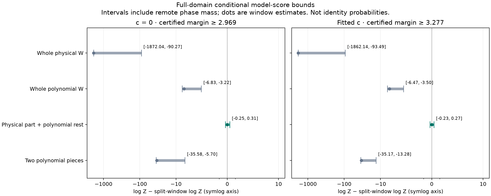
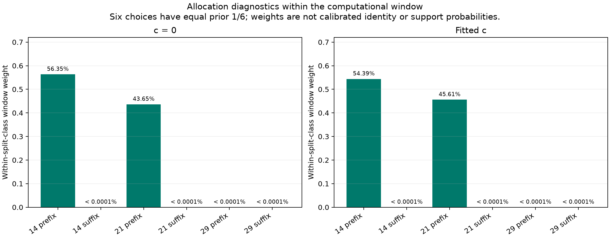

# Complete-source coherence, conditional on CH5 being 57450

The normalized **physical portion plus unresolved remainder** class beats all
three declared alternatives in both c arms. The conservative full-domain
log-evidence margins are **2.969261 (c=0)** and **3.277084 (fitted c)** over every
competing class. These are conditional model scores, not calibrated identity
probabilities or permission to accept a prefix. Independent artifact audit
[passed 67 checks](../audit/terminal.json), without new propagation or scores.

All **100 observations** enter every model: complete CH5 discovery D (57 IDs)
and complete CH4 witness W (43 IDs). D is physical 57450 throughout, as a
hypothesis inherited from ordinary earlier nomination. The saved CH5 discovery
cavity, common c=0 RF position and arm-specific background remain unchanged.
Radio covariance, source constants, native point noise, priors and aliases are
matched between arms and models. No parent recalibration, geographic truth,
position fit or new RF was used.

| Class | Normalized internal prior | Window −2 log Z, c=0 | Window −2 log Z, fitted c |
|---|---|---:|---:|
| Whole W physical 57450 | One choice | 4983.312944 | 4962.157418 |
| Whole W proper polynomial | One choice | 1259.770297 | 1257.806070 |
| Physical edge portion + proper polynomial rest | Six choices, 1/6 each | **1247.790751** | **1246.441936** |
| Two proper polynomial pieces | Three cuts, 1/3 each | 1315.978785 | 1314.011441 |

Each primary class has prior 1/4. The split class averages cuts after native
W counts 14, 21 and 29, with both prefix-physical and suffix-physical allocation.
The piecewise-unresolved control averages those same cuts. The result therefore
charges cut/allocation selection and scores the unresolved remainder. It does
not substitute a free best cut for either class sum. Full tables retain all
[eight class contexts](report02/class_table.csv) and
[22 cell contexts](report02/cell_table.csv).

The table contains **computational-window estimates**, not globally precise
absolute scores. The global class ordering instead uses complete lower/upper
evidence bounds, including every remote phase in the original domain. In
particular, whole-physical W's global upper bound is dominated by the remote
mass bound; its window score must not be quoted as a qualified global integral.
No cell achieves the stronger absolute 1e-3 objective-precision certificate
(**0/22**).

Within the split class and computational window, cut14-prefix/cut21-prefix
weights are 56.35%/43.65% for c=0 and 54.39%/45.61% for fitted c. The other four
allocations have negligible window weight. These are quadrature diagnostics,
not calibrated support probabilities. They do not establish an exact switch
time. Full phase covariance includes all three physical modes and their
constant/phase overlap; this is not a pure projected-curvature test.

## What was checked

The unchanged D score replays within 9.10e-13 objective units and the original
whole-W polynomial joint score within 2.28e-13. All 22 direct-phase GL32/GL64
checks pass; the maximum objective difference is 2.23e-11. No discovery-posterior
Normal approximation replaces the integrand: the original Student ν=3 phase
prior conditioned on [-15,+15] seconds and its normalization are retained.
The archived D mean ±24 SD defines only the computational window.

Analytic local envelopes and a common certified D-tail upper bound times W's
independent Gaussian noise-density ceiling bound remote joint evidence for
every allocation. There is no window renormalization or Gamma-mixture peak
claim: the inherited unseen-precision approximation remains Gaussian 2σ².
Tail `success:false` denotes failure to reach absolute precision; both tails
stopped for certified exclusion and still provide valid conservative bounds.
The split lower bound exceeds every competing full upper bound. The local
panel cap and unresolved absolute precision remain explicit in saved outputs.

There is one physical phase and one shared three-mode realization on D and
physical W rows. Every unresolved segment has its own proper degree-four
Legendre prior on its own time coordinate. One original 300 Hz W owner
constant and one uniform finite W alias remain shared across its pieces;
D has its own constant/alias, giving the same 81 joint aliases in every model.
Polynomial covariance is exactly zero on D and physical W rows.

## Limits and next discriminating test

This exposed development example supports a partial-coherence explanation
against these particular proper unresolved controls. It does not establish
57450 as the true identity, identify another satellite in the remainder,
prove a GLRT graph crossover, or validate the polynomial/physical prior family.
The unresolved prior has degree-four Legendre coefficients with scale
PERIOD/√6 on each segment's own time coordinate. Its determinant/volume penalty
is part of this result; a physical split beating these polynomial controls is
not a full competing-satellite comparison or a prior-insensitive truth test.
CH4 was already `structure_flagged` and rejected; this is not evidence that the
pipeline accepted a clean wrong join. The favored prefix spans are only 8.858
and 14.524 seconds, below the original 20-second curved-salvage duration gate.
Even a coherent portion would still need original curvature, ownership,
residual and support qualification. No gate or operational assignment changes.

The next useful test is ordinary causal full-catalogue nomination of **all six
predeclared prefix/suffix portions**, retaining misses and unresolved-source
outcomes, before a separately bounded two-source joint challenge. Do not force
57450 into a prefix pool, choose the best cut, or call the remainder independent
evidence after using it to select an identity. Failure to reproduce 57450-like
prefix evidence or find a coherent competing explanation in the remainder
would weaken the crossover interpretation. Position testing is premature.

## Execution and replay

The first attempt failed before any evidence integral because the input adapter
looked up a metadata path on the wrong imported module. Its source, protocol,
two failed arm records and RF seal remain archived unchanged. The authorized
revision changes that lookup only, adds an actual both-arm input smoke check,
and deducts all setup time: 4.737606174313 failed worker-seconds +
4.404138068669 smoke seconds + 43.568079470191 successful worker-seconds =
**52.709823713172 cumulative worker-seconds**, below the unchanged 600-second
cap. There was no scientific retry, tuned prior, new cut or budget extension.

The final scientific protocol is
[run02/protocol.json](run02/protocol.json), SHA256
`6b46e3b99c0239b93bf19f9923f399df39055830826bae3290113fc6d768c80e`.
Eleven owned tests pass, independently rerun by B; dense observation-space
fixtures check every allocation and all 81 aliases. The actual load smoke
checks both original backgrounds and all native IDs before quadrature.
[run02/RF_seal.json](run02/RF_seal.json) binds the completed run.

From the repository root, use `.venv/bin/python -B` with one BLAS/OMP/MKL
thread and `PYTHONPATH=/tmp/algo03-feasible-deps:src:tools:/srv/bulk/leo/research/ds24-movement-policy-r01/recovery:/srv/bulk/leo/research/ds24-source-coherence-r01/scientific`.
Owned tests: `-m pytest -q -p no:cacheprovider` followed by the absolute path to
[test_coherence02.py](test_coherence02.py). The immutable execution entry point
is [coherence02.py](coherence02.py) `run`; it refuses to overwrite outputs and
requires the matching independent preflight. Do not rerun it in this sealed
directory. [report_coherence02.py](report_coherence02.py) reads saved artifacts
only, verifies the RF hashes, and emits the displayed figures and tables into
a fresh `report02/` directory. Original reporting revision `report/` is retained;
revision02 only improves figure spacing and tick labels. It adds no inference.
