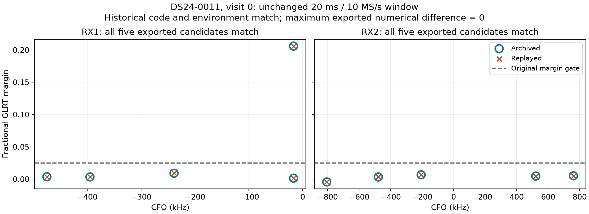

# DS24: testing the ambiguity lead and qualifying unused curves

2026-10-26 UTC. This follows the
[cumulative fast-scan review](../2026_10_25_ds24_ambiguity_position/REVIEW.md).
Three SOL xhigh agents implement the bounded position comparison, challenge
four complete unused sources, and independently audit the calculations. The
coordinator performs one original-IQ detector replay and publishes the results.

The retained estimator is unchanged. More associated GLRT points are useful
only if their physical identity and independent position information survive
qualification. This iteration distinguishes a numerical fit, an adequately
explained source, and an operationally accepted improvement.

**The ambiguity experiment now reaches actual position fits.** DS24-0011's
complete 20-point RX1 CH1 T006 source keeps the same eight causal candidates,
whole-source aliases, physical timing/shape priors and unresolved-curve model
as the preceding fixed-position pilot. No source point is trimmed. Both c arms
use the original five phase-refresh rounds, optimizer, cold regional-center
start and identical budgets. No evaluation coordinate selects a model or gate.

All three archived probes reproduce within the declared numerical tolerances
in both arms. Both no-addition controls reproduce the saved endpoint and full
parent objective exactly. Hard 58175 additions finish and pass their numerical
checks. The whole-source mixture reaches its fixed 60 s fit cap in both arms
after only one completed phase-refresh round. Those partial iterates are not
converged positions and are not substituted for the missing final endpoints.
The first mixture rounds end normally after 36/41 residual evaluations, but
their parent phase-reference changes remain about five seconds. The timeout
occurs during the following round's likelihood evaluation. Each uncached
mixture score visits roughly 76,928 phase nodes across eight candidates under
the frozen integration rule. This establishes a runtime limitation of this
implementation, not evidence that the mixture converged to a bad location.

The hard addition fails original source support: the family has no accepted
curved evidence and the new source contributes only one receiver/channel owner.
At the matched no-addition endpoints, a fitted constant produces an approximately
135–136 Hz profile RMS, but the conditional residual remains about 1.02/1.23 kHz
in c=0/fitted-c, with mean, slope, quadratic and autocorrelation structure.
A plausible-looking fitted curve therefore does not establish adequate
prediction from the existing calibrated state.

The c=0 hard endpoint also loses 29 original postfit-associated points: 21 from
RX1 CH4 T007 /57955 and eight from RX1 CH8 T000 /68031. No original position
likelihood point is lost. The fitted-c hard endpoint preserves its original
associated IDs. These are distinct source-admission and association-preservation
failures; they are not failures of numerical optimization. The exact original
reference remains the operational output in every method/arm.

| DS24-0011 method | Error c=0 | Error fitted-c | Operational decision |
| --- | ---: | ---: | --- |
| Matched no-addition reference | 1.728 km | 1.567 km | Retained |
| Hard 58175 addition, raw diagnostic | 1.413 km | 1.311 km | Rejected by original qualification |
| Whole-source mixture | No final endpoint | No final endpoint | Runtime cap; retained reference |

The hard diagnostic lowers geographic error by 314/256 m in this one exposed
scan. That is a real evaluated difference between completed fits, but not an
accepted estimator gain. All operational outputs stay at 1.728/1.567 km.
The conservative postfit-ID preservation rule is an experimental guard; losing
an old association does not by itself prove a new position is geographically
wrong. Source validation and the affected associations need separate evidence.

The evaluation runs only after the immutable RF results and independent audit.
The calculation completes four of six method/arm fits, with 285.145 charged
worker-seconds including preparation, and no retries. Detailed RF objectives,
frequency residuals, native-ID losses and actual errors are in the
[position findings](position/FINDINGS.md).

**The four-source challenge identifies different failure mechanisms.** Each
source keeps all native points. Ordinary causal catalogue nomination supplies
eight candidates, shared by both c arms. Candidate families are removed from
the old conditioning data symmetrically before comparison, avoiding a duplicate
independent orbit error for a family already present in the parent. The physical
models and proper unresolved model then share the same remaining background.
These are conditional **cavity** diagnostics, not predictions from the untouched
original parent. The removal excludes 480 curved points in 0015 and 658 curved
plus 173 predictive points in 0016. Remaining old residual gates fail for
0015 fitted-c and both 0016 arms. This limits physical interpretation as well
as blocking admission; restoring shared family conditioning is necessary before
attributing a discrepancy to the original receiver or satellite model.

| Scan and complete source | Points | Completed comparison | Residual RMS c=0 / fitted-c | Interpretation |
| --- | ---: | --- | ---: | --- |
| 0014 RX1 CH1 T004 | 87 | Neither arm finishes | Unavailable | Exact integration hits the slot cap; identity and adequacy remain unresolved. |
| 0015 RX2 CH4 T004 | 29 | 68904 wins both finite pools | 49.3 / 47.0 Hz | Nominal residual remains correlated; a modest target-fitted physical correction gives 26.6 / 26.2 Hz and passes the noise screen. |
| 0016 RX2 CH2 T004 | 40 | 59786 wins both finite pools | 75.1 / 73.1 Hz | Slope, step and correlation fail; fitted physical modes leave 73.7 / 71.8 Hz and still fail. |
| 0017 RX1 CH5 T004 | 51 | Neither arm finishes | Unavailable | Exact integration hits the slot cap; identity and adequacy remain unresolved. |

The 0015 correction is within the declared physical prior: its largest mode
coefficient is about 0.64/0.60 prior SD. It is a plausible model of the observed
discrepancy, but it was learned from the same target being explained. This
does not validate the correction on another track. The 0016 result also does
not prove a wrong identity: 59786 is still preferred to the tested alternatives,
but the present model fails to explain the whole curve adequately.

Conservative evidence bounds establish the winning order among the eight
physical models and unresolved model for the four completed arm comparisons.
They do not certify absolute evidence to 0.001 or give calibrated satellite
identity probabilities. Both winners retain their original nominated labels.
All 64 physical-candidate slots are recorded; 48 primary checkpoints exist,
including partial comparisons from the failed cases. Four of eight owner/arm
comparisons finish, with 513.789 cumulative worker-seconds and no retries.
No new source qualifies for position admission.

The metadata-selected potential witnesses are not verified corroboration:
their archived nominees are different satellites (64716, 60140, 62281 and
62571). A curve from another receiver must first be shown to support the same
physical hypothesis. The report keeps these rows without counting them as
same-family evidence. Original rejection histories, present residuals and
runtime failures remain separate in the [qualification findings](qualification/FINDINGS.md).

**One original detector window is now exactly reproducible.** The first paired
20 ms DS24-0011 window was fixed by recording order before replay. With the
historical deployed code, environment and policy, all ten exported GLRT
candidates match the archive exactly: ranks, epochs, CFOs, scores and gates.
All 82 comparisons pass, with zero numerical differences. Exhausting the
bounded reader also verifies the entire containing compressed chunk and all
64 window hashes; only the first window is processed by the detector.

This establishes a reproducible starting point for a later measurement-selection
experiment. It does not establish satellite identities or detector accuracy.
The aggregate power metadata label the window quiet, yet RX1 has a GLRT margin
about .206, well above the .025 detector gate. It cannot be treated as a
noise-only background. No injection or new RF collection was performed.
[Replay findings and exact scope](REPLAY_FINDINGS.md).

**The next allocation should be narrower, not another full-dataset rollout.**
The useful questions are now concrete:

1. Can a physically plausible correction, such as 0015's, predict independent
   evidence? First establish an appropriate same-family source with the causal
   candidate competition intact. Compare with the earlier grouped-family
   prediction experiments before implementing another variant. A generic
   different-receiver curve is insufficient. Preserve the distinction between
   fitting a target and predicting it.
2. What causes 0016's remaining structured residual? Use its saved native
   residuals and contemporaneous receiver/band/family evidence, first checking
   the effect of the removed conditioning data. Under the current cavity the
   three physical modes do not remove the broad drift and isolated excursion.
   Any receiver- or family-specific attribution needs the original shared
   conditioning restored; adding flexibility should follow that diagnosis.
3. Use the now-established IQ replay parity to prepare a small measurement-
   selection experiment. It must have an explicit waveform and justified
   background, and pass through actual GLRT selection and track construction.
   The current window is not certified noise-only. This targets a mechanism
   that fixed-curve synthetic controls cannot measure.

The exact mixture needs computational work before another position test:
reuse geometry and matrix factors while preserving the frozen likelihood,
then verify the archived probes and endpoint checks. That engineering should
be contingent on a source-validation question worth answering. Extending caps
on the same unresolved cases is not the preferred next scientific experiment.

The [cumulative review](../2026_10_25_ds24_ambiguity_position/REVIEW.md) remains
the guide to experiments already tried. It documents the retained ALGO02 gain,
the benefit of all eight channels, failed transfer of larger development gains,
and why higher association percentage or more generic restarts are weak
promotion criteria. This iteration supplies a raw hard-assignment position
effect, two distinct residual diagnoses and an exact detector replay. It does
not establish a deployable improvement or justify a new ALGO release.

The independent [position audit](audit/position_terminal.json) and
[geographic readback](audit/geographic_readback.json) preserve the numerical
successes, scientific rejections and missing mixture endpoints. The
[qualification audit](audit/qualification_terminal.json) checks the complete
selected panel, partial candidate accounting and original gate semantics.
Eight position tests, four qualification tests, three geographic math/fallback
tests and three detector-comparison tests pass. Audit success establishes that
the experiment was executed and reported as specified, not that an added
source or estimator is scientifically qualified.

The [reproduction guide](REPLAY.md) links sources, tests, protocols and external
dependencies. Both arms retain matched observations, candidate pools, other
priors and search budgets. Inference uses only causal TLEs within the 25×25 km
region centered at 37.906, -122.545. Geographic error is a separate evaluation;
lower frequency residual or higher coverage is not reported as improved
localization. No production code, persisted contract or golden fixture changes.
