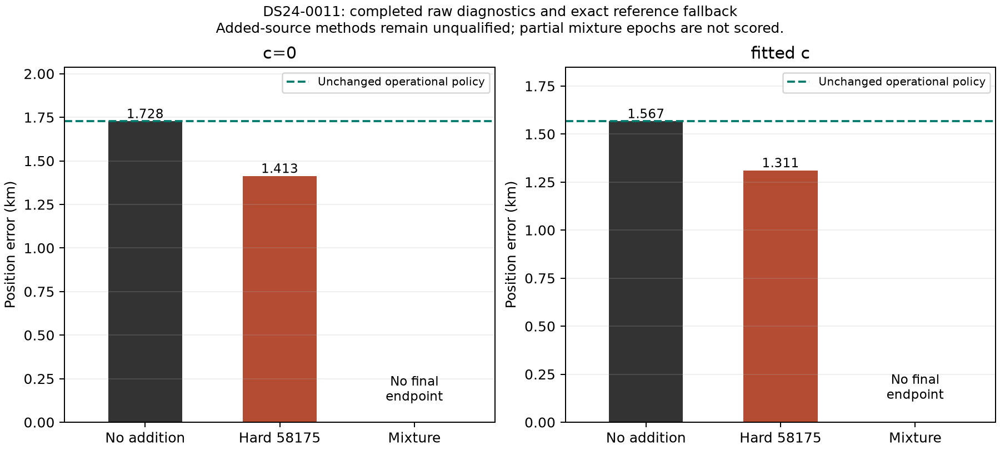
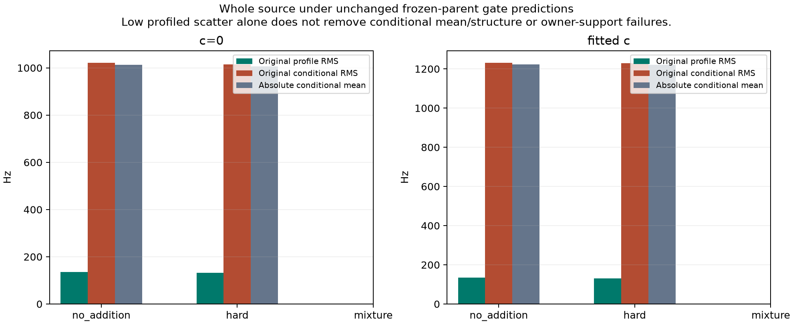

# Actual ambiguity-policy position controls

The hard 58175 addition completed and moved the raw DS24-0011 endpoint closer
to the evaluation site in both arms. The eight-identity/unresolved mixture
did **not** complete its frozen fit budget in either arm, so the main
mixture-versus-hard position comparison remains unresolved. The source is
unqualified throughout; operational policy retains the exact original
reference. No gate, source, phase law, or budget was changed after scoring.

| Arm | No-addition error (km) | Raw hard 58175 error (km) | Raw hard minus reference (m) | Mixture final error | Operational error (km) |
|---|---:|---:|---:|---|---:|
| c=0 | 1.727734 | 1.413451 | −314.283 | Missing: fit cap | 1.727734 |
| Fitted c | 1.567031 | 1.311280 | −255.751 | Missing: fit cap | 1.567031 |

These are one exposed development case, not a cohort improvement or a
validated association. Raw hard improvement does not establish that the
mixture would improve, or that either added-source method can be adopted.
Partial mixture epoch0 positions were **not** geographically evaluated or
substituted for final results. DS24-0012 remains unresolved from the preceding
pilot and was not rerun.

## Controls and numerical reproduction

[PROTOCOL.md](PROTOCOL.md) and [protocol.json](protocol.json) froze the complete
20 IDs, original eight causal candidates, nine uniform whole-source aliases,
full phase-dependent three-mode covariance and Student phase prior on
[−15,+15] seconds. The primary mixture has physical mass 0.5, uniform over
the eight identities, and proper unresolved mass 0.5. Its fixed graph-frequency
Legendre unknown law was never recentered on a candidate or position. All
models share parent radio uncertainty and the same zero-removal cavity.
There are no active same-family parent observations to duplicate; this actual
parent has 2,241 curved and zero existing-predictive observations. Target CFO
never updates parent coefficients or Gamma.

The deterministic GL16 rule covers every original interpolation piece.
Before fitting, hard and mixture GL16/32/64 scores reproduced all three
previously sealed RF probes in both arms within 3.84×10⁻¹² objective units.
The mixture-minus-hard secants reproduced1.6038403/1.3362544 objective/km,
inside the preceding pilot's conservative intervals. Old bounds were reused;
no repeated envelope campaign was performed.

All methods used the original five phase-refresh rounds, 48-iteration bounded
GN helper, zero position and phase starts, and the same25km regional box.
The no-addition endpoints and complete parent ELBO reproduced the saved
original **exactly**, including same-reference objective replay. The scalar
target residual adds its complete normalized NLL once, preserving the original
parent normalization/visibility offset. Its GN curvature is a solver choice,
not the true marginal Hessian.

Both hard endpoints completed all five rounds and pass the fixed endpoint
GL16/32/64 score and ±.01km finite-difference checks: maximum score discrepancy
1.57×10⁻¹² and gradient discrepancy1.99×10⁻¹¹ objective/km. These are point
quadrature stability checks, not global evidence certification or association
adequacy. The independent [RF terminal audit](../audit/position_terminal.json)
passes27 checks without additional propagation or geographic access.

## Why every added-source policy falls back

The original canonical-compatible nomination was not accepted by the final
parent mask. The complete target has no accepted same-family curved support
and one RX/channel owner; original `growth_supported` is false. Added prior
uncertainty cannot create calibration ownership.

At the hard endpoints, the unchanged frozen-parent target profile RMS is
131.43/131.34Hz, but conditional residual RMS is1015.51/1228.01Hz, dominated
by means−1006.97/−1220.97Hz plus original structure/noise failures. Profiling
a bias does not establish that the original conditional prediction passes.
No posterior target orbital/constant correction replaces those gates.

The four completed controls all pass original parent residual and phase/Gamma
checks. Parent frequency RMS changes only82.14180→82.13577Hz (c=0) and
81.99072→81.98697Hz (fitted c); these small fit changes are reported separately
from position. Full original likelihood IDs are retained. However, c=0 hard
loses29 previously accepted **postfit-only** extension IDs: all21 from
RX1 CH4/T007, NORAD57955, and all8 from RX1 CH8/T000, NORAD68031.
Fitted hard loses none. This is an association-preservation failure separate
from the passing original calibration residual gates. Exact IDs/owners are
in [lost_source_families.csv](cost_coverage/lost_source_families.csv).

## Budget outcome and limits

All six method slots remain. Four final endpoints completed; both mixtures
hit the same predeclared **60-second per-method fit cap**, not the600-second
total cap. Charged cumulative science was285.1452076151036 worker-seconds,
including 56.892987 preparation accounting. That preparation includes a
conservative45-second charge for an unmeasured failed smoke assertion, plus
all saved earlier smoke/test receipts. Total-cap headroom did not authorize
a method-cap extension or retry.

Each mixture completed only its first outer round. That GN subfit terminated
normally (`small_step_and_improvement`), with36/41 residual evaluations and
phase-reference changes5.01686/5.00267 seconds. The next round timed out in
finite-difference target propagation, rather than failing a covariance or
quadrature check. One uncached mixture score evaluates8×601×16=76,928 phase
nodes across20 observations, full3modes and9aliases. Saved completed-round
counts exclude work interrupted in the next round. No profiling rerun was
used; [progress.csv](cost_coverage/progress.csv) preserves this distinction.

The source law, historical graph selection, candidate pool and Gaussian/VI
parent approximation remain conditional assumptions. The broad unknown is
not calibrated clutter; neither mixture weights nor finite-pool evidence are
identity probabilities. The current outcome establishes a hard-source
diagnostic position effect and a mixture computational failure under this
budget. It does not establish a deployable ambiguity policy. Any future
tractable scorer must first preserve this law and reproduce the frozen probes;
source adequacy, ownership and broader position validation remain necessary.

## Artifacts and replay

[RF outcomes](rf_report/outcomes.csv), [all six geographic rows](geographic/outcomes.csv),
[RF endpoint offsets](rf_report/RF_endpoint_offsets.png), and
[cost/coverage tables](cost_coverage/progress.csv) are saved-only reports.
The one geographic evaluation ran after immutable RF seal, B terminal PASS,
root release, evaluator freeze and three pure math/fallback tests. It used only
37.849061591561885,−122.48574968092912 and the original haversine convention.
The original geographic figure/seal remain alongside the readability-only
[plot addendum](geographic/plot02_seal.json), which performs no new distances.

Eight owned scientific tests and actual both-arm serialized-input smoke pass.
Preparation caught a module-name collision and an incorrect assertion that
old predictive data must be nonempty; receipts/costs remain, without scientific
rerolls. On the real parent, the final smoke verifies residual² and ELBO
increments equal an appended known scalar cost, with the original scalar
offset unchanged; physical Gaussian density algebra has a separate dense test.

Full replay requires hash-bound local data listed in
[local_artifacts.json](local_artifacts.json). In the original environment,
`policy.py run` verifies exact protocol/input hashes and B preflight before
dispatch; it refuses to overwrite outcomes. `rf_report.py`,
`cost_coverage_report.py` and `geographic_plot02.py` operate only on saved
artifacts. Geographic evaluation is separate in `evaluate.py`; partial
mixture epochs remain excluded. No further scientific run was performed.
