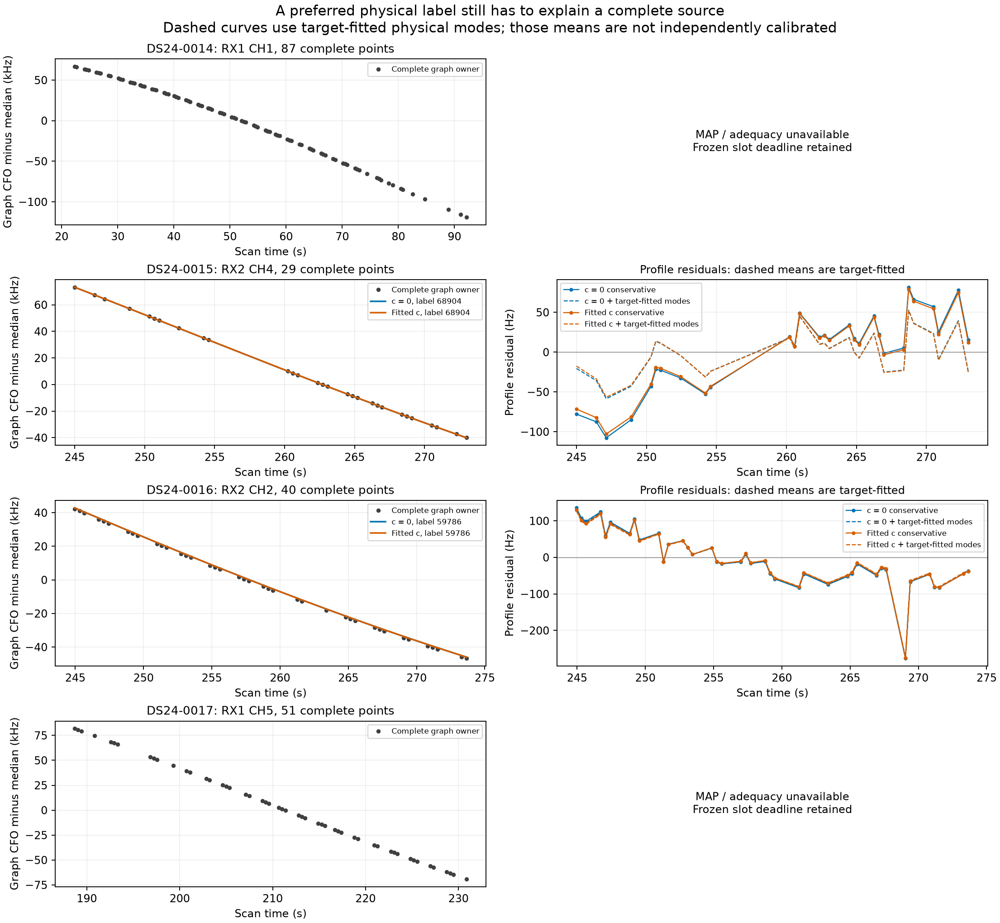
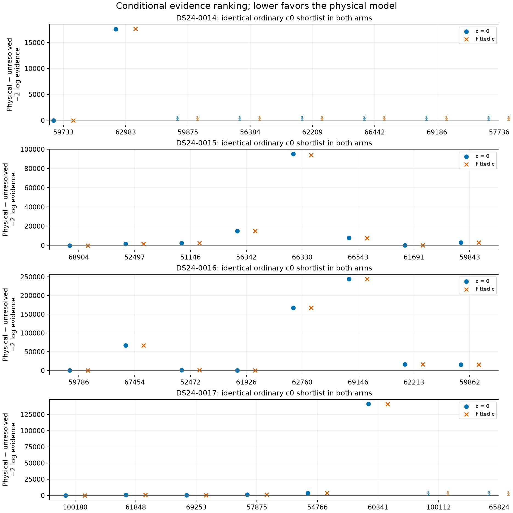

# Information-rich owners still need identity and source adequacy

The frozen four-owner panel produces **no qualified addition and no position
fit**. The completed comparisons favor the archived physical nominees for
0015 and0016, but their conservative residuals fail the original noise tests.
0014 and0017 exhaust their fixed integration allowance; those are unresolved
numerical comparisons, not new evidence of physical mismatch. The current
accepted observations, labels and production reference are unchanged.

All four are exposed development sources with previous baseline retention or
salvage attempts. Their useful local position information was conditional on
the assumed identities, not a validation of those identities. This experiment
tests the missing prerequisites without selecting by geographic error.

## What was actually compared

The [frozen protocol](PROTOCOL.md), [exact binding inventory](protocol.json)
and [actual input smoke](preparation.json) retain the same complete native IDs:

| Case | Complete source | IDs | Archived nominee | Canonical nomination |
| --- | --- | ---: | ---: | --- |
| DS24-0014 | RX1 CH1 T004 | 87 | 59733 | incompatible |
| DS24-0015 | RX2 CH4 T004 | 29 | 68904 | incompatible |
| DS24-0016 | RX2 CH2 T004 | 40 | 59786 | compatible |
| DS24-0017 | RX1 CH5 T004 | 51 | 100180 / A0180 | incompatible |

All207 IDs are absent from the original accepted unions in **both** c arms,
including postfit-only associations. No point was trimmed or replaced. A0180
is the causal catalogue's ordinary Alpha-5 TLE identity, not a synthetic label.

Each case uses its saved c0 RF endpoint in both arms. Ordinary full causal
catalogue nomination received only target observations and the old-only
radio mean/covariance. It retained the archived nominee as rank1 in all four
cases, without receiving that identity as an argument or reserving it. The
ordinary c0 top8 is the exact comparison pool for both arms; the independently
computed fitted-c shortlist happens to agree in all four cases.

For each owner/arm, the whole shortlisted-family union is removed from old
curved **and predictive** conditioning before scoring every candidate and
the proper unresolved comparator. Five fixed-position phase refreshes, old
shared-radio covariance, nominal noise, the explicit unseen-Gamma inverse
moment factor2, and one300Hz owner constant are common within that context.
The common cavities remove480 curved points for0015 and658 curved plus173
predictive points for0016. Thus these residuals are not predictions from the
untouched original parent. This is conditional cavity evidence. It does not restore a shortlisted active
family's original learned calibration only for the winner.

Physical models use the same causal Student nu3 law conditioned on[-15,15]s,
full phase-dependent three-mode B(phi), and uniform proper whole-owner aliases
-4 through4. Impossible nominal visibility has zero likelihood with the
original domain normalization retained. The unresolved model uses the existing
proper degree4 Legendre prior with coefficient SD PERIOD/sqrt6 and exactly the
same background and alias measure. This declared broad null is not calibrated
empirical clutter. Finite-pool evidence is not a posterior probability that a
satellite identity is true.

## Complete results and preserved failures

| Case | c0 / fitted-c outcome | Finite-pool result | Conservative source check |
| --- | --- | --- | --- |
|0014|both timed out during primary integration|unresolved;2/8 candidate checkpoints per arm|unavailable|
|0015|both complete|68904 wins; minimum log-evidence margins11.929 /11.517|fails residual structure|
|0016|both complete|59786 wins; margins28.839 /29.257|fails residual structure|
|0017|both timed out during primary integration|unresolved;6/8 candidate checkpoints per arm|unavailable|

There are4/8 complete owner-arm results,48/64 candidate checkpoints and four
finite-pool ordering certificates. The32 candidates in the complete arm results
and16 checkpoints from incomplete arms all lack the stronger absolute1e-3
integration qualification. The remaining16 candidate slots are unavailable;
the [64-row table](report/candidate_slots.csv) preserves every denominator
slot. No certificate is inferred from a partial pool or an ordinary rank1.

The fixed per-owner-arm allowance was71.005852s. All four failures occurred
inside primary physical integration, before the MAP/adequacy checkpoint or
independent reference stage. No retry, rescue, time transfer or replacement
was performed. [Execution](execution.json) totals513.788986 scientific
worker-seconds, including preparation, tests, freezing and screening, with
254.486076s execution wall time and two single-BLAS workers. This is below
the600s cap. A numerical timeout says nothing new about the source's physical
adequacy. The original rejection history remains separate evidence.

The [RF seal](RF_seal.json) preserves source, inputs, partial checkpoints and
failures. The [owner-arm table](report/owner_arms.csv) and
[report summary](report/summary.json) include complete and unavailable cases.

## Why a small RMS is insufficient

The bounded phase/whole-alias MAP is a diagnostic, not a certified global MAP
or an independently held-out phase estimate. It uses the declared641-point
grid plus causal mean and at most three local refinements. The conservative
residual retains only the old-only parent radio mean and exact nominal orbit
prediction; it excludes target-trained radio changes and physical-mode means.
One whole-owner alias is applied before the original profile/noise comparator.

| Case/arm | MAP phase(s) | Causal z | Conservative RMS(Hz) | Profile bias(Hz) | Main failed noise quantities | Full-mode RMS(Hz) / check |
| --- | ---: | ---: | ---: | ---: | --- | --- |
|0015 c0|0.074603|0.469|49.272|59.730|slope z3.104; ACF0.7597|26.639 / pass|
|0015 fitted c|0.042608|0.448|46.962|54.135|ACF0.7456|26.158 / pass|
|0016 c0|-0.150159|-0.199|75.139|-759.662|slope z5.036; step z4.746; ACF0.6460|73.748 / fail|
|0016 fitted c|-0.143532|-0.188|73.082|-738.351|slope z4.935; step z4.621; ACF0.6295|71.754 / fail|

The inherited noise limits are slope z<=3, step z<=4 and absolute
ACF<=4/sqrt(n):0.7428 for0015 and0.6325 for0016. RMS<=450Hz,
absolute profiled constant<=3000Hz, residual alias0 and nominal visibility
pass in these four diagnostic fits. Full individual statistics remain in the
saved results, rather than reducing failure to a single Boolean.

For0015, target-fitted physical coefficients of approximately
(-0.639,-0.083,0.099) and(-0.601,-0.078,0.093) in unit-prior coordinates
remove enough coherent structure to pass this local comparator. This is a
plausible correction needing independent prediction, not proof of a wrong
satellite or measured orbit calibration. Its conservative fitted-c ACF is
only slightly above the frozen limit; the limit was not relaxed. For0016,
the complete residual retains broad drift and an isolated excursion, and even
the full-mode conditional mean fails. No point is dropped to improve that
comparison.

Solid predictions/residuals use the old-only background and nominal physical
curve. Dashed curves additionally use **target-fitted** physical-mode means;
they are not independent calibration. Both branches retain every native point.
The left panels use graph CFO minus its median, not native wrapped CFO. The
graph-to-native whole-owner shifts are0,2,2,0 PERIOD for0014–0017 respectively.
The finite alias is a graph-gauge coordinate, not an absolute native alias.

The necessary residual check fails in all four available arm diagnostics.
Original `growth_supported` is false for both completed identities. In
addition, the old remaining cavity residual gates pass only0015 c0, failing
0015 fitted-c and both0016 arms. These independent blocks are retained; a
favorable cavity ranking cannot waive them. No shared-family restoration or
independent-owner predictive validation was performed, so neither completed
source is eligible for a new position test here.

These are saved point estimates relative to the unresolved model; negative
values favor the physical model. They are not calibrated odds, and the figure
does not assert absolute integration precision or a complete ordering for the
timed-out owners. Exact bounds and certificate margins are in the JSON results.

## What originally excluded these sources

The canonical seed labels match the selected original radio hypothesis in
all four cases. Thus the stored original metrics below are attributed to the
same label, rather than a relabeled stale residual. Original nomination,
joint-radio fit and later retention epochs are different contexts.

| Case | Canonical RMS/bias(Hz) | Selected original joint-fit conditional RMS c0/fitted(Hz) | Stored exclusion mechanism |
| --- | --- | --- | --- |
|0014|576.936 /8586.753|86.064 /86.111|conditional noise fails: ACF0.605 exceeds0.429; step z4.65 exceeds4; original profile also fails; later ALGO02 removes the salvaged prefix|
|0015|202.710 /5268.639|48.623 /49.203|selected original fit initially passes; later ALGO02 epoch0 excludes the whole owner|
|0016|50.673 /-2280.256|45.935 /45.937|canonical nomination and conditional noise pass, but the stored original-profile predicate fails; later retention excludes it|
|0017|148.182 /627.457|86.887 /86.877|conditional noise fails: step z4.30 exceeds4; original profile also fails; later retention excludes it|

For0017 the ACF itself is below its4/sqrt(51)=0.5601 limit; its documented
conditional noise failure includes the step statistic. The table deliberately
does not infer a canonical primitive cause solely from `compatible=False`.
The saved original-profile rows do not export every primitive reason;0016's
profile failure is therefore not relabeled as a proven ownership-only veto.
Likewise, later exclusion epochs lack complete scalar primitive details and
are recorded as unavailable, not regenerated by a new fit.

Historical salvage had already selected0014's46-point prefix at+0.75s,
0016's40-point source at-0.5s, and0017's51-point source at-7.75s, with saved
RMS70.212,57.586 and79.090Hz. Later processing removed those associations.
They are past development attempts, not newly available independent witnesses
and not the observations used to trim this experiment. The full87/29/40/51
owners remain intact here. Per-case `original_trace.json` and the
[historical table](report/original_gate_history.csv) preserve these distinctions.

## Separate-owner availability is not corroboration

A metadata-only rule, frozen before the new CFO comparisons, selected one
potential complete unused owner per case. It preferred a different receiver,
then identical RF, then overlap, point count and component. All alternatives,
accepted-source exclusions remain in[compact metadata](metadata_compact.json),
with complete target IDs and hashes for the larger external native-owner ledger.
Only after that selection were the archived nominee columns joined for
description; no extra RF scores were computed.

| Case | Frozen potential owner | Points | Time overlap(s) | Same RF | Its archived nominee/status |
| --- | --- | ---: | ---: | --- | --- |
|0014|RX2 CH3 T005|17|0|no|64716 / incompatible|
|0015|RX1 CH7 T009|16|20.329|no|60140 / incompatible|
|0016|RX1 CH2 T012|24|0|yes|62281 / incompatible|
|0017|RX2 CH3 T001|35|0|no|62571 / compatible|

None is an established same-family witness. A different receiver or temporal
overlap does not establish shared transmitter offsets, correct identity or
independence. The existing graph extraction is response-selected. The
[primary witness table](report/metadata_witnesses02.csv) retains all metadata
rows;[reporting correction](report/witness02_seal.json) preserves the original
table whose optional compatibility field used an absent key. No selection or
scientific values changed.

The most useful surviving question is whether0015's modest physical
correction predicts a genuinely separate complete owner under the same shared
radio/orbit hierarchy. Availability and causal nomination/visibility of that
owner must be established before treating it as a same-family challenge.
Its archived60140 assignment is not converted into68904 by fiat. This work
does not justify another position fit, a threshold relaxation, or promotion
from an evidence-rank win alone.

## Replay and scope

Run `qualify.py prepare`, obtain the exact protocol-bound independent receipt,
then `qualify.py run` with all three BLAS environment variables set to1. The
saved preparation and execution here are immutable: a replay requires a new
research directory, the original DS24 scan exports/banks/causal prior files,
the frozen parent/accepted-ID receipts and research modules listed in
[protocol.json](protocol.json). They are external replay dependencies, not
new RF inputs and not a self-contained numerical archive in this small report.

`report_qualification.py`,[the witness-field correction](report_witness02.py)
and[the explicit dashed-curve presentation](plot_adequacy02.py) read only
saved JSON/NPZ arrays; they do not propagate, integrate, fit or alter source
membership. The original reporting artifacts remain preserved. The unused
first freeze in`preparation01/` is retained: the final freeze added the12
causal-prior file bindings and coordinator plan without rerunning preparation.
Four owned tests and the independent preflight passed before catalogue scores.
No GPS, position error, new RF/IQ, label adoption or position optimization was
used anywhere in this branch.
