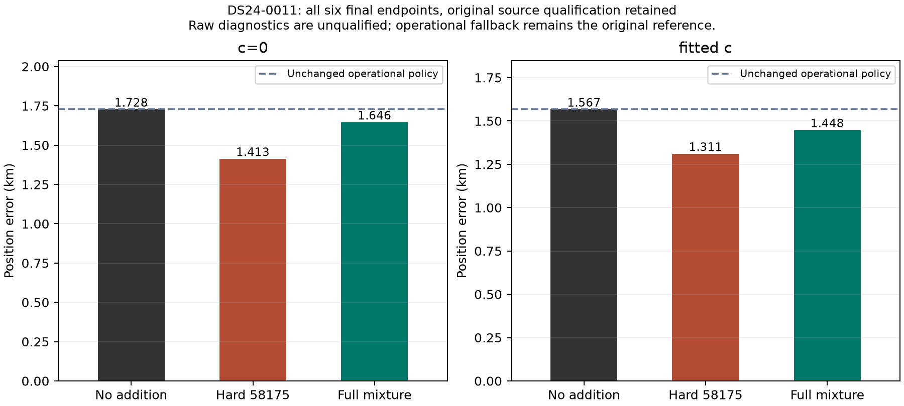
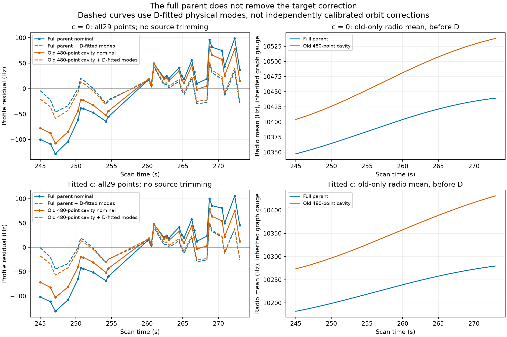
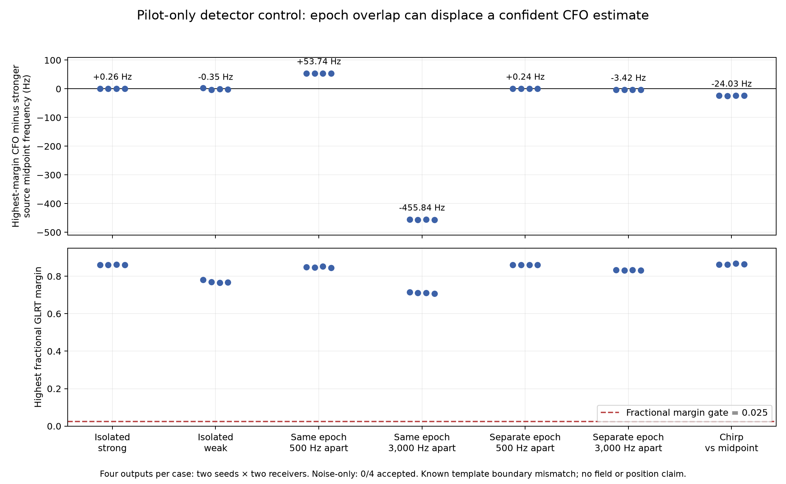

# Fast-scan review: close the measurement and identity evidence gaps

2026-10-26 UTC. The cumulative experiments support **better separation of
measurement error, source identity and orbital timing/shape** as the next
direction. They give little support for another broad recovery campaign,
generic optimizer restart campaign, or unrestricted nuisance correction.
The retained reference remains ALGO02-v1 with the qualified causal signed
timing means and equal-assignment-prior family comparison. No new ALGO is
promoted by this report.

This iteration completes the previously budget-limited whole-source mixture
position test, checks whether the 0015 correction survives full parent
conditioning, and introduces a bounded detector-selection control. All
position comparisons preserve matched c=0/fitted-c inputs and budgets.
Regional inference uses the 25×25 km box centered at 37.906, −122.545. GPS
37.849061591561885, −122.48574968092912 is used only for error reporting after
the RF results and policy decisions are sealed. Only causal TLEs enter inference.

## What the cumulative work establishes

The [preceding cumulative review](../2026_10_25_ds24_ambiguity_position/REVIEW.md)
links the underlying cohorts, failures, information calculations and earlier
method inventory. The comparisons below have different cohorts and are not
additive stages of one benchmark.

| Question tested | Evidence | Consequence for the next allocation |
| --- | --- | --- |
| Did the main algorithm improve? | ALGO01→ALGO02 on 404 matched DS23 outputs: mean error 1.870→1.520 km c0 and 1.870→1.508 km fitted-c. Output availability falls from 407/413 to 404/413. | Keep the demonstrated improvement and report missing outputs. |
| Does adding more graph evidence improve accuracy? | Full ALGO04 recovery candidate: fitted-c association 70.08→75.08%, mean error 1.469→1.591 km, P95 3.157→3.473 km. c0 mean also worsens, 1.479→1.607 km. | Coverage is a diagnostic, not an acceptance objective. |
| Are all eight channels useful? | Same 24 usable out of 34 DS24 scans: CH1–8 / CH1–4 / CH5–8 fitted-c means 1.220 / 1.558 / 2.040 km; c0 1.202 / 1.538 / 2.040 km. | Full-band data already improve average accuracy; gains need not multiply. |
| Is a continuous local minimum the main explanation? | Thirty targeted restarts agree within 2.06 cm; four channel-half identity transfers yield no qualified better full-data solution. | Deprioritize generic multistart for the tested models; discrete identities remain open. |
| Is ordinary curve scatter the limiting error? | RX2 remeasurement reduces median fixed-degree scatter 78.07→22.18 Hz without a qualified cohort gain. | Smoother CFO observations alone do not fix coherent errors or weak geometry. |
| Does another smooth RX correction transfer? | RX1 development fitted-c mean 1.220→1.120 km; frozen eight-later-scan test 1.239→1.224 km, with worse P95 tails in both arms. | Development-sized gain did not transfer; do not add a generic correction. |
| Are known numerical approximations large enough? | Tested parent covariance, nonlinear phase, phase-dependent shape design and log-volume changes have small or unqualified effects. | Preserve the numerical fixes where valid, but do not keep repeating them as a kilometer-scale remedy. |

The strongest observed identifiability issue is separation of position from
satellite timing and shape. The DS24 local model diagnostic has median weak-axis
SD 534 m, 386 m if receiver terms are known, 110 m if orbital timing is known,
and 56 m if timing and shape are known. Median timing/weak-position correlation
is 0.935. Bands share a median eleven calibration families; their weak axes
differ by only 17.7°. These are **conditional model calculations**, not achieved
accuracy or a proven physical floor. They explain why more channels can add
many samples of the same uncertain satellite motion without supplying a new
independent geometric reference.

All compared fast scans are 10 MS/s, so the data do not identify a causal
sample-rate effect. The nominal 40° feed separation changes coverage; it is
not a calibrated bearing measurement or separated-station baseline. A different
sample-rate or orientation claim requires matched measurement evidence. It
should not be inferred from fast-versus-adaptive cohort differences.

## New result: the mixture completes, but is still an unqualified addition

The [previous bounded study](../2026_10_26_ds24_ambiguity_policy/README.md)
completed hard-label and no-addition fits but timed out both whole-source
mixtures. This iteration caches nominal and physical-mode satellite states at
the unchanged quadrature nodes. Geometry and parent conditioning still respond
to receiver position and each phase refresh. Eight causal identities, nine
aliases, physical/unresolved model weights and all likelihood terms remain
unchanged.

On the frozen equivalence panel, cached and original scores and finite-difference
gradients agree exactly. Eighty paired score evaluations take 106.83 versus
34.90 seconds, approximately 3.06× faster. The original implementation ran
first, so the timing includes a warm-parent/order caveat; this is not an
embedded-system benchmark. The read-only numerical cache occupies 2.068 GB.
All six fits now complete five refresh rounds under the original 60 s fit cap.
Endpoint diagnostics use the separately declared remaining branch budget.

| DS24-0011 method | Raw diagnostic error c0, km | Raw diagnostic error fitted-c, km | Operational result |
| --- | ---: | ---: | --- |
| No addition | 1.727734 | 1.567031 | Retained reference |
| Hard addition | 1.413451 | 1.311280 | Rejected; reference returned |
| Whole-source mixture | 1.645789 | 1.448246 | Rejected; reference returned |

The mixture's raw error is 82/119 m lower than no addition, but 232/137 m higher
than the hard addition. This exposed case does not validate either policy.
Both additions fail the original conditional source and support requirements;
the source has only one receiver/channel owner and no accepted curved family.
The c0 hard and mixture endpoints additionally lose 29 and 21 original postfit
accepted IDs. Those losses are postfit classifications, not deleted parent
likelihood observations; preservation is a conservative experiment guard,
not proof the old labels are correct. Fitted-c loses no old IDs but still fails
source admission. Operational error and association remain exactly the reference.

The old 254–305 m scaled-secant diagnostic was a local mixture-versus-hard
movement proxy. It was never a predicted GPS improvement or a complete fit.
The six completed fits now supply that missing comparison. The 0012 pilot
remains unresolved; it was not silently rerun or replaced.

At the final mixture endpoints, 58175 and 63312 receive almost all model weight;
the unresolved component gets less than 4.5×10⁻¹³. That is not calibrated identity
certainty or validated abstention. The broad unresolved law and finite candidate
pool matter, especially when the original source gates still fail. Adding an
unknown component by itself does not ensure useful rejection behavior.
[Full position findings](position/FINDINGS.md),
[all endpoint rows](position/geographic/outcomes.csv),
[independent terminal audit](audit/position_terminal.json).

## New result: a fitted satellite correction lacks independent corroboration

For DS24-0015, restoring the 480 original curved observations removed by the
earlier candidate-union cavity does not eliminate the 68904 target's correction.
Its leading conditional physical-mode mean increases from about −0.6 to −1.1
prior units. The nominal residual structure persists; using target-fitted
mode means reduces full-parent RMS from 62–65 Hz to about 24 Hz.

This excludes the narrow explanation that removing those parent observations
alone created the correction. It does not distinguish orbit error, coherent
measurement error or wrong identity. The mode columns also contain level and
phase-like components. A lower fitted RMS is not an independent orbit calibration.

The complete inventory of 164 original owners finds **zero separate eligible
owners explicitly nominated as 68904 in the audited archived fields**. Full
alternative candidate lists were not persisted, so this is an evidence-availability
result, not proof that no other curve belongs to 68904. We do not relabel an
unrelated owner to create corroboration. All four diagnostics finish in 10.54
worker-seconds; no position fit or observation admission follows.
[Complete findings](witness/FINDINGS.md),
[164-owner inventory](witness/report/owner_inventory.csv).

## New lead: measurements can look confident while combining sources

The original-window detector replay already reproduced the archive exactly.
This iteration runs the unchanged deployed detector on sixteen paired synthetic
20 ms windows, retaining all 256 exported candidate records. Isolated signals
are recovered closely, but pairs with coincident frame epochs produce roughly
+54 Hz and −456 Hz highest-margin CFO displacements in the tested configurations.
Separating their epochs reduces the displacement substantially. Margins remain
well above the detection gate in the displaced cases.

The integral-epoch construction test found a template discretization mismatch
at 68 exact symbol-boundary samples; that original test remains failed. The
count does not describe the fractional-epoch detector windows themselves.
There is no payload or analog channel. Four outputs per scenario cannot
establish field bias or a false-alarm rate. The chirp's approximately −24 Hz
midpoint difference also needs an effective-time analysis before calling it bias.
All limitations, raw candidates, failed prerequisite and pre-detector amendment
remain in the [detector-control report](iq/FINDINGS.md).

This is a more specific new mechanism than another flexible orbit fit:
**a smooth measured curve might represent a biased mixture of signals**.
Whether that mechanism survives actual graph construction, occurs in recorded
data, and matters for geographic error remains untested.

## Recommended next sequence

1. **Trace measurement selection into track ownership.** First isolate the
   known waveform-discretization difference with a detector-template closure
   control alongside the continuous synthetic law. Then use a short frozen
   sequence of two known CFO trajectories, with a crossing and a matched
   separated-source control, through the unchanged detector and graph input
   contract. Compare all observed peaks/owners with oracle measurements and
   oracle ownership for diagnosis only. Count source switches, mixed smooth
   tracks, misses and CFO displacement; do not begin with a position campaign.
   If a meaningful failure survives, inspect a small RF-selected archived
   example before designing any repair. No new RF collection is needed.

2. **Require predictive evidence for new physical corrections.** The 0015
   correction can next be tested on a predeclared chronological half of the
   same source, forecasting the other half and reversing direction, with shared
   phase, modes, owner constant and radio covariance. Held values must not set
   parameters or phase weights. This can reject a correction that only fits
   its training span; even success cannot establish identity because both halves
   are one selected owner. A separately nominated complete owner remains the
   stronger prerequisite for new-family admission. Stop repeating target-only
   fits if neither form of predictive evidence is available.

3. **Calibrate any changed acceptance policy before broad deployment.** The
   current support and residual guards are necessary for this comparison, but
   their preservation is not proof that every threshold is a calibrated physical
   identity test. Do not loosen them because GPS error improves. A replacement
   needs positive and wrong-identity/composite-source controls, proper shared
   uncertainty and an unresolved outcome. Only an implementable frozen policy
   with a demonstrated mechanism should reach a matched-c position comparison
   and then an exposure-checked later block, with means, tails and failures.

The whole-source mixture is now a tractable diagnostic, not the lead production
candidate. We should also defer unchanged broad recovery, generic multistart,
blanket smoothing, more unconstrained receiver terms and prior narrowing from
known-location error. Existing grouped-family, orphan-mixture, HMM, sample-clock
and causal-TLE-history experiments must be reviewed before proposing those
mechanisms again. The SOL xhigh branch reviews agree on measurement/ownership
as the highest-value gap: [scientific proposals](witness/NEXT_DIRECTIONS.md)
and [independent critique](audit/NEXT_DIRECTIONS.md).

All current DS24 and eight later RX1V outcomes are exposed development evidence.
None demonstrates a new-location gain. Numerical completion, polynomial
coverage, satellite plausibility, operational membership and geographic accuracy
remain separate reported outcomes.

## Reproduction and publication

The [coordinator plan](COORDINATOR_PLAN.md) assigns two scientific branches and
one independent SOL xhigh reviewer. Position work uses 419.66 cumulative
worker-seconds including preparation against its 600 s cap; witness work uses
10.54 against 300 s. The IQ invocation takes 21.81 s against its 120 s cap.
These budget measures have different scopes and are not a pipeline benchmark.
There is no new RF, QNAP mutation, production change or golden-fixture update.

Branch protocols, tests, immutable results, figures and compact tables are
included; original corpus, prior numerical banks and the large reusable cache
remain external hash-bound replay inputs. The publication manifest identifies
every included and external file. Remote main receives the report from a clean
publisher checkout; unrelated workspace changes are preserved.
