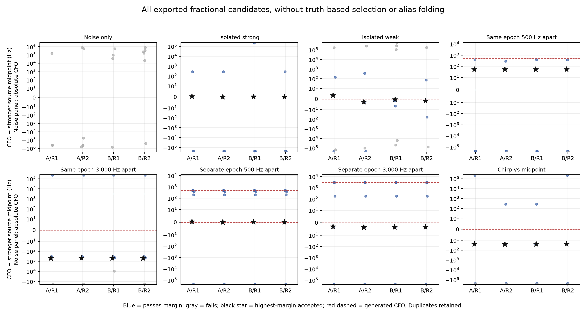

# Close signals can displace a confident frequency estimate in this control

The frozen pilot-only control completed all **16 paired windows / 32 receiver
outputs** in 21.81 seconds. The highest-margin accepted candidate closely
recovers the isolated static source. Coincident-epoch source pairs produce
frequency displacements of about +54 Hz and −456 Hz relative to the stronger
source, despite high margins. Separating the two epochs substantially reduces
those displacements. This establishes a mechanism within the declared synthetic
law, not field bias, a satellite identity, or a localization improvement.

## Measured outcomes

Each row has four outputs: two fixed seeds × two receivers. Receivers have
independent noise but the same generated signals; these are not four different
physical scenarios. The table reports the arithmetic range, not an uncertainty
interval or population estimate. All seven signal scenarios have an accepted
candidate in all four outputs. Noise-only has none in four outputs; its largest
fractional margin is 0.01545, below the fixed 0.025 gate.

| Generated scenario | Highest-margin CFO minus stronger-source midpoint, Hz | Highest fractional margin |
| --- | ---: | ---: |
| Isolated strong | +0.10 to +0.55 | 0.860–0.864 |
| Isolated reduced amplitude | −2.70 to +3.34 | 0.766–0.782 |
| Same epoch, frequencies 500 Hz apart | +53.23 to +54.16 | 0.846–0.852 |
| Same epoch, frequencies 3,000 Hz apart | −455.99 to −455.55 | 0.707–0.715 |
| Separate epochs, 500 Hz apart | +0.08 to +0.53 | 0.860–0.861 |
| Separate epochs, 3,000 Hz apart | −3.60 to −3.11 | 0.831–0.834 |
| Single chirp, 10,000 Hz/s | −24.59 to −23.67 | 0.862–0.869 |

The chirp spans 100,000–100,200 Hz over the 20 ms window. Its comparator is the
100,100 Hz midpoint frequency. A constant-CFO fit can have a different effective
time within that window; the approximately −24 Hz difference is **not** an
established estimator bias until the detector's effective-time convention is
identified. The reduced-amplitude signal remains far above the margin gate;
this experiment does not characterize near-threshold detection.

The two sources in the overlap scenarios share an identical pilot sequence,
have amplitudes 1,000 and 600, and have fixed distinct carrier phases. Their
frame epochs are either both 127.25 samples or 127.25 and 811.75 samples. Noise
RMS is 300 ADC units. The noise draw is paired across scenarios within each
seed/receiver. No clipping occurs. The result is conditional on these exact
scenarios; no monotonic separation law or field occurrence rate is inferred.

## Preserve candidates and distinguish detection from identity

All **256 exported candidate records** remain in the raw JSON and
[candidate CSV](report/candidates.csv). Blue points pass the fractional margin
gate, gray points fail, and black stars identify the highest-margin accepted
candidate. Red dashed lines mark generated midpoint frequencies. The plot
does not fold frequency aliases or choose the candidate closest to truth.
Duplicate proposals and remote frequency alternatives remain visible; the
number of accepted candidates is not the number of physical sources.

The protocol separately records every candidate within three circular-frame
samples of each generated epoch. For coincident epochs the same candidate can
appear in both source lists: epoch proximity does not resolve identity.
For separated epochs, weaker-source candidates also appear, including an
approximately +16 Hz offset in the 3,000 Hz case. The headline table describes
the highest-margin selection only. It does not replace downstream graph
ownership or claim that all exported candidates would become graph members.

## Construction limitation and retained failed test

Before any detector call, the original integral-epoch full-frame construction test failed at
**68 of 13,333 samples**, all exact 44-sample symbol boundaries. Off-boundary
maximum disagreement is 1.493e−7. The deployed sampled template uses floating
division followed by floor, which chooses the preceding symbol at some exact
boundaries. The direct generator uses a continuous law with right-boundary
symbol intervals. This is a known discretization mismatch, not proof that a
physical receiver or immutable scientific fixture is wrong.

The [pre-detector amendment](AMENDMENT02.md) retains that failed test and the
original tolerance. Five amended construction/reporting checks pass, including
analytic evaluation of every right-boundary sample, the right-hand limit and
the original off-boundary tolerance. The original suite remains **3 passed /
1 failed**; it is not relabeled as an all-passing waveform-parity test. The
golden fixture and detector implementation are unchanged.

There is no payload, analog filtering, multipath, hardware drift, or satellite
propagation in this synthetic law. No recorded background is assumed to be
noise-only. A separate preceding study reproduced one original archived
window exactly; this branch does not rerun it or read original IQ. The known
template mismatch means this control cannot isolate how much displacement
would persist with a different physically justified waveform representation.

## Decision

This supports a bounded measurement-selection investigation before adding more
orbit freedom. First separate waveform discretization effects from superposed
signals using a declared detector-template closure control alongside the
continuous law. Then send a short known two-source sequence through actual
peak selection and graph construction, retaining an oracle-measurement and
oracle-ownership comparator for diagnosis only. Measure source switches,
misses, mixed tracks and coherent CFO displacement. Do not turn a toy residual
improvement into a correction applied to real scans.

No production code, graph constructor, satellite assignment, source gate or
position estimate changes here. There is no new RF collection. The original
sixteen slots ran once, with a 120 s total and 20 s per-slot internal cap.

Sources and provenance: [protocol](protocol.json), [control](control.py),
[original tests](test_control.py), [amended tests](test_control02.py),
[preparation receipt](preparation_tests.json), [raw results](results.json),
[32 receiver rows](report/receivers.csv), [scenario table](report/scenarios.csv),
[saved-output reporter](report.py), and [report seal](report/seal.json).
