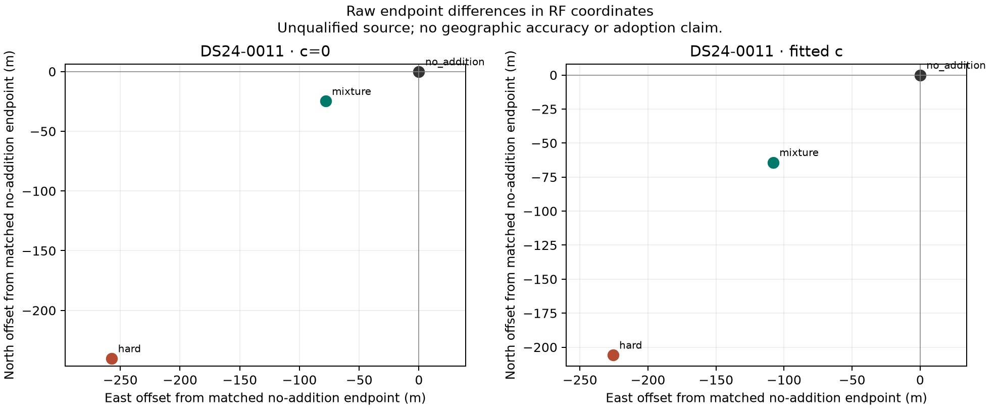
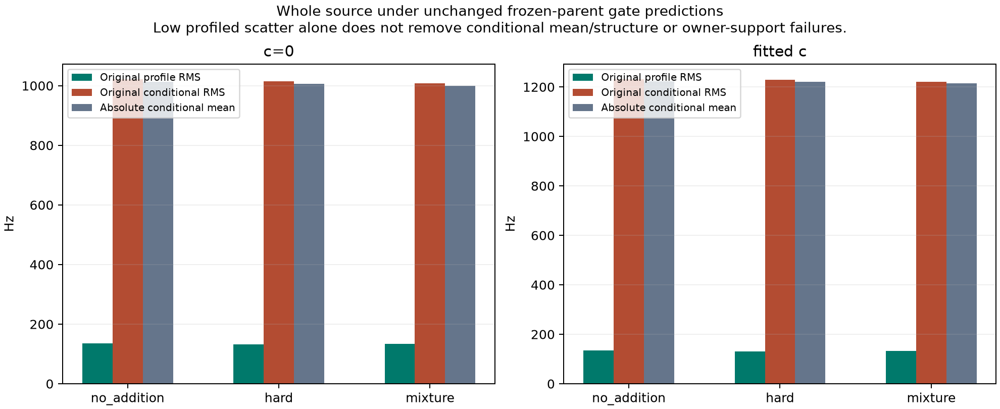

# Exact caching completes the ambiguity position comparison

All six DS24-0011 controls completed under the unchanged solver and fit caps.
Exact satellite-state caching resolved the previous computational blocker;
the scientific law was unchanged. The full mixture moves the final endpoint
materially relative to hard 58175, but yields **less raw geographic improvement
than hard addition** on this exposed development case. Every added source
remains unqualified, so operational policy retains the exact original reference.

| Arm | No-addition error (km) | Raw hard error (km) | Raw mixture error (km) | Hard reduction (m) | Mixture reduction (m) | Operational error (km) |
|---|---:|---:|---:|---:|---:|---:|
| c=0 | 1.727734 | 1.413451 | 1.645789 | 314.283 | 81.945 | 1.727734 |
| Fitted c | 1.567031 | 1.311280 | 1.448246 | 255.751 | 118.785 | 1.567031 |

These are six completed final endpoints, not substituted partial rounds.
The separate geographic evaluation followed immutable RF seal, B terminal
PASS and explicit root release. It reuses the prior evaluator's coordinate,
haversine and fallback functions; only the completed-slot denominator changes
from four to six. It uses the same known site, with no fitting or gate changes.
[All geographic rows](geographic/outcomes.csv) retain the diagnostic/policy distinction.

## What completion adds beyond the old secant

The earlier fixed-position pilot reported curvature-scaled secant proxies
of −304.9 m / −254.0 m along the frozen c0 weak axis. Those were not actual
movement or accuracy bounds. The completed five-refresh optimization now gives:

| Mixture minus hard | c=0 | Fitted c |
|---|---:|---:|
| Actual endpoint separation (m) | 280.1 | 184.1 |
| Actual projection on old weak axis (m) | −279.5 | −183.7 |
| Raw error increase relative to hard (m) | 232.3 | 137.0 |

Thus retaining alternatives materially changes the optimizer's result, rather
than only a local score. The old numerical interval bounded its secant proxy,
not this new displacement. Similar sign/scale on the same exposed case is
not calibration of a movement prediction. Mixture endpoints are only
82.0 m / 125.7 m from no addition in RF coordinates.
[Exact vectors](compact/endpoint_vectors.csv) separate these quantities.

At the final mixture endpoints, saved density weights are approximately
58175:0.5754 / 0.6957 and 63312:0.4246 / 0.3043. Other physical weights total
less than 0.000006; unresolved weights are below 4.5×10⁻¹³. These are conditional
model weights under the fixed prior, **not calibrated identity probabilities**.
58175 remains largest at both final mixture endpoints. The broad unresolved
prior contributes negligibly, so this does not validate unknown rejection or
abstention calibration. [All nine weights](compact/mixture_weights.csv) are saved.

## Exact implementation and measured cost

The cache stores only original `paired_phase_states` nominal position/velocity
and three mode position/velocity arrays at the unchanged GL16/32/64 phase nodes.
Receiver ECEF/ENU, look angles, frequency and physical-mode projection recompute
at every position. Parent radio covariance, coefficients and Gamma remain live
and belong to fresh Target instances at every outer phase-refresh round.
All original native IDs, eight candidates, prior normalization, visibility,
nine aliases, positive Woodbury calculation and unknown law are retained.
There is no pruning, reduced quadrature or likelihood approximation.

Before values, [preparation_protocol.json](preparation_protocol.json) froze
tolerances and the old three RF probes plus (0,0) and all four (±10,±10) km
regional points. Eighty paired scores, sixteen finite-difference gradients,
64 all-node candidate geometry checks and twelve higher-order score checks
match the original **exactly**. Both actual cross-round checks reproduce a
fresh original parent conditional while covariance changes and satellite keys
stay fixed. Four owned tests and independent preflight pass.

The ordered 80-score timings are 106.825 s original versus 34.899 s cached,
or 3.061×. The original call came first, so the cached call benefits from a
warm shared parent; this is an ordered paired measurement, not a general
benchmark. [Equivalence/timings](report/equivalence.csv) retain every control.

Both mixtures finish five rounds in **54.646 s / 52.799 s of fit time**, below
the unchanged 60-second fit cap. Their total method times, including the
separate endpoint numerical checks, are 68.918 s / 67.116 s, charged to the
same overall arm budget. Total charged science is **419.6561338426545
worker-seconds**, including 235.616 s preparation/tests. There were no failures,
retries, larger caps or altered starts. All original no-addition/hard endpoints,
parent ELBO and full parent-plus-target scalar objectives reproduce exactly.
[Control/cost rows](report/controls_and_cost.csv) retain both iterations' outcomes.

## Qualification remains decisive

All six endpoints pass original parent residual, phase/Gamma and point
GL16/32/64 numerical checks. Point quadrature agreement does not establish
global integration certification or source identity. The original complete
source still fails conditional-residual/noise gates and the one-owner growth
support requirement. Marginal uncertainty does not create calibration owners
or qualify a learned orbit correction.

Parent frequency RMS remains separate from accuracy: c=0 no-addition/hard/
mixture are 82.14180/82.13577/82.14332 Hz; fitted c gives
81.99072/81.98697/81.99048 Hz. The mixture's profiled target scatter is only
134.43/133.29 Hz, while original conditional target RMS remains
1008.49/1221.01 Hz with mean/structure failures. Low profiled scatter is not
adequacy of the original conditional prediction.

All original curved/predictive likelihood IDs are retained. In c=0, hard loses
29 accepted postfit-only IDs (21 from NORAD57955 and eight from NORAD68031);
mixture loses the 21 from NORAD57955. Neither fitted-c addition loses accepted
IDs. These association-preservation failures are separate from the passing
parent residual gates. [Compact endpoint/gate facts](compact/endpoints_and_gates.json)
retain exact lost IDs, source diagnostics and convergence flags. All added
source outcomes fall back, including fitted-c outcomes whose parent coverage
is preserved. There is no production promotion or cohort performance claim.

## Artifacts and replay limits

[PROTOCOL.md](PROTOCOL.md), [protocol.json](protocol.json),
[RF audit](../audit/position_terminal.json) and
[geographic readback](../audit/geographic_readback.json) preserve the separation
of scientific equivalence, endpoint qualification and evaluation. No new RF,
GPS-informed design, position prior, candidate injection or source trimming
was used. DS24-0012 remains unresolved and was not reattempted.

The read-only cache is 2,067,827,712 bytes and is intentionally **not published**.
[cache_manifest.json](cache_manifest.json) records every state/input/code key
and byte hash. [lean_publication.json](lean_publication.json) binds compact
public outputs and externally retained large states/gate ledgers; public tables
alone cannot replay original calibration without the local corpus. The original
sources and prior results remain unchanged.

This iteration establishes a tractable exact implementation and completes
one mechanism test. It does not establish that ambiguity marginalization is
a better positioning policy: the raw hard result is better on this case,
and neither method clears source admission. Further value requires independent
source qualification and broader validation, not a gate waiver or a new claim
from the former secant proxy. No further scientific run was performed.
