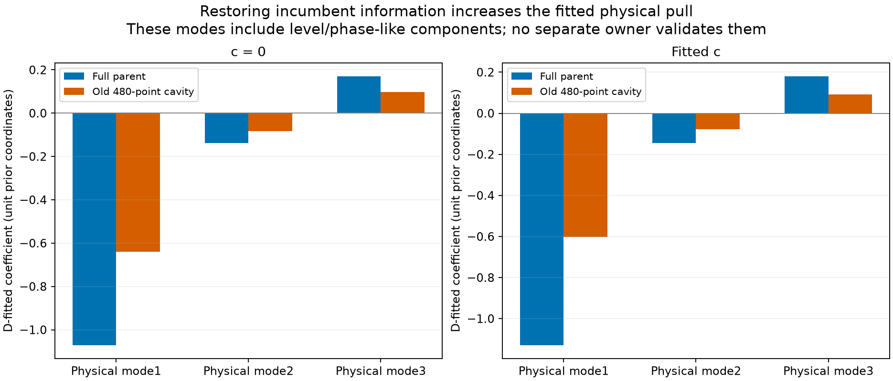

# Restoring the parent does not remove the 0015 correction

The 0015/68904 source still needs a target-fitted correction when all original
parent observations are restored. Its leading physical-mode mean increases
from about −0.6 to −1.1 unit-prior coordinates. There is **no separate complete
unused owner with an explicit persisted own 68904 nomination in the audited
fields**. No independent prediction, identity qualification, observation
addition or position fit follows from this result.

All four frozen full-parent/cavity comparisons completed. The
[RF seal](RF_seal.json) and [execution](execution.json) retain 10.541402
cumulative scientific worker-seconds, including metadata, owned tests and
preparation, against the 300 s cap. Execution itself took 2.574449 s with one
single-BLAS worker. There were no retries or unavailable diagnostic slots.

## The missing evidence is a separate source, not another fitted curve

The [complete owner table](report/owner_inventory.csv) covers all 164 original
DS24-0015 graph owners across both receivers, all bands and original source
classes. It preserves accepted-overlap counts, original quality, native-ID
hashes and each owner's archived nomination labels. The full native-ID ledger
remains in the hash-bound local `witness/inventory.json`.

The audit reads canonical seed rows, all three original radio hypotheses,
the initial algorithm's final node, stored salvage alternatives/selection and
all 62 ALGO02 predictive offers. **Only the 29-point discovery owner itself has
68904 in these persisted own-label fields.** After excluding discovery/native
ID overlap and either arm's complete accepted union, the separate-owner count
is zero. This selection was frozen before new target-fit comparisons.

Complete alternative feasible-candidate lists are not persisted in these
artifacts. Their absence is unavailable evidence, not an implicit negative.
The result does not prove that no other radio curve physically belongs to
68904. Conversely, the previously metadata-selected RX1 CH7 T009 owner has
its own archived 60140 nomination; it is not converted to 68904. Original graph
extraction and joint radio hypotheses are response-selected and may share D
calibration, so even an archived same-label row would still need its own
target-independent nomination/provenance check before serving as corroboration.

This is a specific availability gap. The earlier
[DS23 grouped new-family experiment](https://github.com/misko/leo-tracker-reduxredux/blob/main/reports/2026_10_22_ds23_dbg01_iteration_007/README.md)
already nominated pairs/triples of unused linear fragments and integrated a
shared new-family phase/three physical modes with full old-radio covariance;
linear fragments did not calibrate receiver offsets/drifts. The later
[CH5-only whole-owner prediction](https://github.com/misko/leo-tracker-reduxredux/blob/main/reports/2026_10_25_ds24_ch5_prediction/prediction/FINDINGS.md)
already tested joint D/W evidence with D physical in both competing models:
CH3 was inconsistent with the shared-family hypothesis, while CH4 remained
budget-limited. Repeating generic grouping or calling a fitted D curve its
own validation would not supply the missing independent 68904 evidence here.

## What restoration changes

Both c arms use the same saved c0 RF endpoint and the complete 29 discovery
IDs. 68904 is absent from original active curved **and predictive** family
state, so the target's fresh three-mode prior does not duplicate a learned
incumbent orbit. Full conditioning restores all 480 curved points removed by
the previous ordinary-top8 union cavity; no predictive points differ.

Both contexts use the same five fixed-position parent phase refreshes. Thus
“full parent” means full original observation conditioning at the common RF
point, not a replay of the original position optimizer or original joint
radio fit. Its old-only calibration and Gamma remain untouched by D values.
The [actual smoke](preparation.json) reproduces all four previously saved
raw/C/q arrays **exactly**; shifting only D CFO by 1000 Hz changes neither old
coefficients, covariance nor noise. Original full-parent gates pass in both
arms. The old fitted-c cavity's remaining residual-gate failure stays explicit.

The [matched law](PROTOCOL.md) is unchanged across contexts: causal Student
nu = 3 phase prior conditioned on [−15, 15] s, uniform nine whole-owner aliases,
full B(phi), old/new radio covariance, one 300 Hz owner constant and original
noise convention. The bounded 641-point grid plus causal mean and at most
three local refinements is the previous **MAP diagnostic**, not a certified
global MAP, evidence integral or calibrated posterior. No failed prior
integral is retried.

The reported physical-mode means are conditional Gaussian coefficient means
at that diagnostic phase/alias, expressed in unit-prior coordinates; they are
not phase-marginal posterior means or isolated ephemeris/curvature errors.

| Quantity | c0: old cavity → full parent | Fitted c: old cavity → full parent |
| --- | --- | --- |
| Phase MAP (s) | 0.074603 → 0.069491 | 0.042608 → 0.033555 |
| Leading physical-mode mean, prior units | −0.639297 → −1.070437 | −0.601494 → −1.128522 |
| Conservative profile RMS (Hz) | 49.272 → 61.974 | 46.962 → 64.844 |
| Conservative slope z | 3.104 → 4.121 | 2.920 → 4.355 |
| Conservative lag1 ACF | 0.7597 → 0.8175 | 0.7456 → 0.8275 |
| D-fitted-mode profile RMS (Hz) | 26.639 → 23.709 | 26.158 → 23.590 |
| D-fitted-mode necessary comparator | pass → pass | pass → pass |

The whole-owner MAP alias remains 0 in the inherited graph gauge in all four
contexts; native observations are uniformly graph values plus 2 PERIOD.
This is not an absolute native-alias assignment. The causal phase location
and marginal SD before domain conditioning remain −0.626885 s and 1.495137 s.

The full-minus-cavity old-only radio mean changes by RMS 80.086 Hz (c0) and
123.226 Hz (fitted c), mostly a level shift but with time structure. The base
predictive covariance changes by 8.116% and 7.420% in Frobenius norm. Phase MAP
shifts are only −5.112 ms and −9.052 ms. A separate
[same-old-MAP phase/alias comparison](report/fixed_old_phase.csv) holds those
target parameters fixed while restoring the parent; it preserves the larger
required physical pull. The effect is not merely a new phase proposal.

Solid residuals use only the old-only background and exact nominal curve.
Dashed residuals additionally use **D-fitted** physical-mode means. All 29
points remain; neither branch learns target noise or updates the parent radio
mean from D. The conservative residuals fail the original structure comparator
in both contexts and arms. For full fitted-c, step z = 4.136 also exceeds 4;
full-parent ACF 0.818/0.827 exceeds 4/sqrt(29) = 0.7428. Low absolute RMS does not
make this structure independent noise.

The full three-coordinate mean is approximately (−1.070, −0.139, +0.170) for c0
and (−1.129, −0.146, +0.180) for fitted c. These physical columns contain level
and phase-like components as well as curvature; this is not an isolated
curvature correction. The fitted means are plausible latent pulls under the
declared prior, not measured orbit calibration or proof of a physical cause.

## Decision and limits

This rejects the narrow explanation that the previous correction was caused
solely by removing 480 incumbent observations: restoring them strengthens it.
It does **not** authenticate 68904, distinguish orbit error from other coherent
radio/path/transmitter effects, validate the unsupported mode means, or show
better position accuracy. Original support requirements are unchanged and
`growth_supported` remains false. The production reference stays fixed.

The next useful 68904 test requires an actual separate owner nominated from
its own data with D excluded from its calibration/selection, followed by a
shared-family D-only prediction with full radio/orbit cross-covariance and an
unresolved/alternative-identity comparator. That mechanism is established;
its prerequisite is not met by this archived inventory. Do not repeat the
same D fit, force 60140, relax the residual gate, or start a position experiment
as if independent support had appeared.

All contexts are exposed development data. The parent is a local
Gaussian/variational approximation, physical-mode response is linear in its
three coefficients, and target phase/alias selection uses D. Full absolute
phase integration and candidate competition are outside this narrow
conditioning test. No geography, new RF/IQ, future elements or operational
identity/ownership change enters the branch.

## Replay

Sources are [inventory.py](inventory.py), [contrast.py](contrast.py), four
[owned tests](test_contrast.py), and the saved-array [reporter](report.py).
The [protocol](protocol.json) binds actual causal inputs, source closure and
all four prepared backgrounds. Exact old RF-sealed inputs were independently
verified before execution. Run `inventory.py`, tests, `contrast.py prepare`,
obtain the exact B preflight, then `contrast.py run` in a new research output
directory with `OPENBLAS_NUM_THREADS=1`, `OMP_NUM_THREADS=1` and
`MKL_NUM_THREADS=1`. `report.py` only reads
the sealed arrays/JSON after execution.

The compact report includes the [complete 164-row inventory](report/owner_inventory.csv),
[four-context diagnostic table](report/diagnostics.csv),
[116 per-point comparison rows](report/per_point.csv),
[same-phase controls](report/fixed_old_phase.csv) and
[summary/provenance](report/summary.json). Original DS24 exports, causal banks,
parent receipts and older research modules remain external replay dependencies;
this report is not a standalone full raw-input closure. The full local
inventory and parent metadata remain hash-bound and unchanged.
