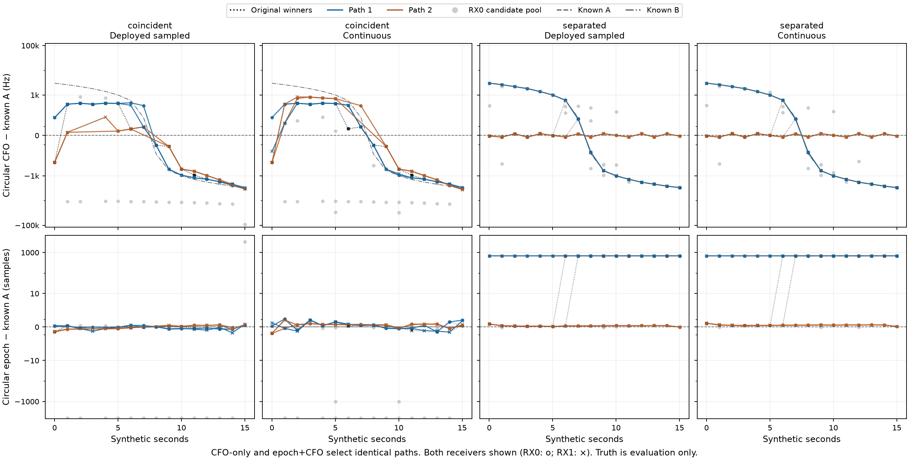
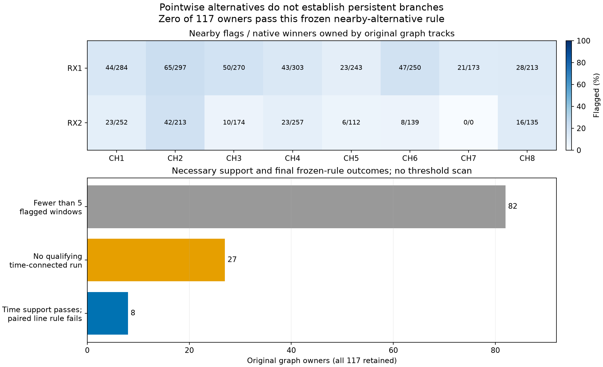
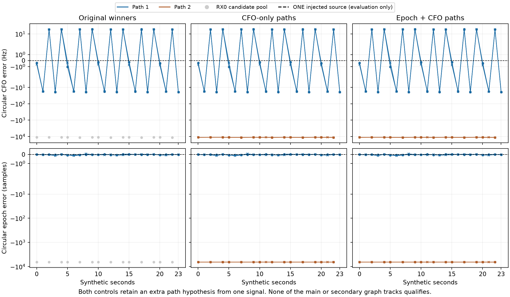

# Fast-scan review: what has improved, what has not, and the next decision

Reviewed 2026-10-26 UTC. The strongest retained improvement is still the
ALGO02 lineage, with qualified causal timing priors and equal-prior satellite
family comparison. Recent work has clarified failure mechanisms, but has not
established another transferable position-accuracy improvement. No new ALGO
version is justified by this iteration.

My recommendation is to stop expanding smooth candidate-path recovery for now.
Concentrate the next small experiment on the integrity of measurements from
**already accepted, position-influential families**. A corrected observable or
independently supported orbital constraint could help. More flexible curves,
more nominal associations, and more optimizer starts have repeatedly failed to
provide reliable gains.

This report combines a review of saved studies with the completed candidate
continuity controls. The current scientific branches use two SOL xhigh agents
and an independent SOL xhigh reviewer. No new real-data position fit occurs in
this iteration. The historical detector, production algorithm, original corpus
and golden fixtures remain unchanged.

## What we have tried

These are separate matched cohorts, not additive stages of one benchmark.
The linked sources retain c=0 and fitted-c controls, failures and tails.

| Direction | Measured result | Assessment |
| --- | --- | --- |
| Graph, EM, Hough and multiple-hypothesis polynomial construction | Roughly 90–93% polynomial membership on DSX01 S01 | Successful curve construction; not satellite identity or position validation |
| ALGO01 to ALGO02, 404 common DS23 outputs | Mean error 1.870→1.520 km c0; 1.870→1.508 km fitted-c; qualified outputs 407/413→404/413 | Substantial retained gain, with an availability tradeoff |
| Equal-prior family comparison, 410 DS23 cases | Mean 1.509→1.479 km c0; 1.498→1.469 km fitted-c | Modest retained gain; temporally dependent, same-site evidence |
| Full ALGO04 recovery candidate, 410 cases | Fitted-c association 70.08→75.08%, but mean error 1.469→1.591 km and P95 3.157→3.473 km; c0 also worsens | Reject broad recovery as an accuracy improvement |
| CH1–8 / CH1–4 / CH5–8, same 24 usable DS24 fast cases | Fitted-c means 1.220 / 1.558 / 2.040 km; c0 1.202 / 1.538 / 2.040 | All channels already help on average |
| Continuous optimization and assignment transfers | Thirty restarts agree within 2.06 cm; four half-channel identity transfers produce no qualified better full-data solution | Generic continuous multistart is low priority for the tested assignments |
| RX2 pilot CFO/time refinement, 322 curves | Median fixed-degree scatter 78.07→22.18 Hz without a qualified cohort accuracy gain | Cleaner individual curves are insufficient |
| Smooth shared RX1 correction | Development fitted-c mean 1.220→1.120 km; later eight cases 1.239→1.224 km with worse tails; c0 later mean changes only 1.243→1.240 km | Development-sized gain did not transfer; retain reference |
| More exact nuisance treatment | Tested nonlinear phase, log-volume, phase-dependent shape and parent covariance changes have small or unqualified effects | Close these specific variants rather than repeat them unchanged |
| Whole-source uncertain satellite mixture | DS24-0011 raw diagnostic position improves 82/119 m c0/fitted-c, but fails original admission/support checks | No operational gain; mixture weight is not calibrated identity confidence |

Sources: [ALGO02](../2026_10_19_algo02_ds23_full/README.md),
[family comparison](../2026_10_22_ds23_family_cavity_full_assessment/README.md),
[rejected full recovery](../2026_10_23_algo04_candidate_full_ds23/README.md),
[channel and information review](../2026_10_24_ds24_bottlenecks/README.md),
[later RX1 validation](../2026_10_25_ds24_phase_shape_validation/README.md),
[methods inventory](../2026_10_25_ds24_next_directions_review/methods/FINDINGS.md),
[completed mixture](../2026_10_26_ds24_cached_ambiguity/README.md).

The reviewed DS24 reference uses 78,067/108,600 distinct original GLRT winners
in its position likelihood, or 71.8849%. Polynomial membership, postfit
satellite association and position-likelihood membership must stay separate.
The denominator is 24 usable cases from a frozen 34-fast-recording population;
the other ten lacked the required frozen inputs. This is not 34 successful
localizations.

The same-interval DS25 comparison found fitted-c mean/median/P95 of
1.595/1.241/3.992 km on 68/69 adaptive cases, versus 1.220/1.114/2.131 km on
24/34 fast cases. Adaptive covers CH1–4 and fast CH1–8, with different sampling
and availability. The shared-time-block interval includes zero mode difference.
This is an observational comparison, not proof that fast acquisition is
intrinsically superior. [DS25 report](../2026_10_24_ds25_adaptive/README.md).

There was also a substantial **declared-stationary** gain: causal averaging of
RF positions reduced DS23 fitted-c mean error from 1.508 to about 0.540 km
(c0 1.520→0.539 km). That uses information across scans and assumes a stationary
receiver. It helps explain earlier approximately 0.5 km figures, but is not a
single-scan result or a solution for the intended moving receiver. We retain
the user's scope: no stationary pooling and no trajectory prototype here.
[Stationary comparison](../2026_10_19_ds23_stationary_consensus/README.md).

## What is limiting precision

The strongest demonstrated model ambiguity is between receiver position and
satellite orbital timing/shape. In the reviewed DS24 local calculation, the
median weak-direction SD is 534 m. It falls to 386 m with receiver terms
hypothetically known, 110 m with orbital timing known, and 56 m with timing and
shape known. The median strongest timing/weak-position correlation is 0.935.
The two bands share a median eleven calibration families and their weak axes
differ by only 17.7 degrees.

These controls identify where this selected local model loses information.
They neither establish a physical accuracy floor nor demonstrate that an
available prior can deliver 56–110 m. More channels frequently repeat a
satellite's uncertain motion. The nominal 40-degree feed separation does not
provide measured bearing or a spatial geolocation baseline. All fast cases in
this cohort are 10 MS/s, so a sample-rate effect remains unidentified.

Individual association and measurement failures remain plausible on top of that
ambiguity. However, common accepted full/half-channel IDs agree on satellite
labels at 99.686% for the low half and 100% for the high half. Related methods
can share an error, so this is not identity truth; it weakens the hypothesis
that widespread label disagreement explains the channel comparison.

Several apparent solutions have now been tested. The phase-dependent shape
design control gives at most 0.571 m local movement in its two selected fast
contexts. Adding missing parent orbit covariance qualifies zero of four
candidate pairs. The 0015 target's additional orbit modes improve prediction
between two chronological portions of its own track, but there is no separately
qualified supporting owner, and the nominal full-uncertainty prediction is not
strongly rejected. None supplies independent orbit calibration.
[Shape control](../2026_10_25_ds24_ch5_prediction/README.md),
[parent covariance](../2026_10_25_ds24_parent_orbit_uncertainty/README.md),
[conditional prediction](../2026_10_26_ds24_measurement_continuity/README.md).

## New continuity experiments: useful negative results

The earlier two-source controls showed that selecting the strongest candidate
independently in each window can switch between two physical curves. They also
showed that coincident sources can displace measured CFO even when the synthetic
waveform matches the detector's own template. These are controlled mechanisms;
their contribution to field position error remains unmeasured.

The new prototype compares original winners, CFO-only continuity, and CFO plus
counter-corrected frame-epoch continuity on all saved candidates. It uses a
second-order candidate graph, then greedy candidate-exclusive extraction of at
most two paths. The costs and two-path capacity are engineering choices, not a
calibrated source-count posterior. Paths may share a physical window, so their
candidate counts are correlated hypotheses rather than independent observations.

All 24 primary lane/method slots finish without new detector calls. CFO-only
and epoch+CFO select exactly the same candidates in all eight receiver lanes.

| Two-source control, both receivers | Original selected joint-proximity coverage | Both continuity variants | Remaining problem |
| --- | ---: | ---: | --- |
| Separated epochs, either waveform law | 32/64 source opportunities | 64/64 | Only 32 distinct receiver windows; all four graph tracks structure-flagged |
| Coincident epochs, sampled law | 24/64 | 35/64 | All four selected paths still mix source proximity |
| Coincident epochs, continuous law | 23/64 | 34/64 | All four selected paths still mix source proximity |

Joint proximity means within the frozen CFO/epoch tolerances of generated
truth, read only after selection was sealed. It does not certify source identity.
All primary graph tracks contain fewer than 20 points, and none has quality
status `no_structure_detected`. Literal structure flags can take precedence
over the short-support flag; both facts are retained.

The recorded DS24-0011 inventory processes all 117 original graph owners.
There are 483 flagged windows and 501 nearby alternatives, but **zero owners
pass the frozen persistence rule**: 82 lack five flagged windows, 27 lack the
required connected time support, and eight fail the joint CFO/epoch rule.
This only tests the declared nearby-alternative class within original owners.
It neither covers all farther-epoch paths nor proves no physical alternative
exists. No positive example is substituted and no gate is relaxed.

The nearby CFO separations lie between 250.03 and 820.58 Hz, with median
310.76 Hz, near the original 250 Hz deduplication boundary. Only 30/501 are
within 25 Hz of a nonzero multiple of the 443.892 Hz refinement grid. They are
not mostly exact refinement-bin copies, but could still be competing estimates
of one broad peak. [Inventory](recorded/FINDINGS.md),
[grid readback](grid/FINDINGS.md), [clock authority](CLOCK_AND_EXPORT_REVIEW.md).

A separately frozen 24-visit **single-source** control completes 24 paired
detector calls, followed by the unchanged six-slot path application. Each
receiver has one 24-point main path; continuity also produces a 14-point and
16-point secondary path respectively. The secondary tracks fail support and
the main tracks are structure-flagged. There is **no quality-qualified extra
track**. This demonstrates that a coherent extra engineering path need not be
another emitter, while preserving the distinction from false operational
acceptance. [Prototype findings](prototype/FINDINGS.md),
[independent audit](audit/FINDINGS.md).

The epoch penalty shows no incremental benefit in these controls. We should
close this exact variant, not launch it across DS24 or relax persistence until
a positive appears.

## Ranked next directions

### 1. Audit measurements that actually move the current position

Reuse existing family-influence and ablation outputs to choose a small set of
already accepted families using RF influence, with matched low-influence
controls. Start with four complete owners across two scans, retaining all
native points. This changes the emphasis from repeatedly examining rejected
single-owner candidates, whose repair may add little independent geometry.

On existing IQ, inspect acquisition versus refinement, per-frame support and
the dependence of CFO on frame subset, epoch, amplitude and pilot aperture.
Compare the same physical windows before changing graph joins or satellites.
A model discrepancy should predict which measurements change, with a physical
scale and sign; it should not be a new free polynomial tuned by GPS.

There is important prior art: signed-chirp midpoint tests, information-weighted
timestamps, asymmetric-envelope closure and the 322-curve CFO/time cohort have
already run. Repeating a generic timestamp or sample-clock sweep is low value.
The narrower open question concerns the exact deployed scope64 fast detector's
frame-weighted aperture. Its recent +10,000 Hz/s chirp differs from midpoint
by about −24 Hz, equivalent to −2.4 ms only under a pure time-shift explanation.
That is not yet a measured timing bias or a kilometer-scale explanation.
First predict its effective time from actual weights and distinguish a peak
switch. Stop if the independently predicted effect is too small to matter in
the existing position sensitivity calculation.

The new single-source main paths also have approximately 16.5 Hz polynomial
RMS and maximum truth-CFO error near 19.5 Hz. At their 200 Hz/s rate, shifting
a midpoint anywhere within a 20 ms window changes frequency by at most 2 Hz.
A pure within-window timestamp correction cannot explain that entire result.
Acquisition/refinement response and correlated errors deserve direct inspection.

### 2. Test source multiplicity in the waveform, not by counting smooth paths

The one-source counterexample makes a concrete next comparison possible:
one-template versus two-template models on the same short IQ windows, with
shared nuisance terms, explicit complexity penalty, and parameters estimated
on one frame subset and evaluated on another. Keep one-source, separated-source
and unresolved-overlap controls. Preserve correlated alternatives from each
window; do not multiply their likelihoods as independent observations.

The decisive question is whether the proposed second source predicts additional
waveform structure and reduces bias on separate frames while avoiding extra
sources in controls. Frame subsets share transmitter and receiver effects;
this is a measurement diagnostic, not independent satellite corroboration.
If a simpler coherent estimator correction explains the discrepancy, use it.
If neither model separates sources, retain ambiguity. A broad new path search
or automatic interference cancellation rollout is premature.

### 3. Seek an independently constrained orbit or new geometric direction

Use identity competition and conditional information to allocate effort to
sources that add a different position direction after orbital and receiver
uncertainty is included. Source length alone is insufficient. Reuse existing
inventory and witness negatives; do not repeatedly refit the same 0011/0015
owner and call it new evidence.

A candidate correction should transfer to a separately nominated complete
owner, preferably across receiver or band, without refitting to its values.
Carry the shared satellite error and receiver covariance. A receiver defect
should follow the receiver across families; an orbital defect should follow
one satellite across receivers. Where the requisite overlap or witness is
absent, report that limitation and move on. Existing generic shared-receiver,
causal neighbor-prior and cross-family covariance tests do not justify another
unconstrained version.

Larger long-term gains may require an independent observable. Published
DOA+Doppler work obtains a bearing measurement and studies reduced ephemeris
sensitivity; our nominal feed angle does not provide that observable
([primary abstract](https://www.ion.org/publications/abstract.cfm?articleID=20327)).
Starlink frame timing has jumps and loose clock discipline, so an epoch path
cannot simply become a pseudorange ([primary paper](https://arxiv.org/abs/2501.05302)).
Differential orbit correction studies use a separate known-position base
([primary paper](https://arxiv.org/abs/2409.05026)). These sources were checked
2026-10-26; none supplies an expected accuracy for our hardware. No new RF,
hardware purchase, motion prototype or stationary-history pooling is proposed.

### 4. Qualify a concrete repair before another large campaign

The next bounded work should produce a measurable correction or a closed
hypothesis. One SOL xhigh agent can audit accepted high-influence measurements,
one can test one/two-source discrimination, and one can independently check
controls and previous experiments. Keep this to two scans and minutes of
numerical work. Source selection and stop rules must be fixed before GPS
evaluation. Avoid building another large framework to answer a small question.

Only a qualified repair proceeds to a matched position experiment and a frozen
later-block comparison. Report actual likelihood IDs, postfit association,
frequency fit, availability, mean/median/P95 position error and regressions
separately in both c arms. Do not select the better arm per scan. All reviewed
DS24 cases and the eight later cases are now development data; a validation
claim needs an exposure-checked block. New-location transfer remains untested.

We should explicitly stop repeating unchanged generic multistart, blanket prior
narrowing, unrestricted recovery, broad receiver flexibility, source-only orbit
fits and numerical approximations already shown immaterial. The latest work
is diagnostic progress, not new positioning performance. Promotion requires a
transferable rule and broader matched DS23/DS24 accuracy gains, including tails.

## Reproduction and scope

The inference reference remains the 25×25 km region centered at
37.906, −122.545. The supplied 37.849061591561885, −122.48574968092912 coordinate
is evaluation-only. No satellite whitelist, postscan TLE inference or GPS-based
acceptance enters these controls. Localization comparisons in the linked
studies retain matched c=0/fitted-c observations, candidates, priors and budgets.

The current prototype completes 24 primary and six single-source application
slots in 2.868 cumulative charged numerical seconds. The recorded inventory
uses 3.354 seconds; the new single-source detector control uses 31.753 seconds
including preparation/tests. These are branch execution scopes, not embedded
pipeline timings. The protocol, tests, failed preparations, all outcomes and
independent checks are retained. Larger original inputs remain external and
hash-bound; this compact publication is not a standalone corpus distribution.

[Coordinator plan](COORDINATOR_PLAN.md), [prototype](prototype/FINDINGS.md),
[recorded findings](recorded/FINDINGS.md), [independent audit](audit/FINDINGS.md)
and the publication manifest bind the new scientific results. The review adds
no new geographic fit and changes no production policy.
