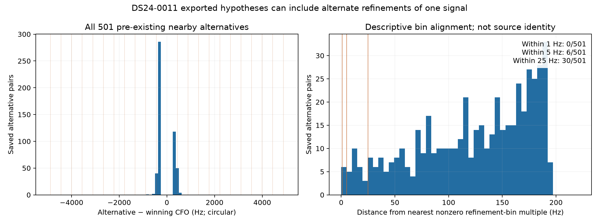

# Nearby alternatives are not mostly exact refinement-bin duplicates

The predeclared saved-output check covers all 501 prior nearby alternative
pairs, spanning 483 original winning windows in DS24-0011. It compares each
circular CFO gap with the nearest nonzero integer multiple of the deployed
443.892045 Hz fractional-refinement grid spacing.

| Distance to nearest grid multiple | Pairs |
| --- | ---: |
| At most 1 Hz | 0 / 501 |
| At most 5 Hz | 6 / 501 |
| At most 25 Hz | 30 / 501 |

Median distance is 133.136 Hz. Thus exact multiples of this refinement spacing
do not explain most of these saved pair differences. This does not establish
independent signals: candidates may have different acquisition estimates,
fractional timing, or sidelobes, and the tracking export omits the acquisition
CFO needed to decompose these stages. No random-gap reference distribution or
false-source probability is assumed.

The full gap histogram also shows a separate ambiguity: absolute gaps range
only 250.032–820.585 Hz, with median 310.756 Hz. Many lie close to the original
250 Hz deduplication floor. Persistent alternatives in this range can be
different estimates of one broad peak, rather than distinct emitters. These
descriptive ranges come from the complete saved table; they do not modify the
frozen persistence or prototype policy. The co-epoch synthetic 3,000 Hz example
is not automatically representative of this recorded subset.

This is a negative result for one narrow duplication explanation. It does
not establish temporal persistence, satellite identity, a source count, or a
repair. The persistence branch's selection policy is unchanged. All pairs
remain in [all_pairs.csv](all_pairs.csv); [summary.json](summary.json) binds
the prior export, declared comparison and historical scorer source. No IQ,
detector, track, orbit or position calculation was performed.
