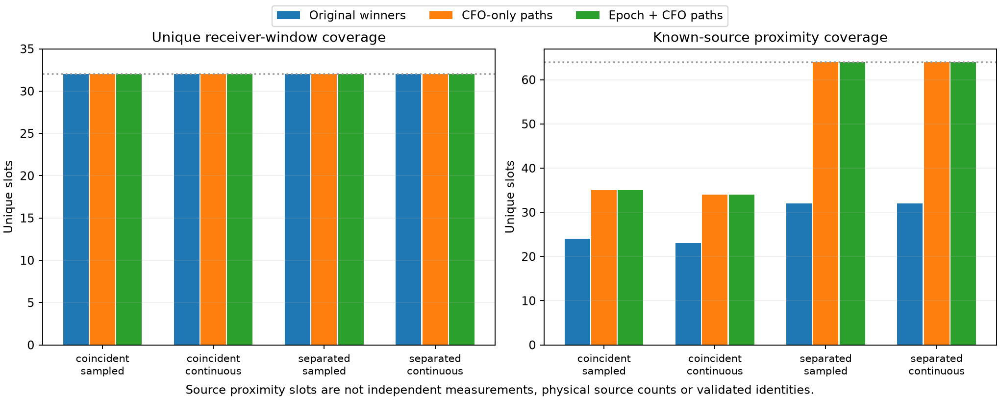

# Candidate paths preserve alternatives; continuity does not identify sources

The frozen prototype can retain source-proximate candidates discarded by winner
selection in the separated-epoch synthetic control. **Adding epoch continuity
selects exactly the same candidate paths as CFO-only continuity in every tested
lane.** A single injected source also produces an extra coherent path under both
controls. There is no evidence here for promoting path count, smoothness or
proximity to source identity, independent information, or localization admission.

All **24 primary lane-method slots** and the **six unchanged single-source
application slots** completed. A's cumulative numerical preparation/selection
time was **2.867557 worker-seconds**, including the conservative charge for an
initial pure-fixture ordering assertion. This is within the original 300-second
budget. A made no detector calls. The root's separately frozen 24-call detector
control has its own unchanged 120-second cap and [RF seal](../single_source/RF_seal.json).
There was no recorded IQ read, RF collection, satellite assignment, position fit,
GPS use or production change. All scientific outputs and original gates remain.

## What changed upstream

The earlier satellite-family HMM used already selected winning CFOs, with
incumbent active satellite families and clutter as hidden states. It could not
revisit discarded exported peaks. This prototype instead operates on complete
candidate windows before satellite assignment, without orbital or family input.
Its [row contract and frozen costs](PROTOCOL.md) use raw CFO, margin/rank and
global circular frame phase. The latter includes the native acquisition counter,
reduced by exact integer arithmetic before adding the local fractional epoch;
packed payload indices and raw local epochs alone are not clock authority.

Compare original maximum-margin winners with a bounded second-order CFO path and
the same objective plus an epoch-drift-change penalty. Linear epoch drift is
allowed. Margins and continuity penalties are engineering costs, not calibrated
likelihoods. At most two candidate-exclusive paths per lane is a capacity limit,
not an inferred source count. Each path has at most one candidate per receiver
window; separate paths can use correlated alternatives from the same window.
Nearest phase winding remains an explicit model restriction, not physical clock
identification. The unchanged graph constructor/config runs separately on each
path, retaining its exact residual and quality flags.

Preparation preserves **1,024 raw peaks, 128 receiver windows and 386 gated,
deduplicated candidate hypotheses** from the four old sequences. Original winner
IDs, CFOs, times and graph assignments replay exactly. Ten owned fixtures cover
counter/origin and alias invariance, crossings, gaps, linear drift and exclusivity.
An initial fixture incorrectly assumed symmetric source A must be listed first;
the deterministic selector already returned both pure paths. Only that ordering
assertion changed; the failed log and a conservative 2-second charge are preserved.
Source labels never choose candidates, parameters, path order or aliases.

## Four existing two-source sequences

Both receivers are aggregated below. A source-slot is a known source at one
receiver/window, counted at most once even if multiple selected peaks match it.
The frozen descriptive match is circular CFO distance≤450 Hz AND frame-epoch
distance≤3 samples. Near crossings one peak may match both truths, so these
slots are not independent measurements or validated source recoveries.

| Sequence | Original-winner proximity /64 source-slots | CFO-only proximity | Epoch+CFO proximity | All-candidate ceiling | Unique receiver windows, every method |
|---|---:|---:|---:|---:|---:|
| Coincident, deployed sampled | 24 | 35 | 35 | 37 | 32/32 |
| Coincident, continuous | 23 | 34 | 34 | 41 | 32/32 |
| Separated, deployed sampled | 32 | 64 | 64 | 64 | 32/32 |
| Separated, continuous | 32 | 64 | 64 | 64 | 32/32 |

CFO-only and epoch+CFO select **identical path candidate IDs in all eight lanes**.
Their objectives differ by the declared epoch penalty, but selection does not.
The separated controls retain two individually source-proximate paths rather than
the winner stream's changing proximity. The coincident controls remain mixed:
every selected path contains unique-near-A and unique-near-B proximity labels.
Candidate selection cannot recover source evidence absent from the exported pool.

The two controls select 55/59 candidate hypotheses on 32 windows in the coincident
sampled/continuous cases, and 64 hypotheses on 32 windows in each separated case.
The shared windows are 23/27/32/32, respectively. These are retained alternatives,
**not additional independent observations**. The graph-assigned source proximity
is 32/34/64/64; its unique-window denominator remains 32 in each case.
All per-lane counts, missed windows, unselected candidates, alias/winding choices
and path-level ambiguity are retained in [comparison.csv](report/comparison.csv),
[path_diagnostics.csv](report/path_diagnostics.csv), the saved selections and graphs.

Gray points show the RX0 candidate pool; both receivers' selections are displayed.
The known-source curves only define these post-seal visualization coordinates.
All graph pieces have at most 16 points. Literal statuses include both
`insufficient_support` and `structure_flagged`, with flag precedence preserved;
none is `no_structure_detected`. In particular, separated-epoch source-proximate
tracks are flagged for adjacent residual correlation, with roughly 16 Hz RMS.
Assignment, smoothness and source proximity do not bypass the original checks.

## One injected source still produces a second path

The root generated a separately frozen 24-visit, one-source deployed-template
control at unchanged amplitude 1000 and epoch 127, CFO=100000+200T Hz, with a new
fixed noise seed. A's [thin application](single_application.py) imports the exact
original selector, settings, winner rule and graph port; it changes none of them.
An owned actual-port parity test matches the previous adapter exactly. All 384
raw peaks, 48 receiver windows and 78 gated/deduplicated candidates are retained.

| Receiver | Main path | Extra path | Extra median CFO error | Extra circular epoch error | Extra median margin /winner |
|---|---:|---:|---:|---:|---:|
| RX0 | 24 points | 14 points | −11,232.27 Hz | −6,508.19 samples | 0.0676 |
| RX1 | 24 points | 16 points | −11,228.22 Hz | −6,508.19 samples | 0.0692 |

Both controls again select the same paths. The extra branches have zero joint
matches to the one injected source under the frozen proximity criterion. They
are coherent detector-output alternatives from one signal, not evidence for a
second physical emitter. Their exact physical origin is not identified by this
path experiment. The larger count is 78 selected hypotheses on the **same 48
receiver windows**; there is no independent coverage gain or extra source truth.

The main 24-point paths are the original winners. Their graph RMS is 16.530/16.605 Hz,
and their maximum circular CFO error to the known midpoint is 19.479/19.682 Hz.
They are **structure_flagged for adjacent residual correlation**. The extra paths
have 85.96/90.14 Hz graph RMS and **insufficient_support**. No main or secondary
graph track qualifies. This retains a distinct correlated-measurement issue even
when source multiplicity is known. It does not justify waiving the structure gate
or assigning all CFO error to a particular detector stage without another test.
Full errors, ranks, margin ratios and flags are in
[single_paths.csv](report02/single_paths.csv) and
[single_methods.csv](report02/single_methods.csv).

## Decision and next discriminating direction

The recorded inventory found **zero persistent positive owners among 117** under
its frozen rule; [its result](../recorded/FINDINGS.md) does not trigger a recorded
positive-path application. The result is conditional on that rule, not proof that
no real interference exists. Neither parameters nor eligibility were loosened.

Keep this selector as an ambiguity-retention prototype. Do not promote the epoch
term, infer source count from its two-path capacity, or turn these alternative
peaks into extra independent position observations. A further generic HMM/path
sweep is low priority after the identical-control and single-source results.

The strongest next measurement question is a **one-source versus multiple-source
explanation of correlated detector hypotheses and CFO errors**. First use the
sealed one-source responses to localize the main error to acquisition/refinement
and test whether its dependence on injected CFO explains the residual structure.
A subsequent repair would need fixed isolated/overlap/epoch controls and held-out
CFO/noise settings, with one-window alternatives treated jointly. Stop if a
single-source explanation already accounts for the apparent extra branches or a
new method merely adds smooth paths without better source/error calibration.
Only a positive RF-selected recorded example with independent support would
justify a later frozen localization comparison. No further scientific run was
performed in this prototype.

## Artifacts and independent checks

[Primary protocol](protocol.json) binds the four old sequences, exact sources and
settings; [RF_seal.json](RF_seal.json) precedes all truth metrics. The separately
bound [single-source application protocol](single_application/protocol.json) and
[RF seal](single_application/RF_seal.json) preserve the same policy. Independent
[primary](../audit/prototype_terminal.json) and
[single-application](../audit/single_application_terminal.json) terminal checks pass
without rerunning a detector or graph search. Initial report artifacts remain;
the readable combined figures and single-source tables have a separate
[report02 seal](report02/seal.json). The [lean publication manifest](lean_publication.json)
includes compact sources, tests, outputs and figures, with external immutable
dependencies listed by path/hash. No prior report or production file was edited.
