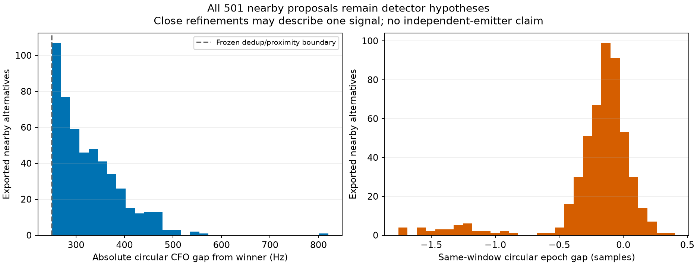
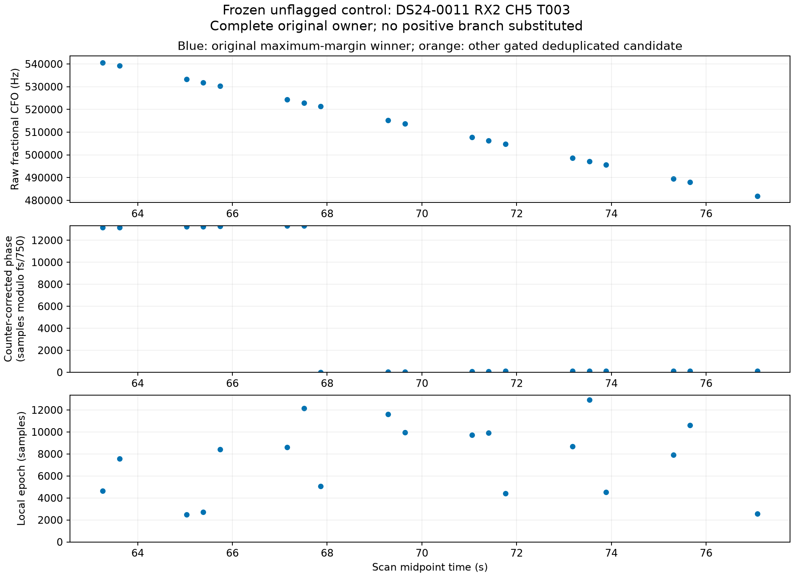

# No persistent nearby alternative under the frozen rule

The original 483 pointwise flags do **not** yield a selected persistent recorded branch under this iteration's frozen RF-only rule: **0 of 117 original graph owners pass**. All 117 owners were processed, with no numerical failure or threshold change. No positive owner was backfilled. This is a negative result for the declared nearby-alternative class and engineering limits, not proof that the recording contains no persistent alternative source.

The entire recorded export remains available. [The public candidate row port](report/deduplicated_candidates.csv) contains every gate-passing deduplicated hypothesis, including candidates outside the nearby class. [All-owner support counts](report/owner_support.csv) and [the original complete ownership ledger](owners.json) retain exclusions, quality status, and original native IDs.

| Denominator or result | Count |
|---|---:|
| Original receiver probes | 13,484 |
| All exported candidate hypotheses | 60,391 |
| Gate-passing candidate hypotheses | 10,428 |
| Gate-passing deduplicated hypotheses | 5,206 |
| Original maximum-margin native winners | 3,754 |
| Original winners without graph ownership | 439 |
| Original graph owners | 117 |
| Pointwise flagged windows | 483 |
| Nearby alternative hypotheses | 501 |
| Owners completing the frozen persistence test | 117 |
| Owners passing that test | **0** |
| Eligible unflagged controls | 3 |

Candidates are correlated hypotheses within receiver windows, not 60,391 or 5,206 independent observations. The detector and original graph construction are response-selected, and these are exposed development data. The 483/501 counts reproduce the previous inventory exactly. Of the 483 flagged windows, 449 belong to original graph owners and 34 are unowned. Persistence is evaluated within the 117 original owners, without assigning unowned observations to a new source.

The saved metadata explains the limiting counts without rerunning paths or scanning thresholds:

| Limiting stage | Owners |
|---|---:|
| Fewer than five distinct pointwise flagged windows | 82 |
| At least five flags, but no five-window run spanning ≥3 s with gaps ≤2 s | 27 |
| Necessary time support passes, but the paired CFO/epoch line rule does not | 8 |

The last eight are not separately attributed to CFO versus epoch failure; no additional one-variable rule or relaxed threshold was tested. Their failure is not evidence of physical source inadequacy.

## Clock authority and frozen test

The [protocol](PROTOCOL.md) was frozen before any persistence outcomes and independently reviewed. Epoch is relative to the acquisition-window start, so local epoch alone cannot be compared across visits. The exact sample start is `valid_start_counter + round(probe_start_ms * fs / 1000)`. Using the declared common device origin, evaluate the integer counter remainder `((start - origin) * 750) % fs / 750` **before** adding integer epoch plus fractional offset and reducing modulo exact `fs / 750`. At 10 MS/s that period is 13,333⅓ samples. Packed payload indices and observation midpoints are not frame-phase origins. [The source review](../CLOCK_AND_EXPORT_REVIEW.md) records the producer authority.

Acquired CFO is not retained by this historical tracking contract and stays null. Raw fractional CFO, rank, margin, original receiver/channel/RF, window counters, local and global epoch, winner state, and native ownership are retained. Historical observation IDs are preserved from the original exact receiver/channel/time join, with exact winner CFO and margin reconciliation; newly computed research receiver-window IDs remain separate.

Deduplication is unchanged from the prior helper: gate-passing candidates sorted by margin, suppressing pairs within both 120 ns of circular frame epoch and 250 Hz of circular CFO. Pointwise nearby proposals retain the earlier ≤3-sample epoch separation and (250, 5,000] Hz CFO separation from the original winner.

Within each original owner, the deterministic persistence rule tests paired linear CFO and counter-corrected frame-phase behavior, including one candidate per window. It requires at least five windows over at least three seconds, gaps no larger than two seconds, maximum residuals of 250 Hz and three samples, and the predeclared drift limits. [The implementation](continuity.py) enumerates seed pairs and uses exactly two refit/reselection passes. These are engineering sensitivities, not calibrated likelihoods or identity evidence. The rule does not exhaust every farther-epoch branch in the complete exported row port.

The nearby CFO gaps cluster close to the original 250 Hz deduplication/proximity boundary. Such proposals could be refinements of one broad detector peak, interference, or separate signals. Continuity alone would not resolve that ambiguity even if a path passed. No satellite catalogue, physical identity, or position information enters this branch.

## Control and downstream decision

The frozen chronological selection yields no positive case. [The positive port](positive_port.json) explicitly contains zero windows. The first eligible unflagged control is **DS24-0011 RX2 CH5 T003**, with all 19 original windows preserved in [its complete port](control_port.json). Every one of those windows has one retained candidate. This owner is a control selected by the RF rule, not a replacement positive example or a validated physical identity.

The upper/lower edge transition in circular global phase is a modulo wrap, not a timing discontinuity. Local epochs vary with acquisition starts; the counter-corrected coordinate removes that bookkeeping effect. Raw coordinates remain in the candidate port. No recorded positive-path application or new graph construction was performed by this branch.

## Execution and replay limits

The actual run took **1.008 seconds**, with **3.354 cumulative charged worker-seconds** including preparation, tests, and two conservative one-second allowances for earlier metadata reads and the failed initial smoke. Five owned tests and the actual first-window schema smoke pass. The initial smoke had incorrectly assumed that this historical native observation ID equaled today's public-port hash. It stopped before any path outcomes; [the failed source and receipt](preparation01_failed/failure.json) are preserved. The correction separates historical native IDs from research window IDs and changes no eligibility or persistence rule.

[The final protocol](protocol.json), [RF seal](RF_seal.json), and [independent preflight](../audit/recorded_preflight.json) bind the source and original inputs. The [report seal](report/seal.json) binds saved-ledger-only figures and support accounting; it performs no new path search. [The lean publication inventory](lean_publication.json) includes all 5,206 gated deduplicated rows and all-owner denominators. The full 60,391-row ledger and 13,484-window JSON remain local and hash-bound. Exact rerun also requires the original tracking, observation, and graph exports bound by the protocol; this compact report is not a standalone full corpus capsule.

No detector, IQ read, catalogue nomination, GPS use, position fitting, original ownership change, source admission, or production change occurred. The appropriate decision is to stop this recorded nearby-branch attempt under the frozen rule and retain the zero result.
