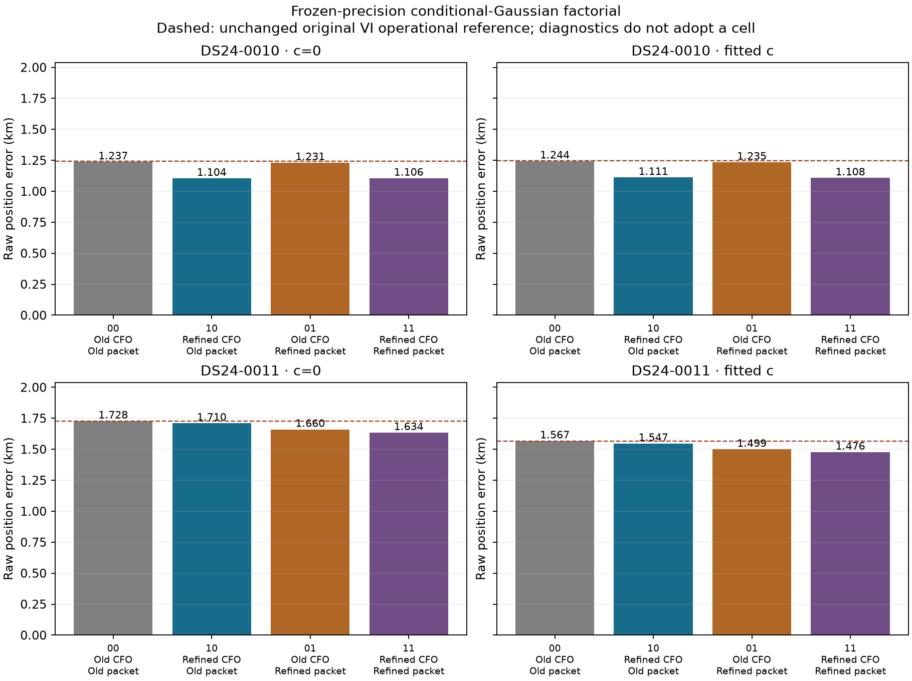
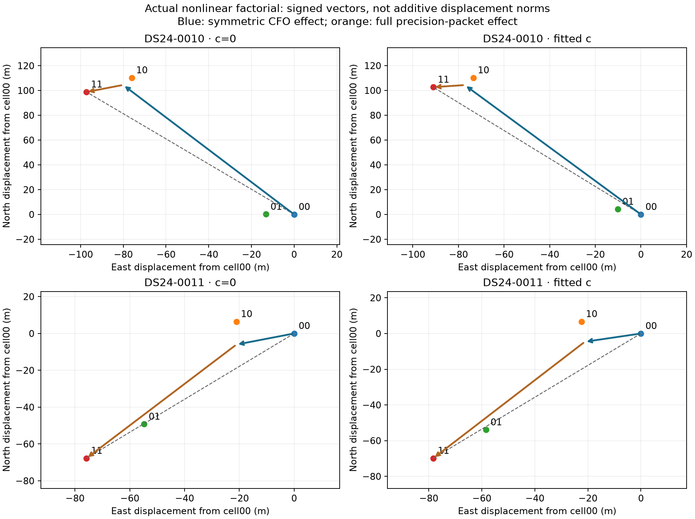
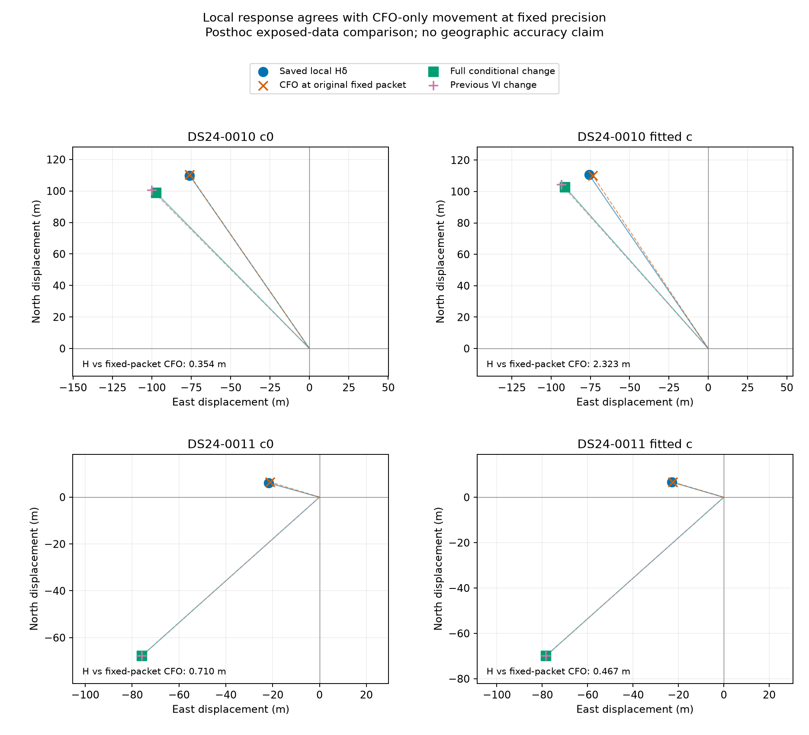

# CFO refinement and learned precision: two different mechanisms

2026-10-26 UTC. Sixteen matched nonlinear fits show that the preceding two-scan
improvement does not have a single explanation. **DS24-0010 moves mainly because
its measured CFO changes. DS24-0011 moves mainly because the learned precision
packet changes.** Both c=0 and fitted-c give the same qualitative result.
Operational outputs remain the original reference; this is a mechanism study,
not a new ALGO or a fresh validation claim.

The [preceding complete-track test](../2026_10_26_ds24_complete_owner_refinement/README.md)
refined all 159 original measurements in four fixed track fragments. It reduced
raw position error by 134-139 m in scan 0010 and 91-93 m in scan 0011. Only
0010 passed paired acceptance. Some residuals became noisier and their learned
precision fell substantially, so that test did not isolate frequency changes
from precision feedback. The present comparison resolves that distinction
within the existing conditional model.

## The controlled comparison

For each scan and calibration setting, fit all four combinations below. The
precision packet contains both fragment noise precisions and nuisance-prior
precisions learned in the preceding original/refined VI fits. It is not just
the noise weight of the four changed owners.

| Cell | Observed CFO | Fixed precision packet |
| --- | --- | --- |
| 00 | Original | Original |
| 10 | Refined | Original |
| 01 | Original | Refined |
| 11 | Refined | Refined |

The nuisance posterior, position and phase are refitted in every cell. The
same original curved and predictive observations, aliases, satellite identities,
causal catalogue, nominal noise, likelihood powers and prior structure remain.
Both c arms use the same 159-ID measurement intervention. Every fit starts at
the regional origin with zero phase reference, using the same five refreshes,
48 inner iterations and 25 by 25 km bounds centered at 37.906,-122.545.

The existing conditional-Gaussian implementation retains its log-volume term
and the complete predictive factor. Its objective is distinct from the previous
VI bound. In particular, the original curved-data Gamma updates also affect
the predictive mean/covariance in 0010; freezing those updates can move even a
diagonal control. The previous VI fits remain separate references, not an
interchangeable objective or a required identical optimum.

Before execution, eight fixed-state diagonal controls reproduced their saved
coefficients, conditional frequency residuals and predictive factors. Maximum
coefficient difference was 3.60e-9, frequency residual difference 1.67e-7 Hz,
and predictive objective difference 5.38e-10. The same-arm precision layout,
including fitted-c's extra hardware coefficient, was reconstructed exactly.
Inactive zero noise-precision groups were preserved, not dropped or replaced.
Six owned fixtures and an independent dense Gaussian covariance check passed.

## Actual geographic results, including failed retention checks

The true site was released to the frozen evaluator only after all inference
outputs were sealed and the independent RF audit passed. Values below are
raw diagnostic errors in km; no cell is selected by geographic performance.

| Scan / calibration | 00: original CFO, original packet | 10: refined CFO, original packet | 01: original CFO, refined packet | 11: refined CFO, refined packet |
| --- | ---: | ---: | ---: | ---: |
| DS24-0010, c=0 | 1.237204 | 1.104368 | 1.231146 | 1.105605 |
| DS24-0010, fitted c | 1.243988 | 1.111407 | 1.234750 | 1.107660 |
| DS24-0011, c=0 | 1.727732 | 1.709973 | 1.660151 | 1.634415 |
| DS24-0011, fitted c | 1.567030 | 1.546597 | 1.498937 | 1.476454 |

Holding the original packet fixed, CFO refinement reduces error by 132.836 and
132.580 m in 0010, versus 17.759 and 20.433 m in 0011. Holding the refined
packet fixed, the reductions are 125.542/127.089 m and 25.736/22.484 m,
respectively. Those are within-packet contrasts, not raw comparisons against
the original VI algorithm.

The operational VI reference remains 1.241915/1.246474 km for 0010 and
1.727734/1.567031 km for 0011, in c=0/fitted-c order. Conditional diagonal
endpoints differ from their corresponding prior VI endpoints by 1.15-5.52 m
in 0010 and less than 8 mm in 0011. These small differences remain explicit;
the fixed-state reproduction checks do not assume identical refitted endpoints.

All 16 fits pass the original single-arm residual, owner and phase checks.
Their maximum final phase-reference change is 1.66e-5 s. The distinct accepted-ID
retention rule still matters:

| Scan / calibration | Old IDs lost in 00 / 10 / 01 / 11 | Fixed likelihood points | Associated points in 00 / 10 / 01 / 11 |
| --- | --- | ---: | --- |
| 0010, either c setting | 0 / 0 / 0 / 0 | 3,186 | 3,186 / 3,186 / 3,186 / 3,186 |
| 0011, c=0 | 0 / 36 / 21 / 57 | 2,241 | 2,671 / 2,635 / 2,650 / 2,614 |
| 0011, fitted c | 0 / 0 / 0 / 0 | 2,241 | 2,642 / 2,642 / 2,642 / 2,642 |

With 4,268 original GLRT winners in 0010, association remains 74.65% in every
cell. With 3,754 winners in 0011, c=0 coverage is 71.15%, 70.19%, 70.59% and
69.63% in cell order; fitted-c remains 70.38%. These endpoint-dependent
association counts are distinct from the fixed position-likelihood membership.

Thus 0010 retains the original IDs in every cell. For 0011, each changed cell
fails paired retention because its c=0 counterpart loses postfit-only evidence.
No fitted-likelihood point is deleted. All gates and postfit associations are
calculated from each cell's own conditional posterior, without rebuilding the
VI parent. The previous exact slope-gate investigation remains relevant, but
this factorial does not remeasure or waive those gates.

## Signed position effects and interaction

With x denoting the two-dimensional endpoint, the CFO effects are x10-x00 and
x11-x01. The packet effects are x01-x00 and x11-x10. Their interaction is
x11-x10-x01+x00. Averaging the two CFO vectors and the two packet vectors gives
a symmetric decomposition whose sum is exactly x11-x00. Displacement lengths
do not add and are not unique causal percentages.

| Scan / calibration | Symmetric CFO vector length (m) | Symmetric packet vector length (m) | Total movement (m) | Interaction length (m) |
| --- | ---: | ---: | ---: | ---: |
| 0010, c=0 | 131.63 | 18.08 | 138.64 | 14.08 |
| 0010, fitted c | 129.79 | 13.92 | 137.18 | 13.92 |
| 0011, c=0 | 21.92 | 82.49 | 101.67 | 24.98 |
| 0011, fitted c | 21.67 | 86.71 | 104.93 | 22.77 |

This distinguishes the mechanisms within the conditional model. It does not
identify physical frequency truth, establish that a particular satellite is
wrong, or prove that measurement noise alone caused the 0011 movement. The
packet includes all learned noise and prior precisions, and both selected
track fragments change together in each scan.

## Why the preceding local prediction missed scan 0011

The previous H-delta calculation freezes the original local model and precision.
Its proper comparator is therefore the isolated CFO effect with the original
packet, rather than the full precision-updated VI refit.

The saved H vector differs from that isolated nonlinear effect by only
0.354/2.323 m in 0010 and 0.710/0.467 m in 0011. By contrast, its discrepancy
against the earlier full VI movement was 25.708/18.608 m and 91.526/94.513 m.
The new full conditional movement reproduces that earlier VI movement within
3.04 m in 0010 and 0.009 m in 0011. Precision feedback and interaction therefore
explain most of the earlier large 0011 discrepancy within this model; a poor
local frequency linearization is not required to explain it.

The [separate saved-vector readback](linearization/FINDINGS.md) is explicitly
posthoc, uses no GPS and performs no new geometry or fitting. It retains the
conditional-versus-VI distinction and does not convert the decomposition into
physical noise calibration.

## What to do next

The next useful step is a temporal replication on a fixed later group, together
with an independently supported uncertainty check. Repeating more variants on
these two exposed scans would give less evidence about generalization.

The metadata branch selected four chronological recordings beyond the original
DS24 population and the eight already evaluated later scans. Selection used
status and unchanged qualified 10 MS/s metadata, never position error:

| Recording-name UTC proxy | Exact recording ID |
| --- | --- |
| 2026-10-24 22:43:59 | fast8-auto-20261024-224359-7249fa17-1-upper |
| 2026-10-24 23:34:14 | fast8-auto-20261024-233414-efe03d6d-1-lower |
| 2026-10-25 00:24:29 | fast8-auto-20261025-002429-895cc487-1-upper |
| 2026-10-25 02:04:56 | fast8-auto-20261025-020456-a88a5971-1-upper |

These have complete production jobs but no verified research parent in the two
prepared roots checked. Canonical times, complete raw authority, causal parent
construction and applicable evaluation position still require verification.
The bounded historical exposure search timed out; absence of matches is not
established. Call this a prospective temporal replication block, not a proven
untouched or new-location holdout. Keep unavailable members in the denominator.

Prepare those inputs through the existing public export/prepare ports, then
freeze the same complete-owner RF selection and correction policy before
measurement outcomes. The earlier cost suggests roughly 650-730 worker-seconds
for four similarly sized selected-owner panels, before preparation and fits.
Exact deduplication and owner counts must precede authorization of that workload.
This is a conditional planning estimate, not a runtime benchmark. A full
likelihood replay would be substantially larger and is not launched here.

For uncertainty, test estimates supported by independent pilot/frame evidence
rather than adopting the geographically favorable precision packet from this
study. The latter is an explanatory control learned from the same scan, not
a deployable correction rule. A future noise experiment should separately
account for measurement variability, systematic estimator bias and orbital
model error; lower in-sample scatter is not sufficient evidence for higher
position confidence. The four-scan preparation can proceed independently of
that diagnostic. See [validation findings](validation/FINDINGS.md) and its
[exact cohort ledger](validation/cohort_ledger.json).

## Reproduction and scope

All 16 fits complete in 29.083 cumulative worker-seconds including 8.065 seconds
of preparation, below the frozen 600-second cap. Two workers use one BLAS thread
each; each fit is capped at 30 seconds. There are no failures, retries, alternate
starts, new measurements or changed observations beyond the original 159 IDs.
These are research execution timings, not embedded-throughput measurements.

The [coordinator plan](COORDINATOR_PLAN.md), [solver protocol](solver/PROTOCOL.md),
[source](solver/model.py), [runner](solver/run.py), [frozen evaluator](solver/evaluate.py),
[solver findings](solver/FINDINGS.md) and [independent audit](audit/FINDINGS.md)
describe the controls and source bindings. The separate
[linearization addendum](LINEARIZATION_READBACK.md) leaves all inference freezes
unchanged. Compact outputs and figures are published; larger original parents
remain external and hash-bound, so this is not a standalone data replay bundle.

No production code, persisted contracts, golden fixtures, recorded IQ or
previous study artifact is changed. No new RF, postscan TLE, GPS-based selection,
stationary pooling or moving-trajectory prototype is introduced. The original
operational references and the broader fast-scan improvement goal remain.
