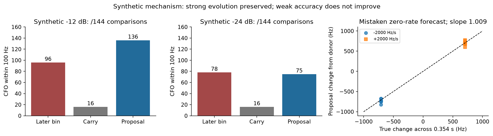
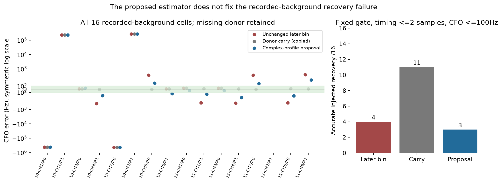
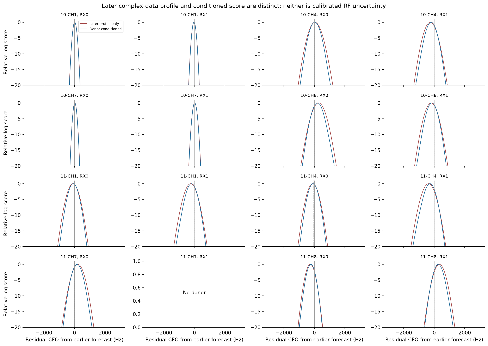
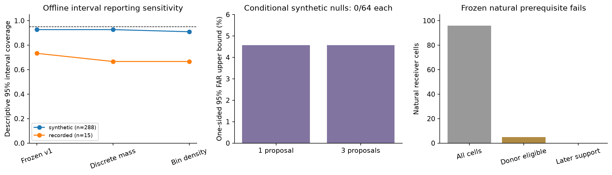

# Frequency continuity: RF qualification fails

The single frozen donor-conditioned frequency proposal is **not RF-qualified**.
It preserves true evolution in controlled complex noise but does not improve
accurate recovery on inherited recorded backgrounds. Every eligible natural
three-visit history also fails later pilot support. No new Doppler point, track,
association or position is produced. This completes the bounded negative screen.

## Synthetic mechanism and frequency evolution

The estimator profiles a complex amplitude per later frame and combines the
later complex-data profile with a broad robust earlier-prediction prior. The
raw later profile and donor-conditioned weights are saved separately. Its scale
follows a stated proper complex white Gaussian model; orthogonal within-symbol
residuals estimate complex variance. GLRT margin is never treated as physical
log likelihood. Interpolation covariance, colored interference, wrong timing,
donor ambiguity, plug-in noise and the midpoint approximation remain explicit
model limitations. Every RF uncertainty output is labeled uncalibrated.

Controls use the actual0.354s revisit interval, true rates-2000/0/+2000Hz/s
(changes-708/0/+708Hz), donor errors-500/0/+500Hz, mistaken zero-rate versus
deliberately correct-rate forecasts, two edges and two strengths. The correct
forecast lane is an explicitly known-truth mechanism control, not evidence for
a natural rate predictor. Truth stays outside the estimator. There are
48independent later Gaussian vectors reused for288conditional comparisons;
the288rows are not independent repetitions and receive no binomial coverage
confidence claim. Power ratios are digital pilot/background, not antenna SNR.

The "unchanged later bin" control is the historical scorer conditioned on the
earlier donor's propagated timing and CFO prediction. It is not blind later
acquisition; all three columns use the same donor-conditioned target support.

| CFO within100Hz | Unchanged donor-conditioned later bin | Donor carry | Proposal |
|---|---:|---:|---:|
| Strong -12dB, /144comparisons | 96 | 16 | 136 |
| Weak -24dB, /144comparisons | 78 | 16 | 75 |

The predeclared evolution subset is strong -12dB, donor-error0,
**zero-rate forecast**, true nonzero-rate:16comparisons on16distinct later
vectors. Proposal accuracy is14/16. Define `d_i=true_rate_i*0.354s` and
`y_i=proposal_CFO_i-donor_carry_CFO_i`. The reported regression is **through
the origin**: `sum(d_i*y_i)/sum(d_i*d_i)=1.0085628531`. The validator uses the
same strong, unbiased, zero-rate-forecast, nonzero-evolution subset, but defines
true change at the target midpoint:0.359s and +/-718Hz, rather than the target
start:0.354s and +/-708Hz. Its slope is0.994516. The difference is the reference
time, not the subset; true frequency evolves another10Hz within the later half.
This screen demonstrates that the estimator need not freeze frequency to the
donor in strong controlled signals. Weak accuracy still does not improve.

## Recorded-background recovery fails

All eight inherited20ms windows replay with complete original paired historical
candidate parity. Reconstructed later10ms complex64 samples exactly match the
round3 support digest. Every unchanged later-bin score and finalized CFO equals
round3. The16-cell denominator retains11correct injected primary donors,
4wrong primary donors and1absent donor.

| Fixed recorded-background result | Unchanged donor-conditioned later bin | Donor carry | Proposal |
|---|---:|---:|---:|
| Gate pass, timing<=2samples, CFO<=100Hz /16 | 4 | 11 | **3** |
| CFO RMSE for11correct donors, Hz | 350.12 | 16.35 | 179.22 |

The proposal shrinks several443.892Hz jumps but does not bring them inside the
frozen100Hz tolerance; one formerly accurate result also moves outside it.
Lower RMSE on the evaluation-only correct-donor subset does not make the
recovery criterion pass. Carry uses the constant injection and copies earlier
information. It cannot become a fresh independent Doppler observation. Wrong
injected donors can follow genuine recorded pilots, so their gate passes are
not false alarms. No tuning follows these outcomes.

## Preserved interval bug and offline correction

Review found a frozen v1 reporting bug: interpolating cumulative grid masses at
grid centers shifts quantiles downward. All mass at0Hz on a25Hz grid yields
approximately[-24.375,-0.625]Hz, excluding the mode. The sealed estimator and
outcomes remain unchanged. A separately sealed **offline** audit compares literal
discrete-grid quantiles and uniform density inside midpoint bins clipped to the
unchanged search domain. The concentrated0Hz bucket becomes[-11.875,+11.875]Hz
under bin density. No weights, likelihood, prior, MAP CFO, gate or RF calls change.
Concentrated, symmetric, off-grid and boundary tests pass.

| Descriptive nominal95% coverage | Frozen v1 | Discrete mass | Bin density |
|---|---:|---:|---:|
| Synthetic conditional comparisons /288 | 267 (92.71%) | 267 (92.71%) | 262 (90.97%) |
| Recorded with a donor /15 | 11 (73.33%) | 10 (66.67%) | 10 (66.67%) |
| Evaluation-only correct recorded donors /11 | 11 | 10 | 10 |

Recorded pooled coverage includes wrong donors; missing donor has no interval.
The subset row uses truth only for diagnosis. Grid spacing and within-bin density
remain numerical assumptions, particularly for off-grid truth. Quantile repair
does not establish physical RF covariance calibration.

## Conditional nulls and natural prerequisite

There are128independent later Gaussian vectors with fixed synthetic prediction
packets; these do not simulate blind earlier acquisition. One-proposal and
three-proposal strata each give0/64any-gate false confirmations. Each exact
one-sided95%binomial upper bound is**4.573%**. This is conditional synthetic
FAR at the unchanged0.025gate, not equal-FAR, eight-proposal or deployment
qualification. Six absent-donor calls explicitly return no estimate. The
proposal retains the old gate and introduces no new acceptance rule.

The declared synthetic screen passes: evolution accuracy>=80%, slope0.5..1.5,
bin-density coverage>=90% and both tested null upper bounds<=5%. Passing these
screening checks cannot overrule the recorded failure or qualify RF weights.

The sealed natural panel retains96receiver cells:5eligible three-visit cells,
8complete modes and91cells without an eligible donor. Every eligible mode fails
later both-half pilot support for both linear and constant forecasts. This is
a negative result for the frozen three-visit policy, not absence of all possible
single-donor opportunities. No relaxed matcher or target-selected mode is tried.

The adapter emits192metadata half-packets using earlier forecasts in original
rank order and never reads `target_original`. Each packet binds native support,
RX/channel/edge/actual RF/IF, source identity, generations, donor IDs/ranks/CFOs,
elapsed time and explicitly heuristic predictive widths. Public native-index
IQ digests bind earlier ownership; donor IQ is not newly opened or verified.
Both natural half-packets retain the forecast CFO at the target start. Timing
and elapsed time are advanced for the second half, but its CFO receives no rate
advance; the omitted change is approximately +/-26–39Hz across the eligible
histories. These metadata packets were never consumed by frequency scoring,
because later pilot support had already failed.
Halves and consecutive targets can share donors and are not independent trials.
Frequency scoring stops at failed support: **zero new natural IQ reads,
zero natural frequency calls, zero admitted observations, zero position calls**.

## Verification and deliverables

Eleven tests pass: likelihood/projection scale, multiple modes, absent donors,
support ownership, fractional sampling/noise convention, truth-free API,
target-response redaction, ambiguity, and interval reporting. All frozen source
hashes and runtime identity remain intact. Every recorded slot completes.
Times: synthetic4.40s, null3.98s, recorded13.43s, natural metadata0.65s and offline
interval audit0.10s. Each numerical process has a580s alarm, BLAS1 and at most
two concurrent workers. No RF collection, production change, git mutation or
raw IQ export occurs. Setup/report execution failures are in `execution.json`.

Use repository `.venv/bin/python`, BLAS thread variables1 and historical
`PYTHONPATH=/opt/leo-shared-scans/native-scope64-v2-3460060352b364a9/worker/src:/tmp/algo03-feasible-deps`.
Run `python -m unittest -v test_estimator test_natural_adapter test_interval_audit_v2`
from this directory. Scoring is `study.py synthetic`, `study.py null`,
`study.py recorded`; restricted inherited sources use authorized read-only
`sudo -n`. Outputs use exclusive creation: reproduce in a separate copy and
preserve originals. The offline interval audit needs saved outcomes, not IQ.

`publication_allowlist.json`/`publication_manifest.json` define lean publication:
source/tests, frozen protocols, compact per-trial CSVs, summary/findings, figures,
recorded profiles, interval audit and natural metadata. Full synthetic/null
grids remain immutable locally under `RF_seal.json` hashes and are excluded
from publication. The final decision is**RF_NOT_QUALIFIED**.
