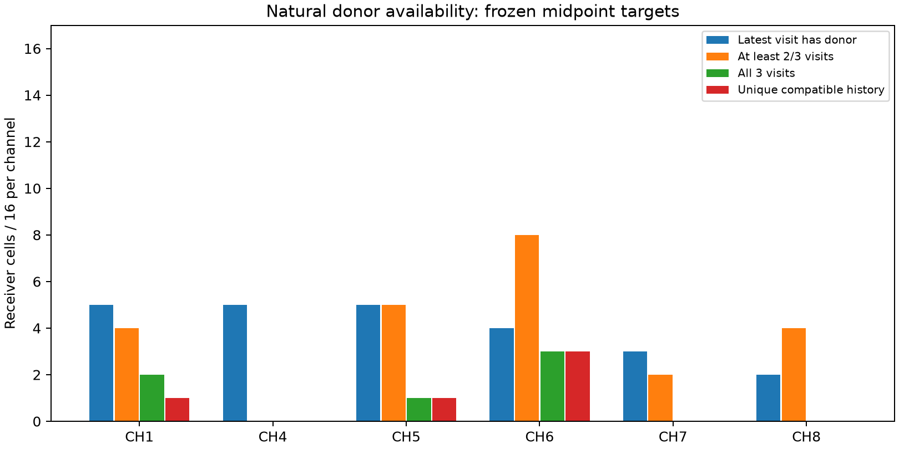
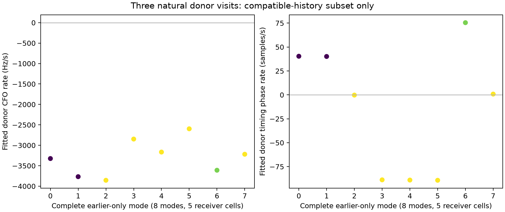
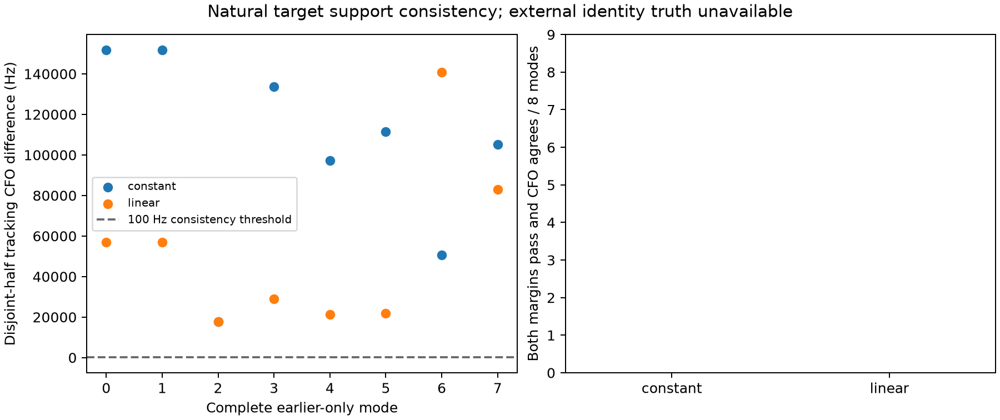

# Natural revisit guidance: bounded negative screen

The frozen three-visit guidance prototype did not establish a new usable natural
signal. Only **5 of 96 receiver cells** supplied a unique compatible three-visit
history. Neither the constant donor carry nor the linear timing/CFO forecast
produced a passing pair of disjoint-half scores in any of those five cells.
This ends this bounded iteration without an RF-qualified localization input.
It does not establish that all shorter-history natural guidance is impossible.

All **48 fixed paired target windows passed exact historical exported-candidate
parity** before guided scoring. The numerical raw stage took **82.18 seconds**,
with the unchanged historical runtime and all requested cells retained. No new
RF, raw-IQ copy, production change, position fit, threshold sweep, or
outcome-dependent replacement was used. Three owned mechanism tests pass;
the audit additionally reproduces all 96 forecasts, checks fresh target-response
redaction and donor/target nonoverlap, and verifies all frozen input hashes.

## The real opportunity funnel

The metadata-only panel contains DS24-0010 through DS24-0013, channels 5–8 plus
CH1/4 controls, two consecutive midpoint target visits, and both native RX IDs.
There are 16 receiver cells per channel. The target selection uses counters and
channel metadata only. Each forecast receives exactly the preceding three
same-channel/edge/RX public persisted probe records. The earliest target may
become an earlier measured donor for the next target; paired targets therefore
share donor samples and are not independent experiments.

| Channel | Latest visit has donor | At least 2/3 visits have donor | All 3 visits have donor | Unique compatible history |
| --- | ---: | ---: | ---: | ---: |
| CH1 | 5/16 | 4/16 | 2/16 | 1/16 |
| CH4 | 5/16 | 0/16 | 0/16 | 0/16 |
| CH5 | 5/16 | 5/16 | 1/16 | 1/16 |
| CH6 | 4/16 | 8/16 | 3/16 | 3/16 |
| CH7 | 3/16 | 2/16 | 0/16 | 0/16 |
| CH8 | 2/16 | 4/16 | 0/16 | 0/16 |
| Total | **24/96** | **23/96** | **6/96** | **5/96** |

“At least 2/3” need not include the latest visit, so the first two columns are
descriptive availability measures rather than nested sets. Sparse passing
donor histories already prevent CH7/8 from reaching the three-visit fit. Among
47 distinct latest-visit seed modes, eight have complete histories, 33 have
missing earlier matches, and six have ambiguous earlier matches. The eight
complete modes belong to five receiver cells; aliases are alternatives, not
eight independent observations. The remaining 91 cells are explicit unavailable
results. Per-channel/RX counts are in `summary.json` and `cells.csv`.

The actual latest-donor-to-target gap is **0.35411045 s median**, range
0.3534416–0.3550532 s. This is substantially longer than the adjacent 10 ms
synthetic mechanism split in the prior round. Donor candidates retain original
rank <=8, measured margin >=0.025, separate CFO/timing modes, and the fixed
duplicate and matching rules in `PROTOCOL.md`.

## Apparent measured drift and target evidence

For the eight compatible three-visit candidate histories, fitted CFO slopes
range from **−3855.6 to −2596.3 Hz/s**, median −3271.1 Hz/s. Fitted circular
timing phase slopes range from −89.28 to +75.47 native samples/s. These are
candidate-history fit results under the fixed association gates. There is no
external identity truth establishing that each history is one physical signal,
so they must not be presented as verified satellite Doppler or clock drift.

The resulting linear CFO prediction differs from latest-donor carry by
**−1393.5 to −992.7 Hz**. A constant CFO assumption over a real revisit is
therefore materially different from this earlier-only temporal fit. This does
not show that the fit predicts the target correctly. Its heuristic three-scale
CFO widths are about 486–782 Hz and timing widths about 8.04–8.07 samples;
these bands are assumptions and are not calibrated confidence intervals.

Every complete mode is evaluated at one forecast timing/CFO point in each
disjoint 100000-sample target half. Constant and linear variants use the same
mode and point budget, and the public conditioned GLRT64 retains its usual
residual-CFO profiling. No target timing search, target-selected CFO mode,
threshold relaxation, or target-selected donor is used. Neither variant passes
the 0.025 margin gate on both halves for any complete mode. Primary and
any-mode support-consistent counts are therefore **0/5 eligible cells and
0/96 requested cells** for both variants. No claim of accurate natural CFO
recovery or increased signal admission follows.

The target's original fullwindow acquisition is already exposed by the source
tracking export. It is excluded from the predictor and used only for parity
and descriptive evaluation. All five eligible cells have zero original target
gatepassing mode. Across the entire fixed panel, however, 26/96 targets have
an original gatepass, and 11/96 have both an original target gatepass and a
latest-earlier gatepass (CH1:3, CH4:4, CH5:2, CH7:2). None overlap the five
three-visit-eligible cells. This identifies a shorter-history question for a
separate prespecified experiment; it does not authorize changing this result's
history length, selecting targets by those outcomes, or claiming a recovery.

The two target halves have disjoint native sample support conditional on the
earlier-only forecast. Agreement would be a support-consistency check, not
external signal identity truth. Shared donors, adjacent targets, same receiver
hardware, and prior fullwindow acquisition exposure limit any independence
claim. There are no null trials here and no measured natural false-confirmation
rate. The frequency branch must qualify its own estimator on known-truth and
null controls before interpreting any conditional uncertainty physically.

## Reproduction and immutable handoff

Use the repository `.venv/bin/python`, historical
`PYTHONPATH=/opt/leo-shared-scans/native-scope64-v2-3460060352b364a9/worker/src`,
and `OPENBLAS_NUM_THREADS=OMP_NUM_THREADS=MKL_NUM_THREADS=1`. Raw/public-metadata
access uses the preexisting noninteractive sudo route. `study.py` has separate
prepare, predict, and run stages; its exclusive-create freezes prevent silently
overwriting results. Run the owned tests with `python -m unittest -v test_study.py`.
`verify.py` is a read-only input/results audit apart from its new receipt.

- Protocol: `f7c58b09ab9c02a3458c265969941286e96083aceab9f1fbbe836af0c5b3324b`
- Panel: `3832ff6212d74161a7f703a89ab2c99a0bb963f6c215f64d37b20e29aa4fb067`
- Earlier-only predictions: `4e10d8bb9bca7338d117d708a46df8a675f40cee60f07af7f64fc40523679159`
- Raw parity/target outcomes: `308b566658924b62b5897a9486208c5c54276ccbfb8adab23c60cc52371e81d2`

`panel.json` binds exact source inventory, verified public manifest/index and
native target support. `predictions.json` contains only target headers and
earlier-only forecasts. `results.json` keeps target scoring separate, with full
paired-parity receipts. `summary.json`, `cells.csv`, `mode_evaluation.csv`,
`verification.json`, the source/tests, and PNG/PDF figures accompany this report.
All are external research artifacts; no public persisted runtime contract or
golden scientific fixture changed. No position comparison is justified by this
negative RF screen, so no geographic improvement is asserted.
