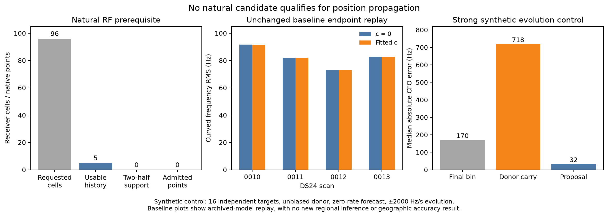

# Independent qualification: no candidate advances to localization

The frozen CH5–8 continuity screen admits **zero corrected existing measurements
and zero new native detections**. All eight complete natural donor modes fail
the required two-half later-sample support test. RF uncertainty and conditional
batch false-confirmation exposure also remain unqualified. The empty
`candidate_manifest.json` and `qualification.json` are the final dependency
handoff; no candidate position run is authorized by this branch.

This completes the requested bounded negative screen. It does not establish
that signals are physically absent, that CH5–8 cannot help, or that a shorter
history policy would fail. A different history/gate policy is a new experiment
and must be frozen before examining its outcomes.

## Exact baseline authority and unchanged replay

The current authority is **ALGO02-v1 + qualified causal signed phase prior +
equal-prior satellite-family cavity**, as frozen in
`/srv/bulk/leo/research/ds25-20261024/protocol.json` and implemented by
`/srv/bulk/leo/research/ds25-20261024/engine/ds24_engine.py`. Its adoption rule is
`equal_assignment_priors_minimum_corrected_normalized_c0`; a shared RF-selected
hypothesis supplies both c arms. It is not a promotion to a new ALGO revision,
nor a claim of parity with all later experimental graph-reentry methods.
Exact source SHA256 values are:

- Baseline engine: `cef23695e6c70a1499ae9c95bca02ff61676a7510c67e564ea4d8caee23ef430`.
- ALGO02-v1 implementation: `3ff7b5f838cdefceb326b6db1f10f8d5009517305debc273a83198803fce36ff`.
- Read-only recovery reconstruction: `1fdcba5faddb97786659986724cecceee039620b90470c85b5e26337a6e9072f`.

`baseline.py` reconstructs the selected/fallback saved policy through
`/srv/bulk/leo/research/ds24-movement-policy-r01/recovery/recovery.py:context`,
`build` and `membership`. It uses the same unchanged event/predictive model as
the prior `ds24-ch78-diagnosis-r02/common.py` context. It evaluates only the
saved endpoints and phase references; it does not launch discovery, optimize
position, select new candidates, consult GPS, or evaluate geographic error.

The pre-replay receipt contains **1,172 source/input hashes**. Every source/input
still matches after replay and independent audit. Each case's exact masks,
native IDs, candidates, graph and family aliases, physical support, point noise,
family powers, same-arm noise/prior precision and phase reference are retained
in a local baseline packet. Four packets total about55 MB and are excluded from
publication; their hashes are in `summary.json` and `baseline_audit.json`.

| Scan | Existing GLRT winners | Curved likelihood points | Predictive points | Frequency RMS c=0 / fitted-c (Hz) | Objective replay delta, both arms |
|---|---:|---:|---:|---:|---:|
| DS24-0010 | 4,268 | 2,571 | 615 | 91.588 / 91.489 | 0.0 |
| DS24-0011 | 3,754 | 2,241 | 0 | 82.142 / 81.991 | 0.0 |
| DS24-0012 | 4,233 | 2,885 | 346 | 73.038 / 72.949 | 0.0 |
| DS24-0013 | 4,808 | 3,037 | 747 | 82.511 / 82.500 | 0.0 |

Each c pair has identical likelihood observations/mask, candidate rows/catalogue,
aliases, point noise, powers, phase means and other physical priors. Fitted-c
adds the existing RF-dependent calibration coordinate: its hardware design
column is `(actual_rf_hz/1e9 - 11.5)*200000`, with that coefficient's original
prior. Hardware otherwise retains four receiver/band offsets and the original
receiver mean/contrast drift terms. Receiver smooth, satellite phase/orbit and
fragment terms retain their existing semantics. The fitted normal system and
estimated nuisance precisions can differ between arms; these are model outputs,
not unmatched observations or an intentional change to other priors. Both exact
same-arm precision vectors are saved. A single global empirical precision is
not silently shared across arms.

The archived regional authority uses a25×25km box centered at37.906,-122.545,
with start[0,0], causal catalogues and no GPS in inference. Its original search
budget is inherited, not rerun here. The source historical stage limits exceed
this iteration's cap; they were not launched. Archived positions remain old
results, and no new geographic accuracy number follows from this endpoint replay.
Fitted-c's small frequency RMS changes are reported separately and imply no
localization improvement.

DS24-0011 also has430c0/401fitted-c compatible postfit-only association IDs.
Those are diagnostic associations, not additional likelihood observations;
their differing counts do not violate the matched likelihood-input ablation.
All other cases have zero postfit-only IDs in this reconstruction.

## Natural evidence, support and ownership

The independent audit verifies48/48 paired original candidate-parity receipts,
96 native target mappings, earlier-only forecast replay and target-response
redaction. Native counter gaps, sample rate, receiver numbering, channel/edge,
actual RF, original visit IDs and full reader exhaustion are checked. Eight
complete modes belong to five receiver cells: CH1:1, CH5:1, CH6:3; CH4/7/8:0.
All complete modes fail the frozen two-half margin/support consistency rule
for both constant and linear forecasts. There are32 conditioned half scores
(8modes×2variants×2halves), not32 independent observations.

Across the96 target owners,17already contribute curved likelihood,2predictive
likelihood,7are existing winners unowned by the saved likelihood, and70have no
existing winner. **All five eligible forecast targets fall in the last group.**
If those qualified, they would be new native detections rather than frequency
corrections to existing winners. They do not qualify in this screen.

The audit also finds48first-target receiver cells reused as an earlier donor
for their second target. Neighboring targets share donors, receivers and radio
conditions. Thus96cells,8modes and repeated proposals are not independent
experiments. Original full-window target candidates were previously exposed;
half support is a conditional consistency diagnostic, not external identity
truth. Forecast matching does not identify a satellite. RF mapping authority
is preserved as the capture's `hypothesis`, not upgraded to independently
established physical RF identity.

The frequency branch's192half-packets are independently bound to the same
native inventory, including15unique donor owners. There are182no-donor
half-packets and10eligible half-packets; no natural estimator or new IQ call
was made after the failed support prerequisite. Donor raw metadata was read,
not presented as a newly verified donor IQ digest.

Both half-packets currently retain the full target-start CFO forecast. Their
second-half elapsed time advances, but CFO rate does not: the omitted10ms
advance ranges from−38.56to−25.96Hz over the eight complete modes. No estimator
consumed these packets. A future scoring experiment must declare CFO reference
time and propagate its rate consistently before freezing new outcomes; this
is not a reason to reinterpret this screen as successful.

## Frequency controls and uncertainty audit

The signal harness has288conditional comparisons sharing48independent later
noise vectors. Strong, unbiased-donor, zero-rate-forecast, nonzero-evolution
controls contain16independent targets at±2000Hz/s. The proposal is within100Hz
in14/16, compared with0/16for unchanged donor-conditioned final-bin scoring and
0/16for donor carry. The unchanged scorer is conditioned on the same donor
timing/center; it is not blind acquisition.
Median absolute errors are32.0,169.78and718Hz, respectively; proposal p95 is
109.75Hz versus195.87Hz for final-bin. This establishes a useful controlled
mechanism, not a natural detection or geographic improvement. The weak-signal
and recorded injected branches do not show a general accuracy win.

Slope definitions differ by frequency reference time. Our strong-subset slope
is0.994516: through-origin regression of proposal-minus-carry against
truth-at-target-midpoint-minus-carry, using a0.359s elapsed time. The frequency
STATUS value1.008563 uses target-start evolution over0.354s in the same subset.
These are different reference times, not contradictory outcomes. Other pooled
or differently stratified slopes must keep their own explicit definition.

The estimator retains a later-sample relative complex profile and a separate
donor-conditioned posterior grid. The later-data profile excludes the donor
prior, but remains conditional on donor timing, frequency center and the frozen
search domain. It is not an unconditional blind-acquisition likelihood.
Its complex-white-noise assumptions, plug-in
scale and interpolation covariance are not calibrated for natural RF. A higher
GLRT margin is not a likelihood or measurement standard deviation. Reusing its
posterior as a fresh independent Doppler factor would reuse the donors' prior
information. Target-only likelihood extraction or an explicit joint covariance
model is required before position integration.

The primary review identified a grid-CDF reporting bug in frozen v1: cumulative
point masses were interpolated at grid centers, which can exclude the mode of
a concentrated distribution. Frozen weights, MAP CFOs, gates and original
outcomes remain unchanged. We independently recomputed all303available
signal/recorded intervals from saved weights, without RF/likelihood calls:

| Saved-weight interpretation | Synthetic coverage,288comparisons | Recorded injected coverage,15available |
|---|---:|---:|
| Frozen v1 reported interval | 267 | 11 |
| Literal discrete grid masses | 267 | 10 |
| Uniform density within midpoint bins | 262 | 10 |

The final two are separately sealed offline numerical interpretations, not a
retuned inference algorithm. Neither supplies calibrated real-RF uncertainty.
The288comparisons share48targets, so a naive288-trial binomial calibration
claim is invalid. We do not attribute every apparent coverage failure to
likelihood physics while the discretization issue remains explicit.

The128active-donor synthetic null vectors yield0/64confirmations in each
single-proposal/three-proposal stratum. These nulls assess the unchanged GLRT
acceptance gate, not posterior CFO correctness. Each stratum's exact one-sided95%
upper bound is0.04573per searched target. Multiplying by96exposures yields an
uninformative family bound clipped at1.0. These screen the synthetic model;
they cannot certify the frozen protocol's≤0.05family-wise natural admission
requirement. Natural conditional null exposure remains absent. Zero observed
false alarms is not a zero false-confirmation probability.

## Adapter, verification and handoff

`adapter.py` is an internal versioned research envelope, not an amendment to a
published contract or a functioning new position pipeline. It distinguishes
exact-owner corrections from genuinely new native detections, stages one row
per raw owner, and requires separately reviewed hash-bound RF evidence. It
checks support overlap/aliases, native counters and receiver numbering, actual
RF scaling, receiver/band offsets, source integrity, target-only likelihood
semantics and calibrated uncertainty. Donor carry and donor-conditioned
posterior reuse are rejected even if physical target IDs differ. A correction
preserves all original fields except CFO; new uncertainty is an explicit
sidecar. No-proposal staging exactly preserves every baseline observation.

Staged RF rows still require causal graph/alias/support requalification. The
future position-pair checker requires identical observations, candidates,
aliases, other priors, budgets and regional starts; GPS-free/causal-TLE
certificates; and primary dependency execution approval. It never turns an RF
receipt into a satellite association or grants itself execution authority.

Thirty boundary/replay tests pass; three additional sealed-product checks cover
matched inputs, scientific ownership counts and the no-promotion decision.
Baseline replay workers took2.37–9.53s, using at most two workers, BLAS1 and
600s outer caps. Audits took under1s. No new RF, QNAP writes, production edits,
git mutations or publishing occurred in this branch. Read permission for frozen
capture metadata required `sudo -n`; the first unprivileged audit stopped before
reading those protected inputs, then the same read-only audit completed with
that existing access method. No input was changed.

Primary can publish this negative screen, compact audits, source receipt,
tests, figure and empty candidate manifest using `publication_manifest.json`.
The approximately55MBbaseline packets stay local and hash-bound. No regional
search or new satellite association is a remaining dependency of this result.
