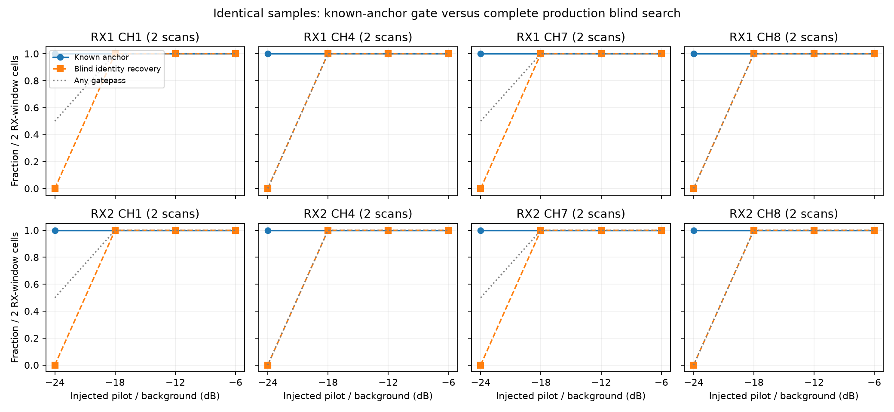
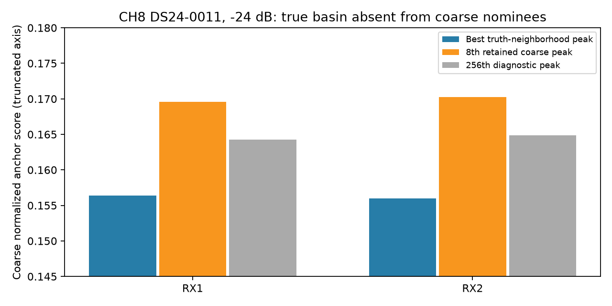
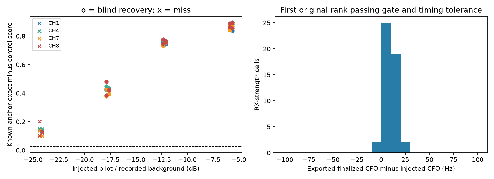
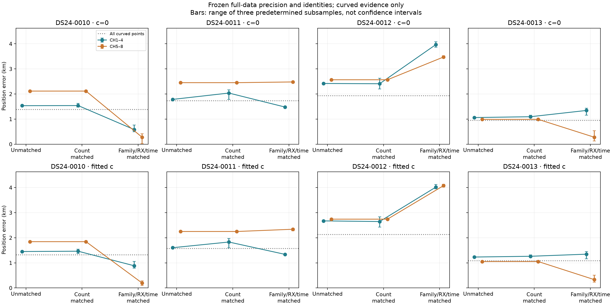
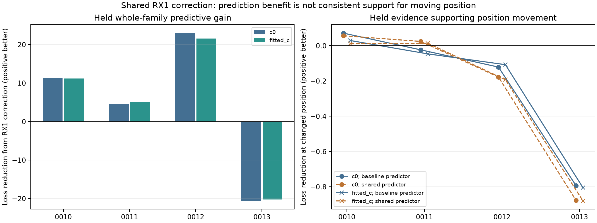
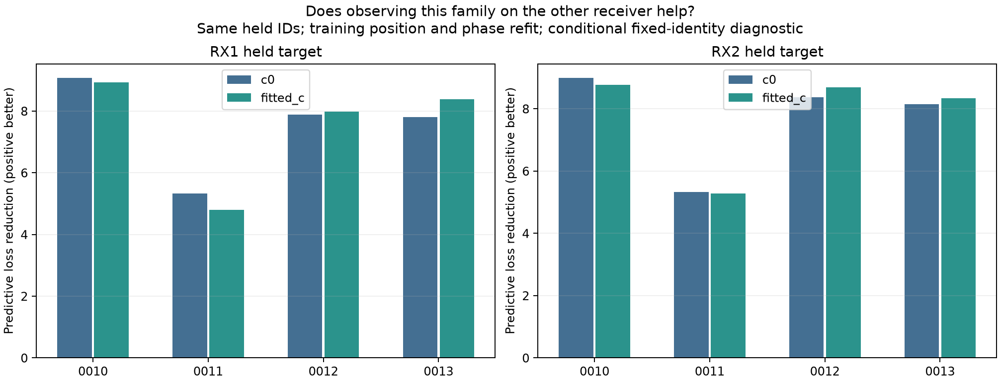

# DS24 CH7/8 diagnosis: acquisition loss, evidence composition, and receiver corrections

Date: 2026-10-26. Status: completed development diagnostics; no production algorithm change or new ALGO release.

Three experiments narrow the next investigation. Weak injected pilots can pass the final GLRT when their timing is supplied, yet fail blind acquisition on every tested channel. Two detailed CH8 traces locate that loss at coarse candidate nomination before refinement; this panel does not identify a special CH7/8 digital-detector defect. The CH5–8 localization disadvantage also changes substantially when satellite-family, receiver and time coverage are matched. Finally, an existing smooth RX1 correction fails the predeclared predictive screen, so it should not be added merely because it improves some fits.

SOL high implemented the injection experiment and independently reviewed the inference branches. The primary agent implemented matched-evidence localization, residual prediction, the review followup, and integration. Further agent launches hit the session thread limit; numerical workers still ran in parallel. All work used existing recordings. No new RF, raw-IQ export, post-observation TLE, association admission, production change or forced match was involved.

## Scope and controls

This follows the published [per-channel audit](../2026_10_26_ds24_per_channel_audit/README.md), [high-band audit](../2026_10_26_ds24_high_band_audit/README.md), and [CH8 correction experiments](../2026_10_26_ds24_ch8_correction_experiments/README.md). Those cohort results and their association percentages remain the operational comparison. This report measures mechanisms on a small development panel, not a replacement DS24 benchmark.

The [frozen protocol](PROTOCOL.md) separates three branches:

| Branch | Panel | Main comparison |
|---|---|---|
| Detection | DS24-0010 and 0011; CH1/4/7/8; both RX | Full blind acquisition versus supplied true timing/frequency |
| Matched evidence | DS24-0010 through 0013 | Original band subsets, equal counts, equal family/RX/time counts |
| Residual prediction | Same four scans | Baseline versus frozen shared RX1 correction, holding out a selected family |

Every geographic comparison includes `c=0` and fitted `c` with identical observations, candidate identities, priors and search budgets within each comparison. Fits start at the center of the 25×25 km region, latitude 37.906, longitude −122.545, with five phase refreshes and 48 position iterations per refresh. They retain the existing causal candidate/phase banks. These are fixed-assignment mechanism tests: satellite identities are not rediscovered during these refits. The reference latitude 37.849061591561885, longitude −122.48574968092912 enters only the final position-error report after RF outputs were sealed. It does not nominate cases, masks, corrections or winners.

The four scans are the first chronological common usable cases, not an independent new-location validation set. Inherited graph assignments, support metadata and empirical noise have prior exposure to full scan data. The matched branch deliberately freezes full-data precision packets. Its results are conditional diagnostics, not blind channel-only validation.

## 1. Weak pilots disappear during candidate nomination

Eight paired physical windows give 16 receiver-window cells. Visits were selected nearest the full-scan midpoint by sample counter, before inspecting outcomes. Both pilot edges are represented. Full unmodified historical candidate parity passed for all eight windows before injection.

An independent analytic flat eight-tone pilot was added to native samples at epoch 4321.25 samples and CFO +213456.75 Hz. Its average complex power relative to each recorded background was −24, −18, −12 or −6 dB. These ratios are **not physical antenna-input SNR**: background includes real signals, interference, noise and DC, and digital injection bypasses antenna/LNB/front-end gain.

The same injected complex64 samples enter complete historical blind acquisition and a supplied-anchor GLRT. Both use the existing 0.025 exact-minus-control gate. Blind recovery additionally requires the injected identity: timing within two native samples modulo the exact sample-rate/750 period and finalized CFO within 100 Hz.

| Injected pilot/background | Supplied-anchor pass | Blind recovery of injected identity | Any blind gatepass |
|---:|---:|---:|---:|
| −24 dB | 16/16 | **0/16** | 4/16 |
| −18 dB | 16/16 | 16/16 | 16/16 |
| −12 dB | 16/16 | 16/16 | 16/16 |
| −6 dB | 16/16 | 16/16 | 16/16 |

Each RX/channel shows the same transition on this six-dB grid. Clean Gaussian controls show the same transition. This establishes a search-versus-scoring gap for this injected signal, but cannot exclude smaller channel-specific threshold differences, multipath effects or different natural RF strengths.

A predeclared replay of DS24-0011 CH8 at −24 dB traced both receivers upstream. The coarse search evaluates 21 CFO values × 13,333 timing cells and retains eight nonmaximum-suppressed peaks. The true-neighborhood peaks rank **6,808 and 7,700** among about 48,000 local peaks. Their scores, 0.156400 and 0.155984, are below the eighth retained scores, 0.169560 and 0.170272. Neither appears even in a diagnostic top-256 list. Extra candidates were not refined or admitted.

For these two traced misses, loss occurs before fine CFO, fractional timing, candidate ordering and final GLRT admission. All 16 weak injections lack a final candidate near the injected timing, but only these two had the full coarse trace. Increasing the retained list slightly is unlikely to recover a basin ranked thousands down.

Among 48 recovered receiver-strength cells, the first original-rank timing-matched gatepass has median absolute CFO error **9.52 Hz**, maximum **24.84 Hz**. No candidate was selected by minimum CFO error.

The supplied anchor bypasses blind search multiplicity. Its success does not demonstrate deployable recovery at an equal false-alarm rate. In zero-injection recorded backgrounds, four of 16 receiver-window cells had at least one gatepass, which can represent genuine existing signals. Noise-only controls produced zero of four RX-edge outcomes, but reuse only two independent noise draws; they do not calibrate a low false-alarm probability. A sequence rolled by 17 symbols produces a retimed valid blind detection, so it is an ambiguity control rather than a null. Full details and every candidate export are retained in [detection findings](detection/FINDINGS.md), [cells](detection/cells.csv) and [results](detection/results.json).

## 2. Satellite/time composition matters beyond point count

This branch removes predictive factors from every variant and uses only the original retained curved evidence. Original identities, aliases, nuisance coordinates, empirical noise and prior precision remain fixed. The controls use all curved evidence, CH1–4, and CH5–8. Three predetermined seeds additionally generate:

1. **Count-only matching:** randomly reduce CH1–4 to the CH5–8 point count.
2. **Family/RX/time matching:** within each satellite-family × receiver × 20-second cell, sample the minimum available count from each band.

No point is fabricated or duplicated. Masks are identical across the two `c` arms. Partial-track diagnostic subsets need not satisfy production track-support gates. Three subsamples are repeated masks of one scan, not three independent scans; error bars below show their ranges, not confidence intervals.

| Scan | All curved | CH1–4 | CH5–8 | Family/RX/time matched, per band |
|---|---:|---:|---:|---:|
| 0010 | 2,571 | 1,493 | 1,078 | 474 |
| 0011 | 2,241 | 1,522 | 719 | 484 |
| 0012 | 2,885 | 1,838 | 1,047 | 517 |
| 0013 | 3,037 | 1,578 | 1,459 | 647 |

The following means average replicates within a scan, then average the four scans equally:

| Calibration | Evidence comparison | CH1–4 mean error | CH5–8 mean error |
|---|---|---:|---:|
| c=0 | Unmatched | 1.700 km | 2.031 km |
| c=0 | Equal count | 1.770 km | 2.031 km |
| c=0 | Matched family/RX/time | 1.843 km | 1.628 km |
| Fitted c | Unmatched | 1.740 km | 1.972 km |
| Fitted c | Equal count | 1.801 km | 1.972 km |
| Fitted c | Matched family/RX/time | 1.896 km | 1.736 km |

Equalizing counts changes the fitted-c gap by about 61 m, from 232 m to 171 m. Matching family/RX/time composition reverses the average band ordering. This is evidence that which curves are observed matters; point count alone does not explain the difference in this panel. It is not a causal percentage decomposition or proof that hardware sensitivity is equal.

The individual cases prevent an overly optimistic interpretation. With fitted c and matched composition, CH5–8 averages **0.196 km** on 0010 and **0.331 km** on 0013, but **2.339 km** on 0011 and **4.078 km** on 0012. CH1–4 is also about 4.015 km on 0012. Selecting these subsets because some land near GPS would create a location-specific policy. No such selection is adopted.

The dotted all-curved controls omit predictive factors and freeze precision, so they are not ordinary operational all-channel baseline results. All 96 outcomes, including frequency RMS, are in [matched endpoints](report/matched_endpoints.csv); [comparisons](report/matched_comparisons.csv) retain per-scan mask ranges. Raw objectives across different masks are not comparable policy scores. No new GLRT association percentage is claimed: these experiments subset existing evidence rather than recover new associations.

## 3. A shared receiver correction fails the advancement screen

For each scan, the largest curved family present on both receivers was nominated by point count, with NORAD as tie-breaker. Three masks remove its whole family, only its RX1 factors, or only its RX2 factors. Matching explicit predictive factors are also removed. Held responses cannot enter training calibration or position. The whole-family test uses causal phase/orbit priors; the single-RX tests let the other receiver inform that family's phase.

| Scan | Selected family | Curved points, RX1 / RX2 |
|---|---:|---:|
| 0010 | 62283 | 312 / 118 |
| 0011 | 61549 | 263 / 100 |
| 0012 | 67123 | 520 / 145 |
| 0013 | 63898 | 245 / 62 |

The candidate is the existing frozen `sharedRF50` RX1 smooth term: 10-second basis spacing, 5-second width, 50-Hz prior at 11.5 GHz. Its strength was not tuned. Both models use train-only fits and joint predictive covariance, including shared nuisance uncertainty, held phase/orbit variance and 300-Hz predictive-fragment constants. Scores are Gaussian moment approximations conditional on fitted training position; they do not integrate position uncertainty or represent exact Student/Gamma densities.

Define predictive gain as baseline minus candidate negative twice log density; positive means better prediction of identical held observations. Whole-family results are:

| Scan | c=0 gain | Fitted-c gain |
|---|---:|---:|
| 0010 | +11.30 | +11.22 |
| 0011 | +4.55 | +5.08 |
| 0012 | +22.97 | +21.54 |
| 0013 | **−20.61** | **−20.25** |
| Total | +18.22 | +17.58 |

Adding flexibility can improve predictive covariance without supporting a new position. We therefore also score both endpoints with each same predictor. Summed support for moving to the corrected endpoint is negative under both predictors in both arms:

| Calibration | Baseline predictor | Corrected predictor |
|---|---:|---:|
| c=0 | −0.867 | −0.974 |
| Fitted c | −0.931 | −1.048 |

The predeclared screen required positive own-model gain in every scan, total gain at least 10 in each arm, positive summed movement support under both predictors, and numerical checks. The last requirement passes; the per-scan and movement requirements fail. **The correction does not advance to operational geographic evaluation.** A better summed RF prediction score is insufficient justification to move the position.

Using the opposite receiver's evidence for the selected family improves prediction on the same held native IDs in all 16 scan × target-RX × c comparisons. Fitted-c gains range from +4.80 to +8.93. This is useful evidence for cross-receiver family support, but training position and phase both change in this comparison, so it does not isolate a pure fixed-position phase effect or prove the satellite identity.

Receiver and channel-group marginal scores, including CH7/8, are in [residual comparisons](report/residual_comparisons.csv). They share covariance and must not be added as independent witnesses. [Other-receiver results](report/other_receiver_witness.csv) preserve the identical-test-ID check.

## Verification, provenance, and reproducibility

There were 144 cold position fits: 96 matched-evidence fits and 48 residual fits. The residual branch produced 96 crossed fixed-position scores. All jobs completed within the bounded worker budgets, with no missing-case substitution. Original protocols and RF seals remain unchanged. Eight owned tests passed: four analytic acquisition tests and four tests for mask ownership, empty overlap, covariance equivalence and actual held-response redaction. The latter also checks the unchanged whole-family optimization trajectory after held values are altered.

The [independent review](detection/REVIEW.md) identified two audit gaps, which are preserved explicitly:

* The original root source manifest omitted 20 ancillary causal-history/prior files. [Supplemental provenance](supplemental_provenance.json) records their hashes after launch. Their mtimes precede both protocols and subsequent rehashes agree, but this **is not retroactive proof of a prelaunch hash freeze**. Existing causal consistency checks ran; the original manifest limitation remains.
* Original crossed-score records omitted final precision-convergence and unclipped-phase diagnostics. [Audit replay](prediction_audit/summary.json) recomputed all 96 scores at the exact saved endpoints without new position optimization. All score dictionaries and predictive arrays reproduced exactly; all phase/precision guards passed. Training fits and all matched fits also pass recorded phase checks, with no `iteration_budget` stop. Solver stopping is not proof of a global optimum or exact stationarity.

Visual inspection caught clipped high-error panels in the original shared-axis matched plot. [The versioned display correction](figure_correction.py) reads the same sealed numbers and sets global limits to include every endpoint, whose maximum is 4.1303 km. The figure used above is `report/figures_v2`; the original sealed figure is retained for provenance and is superseded. No numerical refit or changed error was involved.

Study source is included here. `common.py` lists the reused research modules and the protocols bind their source hashes. Acquisition uses the exact historical runtime under `/opt/leo-shared-scans/native-scope64-v2-3460060352b364a9/worker/src` and the public `FastSegmentSource` reader. Existing restricted recording access is required for replay; this publication is not a self-contained IQ fixture. No raw IQ is packaged. Large original/replay predictive NPZ arrays remain on the research volume; the publication manifest records their paths and hashes. CSV/JSON outcomes, source, protocols, masks, review, plots and verification records are included.

Research working directory: `/srv/bulk/leo/research/ds24-ch78-diagnosis-r02`. Use the repository `.venv/bin/python`, set `OPENBLAS_NUM_THREADS=OMP_NUM_THREADS=MKL_NUM_THREADS=1`, and retain the historical acquisition `PYTHONPATH` above for detector tests. Frozen files should not be overwritten when reproducing; use a new study directory and preserve original path/hash receipts. The source entry points are `detection/study.py`, `detection/diagnostic.py`, `matched/run.py`, `residual/run.py`, `audit_predictions.py` and `report.py`. Inspect their CLI help before starting bounded replays. Final reporting alone takes `--reference-latlon`; inference does not.

## Recommended next experiment

The most concrete opportunity is to improve **candidate nomination for weak persistent pilots**, then establish whether recovered evidence adds independent position information. Use a predeclared small panel of existing recordings. Nominate timing/CFO from earlier disjoint RF samples or confirmed neighboring observations, propagate uncertainty, and confirm on fresh disjoint samples. Compare against the unchanged blind path at a measured false-alarm budget, using genuine null controls and sufficient independent trials. Count unique recovered native points and families, not repeated detections of one correlated curve. The oracle-anchor result is motivation for this experiment, not its validation.

For localization, retain the family/RX/time diagnostic and prioritize independently supported families and temporal coverage. Validate any weighting or correction by held-family prediction and same-predictor support for the proposed position movement before releasing GPS evaluation. Then run matched c=0/fitted-c evaluation on a broader chronological panel. Do not deploy the matched subsets, suppress CH7/8, add the rejected RX1 correction, or promote an ALGO version from this four-scan study.

These results do not establish sample rate or the 40-degree receiver separation as the limiting factor. They also do not rule out analog band-dependent gain or illumination: normalized digital injection cannot measure either. The defensible progress is a localized acquisition failure mechanism and evidence that observation composition contributes to the channel-group accuracy difference. Consistent 500-m localization remains unachieved.
