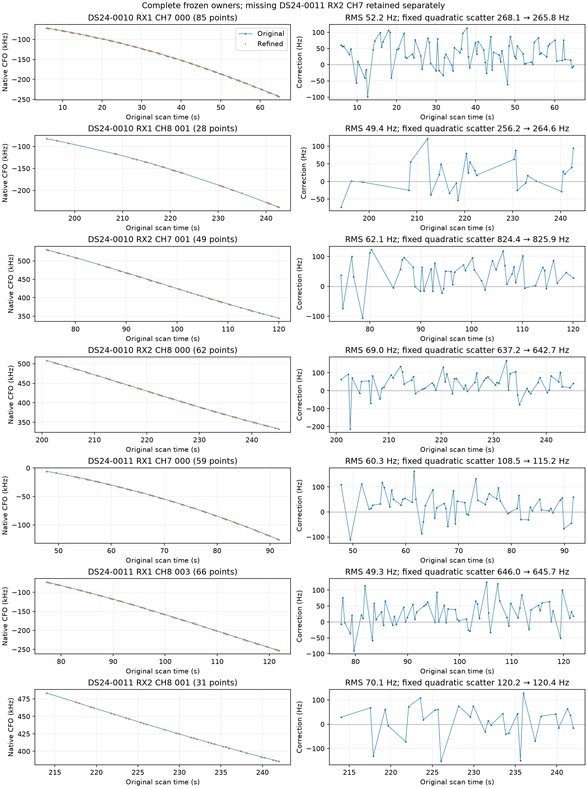
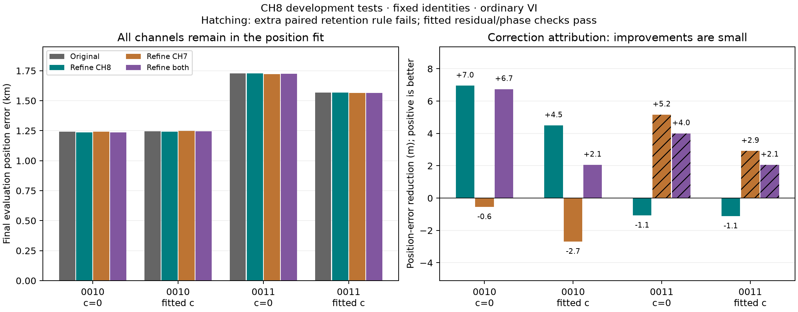
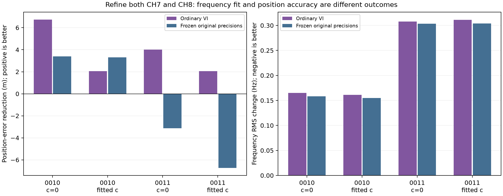
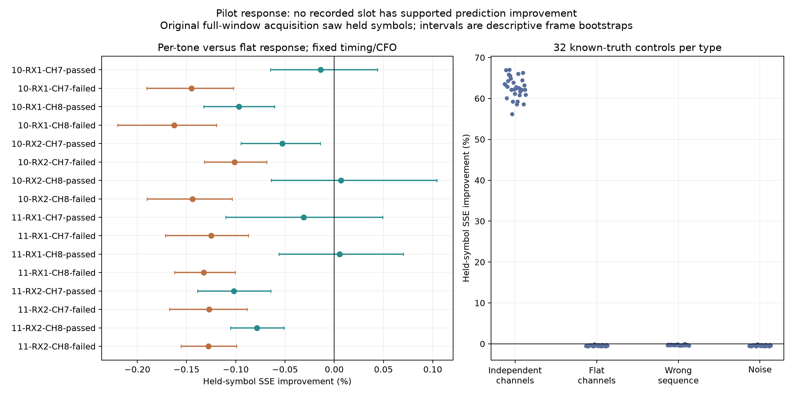
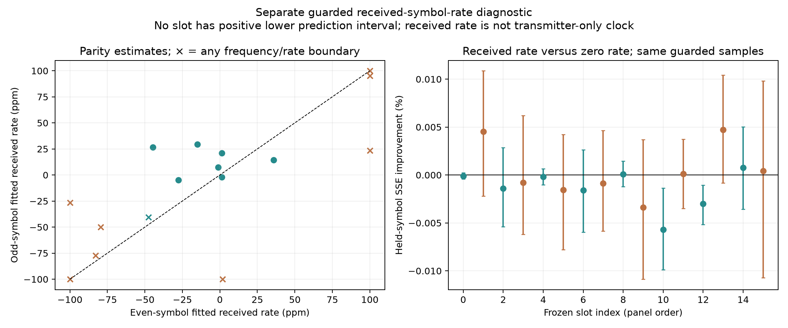

# CH8 correction experiments: no transferable localization improvement established

The three proposed CH8 corrections were implemented and tested. None establishes a useful generalizable improvement yet. Keep the current operational algorithm. Continuous CFO refinement is numerically successful, but its CH8-only effect on these two scans is a few metres. The tested pilot-response and received-rate models have no supported predictive benefit. Replacing RF-scaled receiver drift with native-Hz drift does not consistently predict CH8 better.

This closes the bounded CH8 experiment with a supported next step rather than a new ALGO release: **calibrate measurement uncertainty independently of position error, and determine whether remaining error is dominated by measurement weighting or satellite timing/position ambiguity.** A larger GLRT score, more admitted points, or a smaller fitted frequency residual is not sufficient evidence of better localization.

## Comparison

| Branch | Completed experiment | Result | Decision |
| --- | --- | --- | --- |
| Continuous CFO | 380 native points from seven complete CH7/CH8 tracks; 357 paired windows; 24 position fits including controls | All exact-frequency refinements qualify. CH8-only error improves 4.5–7.0 m on 0010 and worsens about 1.1 m on 0011. | Retain the implementation for research; no operational adoption. |
| Pilot response / received rate | 16 predetermined slots across 14 paired windows, with known-truth and wrong-sequence controls | No recorded slot has supported predictive improvement for either added response model. | Do not add those terms based on this panel. Noise whitening remains untested. |
| Receiver-frequency law | Eight matched CH1–7 training fits; prediction of 373 unique held CH8 curved points | Native-Hz improves predictive loss slightly on 0010 and worsens it on 0011, in both c arms. | Retain the existing RF-scaled smooth term. |

The experiment uses two previously exposed development scans, **DS24-0010 and DS24-0011**, chosen chronologically before corrections. This is neither independent validation nor evidence of new-location transfer. The [frozen protocol](PROTOCOL.md) records nomination, budgets, comparison rules and limitations.

## What was controlled

Two SOL xhigh agents handled CFO and pilot response; root implemented receiver-frequency calibration and integrated final evaluation. All RF came from existing recordings. QNAP remained read-only. No new recordings, raw IQ publication, production edits, public-contract changes, or golden-fixture changes occurred.

The original causal catalogue, identities, aliases, observations, other priors and search budgets stay matched between `c=0` and fitted-`c`. The original 25×25 km region is centered at **37.906, −122.545**. Position fits start at its center with zero phase references and use five phase-refresh rounds of 48 position iterations each.

These are **fixed-assignment mechanism tests**. They retain the saved graph and candidate state while refitting position and nuisance terms from the regional center. They do not rerun regional satellite identity discovery. Thus they test a specific measurement intervention, not the end-to-end effect of a correction on acquisition, tracking and association. No candidate met the evidence standard needed to justify a larger regional pipeline campaign in this round.

GPS **37.849061591561885, −122.48574968092912** was used only after CFO measurement and inference outputs were sealed, for the final error calculations below. Pilot and calibration branches did not read GPS. Saved metadata and assignments have prior data exposure; this work does not retroactively turn them into blind holdouts.

## Continuous CFO: numerical success, small position effect

The frozen rule selects the longest complete retained curved track in each scan × receiver × CH7/CH8 cell, breaking ties by point count and key. Every point must already belong to both c-arm curved likelihoods. The expected DS24-0011 RX2 CH7 cell has only one passing native point and no graph track, so it remains explicitly unavailable. Seven complete tracks remain, with **193 CH7 and 187 CH8 points**. These are selected complete tracks, not every CH8 observation in either scan.

The historical detector was replayed before refinement. All **3,585 archived complete fractional candidate rows** reproduce exactly in every compared floating field. The unchanged continuous estimator optimizes inside the original winning frequency cell while preserving rank, timing, symbol/frame support and admission. All 380 exact-frequency optimizations qualify. One separate control-score optimum reaches its boundary; its margin-qualification flag is retained as false. No margin result changes admission and no point uses a CFO fallback.

The native CFO corrections have roughly 49–70 Hz RMS per track. Maximizing the same detector score does not provide external CFO truth: descriptive fixed-quadratic scatter worsens in five of seven tracks, including three of four CH8 tracks. The full point-level view and exact table are in [CFO findings](cfo/FINDINGS.md).



Sixteen main fits compare original and refined observations under ordinary variational-inference (VI) precision updates and under a frozen original precision model. Eight additional fits apply only the CH8 or CH7 part of the same correction vector. These subsets were frozen before geographic evaluation. All channels remain in every fit: “CH8 only” means **only CH8 measurements are corrected**, not that position is estimated from CH8 alone.

All 24 fits completed. All four ordinary original-control endpoints and objectives reproduce exactly. The original likelihood membership remains 2,571 curved plus 615 predictive points in 0010, and 2,241 curved points in 0011. Native corrections are added once per original occurrence, without extra RF scaling or alias changes.

| Scan / c arm | Original error (km) | Correct CH8 (km) | Correct CH7 (km) | Correct both (km) | CH8-only error reduction (m) |
| --- | ---: | ---: | ---: | ---: | ---: |
| 0010 / c=0 | 1.241915 | 1.234964 | 1.242469 | 1.235176 | +6.951 |
| 0010 / fitted c | 1.246474 | 1.241983 | 1.249171 | 1.244418 | +4.492 |
| 0011 / c=0 | 1.727734 | 1.728811 | 1.722573 | 1.723734 | −1.077 |
| 0011 / fitted c | 1.567031 | 1.568154 | 1.564119 | 1.564974 | −1.123 |



The mean CH8-only reduction across these two scans is 2.94 m for c=0 and 1.68 m for fitted c. These small descriptive changes are not an uncertainty interval or a population benefit. This panel does not reproduce the earlier 90–139 m raw gains obtained by refining different selected tracks on CH1/4/7 in these same development scans. The different interventions should not be pooled as a single validated correction.

All fits pass the fitted residual/likelihood, phase and convergence checks. CH8-only preserves all accepted native IDs in both scans and arms. Applying CH7 corrections, either alone or together with CH8, loses 21 **postfit-only** IDs from the untouched RX1 CH4 T007 track in 0011 c=0; fitted-c loses none. That track was not in the position likelihood. These losses fail the predeclared extra paired-retention rule, but do not establish that the corrected CFO is physically wrong. The actual fitting gates and the extra research retention rule are distinct.

| Scan / c arm | All original GLRT | Original and CH8-only associated | Association % | CH7-only or both associated | Association % |
| --- | ---: | ---: | ---: | ---: | ---: |
| 0010 / c=0 | 4,268 | 3,186 | 74.65% | 3,186 | 74.65% |
| 0010 / fitted c | 4,268 | 3,186 | 74.65% | 3,186 | 74.65% |
| 0011 / c=0 | 3,754 | 2,671 | 71.15% | 2,650 | 70.59% |
| 0011 / fitted c | 3,754 | 2,642 | 70.38% | 2,642 | 70.38% |

These final accepted counts include postfit associations and therefore need not equal likelihood counts. No new detections are sought, and GLRT denominators remain fixed.

### Precision feedback does not rescue the result

The conditional comparison freezes both original observation-noise precision and the complete original nuisance-prior precision array from the same c arm. This produces a conditional Gaussian objective, distinct from the ordinary VI objective. It is a sensitivity analysis, not a choice between commensurate model evidences.

| Scan / c arm | Both-channel correction: ordinary error reduction (m) | Same correction: frozen-precision reduction (m) |
| --- | ---: | ---: |
| 0010 / c=0 | +6.740 | +3.389 |
| 0010 / fitted c | +2.056 | +3.302 |
| 0011 / c=0 | +4.000 | −3.132 |
| 0011 / fitted c | +2.057 | −6.740 |



The both-channel correction increases fitted frequency RMS in every cell, by about 0.15–0.31 Hz. CH8-only slightly reduces it in 0010 and increases it in 0011. Detector score, track consistency, final frequency residual and geographic accuracy are separate quantities. Raw objective differences after changing the observed CFO vector are not Bayes factors.

## Pilot-response mismatch: no predictive support on this panel

Each scan/receiver/CH7–8 cell contributes one original passing winner and one near-threshold failure, selected nearest the scan midpoint with fixed tie breaks. All 16 slots exist, spanning 14 physical windows. Historical paired-receiver parity passes before analysis.

The primary model compares one complex gain per frame with eight complex tone gains per frame, including complex DC in both. Original finalized fractional CFO and fractional timing are held fixed. Even-symbol fits predict odd symbols and vice versa. Every in-sample fit improves with the extra parameters, but held-symbol SSE improvement ranges only from **−0.1626% to +0.00671%**. None passes the declared predictive-support rule. Exact sequences predict better than rolled sequences for all eight passed slots; the failed slots have no positive lower support interval.



Known-truth tone-response-plus-noise controls give support in 32/32 cases, with median held improvement 62.45%; flat, wrong-sequence and noise controls each give 0/32. These show sensitivity under the tested conditions, not a calibrated detector false-positive rate. For example, the exact two-sided 95% interval for 0/32 still extends to 10.89%.

A separately identified guarded-sample received-rate model also finds no supported improvement in any recorded slot. Nine fits touch a parameter boundary and six slots have at least one nonconverged parity fit; successful execution is not equivalent to numerical qualification. An independent noisy control at 37 ppm and +23.4 Hz recovers approximately 37.55/36.65 ppm and 23.31/23.38 Hz in the two splits, demonstrating sensitivity to that tested mismatch.



All prediction splits are conditional on original full-window acquisition, which already saw the held symbols; this is not end-to-end cross-validation. Bootstrap intervals are descriptive. Noise whitening, interference rejection and hardware sensitivity have not been ruled out. No correction qualifies for position propagation from this branch. See [pilot findings](pilot/FINDINGS.md) for the full design and retained failure details.

## Receiver drift law: native Hz does not predict CH8 consistently

The current smooth receiver term scales by actual RF/11.5 GHz. The alternative removes that scale while keeping the same number of columns, priors and all other receiver/band/phase terms. It adds no free channel offsets. All CH8 curved and predictive rows are removed from training; the CH1–7 fit predicts the original retained CH8 curved data while integrating the full shared nuisance covariance. Held noise posterior precisions are never transferred.

| Scan / c arm | Held predictive loss change, native minus RF | Raw CH8 RMS, RF → native (Hz) |
| --- | ---: | ---: |
| 0010 / c=0 | −0.214 | 313.18 → 320.52 |
| 0010 / fitted c | −0.322 | 144.86 → 147.85 |
| 0011 / c=0 | +1.306 | 283.67 → 275.92 |
| 0011 / fitted c | +1.243 | 161.37 → 161.75 |


Lower predictive loss is better. Native-Hz fails the frozen requirement for improvement in both cases and c arms, aggregate gain at least 10, no pooled RMS regression, and convergence. Aggregate gain is **−2.014**, worse. The score includes uncertainty volume, so a raw RMS improvement need not improve predictive loss.

All eight training fits converge and all four original full-objective replays agree exactly. Perturbing held CH8 responses by a 100,000 Hz sinusoid changes no training objective or coefficient. This verifies response isolation conditional on the frozen metadata. It does not remove earlier CH8 exposure through original assignments, support and RF noise proxies. Position uncertainty is not integrated. No geographic result was consulted to reject this branch. See [calibration findings](calibration/FINDINGS.md).

## Supported next goal and SOL work split

**Goal:** determine whether an independently calibrated measurement/noise model or independently supported timing constraint can improve full-channel localization, and validate any proposed change across a frozen scan cohort using the full regional pipeline. A 500 m error remains the longer-term target, not a result of this round.

The next comparison should target a material improvement, for example at least 10% median error reduction with no mean, upper-tail or availability regression, using matched c arms. Freeze the cohort, candidate procedure and evaluation rules before outcomes. Do not treat these two exposed cases as sufficient for promotion. Report association, predictive frequency behavior, runtime and geographic error separately.

| SOL task | First bounded deliverable | Advance only if |
| --- | --- | --- |
| Measurement uncertainty | Test one frequency-uncertainty model on known-frequency noisy controls; compare predicted variance with actual frequency errors. Separate common bias from random scatter and audit acquisition-selection exposure. | Error coverage and held RF prediction support the weights; score curvature alone is insufficient. |
| Timing/position identifiability | Audit the exact joint position/phase/receiver design and quantify which weak position direction overlaps satellite timing modes. Identify one timing observable already present in the recordings that could add independent information. | The observable is identifiable and predicts independent RF evidence; do not fix phase using GPS or a following TLE. |
| Transfer and integration | Freeze a modest chronological cohort and replay the unchanged baseline; preserve all failures. Run only an RF-qualified candidate through full regional acquisition/association/position evaluation. | The predeclared cohort criteria pass in matched c arms. Previously examined cases remain labeled development. |

The uncertainty branch has specific motivation: a separate earlier crossed-precision test found 67–74 m endpoint movement from the fragment-noise precision block in 0011, versus about 6 m from the nuisance-prior block. That is sensitivity to learned weights, not proof that either weight choice is physically correct. This CH8 round reinforces the need to calibrate those weights rather than choose them using geographic gains.

These next tasks are a recommendation, not additional completed experiments. Do not repeat unrestricted recovery, free channel offsets, or extra timing freedom solely to lower training residuals. Do not infer a sample-rate effect from DS24's fixed 10 MS/s recordings, or a bearing measurement from the nominal feed-angle separation. Such claims need separately identifying evidence.

## Reproduction and validation

The branch protocols, source scripts, point corrections, compact results and figures are included. No raw IQ is included. Large paired replay outputs, full numerical endpoint arrays, immutable historical runtime and upstream corpus remain external with path and SHA-256 bindings. This is a reproducible source-bound research package with access to those inputs, not a standalone raw-data bundle.

The three branches report **37 passing test executions**: CFO 13, pilot 21 and calibration 3. Independent SOL review verified CFO units, preserved aliases/masks, identical correction vectors across c arms, all 24 endpoint seals, fixed precision mapping, and that every lost ID is postfit-only. It also reviewed calibration covariance and response isolation. No actionable numerical issue was found. Initial missing-cell nomination, one test-environment collection failure and a reporting-key correction are retained in the CFO receipts; no failed scientific slot was silently replaced.

The integrated [evaluation source](evaluation/evaluate.py) imports no inference code. It verifies sealed inputs, evaluates all 24 endpoints, reproduces the previous 16 geography values to less than 1e−12 km, and writes [all comparisons](evaluation/paired.csv), [full summary](evaluation/summary.json) and two figures. Its command, run after inference sealing, is:

```bash
OPENBLAS_NUM_THREADS=1 MPLCONFIGDIR=/srv/bulk/leo/research/ds24-ch8-correction-r01/mpl \
.venv/bin/python -B /srv/bulk/leo/research/ds24-ch8-correction-r01/evaluation/evaluate.py \
  --study /srv/bulk/leo/research/ds24-ch8-correction-r01 \
  --out /path/to/new/evaluation-directory \
  --reference-latlon 37.849061591561885 -122.48574968092912
```

Source-based inference commands are in each branch's findings and protocol. Scripts refuse to overwrite scientific outputs; use fresh destinations and preserve source/input identities. Publication keeps scientific files byte-identical, including CSV line endings. The root publication manifest binds every included artifact; branch manifests retain external dependencies.

The operational baseline and ALGO series are unchanged. The completed outcome is a negative correction screen with a concrete next experiment, not a claim that every possible CH8 correction has been exhausted.
