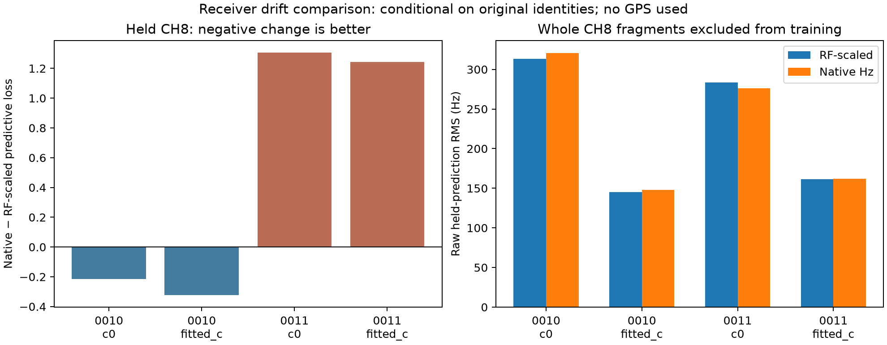

# Receiver-frequency calibration: native-Hz replacement fails the CH8 prediction screen

The same-width native-Hz smooth receiver model does not consistently predict CH8 better than the existing RF-scaled model. It slightly improves predictive density in DS24-0010 and worsens it in DS24-0011, in both c arms. The frozen advancement rule fails. No GPS was loaded or evaluated, and the operational model remains unchanged.

## Actual controlled experiment

Use the first two chronological usable original DS24 cases, not cases selected for poor error. Reproduce each saved full-model objective exactly first (four replay differences are zero). Remove **all CH8 curved and predictive rows from training**, retaining the original candidate identities, aliases, full nuisance support, powers, causal prior means/scales, and RF-only point-noise proxies. Thus this is conditional channel prediction under existing identities and support, not independent satellite authentication or a fully blind association holdout.

The models differ only in the frequency dependence of their existing receiver smooth basis. RF-scaled uses q times the basis, q=actual RF/11.5 GHz. Native-Hz removes q. Column count, coefficient priors, receiver-band constants/linear drifts, phase/orbit terms and fragment priors stay unchanged. A shallow scan view transforms the receiver basis consistently for curved, predictive and residual ports; original scan arrays remain untouched. This reuses the physical distinction in `tools/dsx01_native_drift.py`, without changing to that older experiment's other likelihood settings.

Each of eight fits starts at regional-center coordinates [0,0] with zero phase references, uses five phase refreshes and 48 steps per round inside the existing 25 by 25 km bounds. CH1-7 predictive rows can inform position but do not update calibration coefficients. All training precision/phase checks converge. These are fixed-identity regional-center fits, not full regional association-search reruns.

The held population contains 205 curved CH8 points in 0010 and 168 in 0011. Whole held fragment constants remain uncertain under their original priors. Predictions integrate the complete shared coefficient covariance and use the unseen Gamma(2,2) noise approximation E[1/tau]=2; held CH8 noise posterior precisions are zero and never transferred. Position uncertainty is not integrated, and original selection/support and RF noise estimates have prior CH8 exposure. The scores are conditional Gaussian diagnostics, not calibrated probabilities of identity.

| Scan | c setting | Change in held predictive loss, native minus RF | Raw held RMS, RF to native |
| --- | --- | ---: | ---: |
| 0010 | 0 | -0.214 | 313.18 to 320.52 Hz |
| 0010 | fitted | -0.322 | 144.86 to 147.85 Hz |
| 0011 | 0 | +1.306 | 283.67 to 275.92 Hz |
| 0011 | fitted | +1.243 | 161.37 to 161.75 Hz |

Lower predictive loss is better. It accounts for shared uncertainty and log-volume, so its ordering need not match raw RMS. A large constant discrepancy can have weak influence when an unobserved fragment's offset is uncertain. Conversely, an apparently small RMS improvement need not improve full predictive density.

The predeclared screen requires density improvement in both cases and both arms, summed improvement >=10, no pooled raw RMS increase, and converged fits. The summed density improvement is **-2.014** (worse), so the branch does not advance. The repeated c arms are controls, not independent measurements. The difference is too weak and inconsistent to establish a physical LNB drift law; it is sufficient to reject this replacement as the demonstrated CH8 remedy in this round.

## Validation and next action

Three numerical tests pass: direct dense covariance agrees with the marginalized predictive density, the native-Hz transform has the intended common-Hz response without mutating original arrays, and zero shared uncertainty reduces to independent Gaussian noise. Runtime assertions verify exact baseline objectives, identical c-arm IDs, unchanged smooth-column dimensions, consistent native/RF scaling, no held-fragment fitted noise precision, and zero predictive-to-calibration feedback.

An additional actual-data isolation control perturbs every held CH8 response by a sinusoidal error of amplitude 100,000 Hz before calculation. Across all eight case/arm/model combinations, training objectives and coefficients remain exactly unchanged. This establishes response isolation under the fixed conditioning metadata; it does not remove the documented prior exposure through identities, support and noise proxies. An independent SOL review found no actionable implementation issue and reran the three numerical tests successfully.

`run.py` and `report.py` reproduce the experiment with repository tools on PYTHONPATH plus `/tmp/algo03-feasible-deps`; use BLAS threads=1 and two workers. `execution_protocol.json`, four full endpoint records, `summary.json`, source hashes and this figure preserve the results. No additional model variant is chosen after these outcomes. Continue the independent measurement branches; do not add eight free channel offsets or tighten a nuisance prior on the basis of position error.
