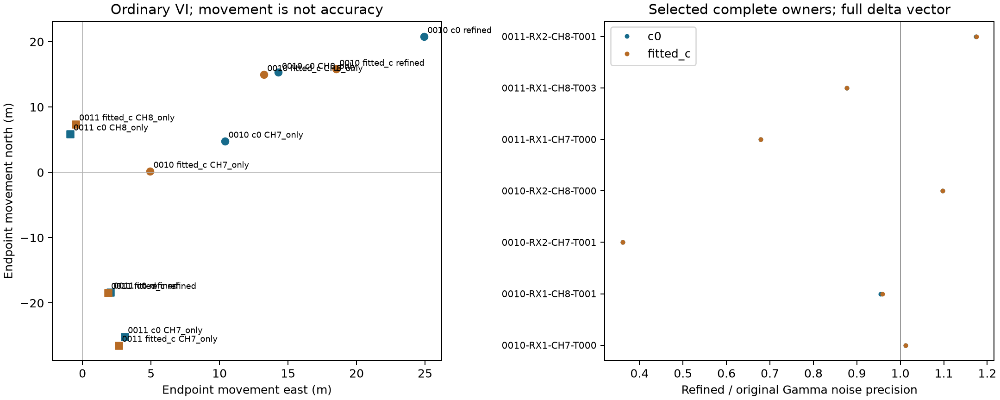

# Continuous CFO: seven complete owners, explicit missing eighth cell

All **380 original native points** in the seven available frozen owners were
replayed and refined, with no failed slots, dropped points or frequency fallback.
The initial 14 time-quantile points passed both-receiver archival parity before
the complete pass. All **3,585 archived complete fractional candidate rows** in
357 paired windows reproduce with zero difference in every compared floating
field. This verifies historical replay and same-cell numerical stability; it
does not establish physical CFO truth or geographic improvement.

The expected eighth owner, DS24-0011 RX2 CH7, is unavailable. It has one native
gate-passing observation among 846 archived probes and no graph track. This
missing cell remains in the denominator. The parent authorized proceeding with
seven available complete owners, without replacement or gate changes, in
[ADDENDUM_01.md](ADDENDUM_01.md). The frozen manifest predates new IQ, correction
and geographic evaluation. There is no eight-owner-complete claim.

## Frozen nomination and exact historical authority

Chronological DS24-0010 and DS24-0011 are exposed development scans. In each
RX1/RX2 by CH7/CH8 cell, nomination orders retained curved complete owners by
decreasing original time span, decreasing original point count, then ascending
key. Every selected original native ID is in both c-arm curved likelihoods.
The manifest preserves the full ranking, exclusions and every original ID.
The 380-point panel is below the 1,200-point bound and was never truncated.

| Scan | Receiver/channel/owner | Points | Span (s) | Correction RMS (Hz) | Descriptive quadratic RMS before → after (Hz) |
| --- | --- | ---: | ---: | ---: | ---: |
| 0010 | RX1 CH7 T000 | 85 | 58.809 | 52.208 | 268.070 → 265.810 |
| 0010 | RX2 CH7 T001 | 49 | 45.721 | 62.108 | 824.404 → 825.892 |
| 0010 | RX1 CH8 T001 | 28 | 48.541 | 49.357 | 256.163 → 264.563 |
| 0010 | RX2 CH8 T000 | 62 | 44.290 | 68.984 | 637.188 → 642.676 |
| 0011 | RX1 CH7 T000 | 59 | 43.939 | 60.335 | 108.549 → 115.212 |
| 0011 | RX1 CH8 T003 | 66 | 44.651 | 49.276 | 645.979 → 645.656 |
| 0011 | RX2 CH8 T001 | 31 | 27.992 | 70.097 | 120.238 → 120.411 |
| 0011 | RX2 CH7 unavailable | — | — | — | One passing native point; no owner |

Quadratic descriptions are fixed-degree RF summaries, not physical satellite
residuals or admission gates. Their scatter worsens in five of seven owners,
including three of four CH8 owners. Native corrections span −212.882 to
+168.453 Hz. They are applied point by point, without sparse interpolation.

The exact tested numerical kernel is
`/srv/bulk/leo/research/ds24-detector-response-r01/measurement/refiner.py`, SHA256
`7cb3c322f38fc5e68fa8fa94dcd2106c5c7ad8102dccfdd289e3994bd00005b9`.
The replay/parity helper is that study's `recorded/replay.py`, SHA256
`9902e8864facc81f3bb1aa18f0e00f44de04f283bca8e13443992ee26a6c0058`.
Neither helper was changed. Runtime code identity is
`sha256:124afbbc81870a4079b272bd828d4a99f716e54624a073d9cb13acc2a1b7fe16`
and environment identity is
`sha256:8ccb220369bccb42b7bea5dcd3bfa546e132d2250a674e6eac7388a2a425e3b9`.
Both match the persisted historical executions and remain exact before/after.
Authority is reused from the same two executions, not inferred from an
unverified binary. Public source inventories, segment manifests and indexes
bind each original receiver/rank/sample support. Fully exhausting the bounded
`FastSegmentSource` reader verifies payload hashes; no raw path is constructed.

The continuous optimizer maximizes the unchanged GLRT64 objective only inside
the original winning frequency cell. Acquired demodulation, epoch, symbols,
rank and original gate remain unchanged. All exact-frequency numerical checks
pass. Exact score increases average 0.000526 on 193 CH7 points and 0.000486 on
187 CH8 points. These local score increases are not physical accuracy evidence.
One CH8 control-score optimization reaches its cell boundary and lacks an
interior derivative root; its margin qualification flag is false and retained.
Its exact CFO optimization qualifies. No corrected margin falls below 0.025,
and no margin outcome changes admission. Two CH8 original residual CFOs are
nonzero; the other 378 original residual CFOs are zero.

The missing-cell timing audit finds the same 846 CH7 probes, exact start/end
times, 20 ms duration and 10 MS/s rate on both receivers in 0011. RX1 passes
187, RX2 passes one. This is not explained by absent probes or differing sample
rates/durations. The separate pilot branch's `sole_RX2_CH7_audit.json` verifies
the sole passing window and its timing/quality receipt; no threshold is relaxed.

## Matched full-channel measurement interventions

Sixteen main fits compare original/refined CFO in ordinary VI and with the
original same-arm complete precision packet frozen, in both scans and both
`c=0` and fitted-`c` arms. Eight additional ordinary-VI fits partition the
complete correction vector into all 187 CH8 points versus all 193 CH7 points.
The subsets were frozen in [ADDENDUM_02.md](ADDENDUM_02.md) before geographic
evaluation. They retain every original observation and partition deltas, not
data membership. Shared original ordinary-VI controls are reused unchanged.

All 24 fits complete. All four original ordinary-VI endpoints and objectives
reproduce exactly. Original and zero-delta fixed-state calculations agree
exactly; all four full-packet diagonals reproduce the source coefficient and
residual ports before conditional fits. Both noise precisions and the full
nuisance-prior precisions are frozen in the conditional branch, including
correct fitted-c column mapping. The predictive factor remains attached.
The fixed-packet objective is conditional Gaussian, not a VI ELBO. Movement
differences between branches include precision feedback and objective/model
differences; they are not an isolated noise-only causal effect.

Native new-minus-old CFO is added once to every original graph occurrence,
preserving its fixed alias with no additional RF scaling or wrapping. All other
observations, masks, candidates, satellite labels, powers, causal priors,
nuisance columns and budgets are matched. The likelihood retains 2,571 curved
plus 615 predictive points in 0010, and 2,241 curved points in 0011.

These are **cold zero-position/zero-phase fixed-assignment interventions** in
the original 25×25 km region centered at 37.906, −122.545. Each uses five
48-iteration phase-refresh rounds. Saved endpoints serve as replay controls and
sources of original precision packets; they are not optimizer starts. However,
the saved graph assignments/candidate state remain fixed. This work does not
rerun the complete regional association/search pipeline, so it does not establish
regional end-to-end gain. The parent coordinates any justified regional test.

| Scan / delta vector | Ordinary-VI movement c0 / fitted c (m) | RMS change c0 / fitted c (Hz) | Postfit-only ID losses c0 / fitted c |
| --- | ---: | ---: | ---: |
| 0010 all seven-owner deltas | 32.460 / 24.319 | +0.1652 / +0.1613 | 0 / 0 |
| 0011 all seven-owner deltas | 18.444 / 18.467 | +0.3077 / +0.3111 | 21 / 0 |
| 0010 CH8 only | 20.946 / 19.972 | −0.0165 / −0.0179 | 0 / 0 |
| 0011 CH8 only | 5.958 / 7.424 | +0.0657 / +0.0707 | 0 / 0 |
| 0010 CH7 only | 11.440 / 4.927 | +0.1811 / +0.1787 | 0 / 0 |
| 0011 CH7 only | 25.323 / 26.593 | +0.2369 / +0.2352 | 21 / 0 |

These are endpoint movements, not improvements in geographic error. For the
all-owner vector, frozen-packet movements are 9.797/7.036 m in 0010 and
16.843/15.379 m in 0011. Ordinary Gamma updates reduce at least one precision
to about 0.361 of original in 0010 and 0.678 in 0011; all frozen-packet ratios
are exactly one. This demonstrates why the two mechanisms must stay separate.

Every endpoint passes its fitted likelihood/residual gates, phase bounds and
refresh tests; ordinary VI Gamma updates converge. The unchanged additional
paired-retention rule passes 0010 and fails 0011 for the all-owner vector and
CH7-only vector. The 21 lost IDs are the untouched **postfit-only** RX1 CH4
T007 owner, absent from the fitted position likelihood. CH8-only loses no old
accepted IDs in either scan or c arm and passes the paired rule. Retention
failure does not show that the corrected CFO is wrong; it remains a distinct
coverage outcome. No gate is waived or changed.

Frequency fit and final position accuracy require separate interpretation.
Objective differences evaluate different observed CFO vectors and are not
model Bayes factors. Neither increased GLRT score nor small endpoint movement
demonstrates improvement. Geographic evaluation is deliberately left to the
parent, using all 24 already sealed outcomes and evaluation-only GPS. No GPS
enters these inference scripts, and these two exposed scans cannot establish
independent generalization or transfer to a new site.

## Execution, failures and reproduction

RF replay uses two BLAS1 workers and durable per-window JSONL checkpoints.
Initial work consumes 31.941 cumulative worker seconds, complete work 795.272,
total 827.212 under the 1,150-worker-second bound. Each external numerical job
is bounded below ten minutes. The main 16 fits consume 37.931 cumulative worker
seconds and the eight channel fits 29.452, under their separate fixed bounds.
No new RF, QNAP writes, production edits, golden fixture edits or publication
occurred. All new branch files are confined to this CFO directory.

Thirteen tests pass: three owned nomination tests, eight reused native-delta/
full-precision-port tests, and two owned delta-partition tests. The original
nomination stopped on the missing eighth cell; its receipt is preserved.
The first reused-test collection omitted the tools PYTHONPATH; correcting the
test environment yielded 11 passes, with no scientific rerun. An RF-only
reporting pass initially used a wrong dictionary level for corrected margins;
that report bug was fixed before its output existed, without repeating any
detector or optimizer work. No scientific failure is concealed by these
implementation-only fixes. The control-score boundary flag remains in the raw
result. See `test_receipt.json` and `terminal_implementation_receipt.json`.

The scripts refuse to overwrite scientific JSON. For a fresh external replay
directory, preserve all frozen upstream inputs and use the same Python/source
identities. The sequence is `prepare.py`, `run_rf.py run --stage initial`,
`run_rf.py run --stage complete`, and `report.py rf`; localization is
`localize.py freeze`, then its bounded `run`, followed by
`channel_diagnostic.py freeze` and its bounded `run`. `mechanism_report.py`
reads saved outputs only. All numerical processes set
`OPENBLAS_NUM_THREADS=OMP_NUM_THREADS=MKL_NUM_THREADS=1`; historical replay runs
under the established leo service user and historical runtime. Frozen hashes,
exact commands and external references are in the protocols and lean manifest.
Large paired replay outputs, raw IQ, full inference endpoints and historical
runtime remain external with path/hash provenance. This lean package is not a
standalone raw-data replay bundle.

Primary receipts: nomination SHA256
`8fa49a7b23a88193e4aab6e48949c7b273ec81d6dec51f25f398136738354e61`;
measurement seal
`fcb18d2303a65c21afaecd67d9a785bc1450bf7ca6e0bd1f7a74e90c6eab8db4`;
main inference seal
`9403921aacf73e33ac10d72191bba4e658488892f08c7022ed814c74b9264d6d`;
channel inference seal
`f14663bd63d31d29f455a81f85eba1c55b84e2ac5c7f4d1297ad27f1ceb25967`.
