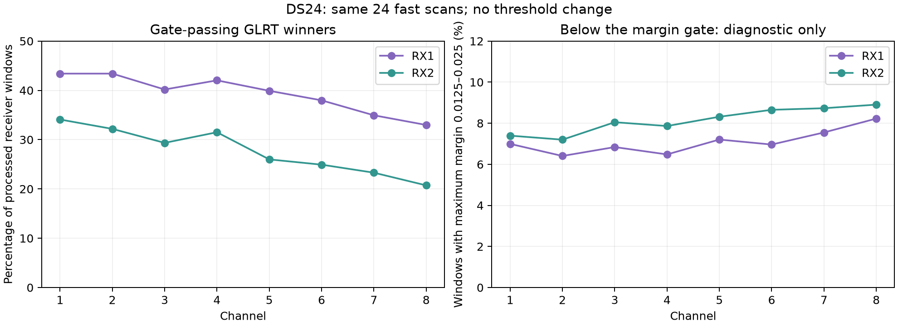

# CH8: which additional corrections are justified to test?

CH8 merits a focused measurement and sensitivity test, but current evidence does not identify a missing CH8 wavelength factor or justify a fixed CH8 frequency correction. The most concrete existing correction is continuous CFO refinement. Frequency-selective pilot response, received symbol-clock mismatch, and the distinction between native-Hz LNB drift and fractional clock drift are testable alternatives with weaker evidence of benefit. No correction is adopted here.

This review uses the same 24 common DS24 fast scans as the [per-channel audit](../2026_10_26_ds24_per_channel_audit/README.md). Its new calculation reads the saved fractional-candidate exports and reproduces every original per-channel winner and processed-window count. There is no IQ replay, new acquisition, new localization, satellite selection, or threshold change. Therefore it supplies no new position-error estimate. The preceding audit preserves both c=0 and fitted-c membership/residual results; this detector-stage calculation does not use c.

## Detection losses occur on both receivers

| Receiver | CH1 winning windows | CH8 winning windows | CH1 accepted normalized RMS | CH8 accepted normalized RMS |
| --- | ---: | ---: | ---: | ---: |
| RX1 | 43.40% | 32.98% | 92.35 Hz | 82.89 Hz |
| RX2 | 34.09% | 20.72% | 35.81 Hz | 33.35 Hz |

The RMS values are pooled conditional residuals of retained curved points from the full fitted-c model, normalized to 11.5 GHz. They are not independently measured CFO uncertainty and compare different selected signals. Selection can hide poor detections or absorb bias in fitted nuisance terms.

CH8 has 10,904 original winners and 7,764 likelihood-associated points (71.20%). CH1 has 15,644 and 11,098 (70.94%). CH8 has slightly more processed windows. The strongest channel trend is reduced detection yield, whereas the larger residual discrepancy follows RX1 across channels. A frequency correction applied after detection cannot by itself recover windows that never passed detection.

Almost all receiver windows contain an exported fractional candidate: 98/40,608 CH8 windows and 84/40,380 CH1 windows have none. This does not prove acquisition was adequate or that a signal existed. An exported candidate can be noise or the wrong source.

The diagnostic interval [0.0125, 0.025) contains 3,478 CH8 windows (8.56%) and 2,905 CH1 windows (7.19%), using the maximum exported fractional margin in each window. The operational margin gate is 0.025. This interval was chosen for description, not as a proposed operating threshold or a definition of signal truth. Hypothetically halving the threshold would add these candidate windows, but the CH1-versus-CH8 yield gap would only shrink from 11.89 to 10.52 percentage points. False-positive rates are not measured by this count, and the new candidates cannot be called recovered signals.

Pooled winning margins remain large: CH8 medians are 0.516 / 0.464 for RX1 / RX2, compared with 0.535 / 0.489 in CH1. Margins are not calibrated SNR. Many windows have multiple passing candidates (9,066 of the 10,904 CH8 winning windows); these can be dependent aliases or estimator alternatives, not independent satellites. Increasing candidate counts is not itself improved detection or localization.

## Ranked correction tests

### 1. Apply the existing continuous CFO estimator to complete CH8 tracks

The original fine residual grid can leave acquisition-frequency error unchanged. The [continuous-refinement study](../2026_10_26_ds24_detector_response/README.md) maximizes the same GLRT64 score inside the original winning frequency cell while preserving candidate identity, timing, symbols, frame support, and admission. Its single-source synthetic RMS improved from approximately 16.6 Hz to 2.2–2.4 Hz. That is a controlled estimator result, not real CH8 error.

The [complete-track follow-up](../2026_10_26_ds24_complete_owner_refinement/README.md) corrected 159 original points in four tracks from channels 1, 4, and 7, not CH8. DS24-0010 raw position error improved by 134 / 139 m for c=0 / fitted c and passed paired research acceptance. DS24-0011 improved by 93 / 91 m but failed paired acceptance because c=0 lost 57 original postfit points. This supports a bounded CH8 test, not an already-proven CH8 benefit or a dataset-wide promotion.

Nominate complete CH8 tracks on both receivers before reading corrections, with CH7 controls from the same scans. Reproduce historical detector outputs first, apply the unchanged refiner to every original point of each nominated track, and compare frequency consistency and downstream position separately. Keep c-arm observations, candidate sets, priors, and budgets matched. Original admission remains fixed in the first comparison. Detection recovery would require a separate false-alarm-calibrated comparison.

### 2. Test the detector's response to the observed pilot waveform

The lower yield on both receivers makes RF response, illumination/transmission activity, interference, and detector mismatch plausible explanations. These saved exports cannot distinguish them. CH8 is at higher RF, but this is not evidence of a measured LNB or tuner roll-off.

On a small predetermined CH7/CH8 panel containing accepted and failed windows, compare the existing waveform against a model with per-tone complex gains and, separately, noise whitening. Profile only the needed channel response, regularize it, and evaluate on different symbols/frames with the same treatment for the wrong-sequence control. The existing `tools/frequency_selective_pilot.py` provides a research implementation, including disjoint-symbol prediction; a prototype's existence is not evidence of CH8 improvement.

A correctable template/channel mismatch should improve prediction on those held samples at a comparable measured false-alarm rate. Merely raising the GLRT score by adding parameters or multiplying all IQ amplitudes cannot establish recovered signal information. If fewer CH8 transmissions are actually present, no software equalizer can restore absent signals. Do not invert weak spectral regions without a noise model.

### 3. Separate clock and receiver-frequency effects before adding calibration freedom

The present model already includes actual-RF Doppler scaling, receiver/band offsets and linear drifts, RF-scaled receiver smooth terms, fragment constants, and optionally the RF-dependent c term. More constants can be absorbed by existing terms and need not improve position.

A useful first-order physical distinction is an additive LNB frequency error in native Hz versus an oscillator error proportional to tuning frequency, plus received waveform time-scale mismatch. These need not have the same frequency dependence. The existing `tools/dsx01_native_drift.py` implements native-RX, native-band, and mixed native/RF smooth variants. Their presence in prior work means this is a targeted transfer/identifiability test, not a new algorithm concept. Earlier shared RX1 corrections had only a small later-block average gain and worse tails.

Any additional receiver/channel offset should be supported by multiple independent families and predict a held channel or time block. Calibration should use curved evidence; a single linear track can absorb arbitrary shifts. Use a gauge constraint and shrink unsupported channel deviations toward zero. Check the actual design rank: an affine frequency term can overlap receiver-band constants, c, and existing RF smooth terms. Reparameterizing the same design adds no information, and adding collinear freedom can worsen position identifiability.

Received symbol-clock error should be measured separately from carrier CFO. Starlink's frame, carrier, and symbol/sample clocks are distinct in the [Morrison–Humphreys clock model](https://radionavlab.ae.utexas.edu/wp-content/uploads/morrison_rtsdr_LEOPNT_2.pdf) and the [Qin et al. pilot model](https://radionavlab.ae.utexas.edu/wp-content/uploads/qin_pilots_starlink_dl.pdf). This motivates a separable test; it does not identify our error source. The earlier [DSX01 pilot-clock experiment](../2026_10_18_dsx01_pilot_clock/README.md) found unstable symbol-clock estimates and generally small extra carrier corrections, insufficient to impose a correction. Do not infer an RF carrier correction by multiplying a received symbol-clock ppm estimate by 12.7 GHz.

## Recommendation and limits

Start with the existing continuous CFO refinement on a fixed CH8 panel, alongside the CH7 controls. In parallel as an experimental comparison, diagnose accepted and failed windows using a noise/channel-aware pilot model. Pursue extra receiver calibration only if independent frequency evidence predicts its effect. This report recommends those bounded experiments; it does not execute them.

There is no measured CH8-specific wavelength omission: actual-RF scaling is already applied. CH8 full-fit association rises from 66.75% in high-only fitting to 71.20% with all channels, and its accepted normalized residual is not unusually high. Retain its useful evidence. The current dataset-wide 500 m objective is still constrained by satellite timing/position ambiguity as well as measurement quality; CH8 refinement alone is not demonstrated to close that gap.

## Reproduction

Run `audit_detection.py` with the repository `.venv/bin/python -B`, `OPENBLAS_NUM_THREADS=1`, and a local `MPLCONFIGDIR`. It reads explicit frozen local paths and writes this directory's CSV/JSON/PNG/PDF artifacts. `summary.json` records all 25 input SHA-256 hashes and the exact diagnostic interval. Assertions check the original margin gate and equality with the prior audit's per-receiver/per-channel winner and window totals. No production component or persisted contract changed.
