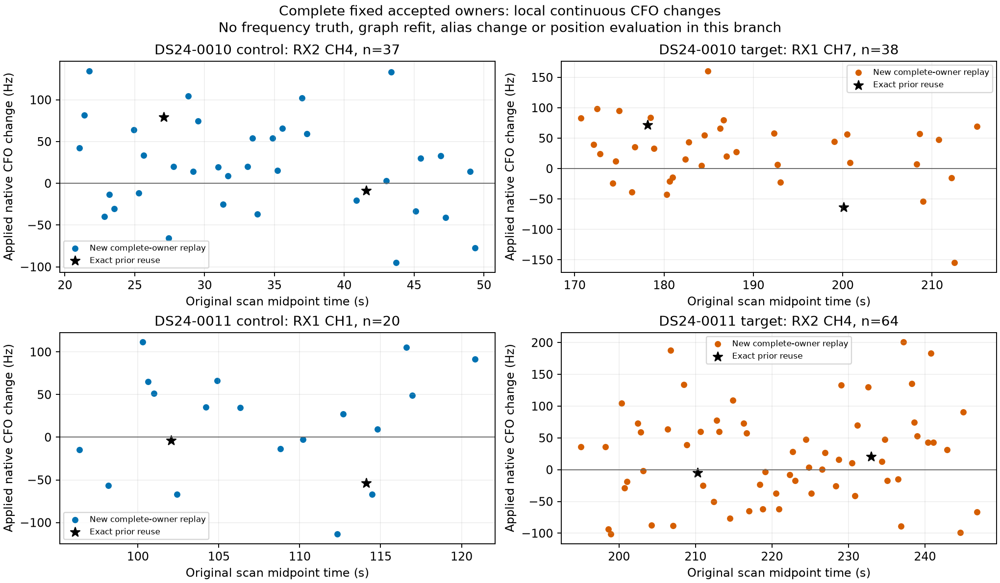
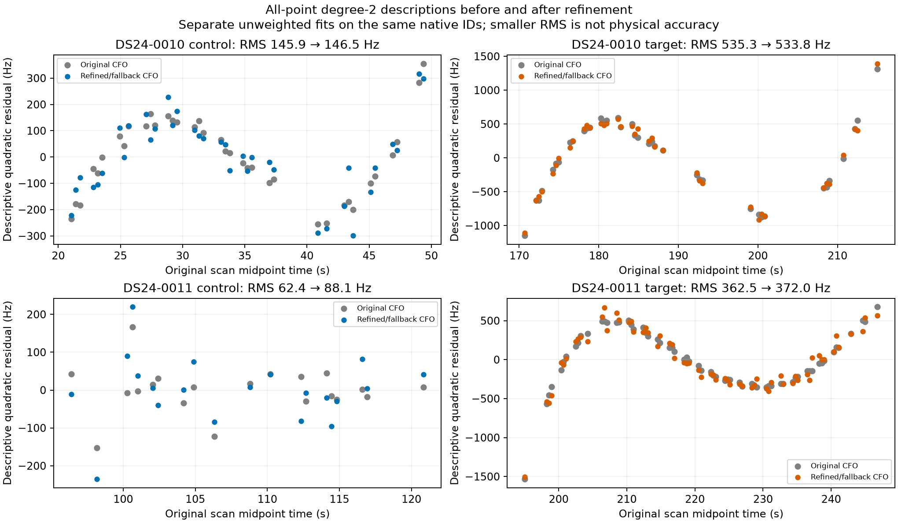
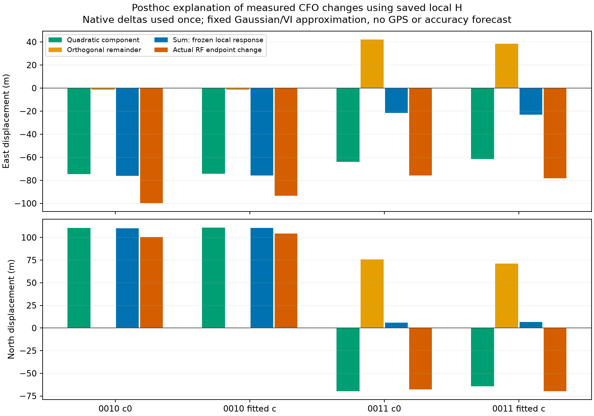

# Complete-track CFO refinement: matched position test and next directions

2026-10-26 UTC. Refining all 159 original measurements in four fixed accepted
tracks reduces raw position error in both tested DS24 scans and both calibration
settings. **Only DS24-0010 passes the paired research acceptance rule.**
DS24-0011 loses 57 previously accepted postfit points with c=0. This is promising
development evidence for a narrowly defined measurement change, not a new ALGO
release or a demonstrated dataset-wide improvement. Operational outputs remain
the original reference.

The continuous GLRT estimator itself is established prior work. Our preceding
inventory missed the directly relevant
[August 23 report](../2026_08_23_470384_continuous_glrt.md) and
[implementation](../../tools/report_470384_continuous_glrt_refinement.py).
That work already tested continuous GLRT64 refinement on 788 associated
windows. The [attribution correction](audit/PRIOR_ART_CORRECTION.md) explains
the common model and the narrower search interval here. The contribution of
this iteration is exact historical DS24 replay, complete fixed-track coverage
and matched nonlinear propagation to position.

## What we have tried, and what this changes

The [accumulated review](../2026_10_26_ds24_candidate_continuity/README.md)
and [preceding detector study](../2026_10_26_ds24_detector_response/README.md)
remain the detailed inventory. These are different controlled cohorts, not
successive changes to one benchmark.

| Evidence | Result | Implication |
| --- | --- | --- |
| ALGO01 to ALGO02, 404 common DS23 outputs | Mean error 1.870 to 1.520 km with c=0; 1.870 to 1.508 km with fitted c | Retain the validated algorithm improvement, including its availability accounting |
| Broad graph recovery | Association 70.08 to 75.08%, but fitted-c mean error 1.469 to 1.591 km and P95 3.157 to 3.473 km; c=0 also worsens | Nominal association is an unsuitable objective by itself |
| All / low / high channels, same 24 usable DS24 cases | Fitted-c means 1.220 / 1.558 / 2.040 km; c=0 1.202 / 1.538 / 2.040 km | All channels help on average, but their information is correlated |
| Thirty continuous restarts for tested assignments | Endpoints agree within 2.06 cm | Repeating the same continuous search is low priority |
| Earlier RX2 remeasurement | Median polynomial scatter 78.07 to 22.18 Hz, without a qualified cohort position gain | Smoother tracks do not establish more accurate positions |
| Shared RX1 correction | Development fitted-c mean 1.220 to 1.120 km; later eight cases 1.239 to 1.224 km with worse tails | Development gains have not reliably transferred |
| Current complete-track test | Raw geographic gains on two scans; one of two passes paired acceptance | Advance to controlled validation, preserving failures and uncertainty |

The broader local information analysis still points to orbital timing and
position ambiguity: median conditional weak-direction SD is 534 m, versus
110 m when timing is hypothetically known and 56 m with timing and shape known.
Those are conditional diagnostics, not achieved errors or an accuracy floor.
The nominal 40-degree receiver pointing separation is not a bearing measurement
or spatial baseline. A cohort recorded entirely at 10 MS/s cannot isolate a
sample-rate effect. Current evidence does not justify buying bandwidth or
changing receiver orientation as the principal remedy.

## A complete, fixed measurement intervention

The unchanged refiner maximizes the same GLRT64 correlation score continuously
inside the original winning frequency cell. It preserves acquired demodulation,
integer/fractional epoch, symbols, original candidate rank and gate. Both exact
and control scores receive the same numerical treatment. Original graph
membership and satellite assignments remain fixed.

The four owners were selected by RF-only local susceptibility in the preceding
study, before their correction outcomes. They are accepted track fragments,
not newly constructed tracks. All 159 original native points were retained:
eight earlier exact results were reused and 151 new paired detector calls
covered the remainder. There were no failed slots, boundary optima, fallbacks,
retries, replacements or trimmed points.

Historical replay matches all 1,849 complete fractional candidate rows archived
across both receivers, with zero difference in all compared floating fields.
The detector returns 2,544 raw candidate records; the unarchived records are
outside that parity claim. All 159 frequency and margin numerical guards pass.
This establishes faithful replay and local numerical stability, not physical
CFO truth or a globally identified source.

| Scan / role | Original owner / satellite | Points | Native correction RMS (Hz) | Descriptive degree-2 RMS before to after (Hz) |
| --- | --- | ---: | ---: | ---: |
| 0010 target | RX1 CH7 T001 / 68566 | 38 | 60.803 | 535.274 to 533.831 |
| 0010 control | RX2 CH4 T004 / 59244 | 37 | 58.756 | 145.875 to 146.453 |
| 0011 target | RX2 CH4 T000 / 63936 | 64 | 75.023 | 362.493 to 372.004 |
| 0011 control | RX1 CH1 T007 / 66341 | 20 | 62.136 | 62.390 to 88.071 |

The corrections span -154.658 to +200.633 Hz. All original fractional residual
CFOs were zero, leaving final CFO equal to the acquisition estimate. Neither
the size of the correction nor a higher GLRT score establishes its true error.
The fixed quadratic description absorbs real Doppler and higher-order curve
structure; it is not a satellite residual or admission test. Its scatter
worsens for three of four owners despite all four raw position contrasts
improving. We must evaluate physical fit and geographic error separately.

See [measurement findings](measurement/FINDINGS.md),
[all 159 corrections](measurement/corrections.json) and
[owner table](measurement/report/owner_summary.csv).

## Matched nonlinear position results

All eight solves complete: original/refined data, two scans and c=0/fitted-c.
The four original controls reproduce their saved endpoints and objectives
exactly. Native refined-minus-original CFO is added once to every existing
graph occurrence, preserving its fixed alias. Both c settings use the identical
159-ID correction vector. Every other observation, candidate, assignment,
prior, nuisance column, initialization and solver budget stays matched.
The original Gamma precision updates and five phase-refresh rounds run normally.

Inference retains the original causal catalogue and 25 by 25 km region centered
at 37.906, -122.545. The supplied true site, 37.849061591561885,
-122.48574968092912, is loaded only after the RF outputs and checks are sealed.

| Scan | Calibration | Original error (km) | Refined raw error (km) | Raw reduction (m) | Paired research acceptance |
| --- | --- | ---: | ---: | ---: | --- |
| DS24-0010 | c=0 | 1.241915 | 1.107702 | 134.214 | Pass |
| DS24-0010 | fitted c | 1.246474 | 1.107491 | 138.983 | Pass |
| DS24-0011 | c=0 | 1.727734 | 1.634419 | 93.315 | Fail: 57 old postfit IDs lost |
| DS24-0011 | fitted c | 1.567031 | 1.476448 | 90.583 | Fail: paired c=0 condition |

Every endpoint passes the original curved/predictive residual, owner, phase
and Gamma convergence checks. The distinct paired rule additionally requires
retention of the original accepted IDs in both c settings. DS24-0011 fails
that requirement even though its fitted-c endpoint retains all prior IDs.
We report its raw gain, without treating it as an operational improvement.
The unchanged operational errors equal the original column for both scans.

| Scan / setting | Fixed position-likelihood points | Postfit-only points before to after | All associated points before to after |
| --- | ---: | ---: | ---: |
| 0010, either c setting | 3,186: 2,571 curved + 615 predictive | 0 to 0 | 3,186 to 3,186 |
| 0011, c=0 | 2,241 curved | 430 to 373 | 2,671 to 2,614 |
| 0011, fitted c | 2,241 curved | 401 to 401 | 2,642 to 2,642 |

The 57 lost points belong to two untouched postfit owners: RX1 CH4 T007,
satellite 57955, with 21 points; and RX2 CH5 T000, satellite 56094, with
36 points. They are not among the 159 corrected observations and were not
in this position likelihood. Their compatibility changes indirectly with
the fitted position and nuisance terms. The
[position findings](position/FINDINGS.md) document the exact acceptance
accounting and the separate frozen-endpoint investigation. No acceptance
threshold is changed to retain the improved geographic endpoint.

The frozen-endpoint readback identifies the exact cause: both old hypotheses
cross the existing residual-slope statistic limit of 3. All other predicates
pass, including RMS, bias, curvature, step, autocorrelation, visibility and
phase domain. No new fit or satellite nomination is involved.

| Lost c=0 owner | Residual slope statistic before to after | Profiled RMS before to after (Hz) |
| --- | ---: | ---: |
| RX1 CH4 T007 / 57955 | 2.999997 to 3.007648 | 135.229 to 135.540 |
| RX2 CH5 T000 / 56094 | 2.906247 to 3.056059 | 48.478 to 49.908 |

Thus the 57-ID coverage change is a discrete gate response to modest residual
changes, rather than a newly demonstrated gross orbit mismatch. It does not
prove that the old associations are correct or justify waiving the frozen
rule. In fitted-c, 57955 already fails before and after; 56094 passes both.
The [complete readback](position/postfit_readback/result.json) reproduces all
eight owner/context statuses and the original accepted RMS/bias exactly.

## Why the geographic gain is not yet proof of better CFO

Overall conditional frequency RMS rises by about 0.267 Hz in 0010 and
0.95 Hz in 0011. The selected RX2 CH4 owner in 0011 changes from approximately
21.78 to 71.20 Hz conditional residual RMS, while its Gamma precision falls
from 7.491 to 1.229. In 0010 the selected RX2 CH4 owner's residual increases
from 20.63 to 60.34 Hz and its precision falls from 2.200 to 1.307.
The original robust model therefore reduces the influence of some changed
observations. Better positions may reflect a combination of CFO changes,
nuisance updates and reweighting; this experiment does not isolate those causes.

Using the actual signed CFO deltas with the previously saved local response
matrix predicts about 134 m movement for 0010, compared with 140-142 m in the
full refit. For 0011 it predicts only 22-24 m, compared with 102-105 m. This
matrix freezes local geometry and precision and cannot replace the nonlinear
fit. Its low-order and orthogonal components partly cancel in 0011; that
cancellation does not carry over to the refit. These are endpoint movements,
not distances to truth. No extra RF scaling is applied to the native deltas.

The [response findings](response/FINDINGS.md) and
[independent audit](audit/FINDINGS.md) preserve the assumptions and checks.
Before/after objectives evaluate different observed CFO vectors; their
difference is not a model Bayes factor.

## Ranked next directions

1. **Validate complete-track refinement on a frozen later block.** Freeze
   scan and owner selection before new correction results, use unchanged
   acceptance rules and both c settings, and include incomplete or rejected
   cases in the denominator. Report geographic mean, median, tails and
   regressions alongside association and likelihood membership. An exposure
   audit is necessary: the previous later-eight cohort is already development
   evidence. A temporal comparison at this site cannot establish new-location
   generalization.
2. **Separate measurement change from robust reweighting.** A small controlled
   diagnostic can hold original precisions fixed while changing CFO and,
   separately, apply the new precisions to original CFO. Keep both c settings
   and original priors matched. This would test whether the present movement
   mainly comes from corrected frequency or reduced influence of a biased
   owner. It is a mechanism test, not a deployable GPS-selected weight rule.
   The existing [frozen-precision helper](../2026_10_24_ds24_receiver_shift_witness/source/repository/tools/ds23_frozen_precision.py)
   supports this diagnostic without a new solver. Freeze both fragment-noise
   and coefficient-prior precisions, preserve the predictive factor, and
   distinguish its conditional-Gaussian objective from the original VI bound.
3. **Require independent evidence for orbit corrections.** Test a correction
   learned from one complete source against a separately nominated source
   across receiver or band. Favor evidence that adds a distinct position
   direction after receiver and orbital uncertainty are projected out. Retain
   uncertainty where there is no independent witness, rather than tightening
   priors to obtain a smaller apparent error.
4. **Investigate ambiguous sources at waveform level.** Use the existing
   one-source counterexamples and two-source controls to compare one versus
   two components with a complexity penalty and separate-frame prediction.
   Extra smooth candidate paths alone have already proved insufficient.

The current result earns a bounded validation experiment. It does not justify
another wide recovery sweep, unchanged multistart, blanket nuisance flexibility,
an association target imposed at the expense of physical support, or a new
ALGO number. The larger structural opportunity remains independently supported
orbital information; the immediate actionable opportunity is a precisely
specified measurement intervention with an observed, limited geographic effect.

## Reproduction, execution and limits

Three SOL xhigh branches handle measurement, actual position propagation and
independent audit. Detector preparation and execution consume 337.479 cumulative
worker-seconds under a 480-second cap; eight position solves plus preparation
consume 42.872 seconds under a 600-second cap. Saved local-response analysis
takes 1.481 seconds. These timings are bounded research execution, not embedded
throughput benchmarks. Protocols, tests, all attempted slots, numerical checks,
figures and compact data are included through per-branch lean manifests.
The separate frozen-endpoint gate readback takes 4.257 seconds under its
30-second cap, with no additional fits or detector calls.

The [coordinator plan](COORDINATOR_PLAN.md) and
[fixed-membership clarification](EVALUATION_SCOPE.md) remain frozen. Large
paired detector outputs, raw IQ and historical runtimes remain external,
identified by hashes and paths; the report is not a standalone raw-data replay
bundle. No production code, persisted contract, golden fixture or recording
is changed. QNAP stays read-only and no new RF is collected. There is no
postscan TLE, GPS-based selection, stationary pooling or motion prototype.
These two scans and four owners are exposed development evidence, with one
paired success and one paired failure.
