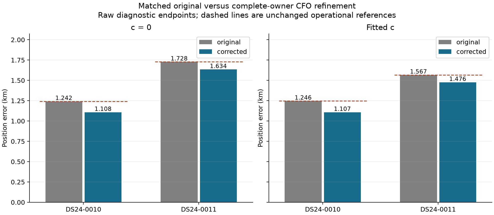
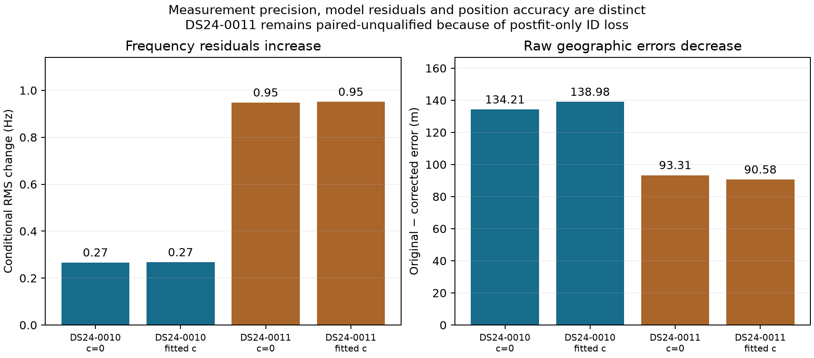

# Complete-owner CFO refinement through the original nonlinear position solve

All eight matched solves completed. Replacing the 159 frozen native CFOs moves
the two RF position estimates by approximately 102–142 m and reduces raw
geographic error in both c arms. DS24-0010 meets the predeclared paired research
qualification. DS24-0011 loses 57 postfit-only associations in c=0 and therefore
fails paired ID preservation, despite all original fitted-data gates passing.
The operational result remains the exact original reference in both scans.

## Actual nonlinear comparison

The original/refined observations use identical native IDs, graph ownership,
candidate identities, aliases, fixed noise rules, likelihood powers, causal
phase/orbit priors and nuisance layout. Each solve starts at the same regional
origin with zero phase reference and performs the original five outer refreshes
of 48 position iterations in the 25x25 km box. There is no local-step substitute,
new initialization, constrained rescue, retry or position-selected correction.
Both c arms receive the exact same native correction vector.

| Scan | c arm | Original error (km) | Refined raw error (km) | Raw gain (m) | RF movement (m) | Paired research qualification |
|---|---|---:|---:|---:|---:|---|
| DS24-0010 | c=0 | 1.241915 | 1.107702 | 134.214 | 141.573 | Pass |
| DS24-0010 | fitted c | 1.246474 | 1.107491 | 138.983 | 139.909 | Pass |
| DS24-0011 | c=0 | 1.727734 | 1.634419 | 93.315 | 101.670 | Fail: 57 postfit-only IDs lost |
| DS24-0011 | fitted c | 1.567031 | 1.476448 | 90.583 | 104.939 | Fail as a pair |

All four original controls reproduce the saved endpoints and full objectives
exactly: endpoint and objective differences are zero. The geographic evaluator
was frozen before evaluation, then run only after the RF seal, passing independent
terminal audit and explicit root release. It uses the same known-site reference
and haversine distance as the preceding reports. [All eight rows](geographic/outcomes.csv)
retain raw diagnostics and unchanged operational errors separately. No mixture
endpoint or uncompleted inference is substituted into this comparison.

## What changed, and what stayed fixed

The measurement branch supplies all 159 unique native IDs, complete original
candidate parity, numerical frequency qualification and zero fallback. Its vector is bound
by [corrections.json](../measurement/corrections.json) and its own RF seal. No new
measurement selection occurs in the position branch.

The detector-to-likelihood coordinate was checked from source and original data.
Public measured CFO equals the original selected fractional tracking CFO; graph
lifting and the retained likelihood then add fixed integer multiples of PERIOD.
Native and graph values differ by additive alias offsets, not a sign or RF-scale
factor. We add native new-minus-old CFO to every occurrence of its ID and to
the derived observation ledger. Original integer lifts and likelihood aliases
remain unchanged. Every other observation is exact, including nonselected
predictive data. No graph is rebuilt, no value is rewrapped and no original
noise estimate or polynomial metadata is recomputed to favor the intervention.

The curved likelihood contains 2571 IDs in DS24-0010 and 2241 in DS24-0011.
DS24-0010 also retains all 615 original predictive IDs in its full shared
conditional factor; DS24-0011 has zero predictive likelihood IDs. These counts,
ownership and identities are exact in all eight fits. Numerical preparation
verified original saved-objective replay and exact zero-delta score, coefficient,
Gamma precision and conditional-residual equality in all four scan/arm contexts.

## Frequency fit and position accuracy differ

The refiner's local score improvement is not a guarantee of a better orbit-model
residual. Conditional frequency RMS rises by 0.266/0.267 Hz in DS24-0010 and
0.948/0.951 Hz in DS24-0011. Full objective increases by 5.771/5.697 and
121.795/121.838 respectively. These are evaluations of different observed CFO
vectors, not nested-model Bayes factors. Their changes do not establish or
contradict geographic accuracy by themselves.

The unchanged hierarchical algorithm refits its Gamma precisions. For the
selected DS24-0010 RX2 CH4 control owner, conditional RMS changes from about
20.6 to 60.3 Hz and precision falls by a factor of 0.594. For the selected
DS24-0011 RX2 CH4 target, conditional RMS changes from 21.8 to 71.2 Hz and
precision falls by a factor of 0.164. All selected owners' conditional RMS
increases. The intervention therefore changes inferred weighting as well as
frequency values and nuisance estimates. It does not isolate a fixed-weight
frequency-to-position mechanism. [Per-owner diagnostics](details/owner_diagnostics.csv)
retain the signed correction statistics and both precision values.

All eight endpoints pass the unchanged active curved/predictive residual and
owner-cascade gates, absolute **unclipped** phase bound, final phase-refresh
criterion and original Gamma convergence criterion. These checks are recomputed
from current graph values; copied seed RMS/residual metadata never qualifies a
new endpoint. Original graph quality metadata is preserved as input, not treated
as a fresh measurement-quality verdict.

## Why DS24-0011 still falls back

The 57 lost IDs are **postfit-only** evidence in two unmodified owners:

| Original owner | Original assigned family | IDs lost | Original profiled RMS (Hz) | Original bias (Hz) |
|---|---:|---:|---:|---:|
| DS24-0011 RX1 CH4/T007 | 57955 | 21 | 135.229 | −398.675 |
| DS24-0011 RX2 CH5/T000 | 56094 | 36 | 48.478 | +84.330 |

Neither owner belongs to the corrected 159-ID panel or the fitted likelihood.
Its postfit compatibility depends on the changed calibrated state and endpoint.
All 2241 fitted DS24-0011 IDs remain present; none is dropped to obtain the
position. Accepted coverage changes from 2671 to 2614 in c=0. Fitted-c coverage
remains 2642, but qualification requires both arms. DS24-0010 retains all 3186
accepted IDs in both arms. [The exact loss ledger](details/postfit_losses.json)
keeps the native IDs and their original ownership.

The original extension stores only accepted hypotheses. A separately authorized,
source-bound frozen-endpoint readback reproduced its old RMS/bias and every
saved accepted/rejected status without fitting or changing observations. Both
c=0 losses arise **only from the unchanged slope-noise gate**, whose limit is 3:

| Original postfit family | c=0 slope z, original → refined | Profiled RMS, original → refined (Hz) | Other predicates |
|---|---:|---:|---|
| 57955 | 2.999997410 → 3.007648003 | 135.229 → 135.540 | All pass |
| 56094 | 2.906246753 → 3.056059076 | 48.478 → 49.908 | All pass |

This is a boundary crossing, rather than a profile-RMS or bias catastrophe.
Fitted-c family 57955 already fails before/after (3.031213 → 3.038718), while
56094 stays below the slope limit (2.326470 → 2.473854). Supported receiver/band,
phase, visibility, mean, quadratic, step and ACF conditions pass for these two
old hypotheses. The result does not justify waiving the original slope gate or
retention rule. [The readback](postfit_readback/result.json) and its separate
[protocol](postfit_readback/protocol.json) / [seal](postfit_readback/seal.json)
preserve all predicates and original competing calibration hypotheses.

Original GLRT winner denominators and endpoint-dependent coverage are:

| Scan / arm | Total original GLRT | Fixed curved + predictive likelihood | Postfit-only original → refined | Associated original → refined | Associated % original → refined |
|---|---:|---:|---:|---:|---:|
| DS24-0010, both arms | 4268 | 2571 + 615 = 3186 | 0 → 0 | 3186 → 3186 | 74.6485 → 74.6485 |
| DS24-0011, c=0 | 3754 | 2241 + 0 = 2241 | 430 → 373 | 2671 → 2614 | 71.1508 → 69.6324 |
| DS24-0011, fitted c | 3754 | 2241 + 0 = 2241 | 401 → 401 | 2642 → 2642 | 70.3783 → 70.3783 |

## Scope, cost and replay

This is a positive two-scan development result for actual position propagation,
with qualification in one scan and a conservative coverage failure in the other.
It is not a cohort or independent-location validation. Both scans and their
high-influence/control owners were previously exposed and RF selected; the c
arms are matched controls, not independent replications. Approximate 100 m raw
gains do not eliminate the remaining 1.1–1.6 km errors or authorize promotion.

Continuous maximization of the same 64-symbol/512-bin GLRT score already exists
in the August 23 implementation. The present contribution is its deployment-
specific DS24 measurement transfer and matched retained-position propagation,
not a new continuous-frequency estimator. See the independent
[prior-art correction](../audit/PRIOR_ART_CORRECTION.md). Earlier generic/full-
pilot remeasurement work also limits broad novelty or expected-gain claims.

The eight-fit branch used 42.871552 cumulative numerical worker-seconds, including
7.897677 seconds of preparation/tests, within its unchanged 600-second cap.
All eight outcomes completed under the frozen 60-second per-fit cap; there were
no failures, rescues, retries or extra starts. The separately authorized
frozen-endpoint gate readback took 4.256824 seconds, below its 30-second cap
(also below that cap including a conservative 1-second source-freeze charge).
Other postseal reporting uses only saved arrays. No recorded IQ is accessed by
this position branch and no new RF occurs.

[PROTOCOL.md](PROTOCOL.md), [protocol.json](protocol.json),
[replacement.py](replacement.py), [run.py](run.py) and
[test_replacement.py](test_replacement.py) define the comparison.
[RF_seal.json](RF_seal.json), [RF outcomes](rf_report/outcomes.csv),
[RF summary](rf_report/summary.json), [geographic seal](geographic/seal.json), and
the independent [preflight](../audit/position_preflight.json) /
[terminal audit](../audit/position_terminal.json) bind the inference/evaluation
sequence. [lean_publication.json](lean_publication.json) publishes compact
endpoint/qualification/progress data and binds the larger unchanged raw endpoint,
full coverage and preparation artifacts at their original absolute paths.
Full replay requires those declared external inputs and the original source
environment; no current detector or alternative calibration is substituted.
