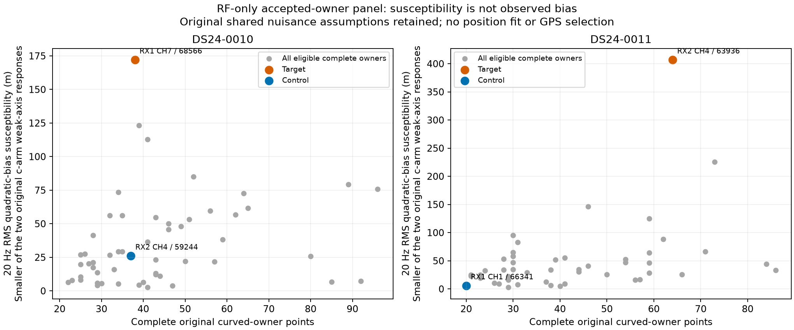
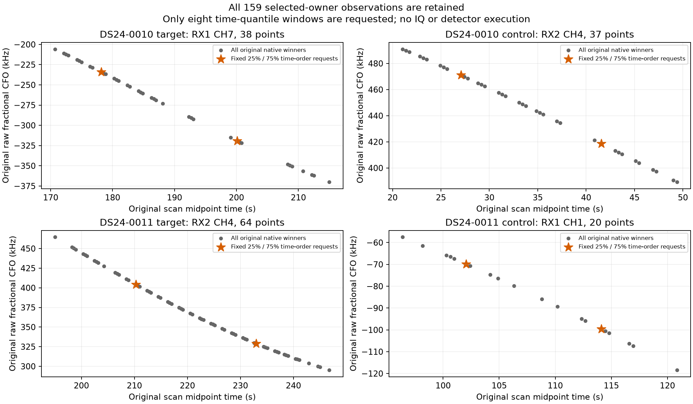

# Accepted-owner panel and exact raw-window readiness

The frozen RF-only selection identifies two complete accepted owners with substantially greater local susceptibility to a declared smooth measurement error than their controls. All **eight** fixed time-quantile window requests have verified source/manifest/index metadata. No IQ was read, no detector ran, and no position or satellite identity changed. These are targets for a small measurement audit, **not detected bad families or measured position gains**.

The first two chronological usable cases, DS24-0010 and DS24-0011, contain **128 and 117 original graph owners**. Exactly **54 and 48** satisfy the frozen pool: at least 20 points and every original ID in both arms' curved position likelihood. Partial curved owners, predictive-only sources, postfit-only associations, and rejected sources remain explicit rows in [the complete ledger](complete_owner_ledger.json). Every selected owner keeps every original native ID; the four selected owners contain **159 points**.

| Case / role | Complete original owner | Inherited family | Points / span | 1 Hz RMS proxy, c0 / fitted | 20 Hz RMS proxy, c0 / fitted | Original three-mode slots |
|---|---|---:|---|---|---|---|
| 0010 target | RX1 CH7 T001 | 68566 | 38 / 44.29 s | 8.60 / 8.63 m | 172.02 / 172.67 m | Absent |
| 0010 control | RX2 CH4 T004 | 59244 | 37 / 28.34 s | 1.30 / 1.35 m | 26.01 / 27.06 m | Absent |
| 0011 target | RX2 CH4 T000 | 63936 | 64 / 51.74 s | 20.34 / 20.57 m | 406.78 / 411.35 m | Present |
| 0011 control | RX1 CH1 T007 | 66341 | 20 / 24.45 s | 0.32 / 0.29 m | 6.49 / 5.71 m | Absent |

The perturbation RMS is defined at the 11.5 GHz reference, then scaled by each observation's RF/11.5 GHz. The values are worst responses within the frozen degree-at-most-two time basis, under each original arm's weak axis and local Gaussian design. They are **linear susceptibility diagnostics**, not a fitted movement, known measurement bias, uncertainty reduction, or geographic direction. Twenty hertz is a declared scale illustration, not an observed correction or a prior learned from the target. [Exact table](report/selected_owners.csv), [all eligible and excluded owner scores](owner_scores.csv).

Both case controls are on the opposite receiver from their target. Selection first ranks eligible families by the smaller of their two arm susceptibilities, then selects the highest-scoring complete owner of the highest family. Controls come from the predeclared low-susceptibility family quartile with the opposite-receiver preference. Original labels only group inherited evidence; they are not new catalogue discoveries or independently validated identities.

## What the saved-matrix calculation retains

Existing diagnostics did not directly rank these accepted owners. We reused the original four saved parent designs, with **3,186 rows** in 0010 and **2,241 rows** in 0011. The 0010 design includes its 615 old predictive observations, and all shared old/new nuisance columns enter exactly once. No geometry, optimizer, family-ablation fit, radio remeasurement, or target residual score was recomputed.

With position design J, nuisance design U, fixed weights W and nuisance posterior precision G, define R = J − U G⁻¹(UᵀWJ). The local data-to-position response is H = I⁻¹RᵀW, using the saved marginal position information I. The code verifies JᵀWR = I. For each family or owner, equal-native-ID orthonormal polynomial functions of its original times are scaled to unit reference-frequency RMS; the score is the norm of the weak-axis response to that basis. [Pure mathematical implementation](local_math.py), [frozen rule](PROTOCOL.md), [source/input protocol](protocol.json).

This is a frozen-mean Gaussian/VI-state diagnostic: covariance derivatives, full nonlinear objective changes, future refits, and uncertainty in identity are not included. Existing noise/Gamma, phase and physical-mode assumptions remain. **In particular, 68566 and both control families have no original three-mode parent slots; this calculation preserves that omission rather than declaring their physical orbit uncertainty zero in reality.** Their rankings are conditional on that retained baseline. The target 63936 does have the original three-mode slots. There is no new calibration support or gate waiver.

## Eight fixed requests, no response-based window selection

Within each complete selected owner, sort by original time and native ID, then request the nearest indices to 25% and 75% of that ordering. Neither CFO residuals, margins, detector alternatives, geographical errors, nor raw-read availability choose the indices. Missing authority would have stayed a failed request without replacing its owner or window.

All 159 native winners are retained in [the point table](report/complete_selected_owner_points.csv). The stars show only the eight metadata requests; their existence does not qualify a whole-curve correction.

[window_requests.json](window_requests.json) is the narrow replay handoff. Every row binds:

- Case, role, complete owner, original native observation ID and time quantile.
- Exact tracking path/hash, receiver/channel/RF, probe/global visit, original candidate rank, fractional CFO, integer/fractional epoch, margin and scores.
- Original physical sample start, common counter origin, 20 ms duration and exact raw source-input path/hash.
- The source-declared segment entry/manifest hash, typed native index path/hash, local sequence, window IQ hash, acquisition counter support and target configuration.

The metadata helper uses public `FastSegmentSource` and `ShortWindowReader` constructors, then reads only the verified contract's declared index member through its typed index schema. It never calls `windows()` or opens a payload. All eight requests match sample start/end, global visit, sample count, native receiver and RF target. The helper ran successfully under the existing `leo` service account, with no permission or configuration changes. [Raw metadata receipt](raw_metadata_receipt.json).

**Readiness is not parity.** Compressed/decompressed payload bytes and selected IQ hashes were not newly verified, and none of these eight windows has been replayed by this branch. A later authorized read must exhaust the bounded public reader, which verifies the entire containing chunk, then compare the unchanged detector output with the original export. Acquisition CFO and separate refinement residual are **absent from the historical tracking contract** and remain null/unavailable. The full public detector result can expose those quantities during a separately authorized exact replay; their existence for these selected archived windows has not been inferred from final CFO.

The coordinator separately verified both original persisted execution identities against the deployed runtime, without IQ or detector calls. [That independent runtime authority](../recorded/authority.json) can be bound by the later replay protocol; it does not alter the already sealed selection or substitute for payload/output parity. Earlier DS24-0011 first-window parity was a different window and does not certify these eight.

## Completion and limits

Four component-owned algebra, equal-ID RMS/RF scaling, permutation and quantile tests pass. The actual saved-array/native-order smoke passes before the source freeze. [Independent preflight](../audit/influence_preflight.json) passes all frozen bindings and parent normal-equation identities. [Independent terminal audit](../audit/influence_terminal.json) reproduces the saved response, every family/eligible-owner score with a different SVD polynomial basis, deterministic selections and all eight metadata requests, without geometry, IQ, detector or fit reruns.

The single run took **1.632 seconds**, with **3.930 cumulative charged numerical worker-seconds** including preparation, tests and a conservative two-second earlier metadata allowance, against the original 180-second cap. There were no scientific failures or replacements. [Summary](summary.json), [RF seal](RF_seal.json), [saved-artifact report seal](report/seal.json), and [lean publication manifest](lean_publication.json) preserve all outcomes and dependencies. Exact numerical replay needs the four external original parent NPZ designs and their original corpus/source bindings; this compact panel is not a standalone full input closure.

All scans and original RF identities are exposed development evidence. Acceptance in the reference is not proof of physical identity. A few successfully replayed windows could establish a specific measurement discrepancy, but would not by themselves justify a whole-owner correction, revised acceptance, or position policy. No production change follows from this panel.
