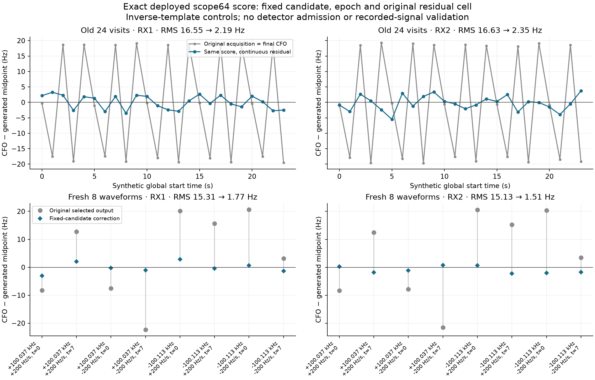
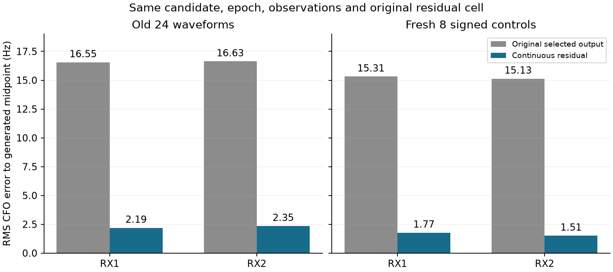
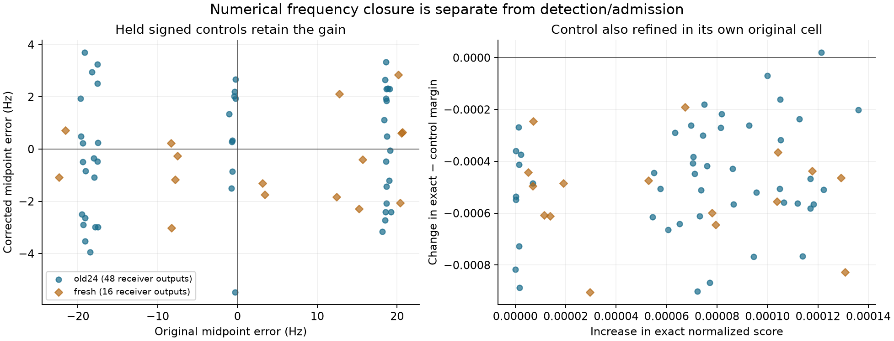

# A continuous residual within the original scope64 frequency cell

The unchanged deployed scope64 score contains enough information to correct the
single-source control's approximately 16.5 Hz correlated error. Holding the
selected candidate, acquired CFO, integer and fractional epoch, window, symbol
aperture and admission decision fixed, a continuous residual-frequency maximum
reduces raw midpoint RMS to 2.19/2.35 Hz on the old 24 waveforms and 1.77/1.51 Hz
on eight fresh signed controls. All 64 receiver results pass the frozen local
numerical checks. These are template-generated controls, not recorded-waveform
validation, a production change or a position improvement.

Plots use RX1/RX2 for native receiver indices 0/1; saved data retain native 0/1.
The two receivers share each generated waveform and have independent noise.
There are 32 waveforms, not 64 independent waveform realizations.

## Stage attribution and the intervention

[Saved stage attribution](attribution.json) confirms that every old selected
fractional GLRT residual is zero. Its final CFO therefore equals its acquired
CFO. The maximum old acquisition error exceeds the 4 Hz total chirp over a
20 ms window. The final CFO is **not** quantized at 443.892 Hz: acquisition
already returns a continuous interpolated frequency. The coarse residual grid
leaves these smaller acquisition errors unchanged.

The source-bound deployed acquisition uses a 500 Hz fine grid with quadratic
interpolation, followed by a 100 Hz conditioned grid. The deployed GLRT then
uses symbols 2–65 and a 512-point residual grid at 443.892045 Hz spacing. This
experiment isolates the residual argmax; it does not separately apportion the
acquisition error among its interpolation and conditioned-grid stages.

[refiner.py](refiner.py) retains the original complex correlations and maximizes
their exact finite-lag trigonometric score within the **original winning cell**
(half-width approximately 221.946 Hz). It does not re-demodulate symbols at a
new CFO or enlarge the aperture. The rolled control is refined symmetrically in
its own original cell with its own unchanged normalization. No candidate,
epoch, gate or input window is reselected using truth or the new margin.

An independent direct complex-sum derivative root checks each maximum in the
same cell. The original 512-bin target/control scores and residual frequencies
replay exactly for all 64 inputs. The maximum direct-score discrepancy is
3.45e-15, and the maximum optimizer/reference frequency difference is
2.98e-5 Hz, below the predeclared 0.01 Hz criterion. All 128 target/control
checks pass; no cell-boundary or missing-reference result occurs. These are
local numerical checks, not global peak or source-identity certificates.

## Paired results

All errors below are against generated midpoint frequency. RMS includes bias;
it is not the earlier graph's detrended polynomial residual RMS.

| Panel | Receiver | n | Original RMS → corrected RMS (Hz) | Original bias → corrected bias (Hz) | Smaller absolute error |
|---|---|---:|---:|---:|---:|
| Old 24 | RX1 | 24 | 16.5519 → 2.1908 | −0.7883 → +0.0772 | 19/24 |
| Old 24 | RX2 | 24 | 16.6325 → 2.3499 | −0.8925 → −0.2454 | 21/24 |
| Fresh 8 | RX1 | 8 | 15.3143 → 1.7733 | +4.2730 → −0.0616 | 8/8 |
| Fresh 8 | RX2 | 8 | 15.1328 → 1.5076 | +4.2897 → −0.9425 | 8/8 |

For the old ordered visits, lag-one midpoint-error correlation changes from
−0.7663/−0.7646 to −0.0455/−0.0709. This diagnoses removal of the conspicuous
alternating response in this control; 24 visits do not establish independent
or calibrated residual noise. Maximum corrected errors are 3.52/5.48 Hz on the
old panel and 3.02/2.28 Hz on the fresh panel. The correction need not improve
every nearly correct old estimate.

The fresh panel was frozen before outcomes: CFO bases +100037 and −100113 Hz,
slopes ±200 Hz/s and global start times 0/7 s. It uses eight independently
seeded noise draws with two receiver outputs per waveform. The carrier phase
integrates global time. All original candidate lists are saved under
[fresh_slots](fresh_slots/); the old complete lists remain hash-bound in the
previous study. There were eight new paired detector calls and zero old full
detector replays. The 24 old IQ hashes regenerate exactly.

Both exact and control scores increase under their continuous maxima; the
margin usually decreases because the control peak also moves. The minimum
corrected margin is 0.8512. Frequency and margin numerical qualification both
hold for 64/64, but the original admission decisions remain authoritative. A
larger score alone is not evidence of a cleaner source.

## Runtime, authority and limits

The run completed all 64/64 receiver slots in approximately 14.204 cumulative
worker-seconds against the unchanged 300-second cap. This includes 1.967 seconds
of preparation/tests and a conservatively charged 1-second initial import-only
failure. That failure exposed missing SciPy in the historical environment;
the final scalar solver is NumPy-only. No detector or panel refinement occurred
before the frozen protocol and independent preflight.

Recorded per-result refiner wall time has median 0.01481 s, maximum 0.02186 s
and sum 0.95388 s across 64 results. Each fresh paired synthesis/detector call
takes 1.209–1.340 s. These host research timings include correlation workspace
construction but do not establish embedded throughput. No extra benchmark was
run. [summary.json](report/summary.json) and [outcomes.csv](report/outcomes.csv)
retain the measurements and every outcome.

Historical code identity remains
`124afbbc81870a4079b272bd828d4a99f716e54624a073d9cb13acc2a1b7fe16`,
with the original isolated interpreter and environment verified before/after.
The full phase/epoch and frame-grid generation is the deployed sampled-template
law. Its successful inverse closure does not test a different physical waveform,
source overlap, model mismatch, global peak selection or measurement uncertainty
calibration. No graph was rerun, and old graph quality flags were not upgraded.

Earlier full-frame/local-pilot continuous CFO/epoch/rate refinement and RX2
remeasurement already exist. The new result is narrower: the exact deployed
64-symbol score, with existing candidate state fixed, benefits from sub-bin
residual maximization. The appropriate next test is unchanged application to a
small authoritative recorded panel with original-score closure and candidate
selection preserved. No recorded application or further scientific run was
performed in this branch.

## Reproduction and seals

[protocol.json](protocol.json), [PROTOCOL.md](PROTOCOL.md),
[preparation.json](preparation.json), [run.py](run.py) and
[test_refiner.py](test_refiner.py) define the immutable comparison. Source/input
hashes and all scientific outputs are bound by [RF_seal.json](RF_seal.json).
Independent preflight and saved-artifact terminal checks are in
[measurement_preflight.json](../audit/measurement_preflight.json) and
[measurement_terminal.json](../audit/measurement_terminal.json).
[report/seal.json](report/seal.json) binds the saved-only reporter, tables and
figures. The portable publication retains correlations and result arrays; raw
IQ is regenerated from the exact hash-bound old generator rather than copied.
Replaying the original driver requires its absolute external authority paths,
the historical interpreter and original input fixtures. They are declared in
[lean_publication.json](lean_publication.json), not silently substituted with
the current repository detector.
