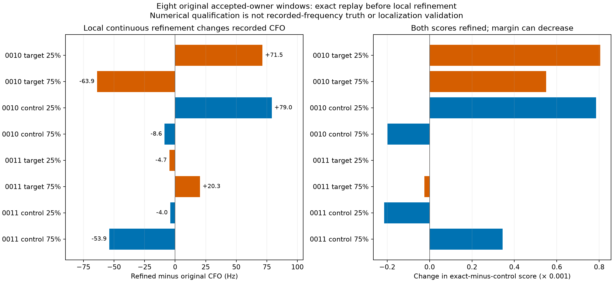
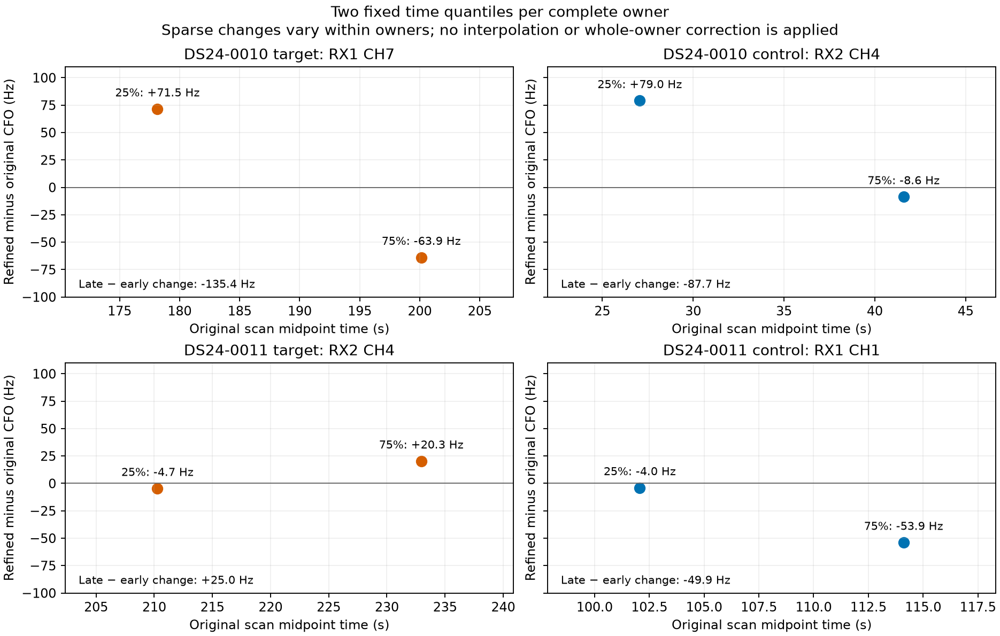

# Original recorded-window replay and continuous CFO refinement

All eight fixed windows replayed successfully with the historical detector and original policy. Every archived candidate on both receivers matched exactly. Refining only the original candidate's winning residual-frequency cell changed its CFO by −63.913 to +79.036 Hz. All eight frequency and margin numerical checks passed. This establishes a reproducible difference in the measurement calculation on real accepted evidence; recorded frequency truth is unavailable, so it does not establish lower field bias or better position accuracy.

The [RF-only panel](../influence/FINDINGS.md) selected two complete accepted owners and two lower-susceptibility controls from DS24-0010/0011, using both original c arms and no geographic errors. Each owner contributed its fixed 25% and 75% chronological windows. All 159 original owner observations remain in the complete-owner ledger; only these eight windows were replayed. The detector operation is independent of c, so the same eight replay results apply to the matched c0/fitted-c panel rather than creating separate measurement replicates.

## Recorded changes

| Case and role | Complete owner | 25% window change (Hz) | 75% window change (Hz) | Late minus early change (Hz) |
|---|---|---:|---:|---:|
| 0010 target | RX1 CH7 T001, 38 points | +71.467 | −63.913 | −135.380 |
| 0010 control | RX2 CH4 T004, 37 points | +79.036 | −8.635 | −87.671 |
| 0011 target | RX2 CH4 T000, 64 points | −4.680 | +20.319 | +24.999 |
| 0011 control | RX1 CH1 T007, 20 points | −4.007 | −53.911 | −49.904 |

The full precision values, native IDs, acquired/original/refined CFO stages, score changes and flags are in [all_slots.csv](report02/all_slots.csv). The four complete two-window comparisons are in [owner_delta_pairs.csv](report02/owner_delta_pairs.csv). Changes vary within owners and occur in lower-susceptibility controls too. Two points do not determine an owner's correction curve, constant offset, drift or position effect. No interpolation, whole-owner correction or sparse-to-position propagation was performed.

Both exact and control scores were refined symmetrically. The exact score increased in all eight windows, while the exact-minus-control margin decreased in four. A better exact score alone is not evidence of improved detection or localization. The original candidate rank, epoch and gate were retained throughout.

## Replay, parity and numerical scope

The [frozen requests](../influence/window_requests.json), [authority](authority.json), [protocol](protocol.json) and [preparation](preparation.json) bind the historical code/environment, persisted policy, public segment/input/index references, receiver/window support, IQ hashes, tracking exports and unchanged [refiner](../measurement/refiner.py). The public `FastSegmentSource` iterator was bounded to each selected window and fully exhausted before detector execution. This verified the containing chunk and its window hashes. QNAP reads were read-only, using the existing service account; no permission or configuration change was made. Initial authority permission/peer failures remain in `authority_attempt01.json` and `authority_attempt02.json`, followed by the successful public-catalog authority receipt.

Eight paired detector calls returned 128 candidate records. The historical tracking contract contains 96 complete fractional candidate rows across these windows; every one was compared on both receivers, including count/order/rank, integer/fractional epoch, CFO, exact/control scores, margin and original gate. All compared floating errors were exactly zero. The remaining returned detector records are retained in [results.json](results.json), without being miscounted as archived parity rows. The initial `report/` summary used 128 for the checked count; `report02/` corrects this presentation distinction and is authoritative. Scientific results are unchanged; the original reporting source and artifacts are preserved.

All eight selected original residual CFOs were zero, so their original final CFO equaled the acquisition-stage CFO. The continuous refiner kept that acquired CFO and the original epoch, replayed the original 512-bin score, and searched only within the original residual cell (443.892 Hz grid spacing). All sixteen exact/control cell calculations passed their independent direct-reference checks; no boundary was reached. These are local numerical checks, not a global peak certificate or evidence that the selected signal is a single emitter. Within-symbol redemodulation was unchanged.

The [independent preflight](../audit/recorded_preflight.json) and [terminal audit](../audit/recorded_terminal.json) passed. All eight slots completed; there were no failed or unattempted slots, retries, replacements or added calls. The cumulative scientific time was **19.818 seconds**, including 3.090 seconds of charged preparation/tests and the earlier import allowance, below the original 180-second cap. One worker ran with `OPENBLAS_NUM_THREADS=1`, `OMP_NUM_THREADS=1` and `MKL_NUM_THREADS=1`. Reporting reads saved JSON only and calls neither IQ readers nor the detector/refiner.

## Limits and replay dependencies

This is a small development panel selected by RF-only local susceptibility under the original parent nuisance assumptions. It is not a random sample or a full accepted-owner correction. Some original families lack physical-mode uncertainty, which affects the panel's susceptibility interpretation. Targets and controls share scan/hardware conditions and are not independent confirmations.

No satellite replacement, graph refit, position fit, GPS comparison, new RF, TLE update or operational change was made. The synthetic branch supplies known-frequency controls; these recorded windows have no equivalent truth. A useful next decision requires checking complete-owner measurement changes and their consistency before any matched localization evaluation; these eight values alone do not authorize a correction rollout.

Exact payload replay requires the external read-only raw segments and declared indexes, the historical deployment under `/opt/leo-shared-scans/native-scope64-v2-3460060352b364a9/worker/src`, and `/opt/leo-fast-auto/20261010-r1/venv/bin/python`. Those dependencies are hash-bound, not republished as a standalone runtime or IQ archive. The executed command used `sudo -n -u leo env`, the explicit historical `PYTHONPATH`, `PYTHONDONTWRITEBYTECODE=1`, all three BLAS variables above, and `python -B recorded/replay.py worker`; stdout was redirected to a user-owned result file. This documents the completed run, not an instruction to retry it. [RF_seal.json](RF_seal.json) binds the terminal evidence, and [report02/seal.json](report02/seal.json) binds the saved-output figures and tables.
