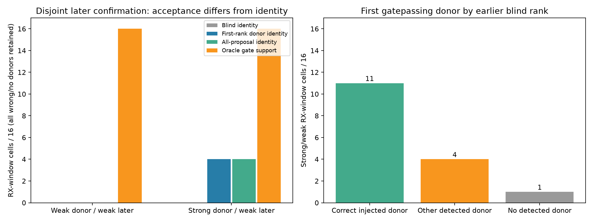
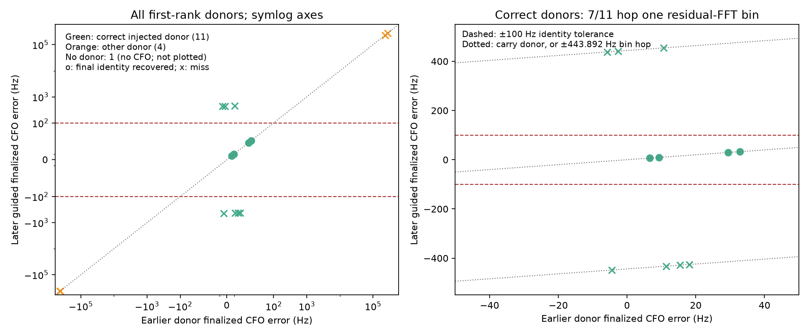
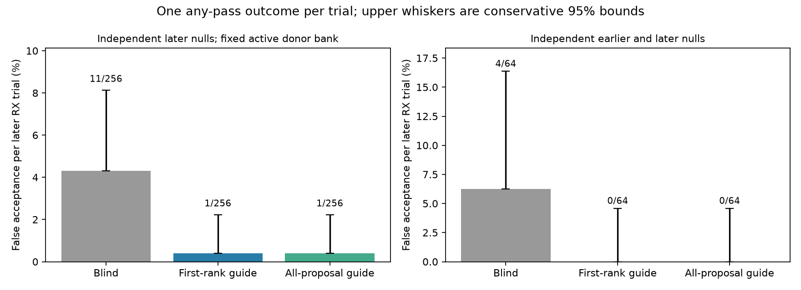
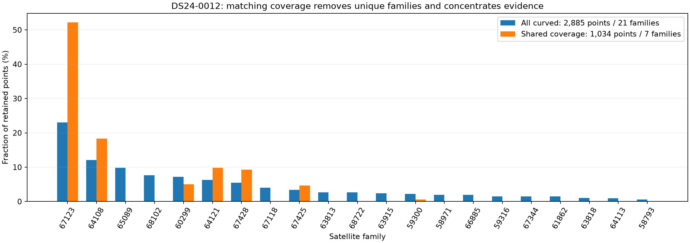
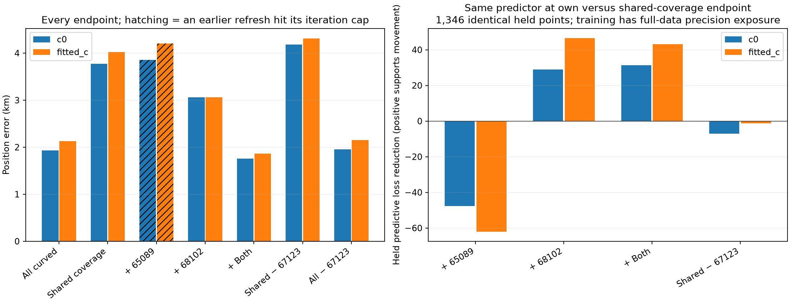
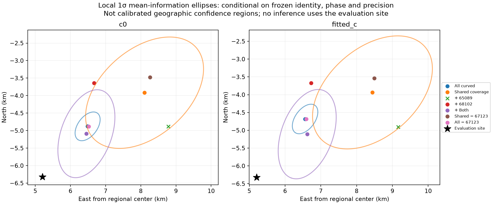

# DS24: disjoint RF-guided acquisition and the common-coverage localization failure

Date: 2026-10-26. Status: completed bounded mechanism studies; no production change, association expansion or new ALGO release.

This follows the [CH7/8 diagnosis](../2026_10_26_ds24_ch78_diagnosis/README.md). The next tests expose two different constraints: locating weak pilots is possible with earlier RF evidence, but a GLRT pass can still yield an unusable CFO; and matching channel coverage can discard useful independent satellite geometry. Neither result establishes a transferable 500-m localization method.

The user authorized continued investigation and SOL high delegation. SOL high owns the acquisition prototype and its null controls; the primary agent owns the scan-0012 localization mechanism and integration. Work uses existing recordings only. QNAP remains read-only. No raw IQ, new RF collection, post-scan TLE, or GPS-selected inference is introduced.

## 1. Use earlier detections to propose a later weak signal

The [detection protocol](detection/PROTOCOL.md) retains the same eight physical windows as the preceding experiment: DS24-0010/0011, CH1/4/7/8, both receivers, 16 receiver-window cells. Each native 20-ms window is split into disjoint 10-ms halves. The earlier blind detector supplies timing and CFO; the later scorer receives only that measured proposal, propagated by exact native sample counters. No true injected timing or frequency enters the guided estimator. The primary rule uses the first earlier gatepassing, complete candidate by original rank. A secondary rule tries every earlier gatepassing candidate, bounded to eight.

The main mechanism contrast places a stronger analytic pilot in the earlier half (−18 dB average pilot/background power), then a weaker pilot in the later half (−24 dB). The waveform phase is continuous; its amplitude changes at the split. These are synthetic superpositions on recorded backgrounds, not naturally recovered tracks or physical antenna-input SNR. Earlier donor availability is deliberately supplied by this mechanism control and must be established separately on natural observations. A weak/weak contrast and strong/no-later-injection contrast are retained.

The later weak samples are identical between weak/weak and strong/weak. All wrong-donor and absent-donor cases remain in the 16-cell denominator. Correct injected recovery requires a GLRT pass, timing within two native samples modulo the exact repetition period, and finalized CFO within 100 Hz.

| Strong-earlier / weak-later result | Receiver-window cells |
|---|---:|
| Correct injected primary donor | 11/16 |
| Wrong primary donor | 4/16 |
| No primary donor | 1/16 |
| Later primary guided GLRT pass | 15/16 |
| Accurate injected timing and finalized CFO after guidance | **4/16** |

Blind search of the same weak later samples recovers none of the injected identities. Trying all earlier gatepassing proposals also recovers four. Weak/weak yields no accurate guided recovery, despite oracle-anchor GLRT support in all 16 later cells. The stronger donor experiment consumes earlier observations in addition to the later samples; it is not an equal-total-data comparison with a new full-window blind estimator.

The distinction between acceptance and measurement quality is decisive. Seven correctly guided cells fail the CFO tolerance because the later residual-frequency profile chooses an adjacent FFT bin, about **443.892 Hz** away. Their earlier donor CFOs were already within 100 Hz. Even the explicitly separate oracle lane, centered at the exact injected CFO, moves by one bin in nine of 16 later cells while all 16 pass its GLRT gate. The preceding report's oracle success was gate support, not proof of an accurate exported frequency measurement.

The frozen estimator is retained without posthoc adjustment. A future frequency-continuity prior must represent donor uncertainty and genuine Doppler change; simply clamping to the injected frequency would be an invalid oracle repair.

### False-confirmation controls

The active-donor null experiment holds four independently acquired clean strong donor outputs fixed and tests 64 independent later Gaussian vectors per donor. Counts are one any-pass outcome per receiver trial, including proposal multiplicity:

| Same 256 independent later noise draws | Any-pass outcomes |
|---|---:|
| Unchanged blind 10-ms search | 11/256 |
| Primary guided confirmation | 1/256 |
| All earlier gatepassing proposals | 1/256 |

An additional 64 independent donor/later noise trials have no earlier gatepassing donor and consequently no guided acceptance; blind later search passes four times. These results are conditional on the synthetic backgrounds and donor bank. They do not establish an equal-false-alarm-rate detector comparison or a deployment-level rare-event rate. The unchanged 0.025 threshold is visibly not a calibrated low false-alarm threshold for these 10-ms blind searches. Recorded strong/no-later-injection gatepasses may be real background pilots and are not false alarms.

The pooled conservative one-sided 95% upper bound on average conditional false acceptance is **2.223%** for the guide and **8.127%** for blind search. This allows heterogeneous probabilities across the four fixed donor banks. Exact binomial bounds are also provided separately within each bank. These bounds cover the tested synthetic conditions, not arbitrary recording backgrounds or future donors.

The archived public 20-ms detector is replayed for parity, and a frozen first-window preflight checks all candidates in both 10-ms halves against the public detector configured explicitly for 10 ms. Later scoring uses no earlier samples or padding. See the detection source, receipts, full results and figures for every outcome and the finite-sample uncertainty bounds.

The [detection findings](detection/FINDINGS.md), [summary](detection/summary.json), [per-cell CSV](detection/cells.csv), [recorded outcomes](detection/recorded.json), [active-donor nulls](detection/active_null.json), and [independent donor/later nulls](detection/noise_null.json) retain all denominators. Six detector tests cover donor ranking, truth-free inputs, source ownership, waveform continuity and finite-trial bounds. Each numerical process had a 580-second cap; measured preflight, recorded, active-null and noise-null times were 7.16, 60.99, 98.33 and 43.08 seconds.

## 2. Why common-coverage matching harms DS24-0012

This scan was selected after the previous development diagnostic showed approximately 4-km errors in both matched channel groups. That is an exploratory outlier investigation, not independent validation. All following fits use the existing causal identities, aliases, nuisance layout and same-arm full-data precision packets. Explicit predictive factors are removed consistently. Each starts at the regional center, latitude 37.906, longitude −122.545, in the 25×25 km box, with five phase refreshes and 48 position iterations per refresh. Reference GPS is used only after RF outputs seal to calculate error.

We union the original replicate-zero matched CH1–4 and CH5–8 masks. This leaves **1,034 points from seven families**, compared with **2,885 curved points from 21 families** in the full control. Family 67123 grows from 23.1% to 52.2% of retained points. The two largest entirely omitted families, nominated by original point count without new fitting or GPS, are 65089 (284 points) and 68102 (221 points). These are existing accepted observations, not newly recovered GLRT associations.

Seven variants were frozen before new fits, each with matched `c=0` and fitted-`c` arms. Counts and outcomes are:

| Evidence | Points | c=0 error | Fitted-c error |
|---|---:|---:|---:|
| Full curved control | 2,885 | 1.933 km | 2.128 km |
| Common-coverage union | 1,034 | 3.770 km | 4.023 km |
| Union + 65089 | 1,318 | 3.859 km* | 4.204 km* |
| Union + 68102 | 1,255 | 3.057 km | 3.059 km |
| Union + both omitted families | 1,539 | **1.756 km** | **1.864 km** |
| Union − dominant family 67123 | 494 | 4.180 km | 4.310 km |
| Full control − family 67123 | 2,220 | 1.952 km | 2.153 km |

*Both +65089 fits hit the iteration cap in the first phase-refresh round. Subsequent rounds settle and final phase checks pass, but the strict all-round solver check fails. They remain visible, without an extra-budget rerun or qualification as eligible candidates.*

Deleting the dominant family barely changes the full solution: fitted-c error changes by only 25 m, with about 37 m endpoint movement. In the reduced union, deleting it worsens the error. This argues against concentration in family 67123 being sufficient evidence of a wrong association. It does not prove the identity correct.

The +both result is about 264 m better than the full frozen-curved control on this development scan, but it was constructed as a diagnostic subset. No subset policy is selected by that geographic result, and no improvement over the operational end-to-end pipeline is claimed. That pipeline includes evidence and precision updates intentionally removed or fixed here.

### Does omitted evidence support the movements?

All five reduced variants leave out the **same 1,346 curved points** outside the union plus the two restored families. None of those values enters reduced training calibration or position. At each variant's own endpoint and the original union endpoint, we recompute the same training-only posterior and jointly predict those held observations, retaining shared nuisance covariance.

The table reports baseline-endpoint loss minus own-endpoint loss, using the same predictor in each row. Positive means that common held evidence supports the movement. These are conditional Gaussian diagnostics with inherited full-data identity/noise/prior exposure and plug-in position; they are not blind validation.

| Reduced predictor | c=0 held movement gain | Fitted-c held movement gain |
|---|---:|---:|
| Union + 65089 | −47.64 | −62.02 |
| Union + 68102 | +28.85 | +46.57 |
| Union + both | +31.34 | +43.18 |
| Union − 67123 | −7.14 | −1.32 |

The positive gains for 68102 and both families are driven by the residual quadratic, rather than extra covariance volume. The full-data control has seen these values and is not scored as held validation. Per-family marginals share covariance and must not be summed as independent evidence. Restoring 65089 alone is unfavorable, while including it together with 68102 is favorable relative to the union endpoint: information interacts through shared nuisance parameters and geometry, so an isolated point-count ranking is inadequate.

### Local information also degrades

At each fitted endpoint we differentiate the predicted mean and remove locally explainable nuisance directions using the same posterior precision. With fitted c, the weak-axis conditional standard-deviation proxy grows from **0.472 km** for all curved evidence to **1.947 km** for common coverage. Restoring both omitted families reduces it to **1.309 km**. This approximately fourfold loss in local positional constraint is consistent with harmful geometry removal.

These ellipses hold identity, phase linearization and empirical precision fixed; they exclude model discrepancy and covariance derivatives. They are not calibrated geographic confidence regions. The full control still has a 2.128-km position error despite its smaller local ellipse. We have explained an important cause of the reduced-subset failure, not the entire remaining absolute localization error.

## Verification and reproduction

The localization [protocol](localization/PROTOCOL.md), [input/source freeze](localization/protocol.json), [all execution outcomes](localization/execution.json), [CSV](localization/report/results.csv) and [RF seal](localization/RF_seal.json) are included. Fourteen cold fits and 20 fixed-position predictions completed. All fixed-position phase checks pass; the two earlier-refresh cap events above remain flagged. Both full-control endpoints exactly reproduce the preceding experiment. Every positional comparison includes both c arms. Fit RMS is recorded separately and is not used as a substitute for position accuracy.

The root tests cover mask ownership, disjoint common held IDs, dense covariance/score equivalence, and response redaction. Review caught that the first redaction check reused a cached posterior. A fresh-instance supplementary test confirms that changing held responses by 123,456 Hz leaves training coefficients, residual objective and an eight-step trajectory exactly unchanged, while the held predictions change as expected. Its initial direct comparison of array-containing dictionaries raised a test-code error; the corrected version compares exact serialized outputs. The original sealed test is preserved as an archived audit artifact, not an active recommended test. Run `test_mechanism.py` and `test_fresh_redaction_v2.py` explicitly: **three tests pass**. No inference source, packet, mask or outcome was changed during this test correction.

All ancillary causal-history inputs omitted from the preceding round's original freeze are included in this round's prelaunch source seal. Empirical precision and graph/identity exposure to full data remain deliberate design limits. The [final review](REVIEW.md) found no material covariance, held-value leakage or endpoint-comparison error. Sources import existing research helpers by their frozen paths; this is a lean research reproduction, not a standalone runtime component. The study directory is `/srv/bulk/leo/research/ds24-ch78-diagnosis-r03`. Use the repository `.venv/bin/python` with BLAS thread counts fixed to one. No raw IQ is packaged. Detailed detector tests, provenance, figures and uncertainty bounds accompany the detection findings.

## Next direction

The acquisition experiment justifies testing a donor-conditioned frequency likelihood that retains uncertainty and multiple plausible residual-CFO modes. Nomination and confirmation must remain on disjoint samples, and the temporal model must allow real frequency evolution. Evaluate accurate CFO recovery and false confirmation together; an increase in GLRT passes alone is insufficient. Repeat on naturally available donor observations before claiming track recovery, then require independently supported position gains in both c arms.

For localization, preserve complementary families and time coverage rather than optimizing point count or agreement between bands. The shared-coverage subset discards evidence that the full pipeline already uses, so restoring it is a diagnosis rather than a new algorithm. The next unresolved question is the remaining full-data position bias: use family prediction and physical-model diagnostics without selecting by GPS. These results do not establish sample rate, receiver angle, or a universal CH7/8 frequency offset as the bottleneck.
