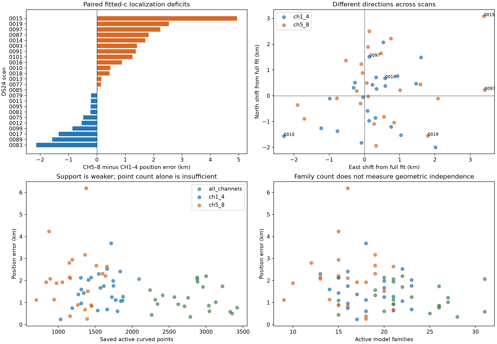
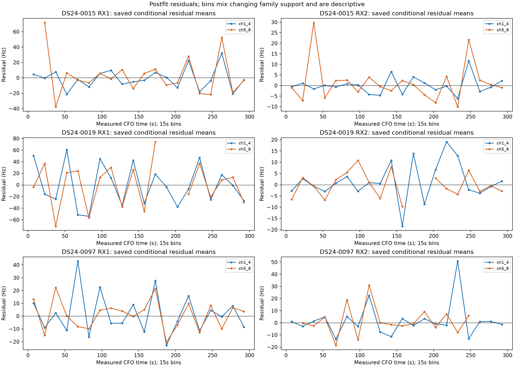
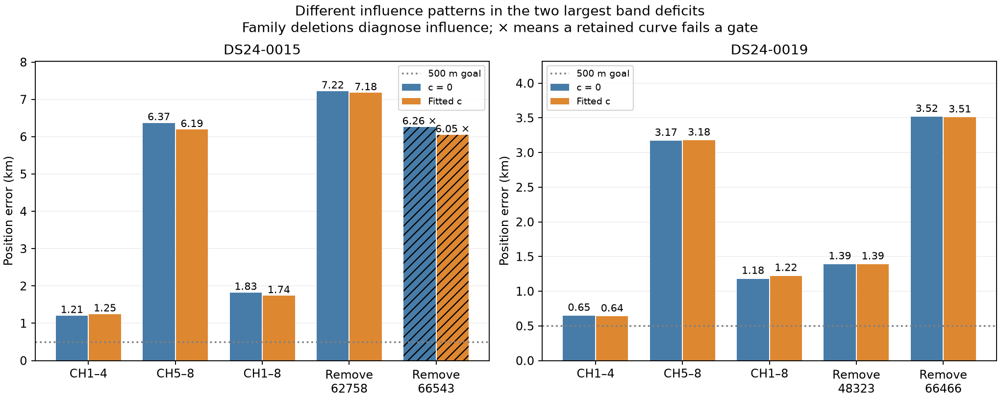
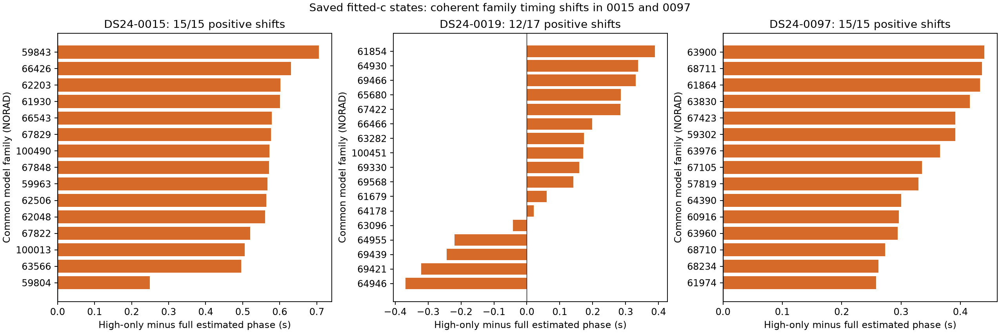
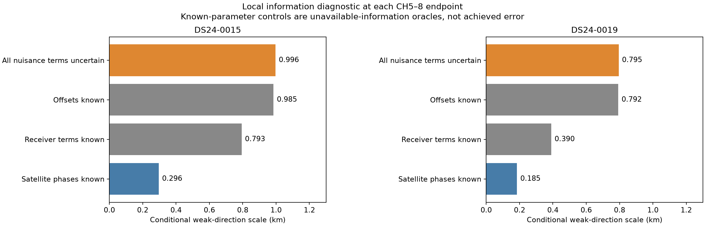

# DS24: why CH5–8 can localize worse than CH1–4

The evidence does not support a downstream CH5–8 sign, offset-index, or missing-low-band gauge bug. Two independent SOL high audits and bounded numerical experiments show fewer high-band observations, strong position–satellite-phase ambiguity, and one influential early RX1-only family. The two largest paired deficits have different diagnostic patterns; their exact physical causes remain unresolved. A real preparation inconsistency was also found, but it does not affect those two cases.

No operational algorithm, calibration prior, production source, or RF recording changed. Family deletions below are influence diagnostics, not a proposed satellite blacklist or a new ALGO version.

## Cohort and comparison

This reviews the original 24 common usable DS24 fast 10 MS/s scans from the frozen 34-recording channel experiment. Ten unavailable upstream inputs remain outside every group. Both receivers are included in each channel group. Each half independently constructed its graph and localized from the same 25 × 25 km region centered at 37.906, −122.545. GPS at 37.849061591561885, −122.48574968092912 is used only for evaluation. Only causal TLE inputs enter inference.

The reference is fresh ALGO02-v1 with qualified causal signed phase priors and equal-assignment-prior family cavity selection. The table uses retained likelihood membership: curved calibration plus predictive observations, excluding postfit-only compatible points. It corrects the old report's omission of the `additional_predictive_points` schema variant.

| Channels | Mean error, c = 0 | Mean error, fitted c | Median error, fitted c | Likelihood GLRT / all winning GLRT | Percentage |
|---|---:|---:|---:|---:|---:|
| CH1–4 | 1.538 km | 1.558 km | 1.512 km | 42,621 / 60,059 | 70.97% |
| CH5–8 | 2.040 km | 2.040 km | 2.001 km | 33,339 / 48,541 | 68.68% |
| CH1–8 | 1.202 km | 1.220 km | 1.114 km | 78,067 / 108,600 | 71.88% |

The high band is worse on 14/24 fitted-c scans and 15/24 c=0 scans. Its fitted-c mean deficit is 483 m, but the median paired deficit is 151 m. DS24-0015 and DS24-0019 account for 64.6% of the net mean gap. Removing those two descriptively leaves a 187 m mean deficit. This exclusion is a decomposition, not a revised benchmark.

## Direct checks of offsets, signs, frequency units, and channel bias

The [code audit](code/code_audit.txt) traces the actual inference and preparation paths with file/line references. [Executable invariance checks](code/check_pipeline_invariants.py) and [their results](code/pipeline_invariants.json) establish:

- All 24 low/high pairs preserve the exported winning GLRT CFO, actual RF, timestamps, and observation identity. Every graph frequency differs from its original CFO by an integer alias period, with maximum fractional-period discrepancy 2.23e−16.
- Doppler is calculated at 11.5 GHz and multiplied by actual RF / 11.5 GHz, yielding the correct −RF × range-rate / c expression in both bands. CH1–4 includes some RF values above 11.5 GHz; it is not treated as entirely below the reference frequency.
- The four offset slots are RX1-low, RX1-high, RX2-low, RX2-high. High-only data uses the high slots; absent low slots contribute zero design columns. Each observed one-band drift has the same marginal prior SD, 10.0125 Hz/s.
- Twelve actual saved problems, covering both channel halves of scans 0010, 0015, 0019 in both c arms, reproduce their original objectives exactly. Relabeling channels by ±4 while retaining the same RF, data, identities, and position, with the corresponding offset permutation and drift-contrast sign reversal, changes the objective by at most 4.72e−9. Conditional predictions change by at most 2.15e−7 Hz. Decoded hardware coefficients reproduce direct design predictions within 2.92e−11 Hz.
- The tested initial seed construction and radio-state projection are also exactly equivariant to that relabeling. An old CH1–4-only diagnostic loop exists elsewhere, but it is outside this inference path.

These checks establish downstream contract and model consistency. They do not independently calibrate raw-IQ RF authority, physical LNB behavior, or clock accuracy. They also do not prove all branches of the bounded discrete search are symmetric for different measured data.

The band gap remains with c=0 on the matched selected observations, so direct fitting of c at that stage does not explain the gap. Those observations and branches were selected through paired-c rules; this check does not exclude a c-dependent selection interaction. Changing the 11.5 GHz pivot without transforming the joint offset/c prior covariance would change the prior, not merely the notation.

## Less evidence and receiver-related residual structure

| Stage | CH1–4 points | CH5–8 points |
|---|---:|---:|
| Winning GLRT | 60,059 | 48,541 |
| In graph tracks | 54,186 | 43,241 |
| In graph tracks with raw active curvature | 39,954 | 32,326 |
| Active curved likelihood | 37,262 | 29,553 |
| Predictive likelihood | 5,359 | 3,786 |

Raw-curvature points are almost the same fraction of GLRT in both halves: 66.52% versus 66.60%. Most of the high-band point deficit therefore exists before satellite fitting. There is additional high-band rejection, especially in 0015 and 0097, but there is no broad collapse of high-band graph construction. The high band has a median 16 retained curved families versus 18 in low and 22 in full. Counts alone do not measure independent geometry.

Mean fitted curved RMS is 67.02 Hz low and 75.71 Hz high. After scaling each track residual to a common 11.5 GHz reference, it is 68.91 versus 71.57 Hz: approximately 3.9% higher, rather than the raw 13.0%. This is a descriptive comparison of conditional residuals on different accepted sets, not a measurement of estimator uncertainty.

Within the full fit, median normalized residual RMS across scans is approximately 83.36/81.20 Hz for RX1 low/high and 33.48/34.25 Hz for RX2 low/high. Same-receiver, same-band, different-family residual correlations are approximately +0.51 on RX1 in both bands, versus +0.005/+0.024 on RX2. The high-only curved evidence also contains a slightly larger RX1 share, 62.3% versus 59.0%. These dependent, postfit correlations point toward a receiver-related model/measurement issue shared by both bands; they do not identify an LNB fault or establish a calibrated covariance model.

Native-Hz noise floors, graph curvature criteria, fragment-bias priors, and acceptance gates are not RF-normalized. Their relative effects deserve controlled prediction tests, but this audit supplies no justification to loosen gates to increase association coverage.

## The bad high-band endpoints are stable under better starts

We restarted the unchanged high-band problems for 0015 and 0019 from the independently inferred low-band and full-band positions. Each restart preserves original high-band observations, aliases, identities, nuisance support, powers, priors, and predictive entries. Both c arms receive five phase-refresh rounds and at most 48 position steps per round. Initial phase references are the saved high-band references. GPS is not a start.

All eight fits pass their retained curved and predictive gates and return within 0.385 m of the saved high-band endpoint. Maximum absolute objective change is 4.57e−5. Thus these two poorer endpoints persist even when initialized near the better inferred position. This is evidence about the tested continuous fits under fixed assignments; it is not a proof of a global discrete optimum. [Protocol](mechanism/restart_protocol.json), [evaluated results](mechanism/evaluation.json).

## Different diagnostic patterns in 0015 and 0019

| Scan / diagnostic | Error c = 0 | Error fitted c | Removed curved + predictive points | Remaining gates |
|---|---:|---:|---:|---|
| 0015: original CH5–8 | 6.372 km | 6.190 km | 0 | Pass |
| 0015: remove family 62758 | 7.222 km | 7.176 km | 20 + 0 | Pass |
| 0015: remove family 66543 | 6.261 km | 6.049 km | 160 + 25 | One curved gate fails in each arm |
| 0019: original CH5–8 | 3.171 km | 3.176 km | 0 | Pass |
| 0019: remove family 48323 | 1.391 km | 1.389 km | 119 + 21 | Pass |
| 0019: remove family 66466 | 3.517 km | 3.509 km | 105 + 0 | Pass |

These four predeclared family tests used the two largest absolute fitted-c conditional family-gradient projections along the displacement between inferred full and high endpoints in each case. The ranking did not use a truth-position vector. Both c arms delete the same observations; original nuisance-mode support, powers, other priors, and budgets remain fixed. Original objectives replay exactly before intervention. Deletion changes the data, so raw objective/RMS differences are not same-mask model comparisons. No deletion is adopted as a policy.

**0015 is consistent with a collective position–phase ambiguity.** Most common high/full families shift phase together: median high-minus-full phase shift about +0.571 s. The local correlation between the weak position direction and one satellite phase reaches 0.973. Removing the tested small family worsens error by about a kilometre; removing the tested larger family barely helps and fails a retained-curve gate. This does not rule out other wrong families, but it does not support a single demonstrated culprit. Scan 0097 has a similar coherent common-family shift, median +0.335 s.

**0019 has a specific influential early family.** The 48323 assignment contains RX1 CH5/6/8 curved tracks during the first 49 seconds, plus 21 predictive CH7 points. It uses no RX2 evidence. Its fitted phase is about +9.69 s, approximately 12.95 of its nominal phase-prior scales from the mean; the heavy-tailed prior reduces its actual penalty. Multiple channels here sample the same early receiver arc and are not independent receiver confirmations.

The full run initially contains this same family's CH4/5/6/8 curves, then rejects all four during its first ALGO02 gate round. Low also rejects CH4. High retains CH5/6/8. The corresponding full/low points are excluded, not reassigned to a competing satellite. Another early high-only family, 57371, has a phase near +9.11 s and is rejected later in full. Specific rejection statistics from those intermediate rounds were not persisted; the membership history alone does not identify which individual gate failed. [Membership evidence](cohort/0019_membership_history.json).

The existing high-band search already tested replacing 48323 with 67338. That trial passes both arms and evaluates to 2.030/2.034 km, but has a worse normalized objective by 3.846/3.760 and is not selected. The 57371 replacement and joint replacement fail paired qualification. This is evidence of model preference/ambiguity, not simply an entirely unsearched satellite. [Saved alternative results](cohort/0019_saved_alternatives_excerpt.json).

Removing 48323 reduces error by about 1.79 km in both arms, while removing 66466 worsens it despite a slightly lower in-sample RMS. The evidence localizes a harmful influence to the 48323-assigned early arc. It does not distinguish wrong identity from orbital/timing error, receiver discrepancy, or incorrect effective weighting. A location-informed blacklist would not generalize.

## Which nuisance terms confound position?

Saved-objective replay and independent finite-difference checks were performed for low, high, and full problems on 0015/0019 in both c arms. The following are local curved-data information controls at the fitted-c high endpoint, conditional on the saved labels, masks, Gamma precisions and model. They are not achieved errors or calibrated confidence intervals.

| High-band local weak-direction scale | 0015 | 0019 |
|---|---:|---:|
| Current uncertain nuisance parameters | 0.996 km | 0.795 km |
| Receiver-band constant offsets hypothetically known | 0.985 km | 0.792 km |
| All receiver terms hypothetically known | 0.793 km | 0.390 km |
| Satellite phases hypothetically known | 0.296 km | 0.185 km |

Offset uncertainty alone contributes little to this particular local information diagnostic. Phase ambiguity is much stronger; receiver time-varying terms also matter, especially in 0019. Knowing a nuisance value is an unavailable-information oracle and does not justify fixing it at its fitted value or tightening its prior until GPS error improves.

## A real preparation inconsistency to correct

The candidate bank duration is derived from the last retained graph timestamp. In 0014 and 0093, a high-band point slightly beyond 300 seconds adds a 305-second visibility sample. Consequently the high bank contains six and three extra candidates, respectively; common candidates have identical states at common knots. No extra candidate becomes active/predictive evidence or a refined cavity candidate.

The extra history population slightly changes 0014's qualified signed-prior coefficient: −0.124530654 low versus −0.125661909 high. Both qualify; 0093 is unqualified in both halves. The other 22 pairs, including 0015 and 0019, have identical low/high banks and historical forecasts. Therefore the mismatch cannot explain the two main outliers, but the original experiment is not strictly a common-candidate-bank comparison in every scan. [Candidate audit](code/candidate_differences.json), [qualification check](code/signed_qualification.json).

The appropriate future correction is to freeze candidate identities, the time grid, causal history population, and cutoff from the complete capture before applying channel filters. Do not delete valid end-of-scan observations merely to equalize duration. Re-run the two affected comparisons with both c arms after that preparation change.

## Recommended bounded next experiments

1. For 0019's early arc, evaluate 48323 and the already-offered 67338 through held-channel and temporal prediction, preserving shared calibration covariance and physical priors. Retain CH7 as predictive-only evidence. Include the rejected full-band CH4 curve as an external frequency-consistency diagnostic. Freeze the test and its acceptance rule before reading position outcomes; neither more channels on one early arc nor a passing residual gate establishes identity.
2. For 0015 and 0097, use matched common families, time support, point budgets, and fixed nuisance support to separate evidence geometry from support-dependent regularization. Inspect collective phase/position displacement and shared RX1 residuals. A generic constant offset, another identical restart, or removing a convenient family is not supported as the remedy.
3. Test a physically motivated receiver-correlated residual model using held evidence across both bands before changing precision weights. Existing smooth-receiver experiments had mixed transfer and are not a license to add unconstrained drift terms. Keep the c=0/fitted-c pairing and report frequency prediction separately from localization.

All scans share the same sample rate, so these results cannot isolate a sample-rate benefit. Feed angle and installed RF boresight are not calibrated bearing observations. The current evidence favors association/model and nuisance-information tests before a hardware change. The 500 m dataset-wide target remains unmet.

## Reproduction and evidence limits

The code audit, cohort audit, and mechanism experiment directories contain executable Python, input hashes, saved diagnostics, PNG/PDF figures, and structured results. Numerical work uses the repository `.venv/bin/python -B` with `OPENBLAS_NUM_THREADS=OMP_NUM_THREADS=MKL_NUM_THREADS=1` and `PYTHONPATH=/tmp/algo03-feasible-deps:src:tools:/srv/bulk/leo/research/ds24-movement-policy-r01/recovery`. The mechanism scripts use the prior information helper in `/srv/bulk/leo/research/ds24-bottlenecks-20261024/information`; paths identify frozen local inputs and must be restored or remapped to replay elsewhere. No IQ reread, new acquisition, following TLE, or stationary cross-scan position pooling is used.

The source replays verify current implementation agreement with saved objectives, not an independently calibrated generative truth. Shared accepted labels agree between high/full wherever jointly retained, but that is model agreement, not external satellite verification. The two focus cases were selected after seeing their errors; their diagnostics are not an unbiased new-method performance benchmark. Source-check results and publication manifest accompany this report.
