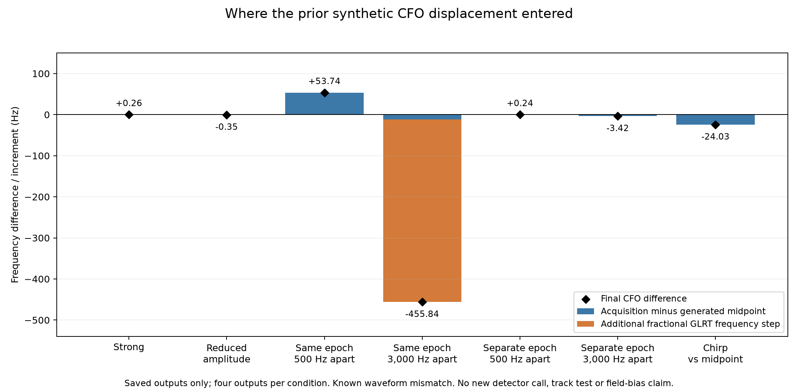

# Fast-scan review: preserve source continuity before adding more curves

2026-10-26 UTC. The best next opportunity is to test whether each measured
curve follows one physical source, and whether any additional orbital
correction predicts evidence it did not fit. More associated points, a
smoother polynomial, and a smaller in-sample residual have repeatedly failed
to guarantee a better position. This iteration identifies two distinct
measurement mechanisms and tests a conditional prediction diagnostic. It
does not establish a new localization improvement or promote an ALGO version.

The retained reference is ALGO02-v1 with the qualified causal signed timing
means and equal-assignment-prior family comparison. No production code,
historical detector, original data, or golden scientific fixture changes.
The scientific work uses three SOL xhigh branches for measurement tests,
prediction tests, and independent review. The root agent also reads existing
detector exports. No new RF, geographic fit, or future TLE is used here.

## What we have tried and what the comparisons actually support

The [previous cumulative report](../2026_10_26_ds24_cached_ambiguity/README.md)
and its [underlying review](../2026_10_25_ds24_ambiguity_position/REVIEW.md)
link the full experiments. The rows below use different cohorts; they cannot
be added together as stages of a single benchmark.

| Direction | Observed result | Interpretation |
| --- | --- | --- |
| Main ALGO01→ALGO02 changes | On 404 matched DS23 outputs, mean error 1.870→1.520 km with c=0 and 1.870→1.508 km fitted-c; availability 407/413→404/413 | A substantial demonstrated gain, with availability reported separately |
| More graph evidence / full recovery | Fitted-c association 70.08→75.08%, but mean error 1.469→1.591 km and P95 3.157→3.473 km; c=0 also worsens | Coverage alone is an unsafe optimization target |
| CH1–8 versus channel halves | On the same 24 usable DS24 scans, fitted-c mean 1.220 / 1.558 / 2.040 km for all / low / high channels; c=0 1.202 / 1.538 / 2.040 | All channels help on average, but share important uncertainties |
| Continuous optimizer restarts | Thirty targeted restarts agree within 2.06 cm; four half-channel identity transfers yield no qualified better full-data solution | Generic multistart is a low-priority explanation for those cases |
| Longer/refined CFO measurements | Median RX2 fixed-degree scatter 78.07→22.18 Hz without a qualified cohort gain | Lower scatter alone does not remove coherent model error |
| Additional smooth receiver correction | Development fitted-c mean 1.220→1.120 km; later eight-scan result 1.239→1.224 km, with worse tails | The initial gain did not transfer reliably |
| Whole-source satellite mixture | DS24-0011 raw diagnostic error improves only 82/119 m in c=0/fitted-c; addition still fails source/support checks | Computationally feasible, but no operational admission or accuracy gain |
| More flexible orbital shape | DS24-0015 target-fitted RMS drops from about 62–65 to 24 Hz, without an independent supporting owner | Predictive validation is needed before interpreting this as orbit correction |

Earlier graph, EM, Hough and multiple-hypothesis constructors placed roughly
90–93% of DSX01 S01 points into polynomials. That success concerns curve
membership. The reviewed DS24 reference instead uses 78,067 of 108,600 points
(71.8849%) in its position likelihood. Postfit satellite association is yet
another count. We should preserve all three denominators rather than treat
90% polynomial membership as 90% useful, correctly identified position evidence.

The strongest model-based limitation remains confusion between receiver
position and satellite timing/shape. Median timing/weak-position correlation
is 0.935 in the reviewed DS24 diagnostic. Conditional weak-axis SD is 534 m,
386 m with receiver nuisance terms hypothetically known, 110 m with satellite
timing known, and 56 m with timing and shape known. These are conditional
calculations, not achieved errors or an irreducible physical floor. The
bands share a median eleven calibration families, with weak axes only 17.7°
apart. More points can repeat the same uncertainty.

The available fast scans are all 10 MS/s, so they cannot establish a causal
sample-rate effect. The nominal 40° feed separation changes sky coverage;
it does not itself provide a calibrated bearing or spatial receiver baseline.
Neither observation currently supports blaming sample rate or antenna
orientation as the principal cause of the remaining position error.

## New result: refinement error and source switching are different problems

First, a saved-output decomposition localizes the preceding 3,000 Hz overlap
example. Its roughly −456 Hz selected CFO difference consists of about −12 Hz
from acquisition plus one −443.892 Hz fractional GLRT step. The 500 Hz pair's
roughly +54 Hz displacement is already present at acquisition. The chirp's
midpoint difference is also already present there; its effective measurement
time remains unresolved.

The detector scores 64 consecutive pilot symbols per frame, about 0.282 ms,
on a zero-padded 512-bin grid, then sums frame powers. Twenty milliseconds of
input is therefore not twenty milliseconds of coherent CFO observation.
This locates a mechanism worth testing, but does not justify disabling
refinement or repeating the previous unsuccessful blanket 300-symbol change.
[Stage details and source bindings](attribution/FINDINGS.md).

Second, the new synthetic experiment tests the detector's exact sampled
template alongside a separately constructed sampled law and the continuous
law. Isolated-source final errors stay below 0.40 Hz in these closure cases.
Overlapping sources still produce hundreds of Hz of displacement even with
the detector's own sampled template. The previous symbol-boundary mismatch
therefore cannot be the sole explanation. This inverse-model closure is not
validation of a real transmitted waveform.

Four 16-visit sequences contain two crossing linear CFO trajectories whose
amplitudes exchange dominance. They compare coincident versus separated
frame epochs under both waveform laws. All detector peaks are saved, but
the actual graph input follows the unchanged highest-margin selection rule.
No true-source label chooses a peak. The graph is the repository's actual
numerical constructor, fed through a narrow synthetic-row adapter; the
synthetic one-second cadence is not a recorded capture clock.

| Per waveform law / paired receivers | Final CFO graph | Same selected candidates with acquired CFO |
| --- | ---: | ---: |
| Coincident epochs: assigned points | 31/32 | 29/32 sampled; 28/32 continuous |
| Coincident epochs: assigned points farther than 450 Hz from both true curves | 12 | 0 |
| Separated epochs: assigned points | 31/32 | 31/32 |
| Separated epochs: assigned points farther than 450 Hz from both true curves | 0 | 0 |

Both separated and coincident sequences produce graph pieces containing
points close to A and points close to B. In the separated control both sources
have a nearby gated epoch/CFO candidate under the frozen diagnostic criterion,
but choosing the strongest one visit by visit still switches source as
amplitudes change. Near the crossing, one peak can be close to both sources;
this coverage is not an independent source-detection count. Overlap adds a different problem:
distorted CFO and missing joint epoch/CFO source evidence. Of the 64 source
opportunities per sequence, the coincident sampled/continuous cases have
27/23 without a jointly close gate-passing candidate; both separated cases
have zero. The same source can be visible in an export yet be discarded by
winner selection.

**Every returned short synthetic graph track has `insufficient_support`.**
These are constructed pieces, not quality-qualified clean-source tracks.
Source-separated true-CFO oracle controls also fail that support requirement
with only 16 points. We do not lengthen the experiment after seeing this
result or claim that an accepted production satellite track was shown wrong.
The useful finding is stage separation: source selection can mix trajectories,
and refinement can add a second measurement discrepancy. Neither is yet
shown to cause the field localization errors.
[Complete measurement findings](measurement/FINDINGS.md),
[independent terminal readback](audit/measurement_terminal.json).

## Recorded-data bridge: inspection candidates, with a negative result for T006

The existing DS24-0011 export contains 3,754 original winners and 117 owners.
A predeclared rule finds 483 winners (12.87%) with a nearby deduplicated,
gate-passing alternative: within three circular frame samples and 250–5,000 Hz
of circular CFO separation. There are 501 alternative records, touching
96 owners. These are inspection flags, not confirmed independent signals or
an interference prevalence estimate.

The difficult RX1 CH1 T006 source has **zero flags among its 20 points**.
This inventory does not diagnose its unresolved identity. Conversely, absence
of an exported alternative cannot exclude unresolved interference. A small
RF-selected recorded example is now possible without choosing it by position
error or a desired satellite answer.
[Complete inventory and limitations](recorded/FINDINGS.md).

## Conditional prediction test

The DS24-0015 test uses the original complete 29-point owner nominated as
68904. It trains on the earliest 14 points and predicts the last 15, then
reverses the direction. Nominal and original three-mode models use matched
c=0/fitted-c conditions, shared owner offset, phase/alias uncertainty and
train-to-held covariance. Prediction variance includes variation between
phase/alias hypotheses.

An independent review caught a real validation leak before forecasting:
the original global noise fit included all 29 target points among its 3,428
residual samples. The unchanged noise estimator was rerun with the entire
target owner excluded, leaving 3,399 samples. Both parent backgrounds were
rebuilt. Changing held CFO values by ±1,000 Hz leaves this whole preprocessing
and training path unchanged. The original preparation is retained but never
used for primary forecasts.

The fixed RF position, graph construction, nominated identity and margin
covariates remain historically exposed. This is a conditional mechanism test
on one selected owner, not independent satellite validation, an end-to-end
cross-validation result, or a new position estimate.
Other parent observations from the whole scan, including later times, condition
the background. Only the target owner is split chronologically. These are
offline conditional predictions, not prospective online forecasts.

All eight forecast slots and their fixed GL32/GL64 numerical comparisons
complete. The three-mode model improves the conditional predictive density
in all four arm/direction comparisons:

| Calibration arm | Train → predict | Nominal RMS, Hz | Three-mode RMS, Hz | Reduction in held −2 log density |
| --- | --- | ---: | ---: | ---: |
| c=0 | Early → late | 90.23 | 27.80 | 4.014 |
| c=0 | Late → early | 108.23 | 75.54 | 5.908 |
| Fitted-c | Early → late | 97.40 | 31.74 | 4.788 |
| Fitted-c | Late → early | 113.90 | 76.03 | 6.679 |

These are modest predictive-density gains within one historically selected
owner. The four comparisons reuse the same data and cannot be counted as
four independent confirmations. The nominal model's largest marginal
standardized prediction error is only 1.91 under its full uncertainty;
lower RMS does not by itself reject that model. The correction also forecasts
less accurately in the reverse direction. This supports pursuing a coherent
discrepancy, but a smooth measurement bias or wrong candidate can also have
predictive structure. No track is admitted and no position gain is claimed.

[Complete predictive results and uncertainty plots](prediction/FINDINGS.md),
[independent audit](audit/prediction_terminal02.json).

## Ranked next experiments

1. **Test candidate continuity before satellite fitting.** First freeze a
   small persistence and epoch-drift inventory: the 483 flags are pointwise,
   and do not yet establish a persistent alternative track. If suitable
   evidence exists, choose a small recorded case using those RF criteria,
   plus an unflagged control; otherwise stop this branch. Preserve every candidate's native window,
   frame epoch, CFO alias, margin and acquisition/refinement decomposition.
   Compare the original winner path with a bounded multi-candidate path using
   circular epoch and CFO continuity. Retain explicit path hypotheses and
   unresolved crossings/missed states; smoothness does not guarantee one
   physical source. Include matched crossing and noncrossing synthetic controls,
   and do not count correlated
   alternatives from one window as independent extra evidence. The prior
   satellite-label HMM consumed one winning CFO per probe and used active
   satellite families plus clutter as states. It could not revisit discarded
   exported peaks or use fractional frame epoch. Its reported temporal
   candidate improved fitted-c error in 0272 only 3.783→3.746 km and worsened 0207
   3.108→3.270 km despite more association; see the
   [iteration 005 report](../2026_10_22_ds23_dbg01_iteration_005/README.md)
   and [iteration 008 follow-up](../2026_10_22_ds23_dbg01_iteration_008/README.md).
   Reuse those lessons. The distinct test here is whether source continuity
   is lost *before* satellite assignment, without restricting paths to the
   currently active satellite families.

2. **Use a targeted two-source measurement model only if the RF example
   supports it.** Compare the original single-source refinement with a
   restricted two-template fit or cancellation diagnostic at the nominated
   epochs/CFOs. Keep isolated-source and separated-source controls. Evaluate
   source errors, recovered support and failed/rejected windows before
   geographic error. If both sources are unresolved in the available pilot
   aperture, retain ambiguity or inflate justified measurement uncertainty;
   do not force two precise CFO estimates. Avoid a broad higher-resolution
   sweep without evidence that it addresses the measured failure.

3. **Demand predictive and independent support for satellite corrections.**
   A chronological test can reject a correction that only fits its training
   span. Passing it would still not establish identity or orbit error: a
   coherent measurement bias can also extrapolate. The stronger next evidence
   is a separately nominated complete owner, preferably another receiver or
   band, with the correction transferred without refitting to its values.
   Do not create that witness by relabeling the target or narrowing priors
   according to GPS error. If no witness exists, retain uncertainty and move
   to another informative case.

4. **Only then run a frozen localization comparison.** A proposed repair
   must specify how it selects cases, resolves ambiguity, and rejects failures
   without GPS. Compare unchanged and repaired inputs on matched causal
   candidate sets, budgets, c=0/fitted-c arms and original IDs. Report raw
   curves, graph membership, satellite membership, position-likelihood points,
   error distributions, availability and tail regressions separately. A
   positive development result needs an exposure-checked later block before
   a new ALGO promotion. All current DS24 and the previously examined later
   eight-scan block are exposed development data, not new-location validation.

This ordering puts measurement integrity ahead of more flexible orbit fits.
It preserves the longer-term identifiability question: independent satellite
timing/shape information could be valuable, but another target-trained
correction can absorb position error just as easily as physical orbit error.
We should defer unchanged full-dataset recovery, generic optimizer restarts,
blanket smoothing, and additional unconstrained receiver terms until there
is a specific failure mechanism and a falsifiable test.

## Reproduction and limits

[COORDINATOR_PLAN.md](COORDINATOR_PLAN.md) records the branch scopes and caps.
The measurement experiment completes 70 paired detector calls, 140 receiver
outputs and four graph sequences in 103.13 cumulative numerical worker-seconds
including preparation, against 600 seconds. All 1,120 exported candidate
records remain available. The detector uses its immutable historical runtime;
the repository graph runs separately, preventing accidental implementation
substitution. No historical repository is introduced as a production runtime
dependency.

The prediction branch uses 128.51 charged cumulative numerical worker-seconds
against its original 300-second cap; the primary forecasts take 18.67 seconds.
The total includes preparation and tests. A preparation serialization error is
preserved and conservatively charged its full 90-second setup allowance
because exact elapsed time was not instrumented. It occurs before a parent
rebuild or forecast and is corrected without changing a scientific model.
The compact publication includes code, protocols, tests, numerical outcomes,
figures, and independent checks. Original corpus and larger geometry arrays
remain external hash-bound inputs. The publication manifest distinguishes
included artifacts from required external inputs.
