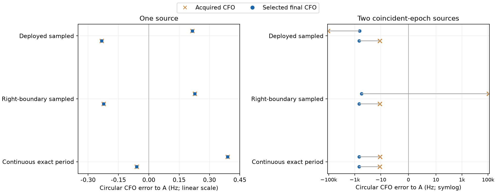
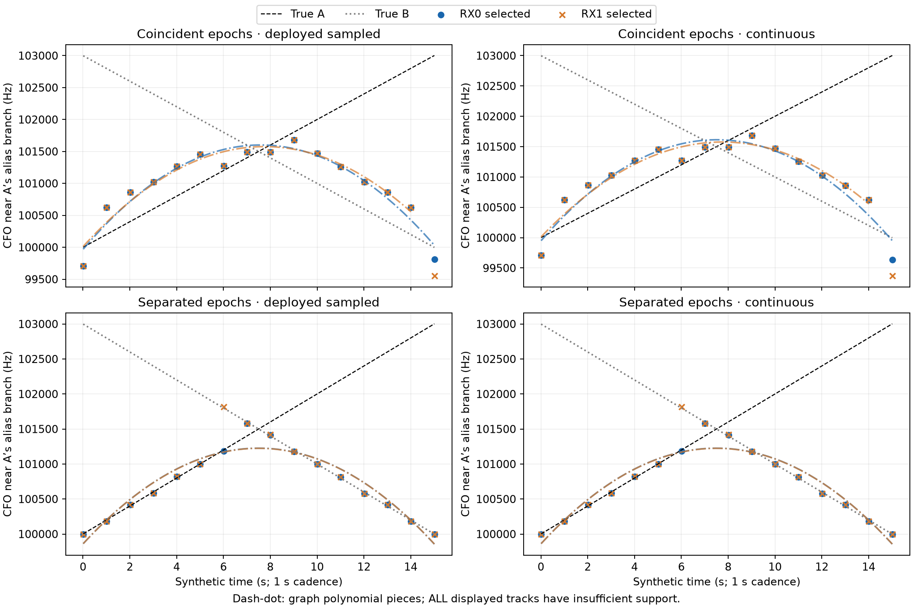
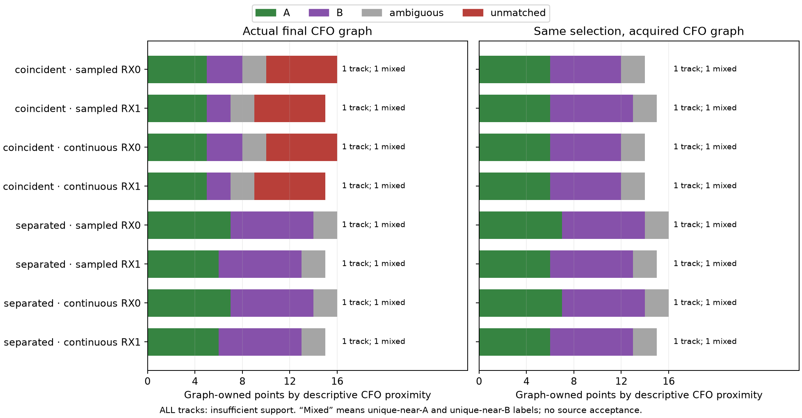

# Pilot measurements and source continuity

The overlap effect survives the deployed-template control. Separating the two
sources' epochs restores a nearby gated candidate for both sources in every
sequence window, but the unchanged one-winner policy still switches between
sources. The graph can fit that selected stream; **none of its tracks qualifies
as a clean source track in this experiment**.

All **70 paired detector calls / 140 receiver windows** completed, preserving
**1,120 exported peaks** and every failure/empty-slot denominator. Every receiver
window had a gated selection. The actual graph component completed all four
sequence comparisons. Cumulative numerical work was **103.126887 worker-seconds**,
including preparation and the two pre-detector preparation failures, within the
unchanged 600-second cap. There were no scientific retries. Nine owned tests and
the independent [preflight](../audit/measurement_preflight.json) and
[terminal readback](../audit/measurement_terminal.json) passed.

## What the waveform control establishes

The [frozen protocol](PROTOCOL.md) compares the deployed sampled frame at its
rounded frame anchors, an independently generated right-boundary sampled frame
at exactly those anchors, and the previous continuous exact-period law. It
reproduces the known **68 symbol-boundary disagreements** without changing the
deployed template or golden fixture. Integer epoch127 and identical seeded noise
keep the closure panel narrow. Template-sampled closure is an inverse-model and
discretization test, **not physical waveform validation**.

Single-source selected final CFO errors were at most **0.390 Hz** across the
three laws and both receivers. With the same two coincident-epoch sources at
100/103 kHz and amplitudes 1000/600, the results were:

| Waveform law | RX0 final error to A | RX1 final error to A |
|---|---:|---:|
| Deployed sampled, rounded anchors | −431.30 Hz | −456.17 Hz |
| Right-boundary sampled, rounded anchors | −296.11 Hz | −456.14 Hz |
| Continuous exact frame period | −455.62 Hz | −456.06 Hz |

Errors here are circular modulo the unchanged 227,272.727 Hz CFO alias spacing.
Raw CFOs, selected ranks, acquisition and integer/fractional residuals remain in
the [complete selected-candidate table](report/selected_candidates.csv).
The RX1 overlap winner under each law and the continuous RX0 winner move from about
99,988 Hz by **−443.892045 Hz**, one residual-grid bin. Other winners use different
acquisition branches: deployed-sampled RX0 selects rank 6 with acquired −12,735.99 Hz
and fractional residual +112,304.69 Hz; right-boundary RX0 selects rank 2 and ends
on a different raw alias branch. Thus the effect is not universally one bad bin
on the same acquired candidate. The discretization convention affects selection,
while substantial overlap displacement remains even in the sampled-template arm.

## What the actual graph sequence establishes

Two base sequences have the same crossing CFO trajectories, changing source
amplitudes, global carrier phases and paired noise. One has coincident epochs,
the other separated epochs 127/811. Each is run under deployed-sampled and
continuous laws: 16 synthetic one-second visits, 20 ms each, two receivers. These
are declared synthetic snapshots, not an original scan cadence or a complete
transmitter waveform. Amplitudes are constant within each window.

All peaks are retained, but actual graph input follows the unchanged public
policy: complete fractional candidates, margin≥.025, maximum margin, tie lower
rank. Truth never chooses a peak. An explicit synthetic-row adapter passes that
stream to the actual `graph_tracklets.fit_lane` through the existing graph port;
it does not fabricate qualified capture or UTC authority. The immutable deployed
detector and repository graph run in separate processes with saved dictionaries
as their boundary.

| Sequence | Source-slots lacking any nearby gated peak /64 | Selected points unmatched to either CFO /32 | Final graph assigned RX0/RX1 |
|---|---:|---:|---:|
| Coincident, deployed sampled | 27 | 12 | 16 /15 |
| Coincident, continuous | 23 | 13 | 16 /15 |
| Separated, deployed sampled | 0 | 0 | 16 /15 |
| Separated, continuous | 0 | 0 | 16 /15 |

A nearby peak means both CFO distance≤450 Hz and circular epoch distance≤3 samples,
as frozen before results. A single peak can match both truths near their crossing;
these counts are descriptive coverage, not independent source detection rates.
The CFO-only diagnostic labels are A/B only within 450 Hz of exactly one source,
`ambiguous` within both and `unmatched` within neither. All signed distances to
both truths are retained in [all_peaks.csv](report/all_peaks.csv) and
[source_coverage.csv](report/source_coverage.csv).

Every final graph returns one track per receiver, with unique-near-A and
unique-near-B labels in that track. Each coincident law has **12 unmatched
graph-owned points**: continuous has 13 unmatched selected points, one of which
is unresolved by the graph. Separated-epoch selection also mixes the A/B proximity
labels, even though the two sources have nearby gated peaks in every window.
This separates generic maximum-margin/dominance switching from the additional
coincident-epoch measurement distortion. Neither mixed proximity labels nor a
smooth fitted curve proves that an individual peak measured an injected source.

Crucially, **all eight final tracks have `insufficient_support`**; all acquired-stage
and oracle tracks do too. The unchanged quality diagnostic requires 20 points to
report `no_structure_detected`; these frozen lanes have at most 16. Assignment is
not qualification. This test does not show a clean wrong-source track silently
passing the existing acceptance policy. All graph pieces satisfy the original
450 Hz residual gate; that frequency consistency alone is not source identity.

The stage ablation uses the **same selected rank, margin, ID and timestamp**, replacing
only final CFO with its acquired CFO before GLRT residual refinement. In coincident
sequences the acquired-stage graph has **zero unmatched graph-owned points**, but
mixed A/B labels remain and assignment is 14/15 or 14/14 rather than 16/15. Separated
sequences retain the same 16/15 assignment and mixed labels. This does not support
globally disabling refinement. Source-separated oracle true-CFO lanes assign all
16 points per source/receiver, using ownership and measurements unavailable to the
actual branch; they are diagnostic controls, not a recovered detector output.

## Scope and replay

The result strengthens a measurement-stage lead and exposes a separate continuity
constraint: the one-winner stream can change source even when both sources remain
in the candidate ledger. It establishes no field prevalence, calibrated source
probabilities, accepted satellite identity or localization gain. It is a two-source,
pilot-only, high-amplitude synthetic construction with one common seed panel.
The next discriminating comparison would preserve competing epoch/CFO branches
through the same bounded graph and test source misses/mixed ownership at unchanged
quality gates, with a noncrossing control. No such extra run was performed here.

Scientific source is [experiment.py](experiment.py), with [owned tests](test_experiment.py)
and exact [protocol/input bindings](protocol.json). The immutable detector runtime is
`/opt/leo-fast-auto/20261010-r1/venv/bin/python` with the historical deployed source
path recorded in [detector_identity.json](detector_identity.json). Its code/env digests
match the previous replay authority before and after all calls. Repository-only
detector invocation first failed its identity guard; the lean deployed tree then
failed to import the graph. Both happened before new detector calls. Their logs are
retained as external exact bindings in the publication manifest; no package or
production source was changed to bypass either guard.

The immutable [RF seal](RF_seal.json) binds all 70 raw slot files, graph results,
source/configuration and execution. [report.py](report.py) reads only saved artifacts;
its [initial report seal](report/seal.json) remains intact. [report02.py](report02.py)
only improves image readability, with a separate [report02 seal](report02/seal.json).
The [lean publication manifest](lean_publication.json) includes every compact result
and source file, and lists external replay dependencies by absolute path/hash.
No recorded IQ, new RF, position fit or geographic evaluation occurred.
