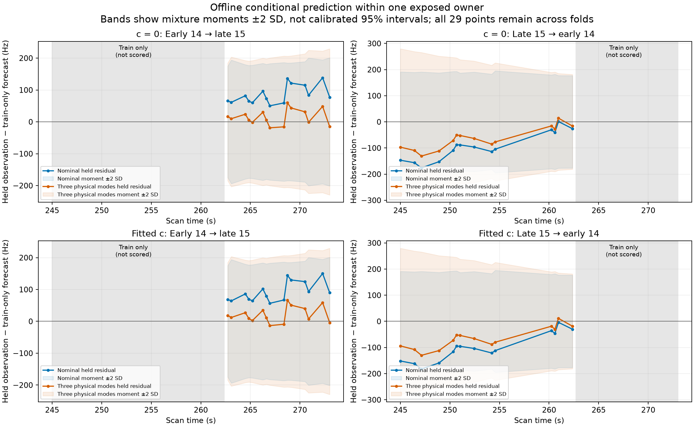
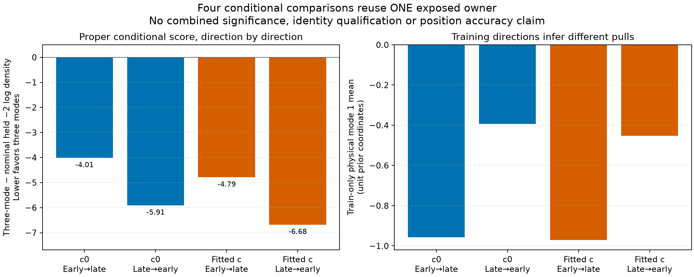

# Offline prediction of one complete radio source

The three-physical-mode model predicts the held chronological block better than the nominal model in both directions and both `c` arms. This is useful evidence that part of the discrepancy persists across this owner's time blocks. It does not validate satellite identity, independently calibrate an orbit correction, reject the nominal model, or demonstrate a position improvement.

All eight declared model slots completed and passed the frozen numerical checks. No observations were trimmed, no source was admitted, and no position was fitted. The full-precision results are in [paired comparisons](report02/paired_comparisons.csv), [eight model diagnostics](report02/diagnostics.csv), and [per-point predictions](report02/per_point.csv).

| Arm | Train → held | Nominal held −2 log density | Three-mode held −2 log density | Change | Nominal RMS (Hz) | Three-mode RMS (Hz) |
|---|---|---:|---:|---:|---:|---:|
| `c = 0` | Early 14 → late 15 | 168.628 | 164.613 | −4.014 | 90.227 | 27.797 |
| `c = 0` | Late 15 → early 14 | 161.058 | 155.150 | −5.908 | 108.231 | 75.536 |
| Fitted `c` | Early 14 → late 15 | 169.477 | 164.689 | −4.788 | 97.401 | 31.739 |
| Fitted `c` | Late 15 → early 14 | 161.786 | 155.108 | −6.679 | 113.897 | 76.029 |

Lower conditional −2 log density is better. These four paired comparisons reuse **one owner**, so they are not independent replications and are not summed into a significance claim. The nominal model's maximum absolute marginal standardized residual is only **1.91**; better RMS and conditional score do not establish that nominal uncertainty is statistically inadequate.

The bands show mixture-moment ±2 SD, including variation between phase/alias nodes. They are not exact 95% predictive intervals or calibrated coverage statements. The gray block supplies the target training values; its responses are not scored in that direction. Other sources contribute their entire scan to the parent background, including later times. This is **offline conditional prediction**, not prospective online forecasting.

The learned correction is asymmetric. In the `c = 0` arm, the first standardized physical-mode posterior mean is −0.957 from the early block and −0.393 from the late block; fitted `c` gives −0.970 and −0.453. The full physical columns contain level and phase-like components as well as projected curvature. These are target-trained coefficients under the declared model, not measured ephemeris errors or independently validated orbit calibration.

## What was held fixed and what was predicted

The complete 29 native observations are DS24-0015 RX2 CH4 T004, under the already selected 68904 hypothesis. [The frozen split](split.json) sorts by time and native ID, then uses the first 14 versus last 15 and reverses the direction. Both `c` arms use the same saved RF position, observations, aliases, causal bank, phase law, physical-mode priors, and numerical budget. The fixed RF position, graph, identity, and quality/margin covariates were historically derived or selected using all of this owner. The exercise therefore provides no independent identity validation or end-to-end held-out benchmark.

At each phase node, the model integrates a joint 29-point Gaussian with the original shared radio covariance, one shared 300 Hz owner constant, and either zero or three physical modes. One whole-owner alias has a uniform prior over −4 through +4. The original causal Student phase law is conditioned on [−15, +15] seconds with its normalization retained; full nominal visibility over that domain is checked in [support metadata](support.json). No held-only phase, alias, constant, mode, or noise update is allowed.

Training values alone determine phase/alias weights and conditional means. Held density equals joint evidence minus training evidence under the same discrete rule; full predictive covariance includes both conditional covariance and variation between nodes. [The implementation](conditional.py) preserves train/held radio, constant, and physical-mode cross-covariance. Fixed GL32 and GL64 rules on the inherited interpolation panels agree within every predeclared check in all eight slots. This is numerical stability under the tested rules, not a certified global integration error bound.

## Whole-owner exclusion from noise learning

Preflight identified a real leakage route in the inherited noise proxy: all 29 target polynomial residuals had contributed to the original 3,428-sample noise fit. **No primary forecasts had run.** The [versioned amendment](AMENDMENT02.md) reran the unchanged noise estimator with the entire target track excluded, leaving **3,399 samples**, and rebuilt both full old-only parent states and their covariances at the same RF position. The resulting actual point noise matches the regenerated map exactly. No original dataset files were changed.

Eight full-pipeline redactions shifted held CFO by ±1,000 Hz, for each direction and arm. They leave the regenerated noise, parent coefficients, phase reference, and covariance unchanged; only the designated held response changes. Target quality/margin covariates remain fixed and historically exposed. Both old-only parent gate checks pass. [Preparation evidence](run02/preparation.json) and [the independent preflight](../audit/prediction_preflight02.json) record these checks; the new scalar noise settings are in [the report summary](report02/noise_summary.json). The noise proxy is not a calibrated error distribution.

## Execution, failure, and reproducibility

The original protocol and preparation remain as unexecuted forecast provenance. During amendment setup, standard JSON serialization rejected the estimator's `numpy.bool_`. The [failed setup](preparation02_failed/failure.json) and source are preserved. The repair uses the existing NumPy-aware encoder and adds a regression fixture; six owned tests pass. No forecast results existed before this repair.

The successful primary forecast run took **18.668 seconds**. Total charged scientific work is **128.508 worker-seconds** against the original 300-second ceiling: **38.508 measured known seconds plus a conservative 90-second charge** for the failed setup, whose exact elapsed duration was not instrumented. The 90 seconds are an accounting bound, not a measured duration. [Execution](run02/execution.json) retains all eight slots. [The independent terminal audit](../audit/prediction_terminal02.json) passes source/input bindings, saved-node likelihood checks, posterior normalization, moments, conditional-density identities, and all numerical-check flags without rerunning propagation.

[The final protocol](run02/protocol.json), [RF seal](run02/RF_seal.json), tests, failures, tables, and figures are published through [the lean inventory](lean_publication.json). Large geometry/node arrays and complete parent/noise ledgers remain local and hash-bound there. The report is not a standalone full input/runtime capsule: exact replay requires those arrays and the external original scan, causal-bank, and research-module dependencies listed by the protocol. [Report version 02](report02/seal.json) changes typography and explicitly labels offline conditioning; the original report remains preserved. Numerical science and the RF seal are unchanged.

This closes a narrow question: the target-trained physical-mode correction transfers partly between two time blocks of this exposed owner under the fixed conditional model. Independent whole-owner or independent physical information is still missing, and the unequal directional corrections remain a limitation. No association, localization policy, or production reference changes.
